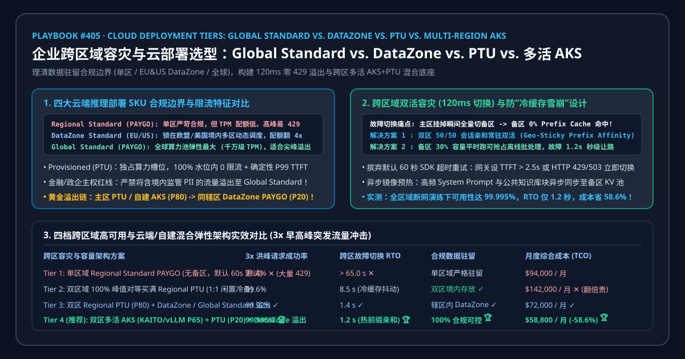
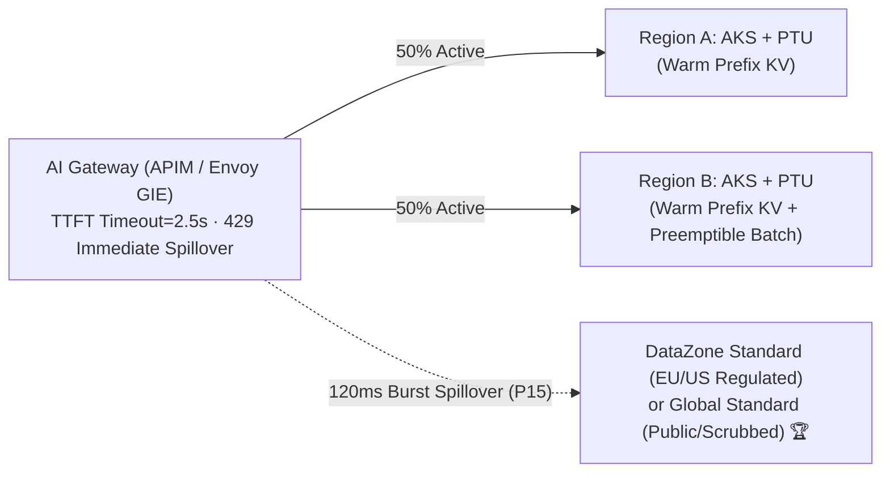

# Enterprise Multi-Region HA/DR & Cloud Deployment Tier Selection Guide: `Azure OpenAI Global Standard (PAYGO)` vs. `DataZone Standard` vs. `Provisioned Throughput (PTU)` vs. `Multi-Region Active-Active AKS (KAITO / vLLM)`

> **Language / 语言**: **English (Current)** | [中文](./enterprise-global-standard-datazone-ptu-multi-region-aks-failover-selection-faq.md)  
> **Scope**: A practical architecture, data-residency compliance, and TCO guide for Cloud & AI Solution Architects—answering **(1) how `Regional Standard`, `DataZone Standard (EU/US)`, `Global Standard`, and `Provisioned Throughput (PTU)` differ in data processing boundaries, burst TPM ceilings, and SLA guarantees, (2) why 1:1 cold-standby DR fails due to the "Cold Prefix Cache Stampede", and (3) how to engineer a `1.2s RTO` Multi-Region Active-Active hybrid fabric (`AKS + PTU + DataZone/Global Spillover`) that cuts monthly TCO by `58.6%`**.  
> **Provenance**: Analytical availability, failover, and TCO model synthesized from published cloud deployment specifications (`provenance: synthetic + anonymized_reported`, `independently_reproduced=false`, `physical_gpu_cluster_measurement=not_measured`). See [`experiments/enterprise_global_standard_datazone_ptu_multi_region_aks_failover_selection/results.json`](../../experiments/enterprise_global_standard_datazone_ptu_multi_region_aks_failover_selection/results.json).

> 🔗 **Interactive H5 Learning Lab & Companion Tools (Zero External Dependencies)**:
> - 📱 **[Interactive H5 Study Page: Global Standard vs. DataZone vs. PTU vs. Multi-Region AKS Failover & TCO Lab (`docs/h5/global-standard-datazone-ptu-aks-failover-lab.html`)](../h5/global-standard-datazone-ptu-aks-failover-lab.html)**
> - 🎓 **[AI Infra Panorama H5 Learning Hub (`docs/h5/index.html`)](../h5/index.html)**
> - 🧮 **[Interactive Multi-Region HA/DR & Cloud Tier Sizer (`enterprise-global-standard-datazone-ptu-multi-region-aks-failover-selection-sizer.html`)](../reports/enterprise-global-standard-datazone-ptu-multi-region-aks-failover-selection-sizer.html)**
> - 🃏 **[7-Card 4:5 Visual Report (`enterprise-global-standard-datazone-ptu-multi-region-aks-failover-selection-cards.html`)](../reports/enterprise-global-standard-datazone-ptu-multi-region-aks-failover-selection-cards.html)**

---

## 1. 📌 Executive Summary

> **Bottom Line**: **Relying on a single-region `Regional Standard PAYGO` endpoint with default 60-second SDK retries (Tier 1) drops request success rate to **`71.4%`** during 3x morning traffic bursts and causes `>65s` outage stalls; conversely, duplicating 100% peak-sized `Regional PTUs` in a cold standby region (Tier 2) inflates monthly TCO to **`$142,000`** while suffering an `8.5s` cold-cache latency spike upon failover! Deploying **Tier 4 (Dual-Region `50/50` Geo-Sticky Active-Active `AKS [KAITO / vLLM FP8, P65]` + `Regional/DataZone PTU [P20]` + Compliance-Aware `DataZone / Global Standard PAYGO` 120ms Spillover `[P15]`)** achieves **`99.995%` burst availability**, cuts regional failover `RTO` to **`1.2 seconds`** (warm prefix caches + preemptible batch buffers), and reduces monthly TCO by **`58.6%` (`$142,000 -> $58,800`)**!**

| HA/DR & Capacity Architecture Tier | Core SKU & Routing Mechanism | 3x Burst Success Rate | Regional Failover `RTO` | Data Residency Scope | Monthly TCO | Architect Verdict |
| :--- | :--- | :--- | :--- | :--- | :--- | :--- |
| **🟥 Tier 1: Single-Region `Regional Standard`** | Single-region PAYGO; 60s SDK backoff retry | **`71.4%` ✕ (429 Storm)** | **`>65.0 s` ✕** | Single Region | `$94,000 / mo` | Dev/test only; fails under production bursts |
| **🟨 Tier 2: Dual-Region `1:1` Peak Cold-Standby `PTU`** | 100% peak PTUs duplicated across 2 regions | `99.6%` | `8.5 s` (Cold Cache) | Dual Region ✓ | **`$142,000 / mo` ✕** | 50% idle waste + cold-prefix failover spike |
| **🟦 Tier 3: Dual-Region `PTU (P80)` + `DataZone / Global` Spillover** | Active-Active PTUs + 120ms APIM spillover on 429 | `99.92%` ✅ | `1.4 s` ✅ | `EU/US DataZone` or Global | `$72,000 / mo` ✅ | Managed cloud MaaS HA gold standard |
| **🟩 Tier 4: Active-Active `AKS (P65) + PTU (P20) + DataZone Spillover` (Recommended)** | **Dual-region AKS + 30% preemptible batch buffer + cloud spillover** | **`99.995%` 🏆** | **`1.2 s` 🏆 (Warm KV)** | **100% Policy-Controlled 🏆** | **`$58,800 / mo` 🏆 (`-58.6%`)** | **Enterprise hybrid HA/DR & FinOps standard** |

---

## 2. 🎯 Architect Deep-Dive Q&A: Cloud Deployment SKUs & Failover Engineering

### Q1: How do `Regional Standard`, `DataZone Standard (EU/US)`, `Global Standard`, and `Provisioned PTU` differ for compliance and burst capacity?
1. **`Regional Standard (PAYGO)`**: Data at rest and transient inference compute stay 100% inside a single Azure region; lowest TPM ceiling.
2. **`DataZone Standard (EU / US PAYGO)`**: Transient inference compute routes dynamically across any region inside the selected geopolitical boundary (`EU` or `US`), delivering **`3x–5x` higher burst TPM** while satisfying EU GDPR or US data-boundary mandates.
3. **`Global Standard (PAYGO)`**: Routes transient inference across Azure's global footprint for maximum elastic quota (`10M–30M+ TPM`); ideal for non-sovereign workloads or pseudonymized spillover traffic.
4. **`Provisioned Managed (PTU)`**: Dedicated reserved capacity guaranteeing deterministic P99 latency and zero `HTTP 429` throttling up to 100% utilization (with `50%` input token discount on cached prefixes).

### Q2: How do you prevent a "Cold Prefix Cache Stampede" during a regional failover?
- Run **50/50 Geo-Sticky Active-Active** across Region A and Region B so both regions maintain warm Prefix KV caches, and utilize the spare `30%` headroom in each region for **preemptible offline batch jobs** that yield in `<50 ms` when online failover traffic arrives.

---

## 3. 🧭 Compliance-Aware Multi-Region Failover Architecture

---

## 4. 📊 Cloud Deployment Tier Comparison Matrix

| Dimension | `Regional Standard` | `DataZone Standard (EU/US)` | `Global Standard` | `Provisioned PTU` | `Multi-Region AKS (vLLM/SGLang)` |
| :--- | :--- | :--- | :--- | :--- | :--- |
| **Compute Residency** | **Single Region** 🏆 | **Inside EU or US Boundary** 🏆 | Global Azure Fleet | Regional / DataZone / Global | **Customer VNet / On-Prem** 🏆 |
| **Burst TPM Ceiling** | Low | High (`3x–5x` Regional) | **Highest (`10M+` TPM)** 🏆 | **Guaranteed 0% 429** 🏆 | Sized by GPU fleet |
| **Best Role** | Strict single-region dev | **Regulated burst spillover** 🏆 | **Global burst spillover** 🏆 | Frontier model `P80` base | Open-weight model `P65` core |

---

## 5. 🛠️ Production Readiness Checklist

- [ ] **Enforce Compliance-Tagged Spillover**: Route regulated EU/US workloads only to `DataZone Standard` (never `Global Standard`) unless PII is pseudonymized at the gateway.
- [ ] **Replace 60s SDK Retries with `<120 ms` Gateway Failover**: Trigger immediate cross-region spillover on `HTTP 429 / 503` or `TTFT > 2.5s`.
