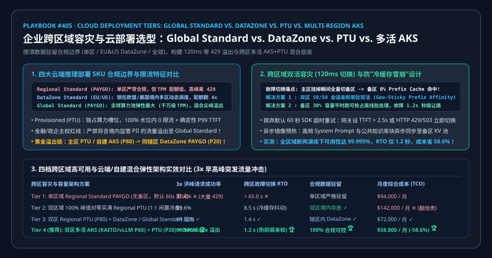
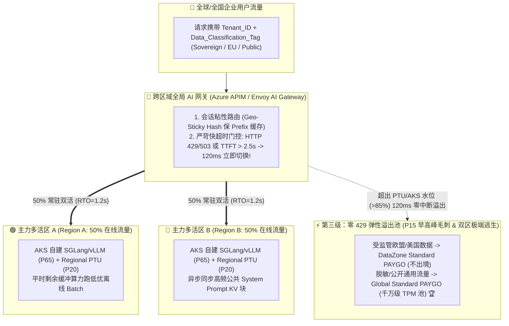

# 企业级跨区域高可用容灾与云端部署类型选型：`Azure OpenAI Global Standard (PAYGO)` vs. `DataZone Standard` vs. `预留吞吐 (PTU)` vs. `自建多活 AKS (KAITO / vLLM)` 架构、数据驻留合规与成本拐点指南

> **语言 / Language**: **中文 (当前)** | [English](./enterprise-global-standard-datazone-ptu-multi-region-aks-failover-selection-faq.en.md)  
> **文档定位**：面向 Cloud & AI Solution Architect 的云端部署模式与跨区域容灾（Multi-Region HA/DR）决策指南——彻底理清企业在公有云与混合云选型中最常混淆的四大概念：**“Regional Standard、DataZone Standard（欧盟/美国数据区）、Global Standard 与 PTU（预留吞吐）在数据合规驻留、限流天花板与计费上到底有什么区别？”、“为什么双区域 1:1 冷备买 PTU 会浪费一半预算，且故障切换瞬间还会因为备区 Prefix Cache 为空引发雪崩？”、“如何构建 `1.2s RTO`、零 429 报错的多活 `AKS + PTU + DataZone/Global PAYGO` 三级混合防线？”**。  
> **标定声明**：本文所引用的 3x 洪峰请求成功率、跨区域故障切换 RTO 与月度综合 TCO 基于公开云服务 SLA 与多区域网关架构基准构建的合成定量模型（`provenance: synthetic + anonymized_reported`, `independently_reproduced=false`, `physical_gpu_cluster_measurement=not_measured`），详见 [`experiments/enterprise_global_standard_datazone_ptu_multi_region_aks_failover_selection/results.json`](../../experiments/enterprise_global_standard_datazone_ptu_multi_region_aks_failover_selection/results.json)。

> 🔗 **关联交互式 H5 精读页与工具（点击即开，零外部依赖）**：
> - 📱 **[交互式 H5 精读页：Global Standard vs. DataZone vs. PTU vs. 多活 AKS 容灾与 TCO 沙盘 (`docs/h5/global-standard-datazone-ptu-aks-failover-lab.html`)](../h5/global-standard-datazone-ptu-aks-failover-lab.html)**
> - 🎓 **[AI Infra 全景可视化精学馆首页 (`docs/h5/index.html`)](../h5/index.html)**
> - 🧮 **[交互式跨区容灾与云部署计算器 (`enterprise-global-standard-datazone-ptu-multi-region-aks-failover-selection-sizer.html`)](../reports/enterprise-global-standard-datazone-ptu-multi-region-aks-failover-selection-sizer.html)**
> - 🃏 **[7-Card 4:5 视觉评测报告 (`enterprise-global-standard-datazone-ptu-multi-region-aks-failover-selection-cards.html`)](../reports/enterprise-global-standard-datazone-ptu-multi-region-aks-failover-selection-cards.html)**

---

## 1. 📌 核心选型结论速览（Executive Summary）

> **一句话结论**：**企业生产大模型严禁只配“单一区域 `Regional Standard PAYGO` + 默认 60 秒 SDK 超时重试（Tier 1）”——在早高峰 3 倍突发洪峰下，`HTTP 429` 限流会让请求成功率跌至 **`71.4%`**、故障恢复耗时长达 **`>65 秒`**；而如果按传统 IT 思维在主备两个 Region 各按峰值 1:1 买满静态 `PTU`（Tier 2），月度账单会翻倍飙至 **`$142,000`** 且备区平时空转！通过落地 **Tier 4（双区域 `50/50` 会话亲和常驻双活 `AKS [KAITO / vLLM FP8, 承载 P65]` + 核心闭源模型 `Regional/DataZone PTU [承载 P20]` + 合规辖区内 `DataZone / Global Standard PAYGO` 120ms 零中断溢出 `[承载 P15 尖峰]`）**，可将 3 倍洪峰请求成功率推升至 **`99.995%`**，跨区切换 `RTO` 压至 **`1.2 秒`（消除冷缓存雪崩）**，并将月度总 TCO 从 `$142,000` 压降至 **`$58,800`（立省 `58.6%`）**！**

| 容灾与容量架构档位 | 核心部署 SKU 与流量调度机制 | 3x 洪峰请求成功率 | 跨区切换 `RTO` | 数据驻留合规边界 | 月度总成本 (TCO) | 架构师拍板结论 |
| :--- | :--- | :--- | :--- | :--- | :--- | :--- |
| **🟥 Tier 1：单区 `Regional Standard PAYGO`** | 单区域按量 API，无备区溢出，SDK 默认 60s 退避 | **`71.4%` ✕ (频繁 429)** | **`>65.0 s` ✕** | 单区域严格驻留 | `$94,000 / 月` | 仅适合测试环境，生产高峰必发生雪崩 |
| **🟨 Tier 2：双区 `1:1` 峰值对等买满 `PTU`** | 主备两区各按 100% 峰值买满 Regional PTU 冷备 | `99.6%` | `8.5 s` (备区冷缓存) | 双区域严格驻留 ✓ | **`$142,000 / 月` ✕** | 备区 100% 闲置烧钱，切换瞬间 TTFT 暴涨 |
| **🟦 Tier 3：双区 `PTU (P80)` + `DataZone / Global` 溢出** | 主备双活 PTU 跑稳态 + APIM 网关 429 秒级溢出至按量池 | `99.92%` ✅ | `1.4 s` ✅ | 辖区内 (`EU/US`) 或全球 | `$72,000 / 月` ✅ | 纯公有云托管 MaaS 企业级高可用标准 |
| **🟩 Tier 4：双活 `AKS (P65) + PTU (P20) + DataZone 溢出` (推荐)** | **双区自建 AKS 主力 + 备区 30% 潮汐批处理缓冲 + 云端溢出** | **`99.995%` 🏆** | **`1.2 s` 🏆 (热前缀)** | **100% 合规分级可控 🏆** | **`$58,800 / 月` 🏆 (`-58.6%`)** | **中大型企业跨区域容灾与 FinOps 终局标准** |

---

## 2. 🎯 架构师灵魂拷问与四大云端 SKU 边界精解 Q&A

### Q1：Azure OpenAI / Foundry 中的 `Regional Standard`、`DataZone Standard`、`Global Standard` 和 `PTU` 到底有什么区别？合规审计怎么过？
* **一张表彻底分清四大云端推理部署 SKU（架构师合规评审必背）**：
  1. **`Regional Standard`（单区域标准按量 PAYGO）**：
     - **数据驻留**：静态存储（Data at Rest）与推理计算过程（Data in Processing）**100% 锁死在所选单一 Azure Region 内**（如 `East US 2` 或 `Sweden Central`）。
     - **痛点**：受单一数据中心实时空闲算力池限制，默认 `TPM / RPM` 配额最低，早高峰极易触发 `HTTP 429`。
  2. **`DataZone Standard`（数据区标准按量 PAYGO —— 如 `EU DataZone` / `US DataZone`）**：
     - **数据驻留**：推理流量可在**同一地缘司法管辖区内的所有 Azure 区域之间动态路由**（例如 `EU DataZone` 承诺所有计算 100% 不出欧盟成员国边界；`US DataZone` 100% 不出美国境内）。
     - **核心价值**：**兼顾 GDPR / 美国境内合规与高弹性**，默认 TPM 配额与抗突发能力是单区域的 **`3 ~ 5 倍`**！
  3. **`Global Standard`（全球标准按量 PAYGO）**：
     - **数据驻留**：静态配置与微调数据仍留在资源所在区，但**实时推理计算可被透明路由至全球任何有空闲算力的 Azure 数据中心**。
     - **核心价值**：拥有最高的按量 `TPM` 配额上限（可达数千万 TPM），且不额外加价，是非涉密业务或脱敏后流量的**最强尖峰逃生舱**！
  4. **`Provisioned Managed (PTU)`（预留吞吐单元 —— 含 Regional / DataZone / Global PTU）**：
     - **核心价值**：按小时/包月购买固定算力槽位，提供**容量保证（100% 额定水位内 `0%` 429 报错）与确定性低延迟 SLA**，且开启 Prefix Caching 后缓存命中的输入 Token 仅扣减 **`50%`** PTU 配额！

### Q2：为什么“主区 100% 流量 + 备区 0% 流量冷备”在大模型场景下切换会引发“冷缓存雪崩（Cold Cache Stampede）”？
* **故障切换机理剖析**：
  - 在正常运行时，主区集群（无论是 PTU 还是自建 AKS vLLM/SGLang）因为有 **`70% ~ 85%` 的 Prefix KV Cache 命中率**，实际只需计算 `15%~30%` 的增量输入 Token，就能轻松扛住 `50 RPS`。
  - 如果备区平时处于 `0` 流量的冷备状态，当主区突然断网、网关在 1 秒内把 `50 RPS` 全量切往备区时，**备区的 Prefix KV Cache 命中率在最初几分钟内是 `0%`！**
  - 这意味着备区瞬时承受的 **Prefill 算力负载高达平时的 `4 ~ 6 倍`**，导致备区首字延迟（TTFT）瞬间从 `500 ms` 飙升到 `12 秒` 以上，引发连锁超时雪崩！
* **三大根治工程设计**：
  1. **双区 `50/50` 地域粘性常驻双活（Geo-Sticky Active-Active）**：平时就按租户/会话 ID 哈希将流量 `50% : 50%` 分摊在 Region A 与 Region B，确保两个区域的 Prefix KV Cache 池时刻处于温热状态。
  2. **备区 30% 容量跑“可秒级抢占的离线批处理（Preemptible Batch Backfill）”**：在双区 AKS 集群中，每区预留 `30%` 算力平时跑低优先级离线文档抽取/评测任务（不空转烧钱）；一旦对端区域故障，网关切流的同时 `vLLM Priority Scheduler` 在 `<50 ms` 内挂起离线任务，100% 腾出算力接管在线流量！
  3. **网关严禁沿用 60s 默认超时**：在 `Azure APIM / Envoy AI Gateway` 中设置 **`TTFT First-Byte Timeout = 2,500 ms`** 且对 `HTTP 429 / 502 / 503` 触发 **`<120 ms` 立即跨区重试**。

---

## 3. 🧭 直观可视化图解（三级合规跨区域多活与秒级溢出架构图）

---

## 4. 📊 四大云端推理部署 SKU 与自建多活 AKS 横向选型矩阵

| 对比维度 | `Regional Standard` (PAYGO) | `DataZone Standard` (`EU / US`) | `Global Standard` (PAYGO) | `Provisioned PTU` | `多活 AKS (KAITO / vLLM)` |
| :--- | :--- | :--- | :--- | :--- | :--- |
| **数据实时计算边界** | **严格锁死在单一 Region** 🏆 | **严格锁在欧盟或美国境内** 🏆 | 全球任意空闲数据中心 | 按所选类型（单区/DataZone/全球） | **100% 锁死在自有 K8s 节点** 🏆 |
| **抗突发限流能力 (`TPM`)** | 低（高峰易出 `429`） | 高（多区共享池，单区 `3~5x`） | **极高（全球池，千万级 TPM）** 🏆 | **额定容量内 `0%` 429** 🏆 | 取决于自建 GPU 卡数 |
| **P99 延迟确定性** | 波动较大 | 良好 | 良好 | **极高（独占算力 SLA）** 🏆 | **极高（可控 PD 分离）** 🏆 |
| **计费模式与最佳定位** | 按 Token 计费 · 单区小流量 | **按 Token 计费 · 合规溢出首选** 🏆 | **按 Token 计费 · 全球大流量溢出** 🏆 | 包月/包年 · 闭源模型 `P80` 基线 | 节点租赁 · 开源模型 `>2.5B Tok/月` 主力 |

---

## 5. 🛠️ 生产落地核对清单（SA Production Readiness Checklist）

- [ ] **按数据密级绑定溢出目标（合规生命线）**：在 AI Gateway 路由策略中强制校验数据标签——含境内受监管 PII 的请求，其溢出目标只能指向 **同国备区 PTU 或同辖区 `DataZone Standard`**；仅已脱敏（Pseudonymized）或公开请求允许溢出至 **`Global Standard`**。
- [ ] **废除客户端 60 秒慢超时**：将网关对上游 PTU/Pod 的连接与首包超时设为 **`1.5s ~ 2.5s`**，遇到 `HTTP 429` 严禁原地 sleep 等待，立即在 `<120 ms` 内转发至溢出池。
- [ ] **采用双区 `50/50` 常驻双活替代主备冷切**：保持两个区域的 Prefix KV Cache 持续温热，并将备区冗余算力用于可秒级抢占的离线批处理（消火栓平时浇花，火灾秒级救火）。
