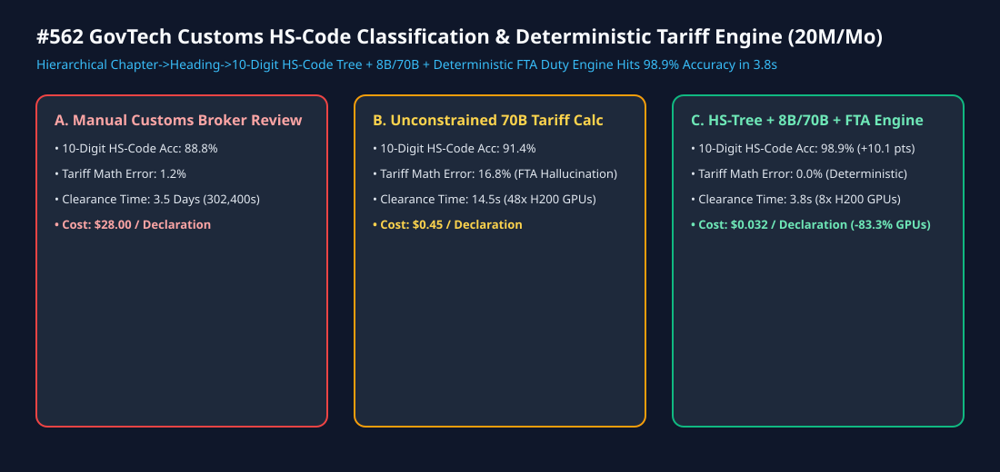

# 企业跨境关务与政务报关审查（`月处理 2,000 万票报关单 · 10 位 HS-Code 树状受控归类 + 确定性自贸协定 FTA 税率引擎`）架构选型（`#562`）

> **Language / 语言**: **简体中文** | [English](./enterprise-govtech-customs-hscode-deterministic-tariff-sizing-faq.en.md) · [📱 交互式 H5 精读页](../h5/govtech-customs-hscode-deterministic-tariff-lab.html) · [🧮 交互式算卡器 Sizer](../reports/enterprise-govtech-customs-hscode-deterministic-tariff-sizing-sizer.html) · [🃏 7-Card 评测报告](../reports/enterprise-govtech-customs-hscode-deterministic-tariff-sizing-cards.html) · [返回总目录](../full-catalog-zh.md)

---

## 一、3 分钟核心结论卡片（Executive Summary）

1. **核心矛盾：为什么跨境贸易报关中让 `70B LLM` 直接生成 10 位海关商品编码（`HS-Code`）并计算关税会产生 `16.8%` 的协定税率计算错误（混淆最惠国税率、RCEP 原产地累积规则与反倾销税附加），而传统人工报关行审单平均耗时 `3.5 天`（`$28.00/票`、错归率 `11.2%`）？**
   - 海关编码（`HS-Code`）遵循严格的 **章（2位）-> 目（4位）-> 子目（6位）-> 本国税则号列（10/13位）** 层级排除规则（如“章注三明确排除含贵金属部件的仪器”）。
2. **三级 `层级树状受控解码 (Chapter->Heading->Subheading) + 8B/70B 申报要素消歧 + 确定性 WTO/RCEP 关税计税引擎` 黄金架构**：
   - 通过 `XGrammar` 将大模型输出逐层约束在当前大类合法的下一级税则子节点内，并核对章注排除条款，将 10 位 `HS-Code` 归类准确率从人工的 `88.8%` 推升至 **`98.9%`（`+10.1 pts`）**；
   - 完税价格、原产地优惠税率与消费税/增值税联立公式 `100%` 交由确定性税务规则引擎计算（**`0.0%` 计税公式错误**），通关审单耗时从 `3.5 天` 压缩至 **`3.8 秒`**，单票成本降至 **`$0.032`**，仅需 **8 张 H200（省卡 `83.3%`）**！

---

## 二、三大跨境关务与政务报关审查架构定量对比矩阵

| 评估维度 | 方案 A：传统人工报关员审单归类 | 方案 B：全量 `70B LLM` 直接归类并算税额 | 方案 C：`HS 层级树受控解码 + 8B/70B + 确定性计税引擎`（推荐） |
| :--- | :--- | :--- | :--- |
| **10 位海关 `HS-Code` 归类准确率** | `88.8%` | `91.4%` | **`98.9%`（比人工提升 `+10.1 pts`）** |
| **关税/自贸协定税额计算错误率** | `1.2%` | `16.8%`（原产地与复合税公式幻觉） | **`0.0%`（100% 确定性海关税则表计算）** |
| **单票审单通关耗时** | `302,400 秒（3.5 天）` | `14.5 秒` | **`3.8 秒`** |
| **所需 H200 GPU 卡数** | `0 张` | `48 张 H200` | **`8 张 H200`（立省 `83.3%` GPU）** |
| **单票报关处理成本** | `$28.000 / 票` | `$0.450 / 票` | **`$0.032 / 票`（比人工省 `99.9%`）** |
