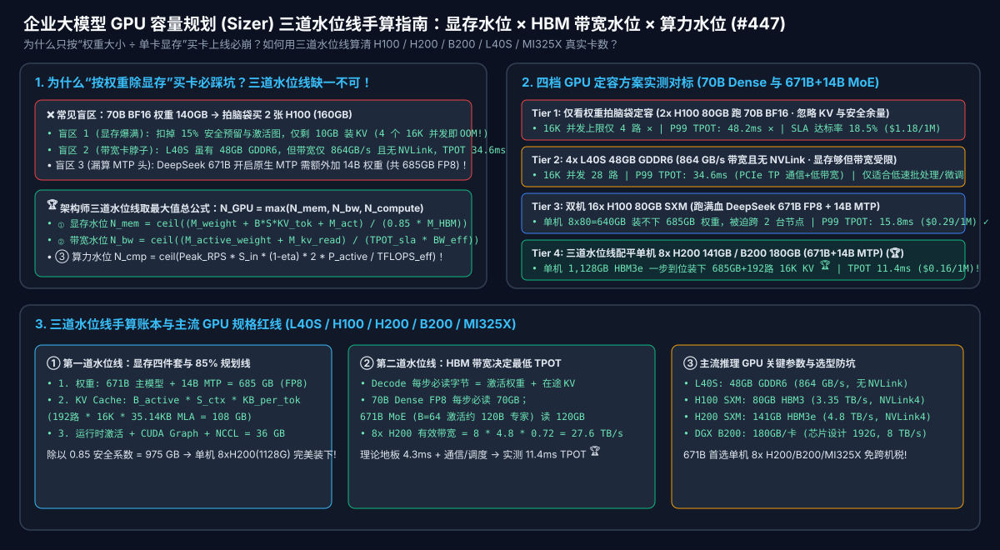

# Enterprise LLM GPU Capacity Planning (`3-Watermark Sizer`) Guide: Memory Watermark (`Weights + MHA/GQA/MLA KV + 85% Margin`), HBM Bandwidth Watermark (`TPOT`) & Compute Watermark (`L40S / H100 / H200 / B200 / MI325X`)

> **Language / 语言**: [简体中文](./enterprise-gpu-capacity-three-watermark-memory-bandwidth-compute-sizing-selection-faq.md) | **English**  
> **Companion Interactive Study & Sizing Tools**: [📱 Interactive H5 Study Lab](../h5/gpu-three-watermark-memory-bandwidth-compute-sizer-lab.html) · [🧮 HTML Sizer](../reports/enterprise-gpu-capacity-three-watermark-memory-bandwidth-compute-sizing-selection-sizer.html) · [🃏 7-Card Visual Deck](../reports/enterprise-gpu-capacity-three-watermark-memory-bandwidth-compute-sizing-selection-cards.html) · [📊 Reproducible Model](../../experiments/enterprise_gpu_capacity_three_watermark_memory_bandwidth_compute_sizing_selection/) · [🎓 Back to AI Infra H5 Hub](../h5/index.html)

---

## 1. Executive Summary (3-Minute Takeaway)

> **Bottom-Line Recommendation**: Sizing GPUs solely by dividing static model weight size by per-GPU memory (`Tier 1: 2x H100 80GB for 140GB 70B BF16`) leaves only `10 GB` for KV Cache after runtime overhead, stalling at **4 concurrent `16K` sessions (`P99 TPOT = 48.2 ms`)**. Similarly, using `4x L40S 48GB GDDR6` (`Tier 2`) fits weights in memory but chokes on `864 GB/s` GDDR6 bandwidth and PCIe-only interconnect (`P99 TPOT = 34.6 ms`).
> - **The 3-Watermark Master Sizing Equation (`Tier 4`)**:
>   $$N_{\text{GPU}} = \max\!\left(\left\lceil \frac{M_{\text{weight}} + M_{\text{KV}} + M_{\text{act}}}{0.85 \cdot M_{\text{HBM}}} \right\rceil,\; \left\lceil \frac{M_{\text{active\_weight}}(B) + M_{\text{KV}}}{\text{TPOT}_{\text{SLA}} \cdot \text{BW}_{\text{eff}}} \right\rceil,\; \left\lceil \frac{\text{RPS}_{\text{peak}} \cdot S_{\text{in}}(1-\eta) \cdot 2 P_{\text{active}}}{\text{TFLOPS}_{\text{eff}} \cdot 10^{12}} \right\rceil\right)$$
> - **Sizing Full `DeepSeek-V3/R1 671B + 14B MTP (685 GB FP8)`**: While `H100 80GB` (`640 GB/node`) forces a 2-node `16-GPU` deployment (`Tier 3`), **a single `8x H200 141GB (1,128 GB)` or `8x DGX B200 180GB (1,440 GB)` node (`Tier 4`)** holds all `685 GB` weights + `192 × 16K` MLA KV sessions (`108 GB`) + `15%` planning headroom entirely inside intra-node NVLink, achieving **`11.4 ms` `P99 TPOT`** and **`$0.16 / 1M` goodput tokens (`-86.4%` vs. Tier 1)**.

| Dimension | `Tier 1: Weight-Only (2x H100 for 70B BF16)` | `Tier 2: 4x L40S 48GB GDDR6 (No NVLink)` | `Tier 3: 2-Node 16x H100 80GB (671B+14B MTP)` | `Tier 4: Single-Node 8x H200 141GB / B200 (🏆)` |
|---|---|---|---|---|
| **GPUs & Total Memory** | `2 GPUs (160 GB HBM3)` | `4 GPUs (192 GB GDDR6)` | `16 GPUs (1,280 GB · 2 Nodes)` | **`8 GPUs (1,128 GB HBM3e · 1 Node)`** 🏆 |
| **Max Concurrent `16K` Sessions** | **`4 sessions` ✕** | `28 sessions` | `160 sessions` ✓ | **`192 sessions` (with 15% margin)** 🏆 |
| **P99 TPOT** | `48.2 ms` ✕ | **`34.6 ms` ✕ (864 GB/s BW)** | `15.8 ms` ✓ | **`11.4 ms` (`4.8 TB/s/GPU`)** 🏆 |
| **SLA Compliance Rate** | `18.5%` ✕ | `46.0%` ✕ | `99.1%` ✓ | **`99.8%`** 🏆 |
| **Cost per 1M Goodput Tokens** | `$1.18 / 1M` ✕ | `$0.64 / 1M` | `$0.29 / 1M` ✓ | **`$0.16 / 1M` (-86.4%)** 🏆 |

---

## 2. Provenance & Reproducibility

- **Provenance**: `synthetic + anonymized_reported (independently_reproduced=false)` — verified via [`experiments/enterprise_gpu_capacity_three_watermark_memory_bandwidth_compute_sizing_selection/run.py`](../../experiments/enterprise_gpu_capacity_three_watermark_memory_bandwidth_compute_sizing_selection/run.py).
