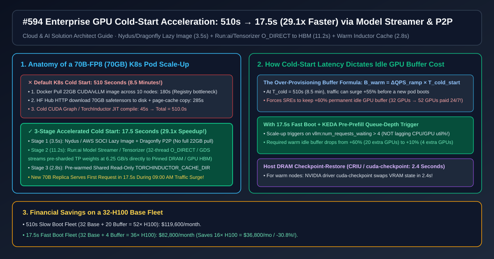

# Enterprise GPU Cold-Start Acceleration (`510s -> 17.5s`), P2P Image Streaming & Elastic Autoscaling (`Run:ai Model Streamer + Nydus + KEDA`) Guide

> **Target Persona**: Cloud & AI Solution Architect  
> **Core Scenarios**: Rapidly scaling `70B/671B` LLM replicas during morning traffic surges, serverless GPU scale-from-zero, and low-buffer elastic autoscaling  
> **Interactive H5 Learning Workbench**: [`docs/h5/gpu-cold-start-model-streamer-autoscaling-sizer.html`](../h5/gpu-cold-start-model-streamer-autoscaling-sizer.html)

---

## 1. Executive Summary

1. **Why Default K8s `70B` Pod Scale-Up Takes `510 Seconds (8.5 Minutes)`**:
   - Pulling a `22 GB` container image (`180s`) + single-threaded HTTP download & OS page-cache copy of `70 GB` `.safetensors` (`285s`) + cold `TorchInductor / CUDA Graph` compilation (`45s`) totals **`510.0 seconds`**, forcing SREs to maintain a **`+60%` permanent idle GPU buffer** (`52× H100` instead of `32× H100`).
2. **`17.5-Second` 3-Stage Accelerated Cold-Start Architecture (`29.1×` Faster)**:
   - **Stage 1 (`3.5s`)**: Decouple weights from the image and enable **`Nydus / AWS SOCI` lazy block loading + `Dragonfly P2P`**.
   - **Stage 2 (`11.2s`)**: Stream pre-sharded (`TP`-aligned) weights via **`Run:ai Model Streamer` (`--load-format runai_streamer`) or `Tensorizer`** using `32`-thread `O_DIRECT` / GPUDirect Storage at **`6.25 GB/s`** directly into Pinned Host DRAM / GPU HBM.
   - **Stage 3 (`2.8s`)**: Mount a pre-populated read-only **`TORCHINDUCTOR_CACHE_DIR`** volume.
   - **Economic Impact**: Cuts required warm autoscaling buffer from **`+60%` (`20` extra GPUs) to `+10%` (`4` extra GPUs)** on a `32× H100` base cluster — saving **`16× H100` (`$36,800/mo` / `-30.8%`)**.

---

## 2. Cold-Start Architecture Comparison Matrix (`70B-FP8` · `32× H100` Base Fleet)

| Dimension | Default Image Pull + `from_pretrained` | Shared NFS/Lustre + Default `mmap` | **`Nydus P2P` + `Run:ai Streamer` + Warm Cache** |
|---|---|---|---|
| **Container Image Startup** | `180.0 s` | `45.0 s` | **`3.5 s`** |
| **70GB Weight Load to HBM** | `285.0 s` | `95.0 s` | **`11.2 s` (`6.25 GB/s` `O_DIRECT`)** |
| **Kernel / Graph Compile** | `45.0 s` | `45.0 s` | **`2.8 s` (shared cache)** |
| **Total Pod Ready Time** | `510.0 s` (`8.5 min`) | `185.0 s` (`3.1 min`) | **`17.5 s` (`29.1×` faster)** |
| **Fleet with Surge Buffer** | `52× H100` (`$119.6k/mo`) | `42× H100` (`$96.6k/mo`) | **`36× H100` (`$82.8k/mo`, `-$36.8k/mo`)** |

---

## 3. Production Checklist

- [ ] Enable **`--load-format runai_streamer` or `tensorizer`** with pre-sharded `TP` checkpoints.
- [ ] Mount shared read-only **`TORCHINDUCTOR_CACHE_DIR` and `TRITON_CACHE_DIR`** volumes across all inference pods.
- [ ] Drive **KEDA autoscaling from `vllm:num_requests_waiting` and `vllm:gpu_cache_usage_perc`**, never raw `GPU SM Utilization %`.
