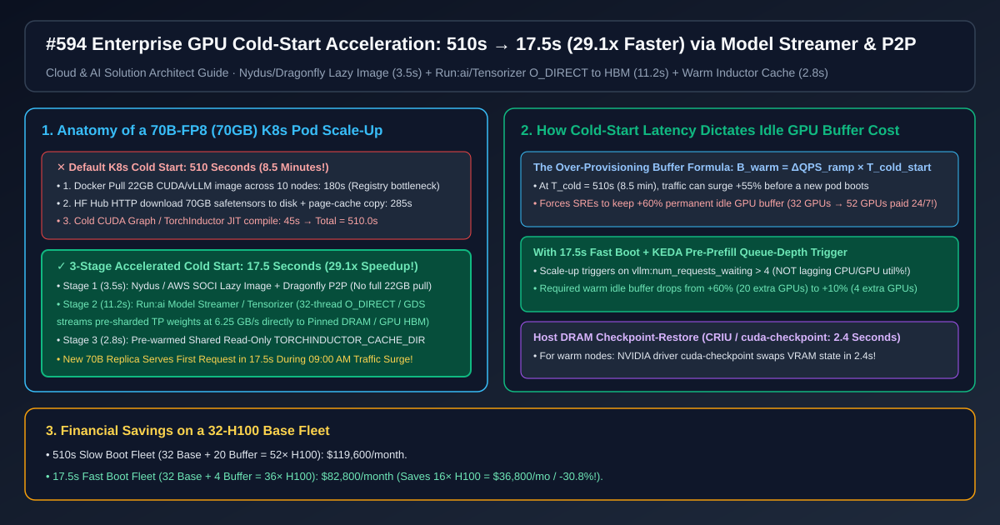
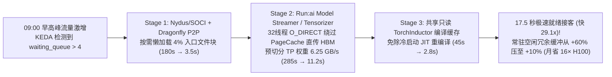

# 企业级大模型冷启动加速（`510s -> 17.5s`）、镜像 P2P 懒加载与弹性 GPU 自动扩缩容（`Run:ai Model Streamer + Nydus + KEDA`）架构选型指南

> **面向角色**：Cloud & AI Solution Architect（云与 AI 解决方案架构师）  
> **核心场景**：早高峰 `09:00 AM` 流量洪峰快速弹出 `70B/671B` 推理副本、Serverless GPU 从零唤醒（Scale-from-Zero）、多模型秒级热切换  
> **配套交互式 H5 精读工作台**：[`docs/h5/gpu-cold-start-model-streamer-autoscaling-sizer.html`](../h5/gpu-cold-start-model-streamer-autoscaling-sizer.html)

---

## 一、执行摘要（Executive Summary：3 分钟掌握核心架构结论）

1. **为什么默认 K8s 部署下，扩容一个 `70B-FP8`（`70 GB` 权重）推理 Pod 竟然要等 `510 秒（8.5 分钟）`？**  
   - **三道串行 I/O 瓶颈**：
     1. **容器镜像全量拉取阻塞（`180s`）**：包含 CUDA + PyTorch + vLLM 的基础镜像高达 `18–25 GB`，10 台节点同时 `docker pull` 瞬间打爆镜像仓库（ACR/ECR/Harbor）出口带宽；
     2. **Python 单线程磁盘落盘与双份内存拷贝（`285s`）**：默认 `AutoModel.from_pretrained` 先通过 HTTP 将 `70 GB` `.safetensors` 写入本地磁盘，再经 Linux 内核 Page Cache 读入用户态 CPU 内存、反序列化张量，最后执行 `cudaMemcpy` 拷入 HBM；
     3. **冷启动算子编译与 CUDA Graph 捕获（`45s`）**：每次新建 Pod 重新执行 `torch.compile` / `FlashInfer` JIT 编译与 CUDA Graph 录制。
   - **直接恶果**：当早高峰 `09:00` 流量在 `2 分钟` 内翻倍时，新扩容的 Pod 要到 `09:08:30` 才能就绪！为了不在早高峰雪崩，运维团队被迫全天候多开 **`+60%` 的常驻冗余备机（`32` 卡基线需常开 `52` 张 `H100`）**！
2. **`17.5 秒` 极速冷启动三级加速架构（提速 `29.1 倍`，砍掉 `80%` 冗余空转备机）**：
   - **第一级：代码与权重彻底解耦 + `Nydus / AWS SOCI` 按需块级懒加载 + `Dragonfly P2P`（`180s -> 3.5s`）**：容器镜像绝不打包模型权重；利用 RAFS/SOCI 索引只拉取启动必需的 `4%` Python 入口文件块，容器 `3.5s` 即进入 `Running` 状态。
   - **第二级：`Run:ai Model Streamer` / `CoreWeave Tensorizer` / `GPUDirect Storage (GDS)` 零落盘直传 HBM（`285s -> 11.2s`）**：按目标 `TP=2/4/8` 预先切分好权重分片（Pre-Sharded Tensor Files），使用 `32` 线程 `O_DIRECT`（绕过操作系统 Page Cache）或 NVMe-oF/S3 Express `6.25 GB/s` 并行流式直传至锁页内存（Pinned DRAM）与 GPU HBM，**`70 GB` 权重加载仅需 `11.2 秒`**！
   - **第三级：共享只读 `TORCHINDUCTOR_CACHE_DIR` 与预编译 CUDA Graph 缓存（`45s -> 2.8s`）**：将编译好的 Triton/FlashInfer 内核挂载为共享只读卷，启动耗时从 `45s` 压至 `2.8s`。
   - **综合收益**：冷启动总耗时从 **`510.0s` 骤降至 `17.5s`（提速 `29.1x`）**；常驻安全冗余缓冲从 `+60%`（`20` 张冗余卡）降至 **`+10%`（`4` 张冗余卡）**，在 `32× H100` 基线集群上 **每月直接省下 `16 张 H100`（月省 `$36,800 / -30.8%`）**！

---

## 二、架构师灵魂拷问（Core Q&A）

### Q1：为什么用 K8s 默认 HPA 基于 `GPU Utilization %`（算力利用率）做自动扩缩容在大模型推理上 100% 会失效？
- **物理机制误区**：大模型 Decode 阶段是典型的 **HBM 显存带宽受限（Memory-Bandwidth Bound）**！当单卡并发 Batch 达到 `64`、HBM 带宽已经 `95%` 饱和且用户 `TPOT` 已经开始劣化超标时，`nvidia-smi` 显示的 **SM 算力利用率（GPU Compute Util）往往只有 `32%–45%`**！
- 如果 HPA 设成“GPU 利用率 `> 75%` 才扩容”，直到集群彻底卡死 OOM 都不会触发扩容！
- **生产标准扩缩容指标（`KEDA + Prometheus Custom Metrics`）**：
  1. **主触发指标（领先指标）**：`vllm:num_requests_waiting > 4`（等待进入 Prefill 的排队请求数）或 `vllm:gpu_cache_usage_perc > 78%`（KV Cache 显存块水位线）；
  2. **辅触发指标（SLO 滞后保护）**：`histogram_quantile(0.95, vllm:time_to_first_token_seconds) > 0.6s`。

### Q2：如果同一物理节点上需要在日间模型与夜间模型（或多业务模型）之间秒级切换，如何把 `17.5 秒` 进一步压到 `2.4 秒`？
- **主机内存/NVMe 预热 + `NVIDIA cuda-checkpoint` 显存状态快照切换（`2.4 秒`）**：
  - 从 R555/R560 驱动起，NVIDIA 原生支持 `cuda-checkpoint` 工具：在不销毁容器进程与 CUDA Context 的前提下，将休眠模型的 GPU HBM 状态一键挂起（Suspend）换出至本机 `512 GB DDR5` 内存，并将目标模型的权重从本机 DDR5 通过 `PCIe 5.0 (55 GB/s per GPU)` 瞬间恢复（Resume）回 HBM，在 `TP=4` 下恢复一个 `70B-FP8` 模型仅需 **`2.4 秒`**！

---

## 三、三种大模型部署与加载方案横向选型矩阵（`70B-FP8` · `32× H100` 基线集群）

| 评估维度 | 方案 A：传统镜像打包或启动期 `huggingface_hub` 下载 | 方案 B：共享 NFS / Lustre 挂载 + 默认 `safetensors mmap` | 方案 C：`Nydus P2P` + `Run:ai Model Streamer` + 预编译缓存 |
|---|---|---|---|
| **镜像拉取耗时** | `180.0 s`（多节点并发拉爆 Registry） | `45.0 s` | **`3.5 s`（按需块级懒加载 + P2P 分发）** |
| **70GB 权重入显存耗时** | `285.0 s`（落盘 + Page Cache 双拷贝） | `95.0 s`（`mmap` 缺页中断单线程瓶颈） | **`11.2 s`（`O_DIRECT` 并发直传 Pinned DRAM/HBM）** |
| **算子编译与图捕获耗时** | `45.0 s` | `45.0 s` | **`2.8 s`（挂载预热 `TORCHINDUCTOR_CACHE_DIR`）** |
| **端到端 Pod 就绪总时间** | `510.0 秒`（`8.5 分钟`） | `185.0 秒`（`3.1 分钟`） | **`17.5 秒`（提速 `29.1 倍`）** |
| **应对早高峰所需常驻冗余卡** | `+60%`（需常开 `52× H100`，`$119.6k/月`） | `+30%`（需常开 `42× H100`，`$96.6k/月`） | **`+10%`（仅需 `36× H100`，`$82.8k/月`，月省 `$36.8k`）** |

---

## 四、生产级大模型极速冷启动落地 Checklist

- [ ] **严禁把 `.safetensors` 模型权重打进 Docker 镜像层**：保持推理引擎镜像纯净，通过对象存储/高性能文件存储 + `Run:ai Model Streamer`（`--load-format runai_streamer`）或 `Tensorizer` 加载权重。
- [ ] **按生产实际 `TP` 度预先切分保存权重文件（`save_sharded_state`）**：避免扩缩容时 8 张卡同时去读同一个未切分的巨型文件并在 CPU 内存中做切分。
- [ ] **将 `TORCHINDUCTOR_CACHE_DIR`、`TRITON_CACHE_DIR` 与 `VLLM_CACHE_DIR` 固化至共享只读持久卷**：彻底消灭新副本启动时的 45 秒算子重编译停顿。
- [ ] **KEDA 自动扩缩容指标绑定 `vllm:num_requests_waiting` 与 `vllm:gpu_cache_usage_perc`**：彻底废弃基于 `GPU Compute Utilization %` 的无效告警策略。

---

## 五、配套资产索引

- **交互式 H5 精读工作台**：[`docs/h5/gpu-cold-start-model-streamer-autoscaling-sizer.html`](../h5/gpu-cold-start-model-streamer-autoscaling-sizer.html)
- **7-Card 4:5 评测报告**：[`docs/reports/enterprise-gpu-cold-start-model-streamer-p2p-autoscaling-sizing-cards.html`](../reports/enterprise-gpu-cold-start-model-streamer-p2p-autoscaling-sizing-cards.html)
- **交互式容量计算器**：[`docs/reports/enterprise-gpu-cold-start-model-streamer-p2p-autoscaling-sizing-sizer.html`](../reports/enterprise-gpu-cold-start-model-streamer-p2p-autoscaling-sizing-sizer.html)
- **可复现实验模型**：[`experiments/enterprise_gpu_cold_start_model_streamer_p2p_autoscaling_sizing/run.py`](../../experiments/enterprise_gpu_cold_start_model_streamer_p2p_autoscaling_sizing/run.py)
