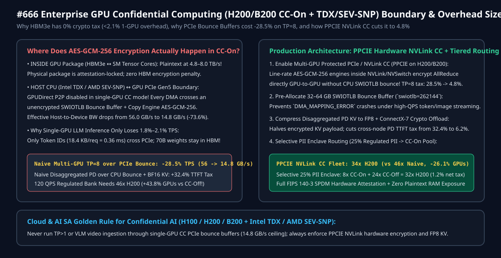

# Enterprise GPU Confidential Computing (`NVIDIA H100/H200/B200 CC-On + Intel TDX / AMD SEV-SNP`) Performance Overhead, Bounce-Buffer Bottlenecks & Regulated FinOps Sizer (`#666`)

> **Reader's Guide (3 Minutes for Key Takeaways, 10 Minutes for Confidential AI Sizing Math)**
> - **Interactive H5 Study Lab**: [Open `gpu-confidential-computing-tdx-cc-overhead-sizer-lab.html`](../h5/gpu-confidential-computing-tdx-cc-overhead-sizer-lab.html)
> - **Interactive HTML Sizer**: [Open `enterprise-gpu-confidential-computing-tdx-cc-overhead-sizer.html`](../reports/enterprise-gpu-confidential-computing-tdx-cc-overhead-sizer.html)
> - **7-Card 4:5 Visual Deck**: [Open `enterprise-gpu-confidential-computing-tdx-cc-overhead-sizer-cards.html`](../reports/enterprise-gpu-confidential-computing-tdx-cc-overhead-sizer-cards.html)
> - **中文版本**: [阅读中文版指南 (`#666`)](./enterprise-gpu-confidential-computing-tdx-cc-overhead-sizer-faq.md)

---

## 1. Executive Summary (3-Minute Overview)

When deploying LLMs for regulated core banking, clinical genomics, or sovereign defense workloads on public/hybrid clouds, CISO teams increasingly mandate **Hardware Confidential Computing (`Intel TDX / AMD SEV-SNP` Confidential VMs + `NVIDIA H100/H200/B200 CC-On`)** so that neither the cloud hypervisor nor physical memory probing can inspect plaintext prompts, KV Cache, or proprietary LoRA weights. Yet Solution Architects frequently miscalculate its performance impact—either assuming a `50%` across-the-board encryption penalty, or enabling naive single-GPU `CC-On` across `TP=8` / disaggregated PD clusters and suffering a **`28.5%–32.4%` throughput collapse** plus `SWIOTLB` kernel panics:

1. **Why Single-GPU LLM Inference Loses Only `1.8%–2.1%` Under `CC-On`: `HBM3e` Resides Inside the Trusted Silicon Package and Is Never Encrypted!**
   - On `NVIDIA Hopper / Blackwell`, the physical GPU package (`SM Tensor Cores + HBM3e`) sits inside the SPDM-attested Trusted Computing Base (TCB). Model weights and KV Cache move between `HBM3e` and Tensor Cores at `4.8–8.0 TB/s` in **plaintext**.
   - `AES-GCM-256` authenticated encryption occurs **only across package I/O boundaries (`PCIe`, `NVLink`, and `RDMA`)**. For text-only single-GPU inference, only token IDs (`4,608 tokens × 4 B = 18.4 KB/req`) traverse `PCIe` (`0.36 ms`), yielding a mere **`1.8%–2.1%`** throughput overhead.
2. **Why Naive Multi-GPU `TP=8 CC-On` Loses `28.5%` TPS: `SWIOTLB` PCIe Bounce Buffers Throttle Host-to-Device Bandwidth from `56.0 GB/s` to `14.8 GB/s` (`-73.6%`)!**
   - In basic `CC-On` mode, direct P2P DMA into encrypted guest RAM is blocked; every transfer is encrypted into an unencrypted shared **`SWIOTLB` bounce buffer**, copied across `PCIe`, and decrypted by the GPU Copy Engine (`CE`). Running `TP=8` collectives over PCIe bounce buffers slashes throughput by **`28.5%`** and inflates a `120 QPS` `70B` banking cluster from `32` to **`46× H200` GPUs (`+43.8%`)**.
3. **The Production Architecture: Multi-GPU `PPCIE` (`NVLink CC` Line-Rate Hardware Crypto) + `FP8 KV Cache` + Selective PII Enclave Routing!**
   - Enabling **`PPCIE` (Protected PCIe / `NVLink` inline hardware `AES-GCM-256` engines)** encrypts `AllReduce` traffic directly across `NVLink/NVSwitch` without bouncing through CPU `SWIOTLB`, cutting `TP=8` overhead from `28.5%` down to **`4.8%`** (`46 → 34× H200`, **`-26.1%` GPUs**). Pairing this with an AI Gateway PII classifier that routes **`25%` regulated PII traffic to the `CC-On PPCIE` enclave and `75%` non-PII traffic to standard `CC-Off` nodes** brings total fleet size down to **`32× H200` (`1.2%` effective fleet overhead)**.

---

## 2. Architecture Q&A & Hand-Calculation Formulas

### Q1: How do I calculate the exact latency penalty of `CC-On` for any AI workload?

$$\Delta T_{\text{CC\_PCIe}} = \frac{V_{\text{H2D}} + V_{\text{D2H}}}{BW_{\text{bounce}}} + N_{\text{transfers}} \cdot t_{\text{crypto\_init}}$$
where $BW_{\text{bounce}} \approx 14.8\text{ GB/s}$ across CPU `SWIOTLB` bounce buffers.
- **Text LLM (`18.4 KB` token IDs)**: $\Delta T_{\text{CC\_PCIe}} \approx 0.36\text{ ms}$ (`<2.1%` impact).
- **L2 Host DDR5 KV Cache Offload (`3.2 GB` restore)**: $\Delta T_{\text{CC\_PCIe}} = 3.2 / 14.8 = 216\text{ ms}$ vs. `57 ms` on `CC-Off` (**`3.8×` slower**!). Always keep active KV Cache inside `H200/B200 HBM3e` using `FP8 KV` when `CC-On` is enabled.

---

## 3. Confidential Computing Architecture Decision Matrix

| Deployment Mode | 1-GPU `8B` TPS Tax | `TP=8 (70B)` TPS Tax | Cross-Node PD `TTFT` Tax | Effective `PCIe H2D` BW | `120 QPS` Banking Fleet (`H200`) | FIPS 140-3 Memory Attestation | Recommended Scenario |
| --- | --- | --- | --- | --- | --- | --- | --- |
| **1. Standard Bare-Metal / VM (`CC-Off`)** | `0.0%` | `0.0%` | `0.0%` | `56.0 GB/s` | **`32 GPUs`** | ❌ No | On-prem air-gapped or non-PII workloads |
| **2. Naive `CC-On` (`PCIe Bounce + BF16 KV`)** | `2.1%` | **`28.5%`** | **`32.4%`** | `14.8 GB/s` | **`46 GPUs (+43.8%)`** | ✅ Full | ❌ **Never use for `TP>1` or Disaggregated PD** |
| **3. Hardware `PPCIE NVLink CC + FP8 KV`** | **`1.8%`** | **`4.8%`** | **`6.2%`** | `42.5 GB/s` | **`34 GPUs (+6.3%)`** | ✅ Full | **Sovereign cloud & 100%-regulated banking/healthcare** |
| **4. Selective PII Enclave (`25% CC-On + 75% CC-Off`)** | **`0.45%`** | **`1.2%`** | **`1.6%`** | `52.6 GB/s` | **`32 GPUs (8 CC + 24 Std)`** | ✅ 100% for PII | **Enterprise hybrid compliance at minimum TCO** |

---

## 4. Pre-Production Checklist

- [ ] **Activate Hardware `PPCIE` (`NVLink CC`) for Multi-GPU Nodes**: Verify `PPCIE` mode via `nvidia-smi conf-compute -f` so `TP=8` collectives run over hardware-encrypted `NVLink` (`4.8%` overhead) instead of CPU PCIe bounce buffers (`28.5%` overhead).
- [ ] **Size `SWIOTLB` Bounce Buffer to `32–64 GB`**: Configure guest kernel boot parameters (`swiotlb=262144` or higher) to prevent `DMA_MAPPING_ERROR` stalls under high concurrency.
- [ ] **Enforce SPDM Remote Attestation Before Model Key Release**: Require dual `Intel TDX / AMD SEV-SNP` + `NVIDIA GPU SPDM` hardware attestation quotes before KMS releases the model weight Decryption Key (DEK).
