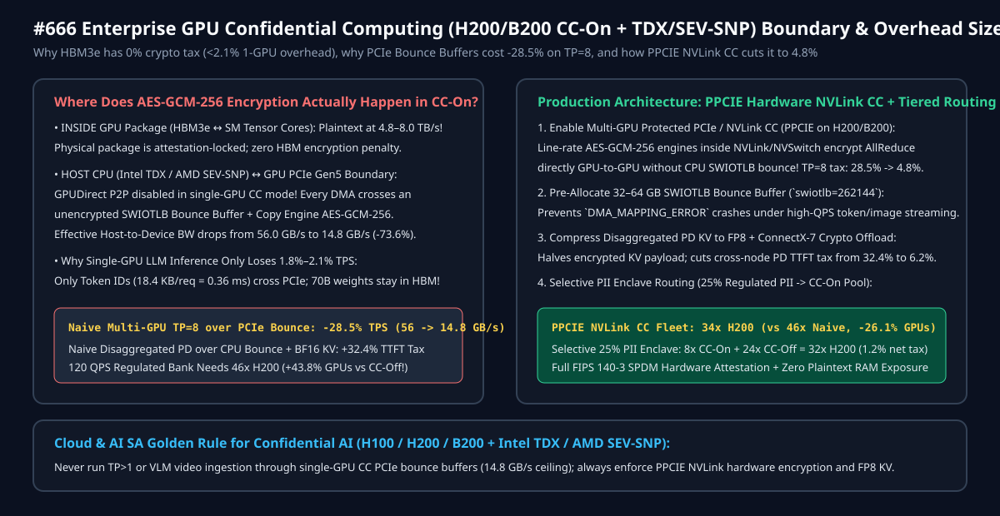
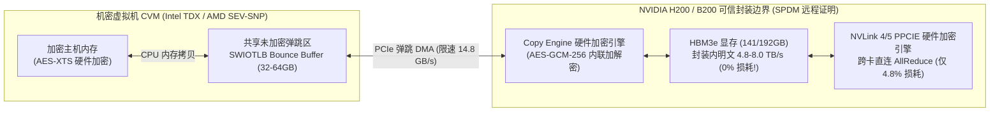

# 企业级机密计算 GPU（`NVIDIA H100/H200/B200 CC-On + Intel TDX / AMD SEV-SNP`）性能损耗手算、`PCIe/NVLink/RDMA` 弹跳缓冲区（Bounce Buffer）瓶颈与金融/政务合规容量规划指南（`#666`）

> **阅读指南（3 分钟看懂核心结论，10 分钟掌握机密计算手算与选型）**
> - **交互式 H5 精读页**：[打开 `gpu-confidential-computing-tdx-cc-overhead-sizer-lab.html`](../h5/gpu-confidential-computing-tdx-cc-overhead-sizer-lab.html)
> - **交互式容量计算器（Sizer）**：[打开 `enterprise-gpu-confidential-computing-tdx-cc-overhead-sizer.html`](../reports/enterprise-gpu-confidential-computing-tdx-cc-overhead-sizer.html)
> - **7-Card 4:5 视觉评测报告**：[打开 `enterprise-gpu-confidential-computing-tdx-cc-overhead-sizer-cards.html`](../reports/enterprise-gpu-confidential-computing-tdx-cc-overhead-sizer-cards.html)
> - **English Version**: [Read the English Guide (`#666`)](./enterprise-gpu-confidential-computing-tdx-cc-overhead-sizer-faq.en.md)

---

## 一、执行摘要与核心结论（3 分钟速览）

在银行核心信贷、医疗基因诊断、主权政务云与跨境合规场景中，客户安全团队常强制要求启用 **硬件级机密计算（Confidential Computing：主机 `Intel TDX / AMD SEV-SNP` + GPU `NVIDIA H100/H200/B200 CC-On`）**，防止云厂商宿主机管理员（Hypervisor/Root）或物理冷启动攻击窃取内存中的明文 Prompt、KV Cache 与微调权重。然而架构师常陷入两个极端误区：要么误以为“所有显存读写都要 `AES-GCM-256` 加密，推理吞吐会腰斩 `50%`”，要么盲目在多卡 `TP=8` 或 PD 分离集群上一键开启单卡 `CC-On` 模式，导致生产吞吐暴跌 **`28.5%–32.4%`** 且频繁触发 Linux 内核 `SWIOTLB` 缓冲区耗尽崩溃！

1. **为什么单卡大模型推理开 `CC-On` 性能损耗只有 `1.8%–2.1%`？—— `HBM3e` 在芯片可信物理边界之内，完全不加密！**
   - `NVIDIA Hopper / Blackwell` 的硬件可信边界（Trusted Computing Base, TCB）包裹了整颗 GPU 封装（SM 计算核心 + `HBM3e` 显存）。模型权重与 KV Cache 在 `HBM3e ↔ Tensor Core` 之间以 `4.8–8.0 TB/s` 传输时是**纯明文（Plaintext）**！
   - `AES-GCM-256` 加解密仅发生在**跨芯片边界（Host CPU ↔ GPU `PCIe`、`NVLink` 跨卡、`RDMA` 跨节点）**。对于单卡运行的 `8B/14B/32B` 文本推理，每次请求穿过 `PCIe` 的只有 Input/Output Token ID 数组（`4,608 tokens × 4 B = 18.4 KB`），加密耗时仅 **`0.36 ms`**，因此单卡推理吞吐损耗仅 **`1.8%–2.1%`**。
2. **为什么天真开启多卡 `TP=8 CC-On` 会暴跌 `28.5%`？—— `PCIe SWIOTLB` 弹跳缓冲区（Bounce Buffer）将主机到 GPU 带宽从 `56 GB/s` 砍到 `14.8 GB/s`！**
   - 在基础 `CC-On` 模式下，为防止不可信宿主机 Hypervisor 篡改 DMA，GPU 禁用了直接访问加密 CVM 内存的 P2P DMA；每一笔通信都必须先由 CPU/GPU Copy Engine 加密写入共享未加密的 **`SWIOTLB` 弹跳缓冲区（Bounce Buffer）**，再由对端拷贝解密。若多卡 `TP=8` 走主机 `PCIe` 弹跳中转，单向有效带宽从 `56.0 GB/s` 暴跌至 **`14.8 GB/s (-73.6%)`**，`70B` 推理吞吐直接损失 **`28.5%`**。
3. **破局之道：必须启用硬件级 `PPCIE`（Protected PCIe / `NVLink CC` 线速硬件加密）+ `FP8 KV Cache` + 网关分级分流！**
   - 在 `8× H200 / B200` 整机上启用 **`PPCIE`（多卡 `NVLink` 硬件内联 `AES-GCM-256` 加密引擎）**，`AllReduce` 张量直接在 `NVLink/NVSwitch` 硬件层完成线速加密与防重放校验，绕开 CPU `SWIOTLB` 弹跳缓冲区，将 `TP=8` 吞吐损耗从 `28.5%` 压回 **`4.8%`**；在 `120 QPS` 银行核心生产集群上，所需 `H200` 从 `46` 张降至 **`34` 张（节省 `26.1%` 算力）**；若进一步在 AI 网关将 **`25%` 含敏感 PII 的请求路由至 `CC-On` 专区、`75%` 脱敏/公共知识问答路由至 `CC-Off` 池**，总卡数可压至 **`32` 张（全集群综合损耗仅 `1.2%`）**。

---

## 二、灵魂拷问 Q&A（架构师现场排障与手算拆解）

### Q1：哪些工作负载开 `CC-On` 几乎零损耗（`<2.5%`），哪些工作负载开 `CC-On` 会灾难性崩盘（`>25%`）？如何手算跨 `PCIe` 加密税？

**跨边界加密延迟手算公式**：
$$\Delta T_{\text{CC\_PCIe}} = \frac{V_{\text{H2D}} + V_{\text{D2H}}}{BW_{\text{bounce}}} + N_{\text{transfers}} \cdot t_{\text{crypto\_init}}$$
其中 $BW_{\text{bounce}} \approx 14.8\text{ GB/s}$（含 CPU `memcpy` + `SWIOTLB` + GPU `CE AES-GCM` 认证标签校验），$t_{\text{crypto\_init}} \approx 18\ \mu\text{s}$。

1. **纯文本单卡 / `PPCIE NVLink` 节点内推理（损耗 `1.8%–4.8%`）**：
   - 仅传输 Token ID（每次请求 `<32 KB`），模型权重常驻 `HBM3e` 不跨 `PCIe`，几乎不受弹跳缓冲区限速影响。
2. **多模态高清视频流 / 高频 LoRA 动态换入 / 跨 `PCIe` 卸载 L2 KV Cache（损耗 `28%–64%`，严禁直接裸开！）**：
   - 若将 `3.2 GB` 的 `L2 Pinned DDR5 KV Cache` 通过 `CC-On PCIe Bounce Buffer` 恢复回 HBM，耗时将从 `CC-Off` 的 `57 ms` 暴增至 **`3.2 / 14.8 = 216 ms`（慢 `3.8 倍`）**！因此在 `CC-On` 节点上，必须优先利用 `H200 (141GB)` / `B200 (192GB)` 的超大本地 HBM 容量并将 KV 量化为 `FP8`，减少跨 `PCIe` 换页。

---

### Q2：在 `CC-On` 生产环境中，为什么高并发下经常出现 Linux 内核报错 `swiotlb buffer is full` 导致推理进程挂死？如何配置宿主机与 CVM 参数？

- **根因**：`Intel TDX / AMD SEV-SNP` 虚拟机默认只分配 `64 MB` 的 `SWIOTLB` 弹跳缓冲区。当 `8× H200` 同时通过 `PCIe` 处理高并发请求、加载冷启动权重分片或走 `RDMA` 弹跳收发时，`64 MB` 瞬间被占满并抛出 `DMA_MAPPING_ERROR`。
- **生产强制配置红线**：
  1. 在 CVM 内核启动参数中显式扩大 `SWIOTLB` 至 **`32 GB–64 GB`**（如 `swiotlb=262144` 或更高，占 `2TB` 主机内存的 `<3%`）；
  2. 权重冷启动加载采用 **SPDM 远程证明（Remote Attestation）后从 KMS 拉取 DEK 在 GPU 内部解密落盘镜像**，严禁每次推理请求重复跨 `PCIe` 传输大块明文权重。

---

## 三、机密计算四大部署方案选型决策矩阵

| 架构模式 | 单卡 `8B` 吞吐损耗 | `TP=8 (70B)` 吞吐损耗 | 跨节点 PD 分离 `TTFT` 损耗 | 有效 `PCIe H2D` 带宽 | `120 QPS` 银行集群所需 `H200` | FIPS 140-3 内存防窃取 | 适用场景 |
| --- | --- | --- | --- | --- | --- | --- | --- |
| **1. 标准裸金属 / 普通 VM (`CC-Off`)** | `0.0%` | `0.0%` | `0.0%` | `56.0 GB/s` | **`32 张`** | ❌ 无 | 内部非涉密研发、私有数据中心可信内网 |
| **2. 天真单卡弹跳模式 (`Naive CC-On PCIe Bounce + BF16 KV`)** | `2.1%` | **`28.5%`** | **`32.4%`** | `14.8 GB/s` | **`46 张 (+43.8%)`** | ✅ 全量 | ❌ **严禁用于多卡 `TP>1` 或 PD 分离** |
| **3. 硬件 `PPCIE NVLink CC + FP8 KV`（推荐全量涉密）** | **`1.8%`** | **`4.8%`** | **`6.2%`** | `42.5 GB/s` | **`34 张 (+6.3%)`** | ✅ 全量 | **主权政务云、公有云全量核心信贷/医疗推理** |
| **4. 网关 PII 分级路由 (`25% CC-On PPCIE + 75% CC-Off`)** | **`0.45%`** | **`1.2%`** | **`1.6%`** | `52.6 GB/s` | **`32 张 (8 CC + 24 标准)`** | ✅ 涉密流量 100% 隔离 | **大型金融/跨国车企混合合规集群（最优 TCO）** |

---

## 四、生产落地核对清单（Pre-Production Checklist）

- [ ] **开启 `PPCIE` 多卡硬件 `NVLink` 加密**：凡在 `8× H100/H200/B200` 上运行 `TP >= 2` 机密计算，必须启用 `PPCIE` 模式（Protected PCIe / NVLink CC）并通过 `nvidia-smi conf-compute -f` 验证硬件级 NVLink 线速加密已激活。
- [ ] **`SWIOTLB` 弹跳内存池扩容至 `>= 32 GB`**：验证 CVM 内 `dmesg | grep -i swiotlb` 预留容量不低于 `32 GB`，并监控 `swiotlb_used` 水位 `< 70%`。
- [ ] **SPDM 硬件远程证明（Attestation）接入 KMS**：配置 `NVIDIA Attestation SDK / Trustee` 验证 CPU `TDX/SEV-SNP` Quote 与 GPU `SPDM` 证书链通过后，才向 CVM 释放模型权重解密密钥（DEK）。
- [ ] **禁用高频 L2 DDR5 KV 跨 `PCIe` 换页**：在 `CC-On` 专区强制开启 `FP8 KV Cache`，将热会话 100% 锁定在 GPU 本地 `HBM3e` 内，规避 `14.8 GB/s` `PCIe` 弹跳带宽瓶颈。
