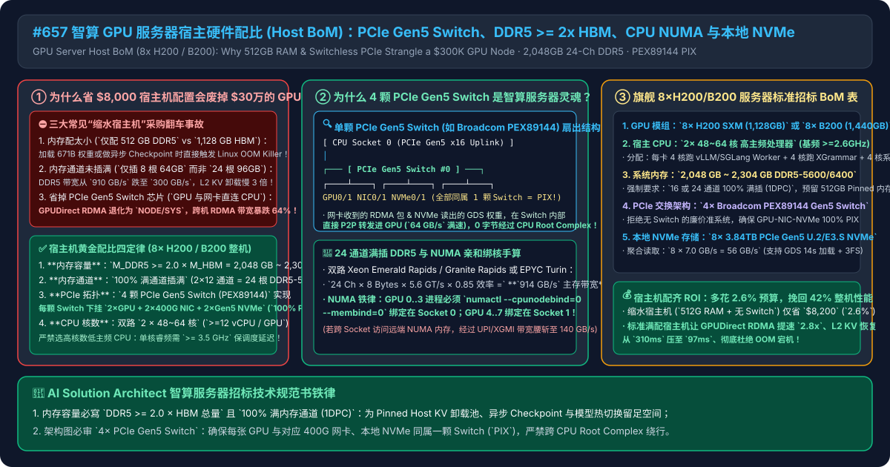

# AI GPU Server Host BoM Sizer: `4× PCIe Gen5 Switch (100% PIX)`, `DDR5 RAM >= 2.0× HBM` (`24-Channel 914 GB/s`), Dual-Socket `NUMA` Pinning & `8× Gen5 NVMe`

> **Language / 语言**: [简体中文](./enterprise-gpu-host-server-bom-numa-pcie-switch-ddr5-nvme-faq.md) | **English** · [📱 Open Interactive H5 Study Lab](../h5/gpu-host-server-bom-numa-pcie-switch-ddr5-nvme-lab.html) · [🧮 Open Interactive Sizer](../reports/enterprise-gpu-host-server-bom-numa-pcie-switch-ddr5-nvme-sizer.html) · [🃏 View 7-Card 4:5 Benchmark Deck](../reports/enterprise-gpu-host-server-bom-numa-pcie-switch-ddr5-nvme-cards.html)

---

## 0. 3-Minute Executive Summary

Skimping `$8,200` (`2.6%`) on the host server configuration of a `$300,000` `8× H200 / B200` node — by ordering only `512 GB` RAM, populating half the memory channels, or omitting dedicated `PCIe Gen5` switches — **strangles `GPUDirect RDMA` throughput by `64.2%`, slows L2 host KV cache restoration by `3.2×`, and triggers Linux `OOM` crashes during model loading and checkpointing**:
1. **Host Memory Rule: `M_DDR5 >= 2.0 × M_HBM` (`2,048–2,304 GB`) Across `100%` Populated Channels (`914 GB/s`)**:
   - An `8× H200` node (`1,128 GB` HBM) requires **`2,048–2,304 GB` DDR5-5600/6400** (`24 × 96 GB` DIMMs populating all `24` channels across dual sockets) to deliver **`914 GB/s`** host memory bandwidth — restoring a `32K` L2 KV cache in **`97 ms`** (vs. `310 ms` on an 8-DIMM under-populated server).
2. **`4× PCIe Gen5 Switches` (`Broadcom PEX89144`) Guarantee `100% PIX` GPU-NIC-NVMe Affinity**:
   - Hanging `2× GPUs + 2× 400G NICs + 2× Gen5 NVMe SSDs` under each of the `4` PCIe Gen5 switches keeps all RDMA and GPUDirect Storage (`GDS`) traffic inside the switch (`64 GB/s` per GPU, **`382 GB/s` node `busbw`**) vs. `136 GB/s` when forced across CPU root complexes (`NODE/SYS`).
3. **Dual High-Frequency CPUs (`2 × 48–64 Cores @ >=3.5 GHz Boost`) + Strict `single-numa-node` Pinning**:
   - Eliminates cross-socket `UPI/XGMI` bottlenecks and feeds `8× 3.84 TB PCIe Gen5 NVMe` drives (`56 GB/s` aggregate read for `14.2s` cold-starts and `DeepSeek 3FS`).

---

## 1. Quantitative Host Server BoM Comparison (`8× H200 SXM` Node)

| Host Server BoM Tier | Host DDR5 RAM & Bandwidth | PCIe Topology & Local NVMe | Node RDMA `busbw` / `32K` L2 KV Restore | Total Node Price | Effective Node Output & Verdict |
| :--- | :--- | :--- | :--- | :--- | :--- |
| **1. Under-Specced Host (Low-Bid Trap)** | `512 GB` (`8 Ch`, `305 GB/s`) | Switchless (`SYS`) + `2× SATA` | `136 GB/s` / `310 ms` (frequent OOM) | `$291,800` | `58.0%` output · ⛔ **Cripples `$300K` GPUs** |
| **2. Partial-Channel Standard Host** | `1,024 GB` (`16 Ch`, `610 GB/s`) | `4× Switch (PIX)` + `4× Gen4 NVMe` | `372 GB/s` / `145 ms` (`38s` cold-start) | `$296,500` | `84.5%` output · ⚠️ **Suboptimal L2 KV & I/O** |
| **3. Golden Full-Spec AI Host (Recommended)** | **`2,048–2,304 GB` (`24 Ch`, `914 GB/s`)** | **`4× PEX89144 (PIX)` + `8× 3.84TB Gen5 NVMe` (`56 GB/s`)** | **`382 GB/s` / `97 ms` (`14.2s` cold-start)** | **`$300,000` (`+2.8%`)** | **`100.0%` output · 🏆 Mandatory RFP Baseline** |
