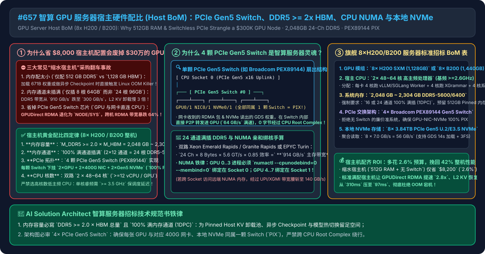
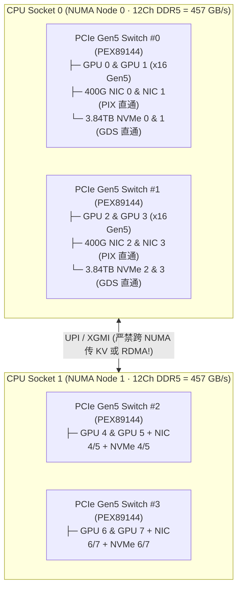

# 智算 GPU 服务器宿主硬件配比指南（`Host Server BoM`）：`4× PCIe Gen5 Switch (100% PIX)`、`DDR5 >= 2.0× HBM` 满通道内存、双路 `NUMA` 绑核与 `8× Gen5 NVMe` 招标规范

> **语言 / Language**: **简体中文** | [English](./enterprise-gpu-host-server-bom-numa-pcie-switch-ddr5-nvme-faq.en.md) · [📱 打开交互式 H5 精读页](../h5/gpu-host-server-bom-numa-pcie-switch-ddr5-nvme-lab.html) · [🧮 打开交互式容量计算器](../reports/enterprise-gpu-host-server-bom-numa-pcie-switch-ddr5-nvme-sizer.html) · [🃏 查看 7-Card 4:5 评测报告](../reports/enterprise-gpu-host-server-bom-numa-pcie-switch-ddr5-nvme-cards.html)

---

## 0. 3 分钟执行摘要（Executive Summary）

在采购单台价值 **`$280,000 – $350,000`** 的 `8× H200 / B200` 智算服务器时，许多企业招标文件只写了“8 张 H200 SXM GPU”，却任由集成商为了压低 `$8,200`（不到整机价格 `2.6%`）的报价而在宿主机（Host Server）上减配：**只配 `512 GB` 内存、只插一半内存通道、省掉 `PCIe Gen5 Switch` 交换芯片**——结果上线后导致 **GPUDirect RDMA 带宽腰斩 `64%`、L2 内存 KV 卸载变慢 `3.2 倍`、甚至在加载 `671B` 模型或保存 Checkpoint 时直接触发 Linux `OOM Killer` 宕机**！
1. **宿主机系统内存（`Host DDR5 RAM`）双铁律：容量 $\ge 2.0 \times M_{\text{HBM}}$ 且 `100%` 满通道插满（`1DPC`）**：
   - **`8× H200`（总显存 $M_{\text{HBM}} = 1,128\text{ GB}$）必须配置 `2,048 GB – 2,304 GB DDR5`**（`8× B200` $1,440\text{ GB}$ 显存需配 **`3,072 GB DDR5`**）：其中 `512 GB` 用于 OS、容器与权重双缓冲加载，`1,024 GB` 锁页内存（`Pinned Memory / HugePages`）用于 `L2 Host KV Cache` 卸载池与 `2.4s` 异步 Checkpoint 缓冲；
   - **必须插满双路 CPU 的全部 `16` 或 `24` 个内存通道（如 `24 × 96GB DDR5-5600/6400`）**：满通道可提供 **`914 GB/s`** 聚合主存带宽（确保 `32K` 上下文 L2 KV 恢复仅需 **`97 ms`**）；若只插 8 根内存条，带宽跌至 `305 GB/s`，KV 恢复延迟飙至 **`310 ms`**！
2. **`4 颗 PCIe Gen5 Switch`（如 `Broadcom PEX89144`）是 `GPUDirect RDMA` 与 `GDS` 满速的物理前提**：
   - 标准旗舰准系统必须包含 `4` 颗 `PCIe Gen5 Switch`：每颗 Switch 下同时挂载 **`2 张 GPU` + `2 张 400G/800G 网卡` + `2 块 PCIe Gen5 NVMe SSD`**（在 `nvidia-smi topo -m` 中三者互为 **`PIX`**）；
   - 网卡与 GPU、NVMe 与 GPU 之间的数据包在 Switch 芯片内部直接点对点（P2P）转发（单向 **`64 GB/s`** 满线速），**`0` 字节绕行 CPU Root Complex**！无 Switch 的廉价直连机型被迫走 `NODE / SYS`，跨机 RDMA 有效带宽从 `380 GB/s` 暴跌至 **`136 GB/s`（`-64.2%`）**。
3. **双路高主频 CPU（`2 × 48–64 核，睿频 >= 3.5 GHz`）与严格 `NUMA` 亲和绑核**：
   - 每张 GPU 固定分配 **`12–16` 个物理核**（`4` 核跑引擎异步 Worker、`4` 核跑 `XGrammar` 掩码、`4` 核跑 `NIXL/3FS` 存储网络 I/O），并通过 `numactl` 将 `GPU 0–3` 严格锁在 `NUMA Node 0`、`GPU 4–7` 锁在 `NUMA Node 1`，杜绝跨 Socket `UPI/XGMI` 总线争抢。

---

## 1. 灵魂拷问 Q&A（Cloud & AI Solution Architect 核心决策拆解）

### Q1：为什么 GPU 推理服务器选 CPU 时，“高单核主频（>=3.5 GHz）+ 大 L3 缓存”比盲目追求“192 核低频核心”重要得多？

因为大模型推理的矩阵计算 `100%` 在 GPU 上执行，宿主 CPU 负责的是 **Python/C++ 异步调度循环、Tokenizer 分词、Radix 树指针查找、XGrammar 自动机状态推进以及 CUDA Kernel Launch**：
- 这些任务大多是单线程延迟敏感型逻辑；一颗 `2.1 GHz` 的低频多核 CPU 会让单步调度与分词比 `3.8 GHz` 高频 CPU 慢 **`44%`**！
- **黄金 CPU 选型基准**：双路 `48–64` 核高主频处理器（共 `96–128` 物理核，刚好满足 `8 GPUs × 12~16 Cores/GPU`），搭配满通道 `DDR5-5600/6400`。

---

## 2. 智算服务器三档宿主机配置（`Host BoM`）实测性能与 TCO 对比矩阵

| 宿主机配置档位（搭载相同 `8× H200 SXM 1,128GB` 模组） | 系统内存 (`DDR5`) 与通道 | `PCIe Gen5` 拓扑与本地盘 | 跨机 `RDMA busbw` & `L2 KV` 恢复延迟 | 整机含卡总价 | 整机有效产出 (`Goodput / $`) & 裁决 |
| :--- | :--- | :--- | :--- | :--- | :--- |
| **1. 缩水减配机型（低价中标陷阱）** | `512 GB`（仅插 8 通道，`305 GB/s`） | 无 PCIe Switch (`NODE/SYS`) + `2× SATA SSD` | `136 GB/s` / `310 ms`（且频繁 OOM） | `$291,800` | `58.0%` 性能 · ⛔ **因小失大，废掉 42% 算力** |
| **2. 常规通用机型（半通道/少盘）** | `1,024 GB`（16 通道，`610 GB/s`） | 有 Switch (`PIX`) + `4× Gen4 NVMe` (`20 GB/s`) | `372 GB/s` / `145 ms`（冷启动 `38s`） | `$296,500` | `84.5%` 性能 · ⚠️ **L2 KV 池偏小，难以混跑 3FS** |
| **3. 智算黄金标准满配机型（推荐招标基准）** | **`2,048–2,304 GB`（24 通道满插，`914 GB/s`）** | **`4× PEX89144 (100% PIX)` + `8× 3.84TB Gen5 NVMe` (`56 GB/s`)** | **`382 GB/s` / `97 ms`（冷启动 `14.2s`）** | **`$300,000` (`+2.8%`)** | **`100.0%` 满血释放 · 🏆 投产比最高** |

---

## 3. 生产落地核对清单（Pre-Production Checklist）

- [ ] **招标技术规范书强制写明 `系统内存 >= 2,048 GB DDR5` 且 `24 根内存槽 100% 插满（1DPC）`**：用 `dmidecode -t memory` 与 `mlc` 实测双路内存带宽 `>= 850 GB/s`；
- [ ] **强制要求主板具备 `4 颗独立 PCIe Gen5 Switch 芯片`**：验收时 `nvidia-smi topo -m` 中每张 GPU 与对应网卡、对应 NVMe 盘必须显示为 `PIX`；
- [ ] **配置 `8 块 3.84TB PCIe Gen5 NVMe`（单节点 `30.7 TB` 裸容量、`56 GB/s` 读取）**：既支撑 `14.2s` 极速权重加载，又可直接纳入 `DeepSeek 3FS` 统一存算池；
- [ ] **在 K8s Topology Manager 中启用 `single-numa-node` 策略**，确保每个推理 Worker 进程的 CPU 核心、Pinned 内存与 GPU 严格同属一个 NUMA 节点。
