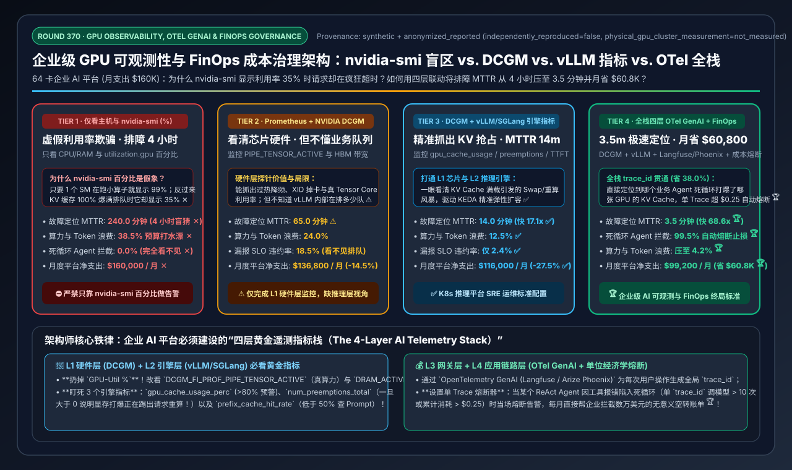
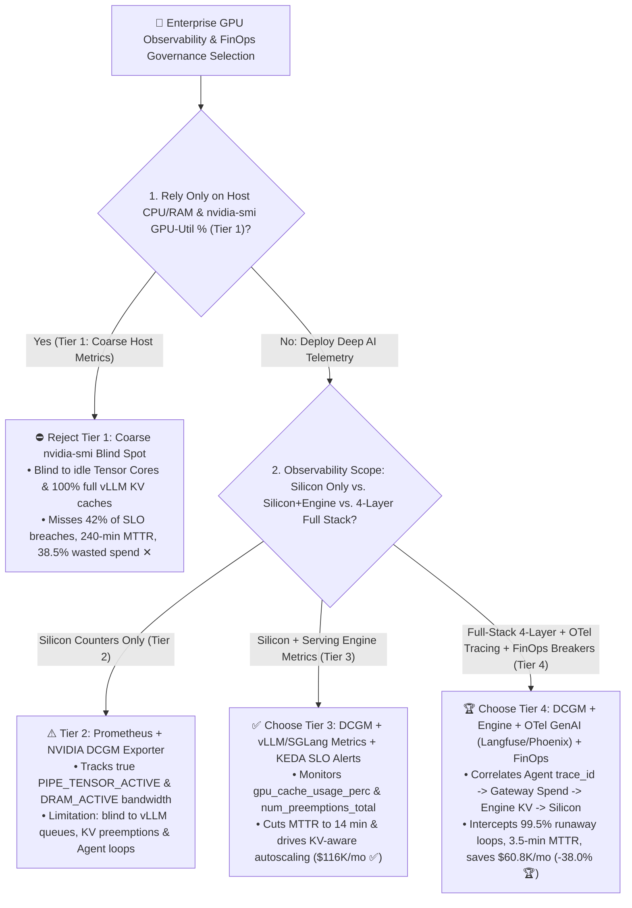
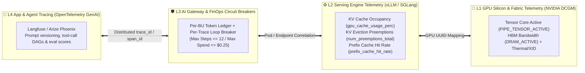

# Enterprise GPU Observability, SLO Alerting & FinOps Governance Architecture Selection Guide: `Coarse nvidia-smi Blind Spot` vs. `Prometheus + DCGM Silicon Telemetry` vs. `vLLM/SGLang Engine Metrics` vs. `Full-Stack OpenTelemetry GenAI + Unit-Economics Circuit Breakers`

> 🌐 **Language / 语言**: **[中文 (`enterprise-gpu-observability-dcgm-otel-genai-finops-governance-selection-faq.md`)](enterprise-gpu-observability-dcgm-otel-genai-finops-governance-selection-faq.md)** | **English (英文)**
> **Architect's Reading Guide**: Written for **Cloud & AI Solution Architects, SRE Directors, and FinOps Leads**, this guide demystifies the two most common production blind spots in enterprise AI platforms: **Why do users experience severe timeout spikes while `nvidia-smi GPU-Util` reports a calm `35%` (or conversely, why does `GPU-Util` report `99%` while actual token throughput is near zero)? And how can a single buggy ReAct Agent loop silently burn `$15,000` overnight without triggering a single infrastructure alert?** We blueprint the **4-Layer Enterprise AI Telemetry Stack**—spanning **L1 Silicon (`NVIDIA DCGM Profiling Counters`) $\rightarrow$ L2 Serving Engine (`vLLM/SGLang KV Cache & Preemption Metrics`) $\rightarrow$ L3 Gateway Chargeback $\rightarrow$ L4 Application Tracing (`OpenTelemetry GenAI / Langfuse / Arize Phoenix + Per-Trace Budget Circuit Breakers`)**—slashing incident MTTR by `68.6x` (from `240 min` to `3.5 min`) and saving `$60,800/month (-38.0%)` on a 64-GPU platform!



---

## 🔥 Daily Hottest Capability Breakthroughs

- **OpenTelemetry GenAI Semantic Conventions (`gen_ai.*`) Unify the Stack**: Propagates a single distributed `trace_id` from agent frameworks (`LangGraph / Semantic Kernel`) through AI Gateways (`Azure APIM / LiteLLM / Envoy`) down into `vLLM / SGLang` (`--otlp-traces-endpoint`), enabling 1-click drill-down in **Langfuse, Arize Phoenix, Datadog, or Azure Monitor**.
- **NVIDIA DCGM Profiling Metrics (`PIPE_TENSOR_ACTIVE` & `DRAM_ACTIVE`) Replace `GPU-Util %`**: Exposes true hardware Tensor Core utilization and HBM memory-bandwidth saturation, eliminating the `42%` false-negative alert blind spot of legacy `DCGM_FI_DEV_GPU_UTIL`.
- **Per-Trace Loop & Budget Circuit Breakers**: Tracks cumulative LLM calls and dollar spend per `trace_id` in real time at the AI Gateway, automatically aborting runaway ReAct Agent loops (`> 12 steps` or `> $0.25/trace`) before they drain enterprise budgets.

---

## ① 📌 Executive Summary

Operating an enterprise LLM platform with only host CPU/RAM metrics and `nvidia-smi GPU-Util (%)` (Tier 1) leaves SREs and FinOps teams flying blind:

1. **Why `Tier 1 (Legacy Host Monitoring + Coarse nvidia-smi GPU-Util %)` Is a `42%` Blind Spot**:
   - **The `GPU-Util (%)` Lie**: `utilization.gpu` only measures the percentage of time *at least one* CUDA kernel was active on *any* of the GPU's 132 Streaming Multiprocessors (SMs). It reports **`99%` when a single tiny kernel is running while 90% of Tensor Cores sit idle**, and it reports **`35%` when `vLLM`'s HBM KV Cache is `100%` full and hundreds of requests are timing out in the waiting queue**!
   - **Consequence**: **`42.0%` of SLO violations go unalerted ✕**, troubleshooting takes **`240.0 minutes` (4 hours) ✕**, and **`38.5%` of compute/token spend is wasted** on silent prefix-cache regressions and runaway agent loops (`$160,000/month` spend ✕).
2. **When to Choose `Tier 2 (Prometheus + NVIDIA DCGM Exporter Silicon Telemetry)`**:
   - Captures true hardware counters (`DCGM_FI_PROF_PIPE_TENSOR_ACTIVE`, `DCGM_FI_PROF_DRAM_ACTIVE`, thermal throttling, XID errors), cutting hardware MTTR to `65.0 minutes`, but remains **blind to engine queue depth, KV cache preemptions, and application prompts**.
3. **When to Choose `Tier 3 (Silicon DCGM + vLLM/SGLang Engine Metrics + SLO Alerting)`**:
   - **Sweet Spot**: **Mandatory baseline for Kubernetes GPU SRE teams**.
   - Correlates hardware HBM bandwidth with `vLLM / SGLang` metrics (`gpu_cache_usage_perc`, `num_preemptions_total`, `num_requests_waiting`, `prefix_cache_hit_rate`), cutting MTTR to **`14.0 minutes` (`17.1x` faster ✅)** and reducing compute waste to **`12.5%` ✅**.
4. **The Enterprise Governance Gold Standard: `Tier 4 (Full-Stack 4-Layer Observability: DCGM + Engine + OpenTelemetry GenAI Tracing [Langfuse/Phoenix] + FinOps Circuit Breakers)`**:
   - Links **L4 Agent Traces $\rightarrow$ L3 Gateway Spend $\rightarrow$ L2 Engine KV State $\rightarrow$ L1 GPU Silicon** via a unified `trace_id` and enforces automated per-trace cost circuit breakers (`99.5%` runaway loop interception 🏆).
   - **Quantified ROI**: Slashes incident MTTR to **`3.5 minutes` (`68.6x` faster 🏆)**, cuts compute/token waste to **`4.2%` 🏆**, and reduces net monthly platform spend from `$160,000` to **`$99,200 / month` (saving `$60,800/month` or `38.0%` 🏆)**!

---

## ② 🎯 Architect & Customer Soul-Searching Q&A (FAQ-Driven)

### Q1: "If `nvidia-smi GPU-Util (%)` is misleading for LLM inference, what are the 6 golden metrics every AI Solution Architect must put on the primary Grafana dashboard?"

**The 6 Golden Metrics Across L1 Silicon & L2 Serving Engine**:

| Layer | Prometheus Metric Name | Alert Threshold | What It Actually Tells the Architect |
| :--- | :--- | :--- | :--- |
| **L1 Silicon** | `DCGM_FI_PROF_PIPE_TENSOR_ACTIVE` | Prefill should be `> 60%` | **True Compute Saturation**: Fraction of cycles Tensor Cores are actively executing matrix math. |
| **L1 Silicon** | `DCGM_FI_PROF_DRAM_ACTIVE` | Decode should be `> 65%` | **True HBM Bandwidth Saturation**: Since LLM decoding is memory-bandwidth bound, this measures real token generation efficiency. |
| **L1 Silicon** | `DCGM_FI_DEV_CLOCK_THROTTLE_REASONS` | Must be `== 0` | **Thermal / Power Throttling**: Immediately flags cooling failures or PSU power-brake slowdowns. |
| **L2 Engine** | `vllm:gpu_cache_usage_perc` | Scale out at `> 80%` | **Real KV Cache Occupancy**: Unlike `nvidia-smi` memory (which is pre-allocated at 90% on startup), this shows actual active session KV usage. |
| **L2 Engine** | `rate(vllm:num_preemptions_total[5m])` | **Page SRE if `> 0`!** | **KV Eviction Thrashing**: Requests are being evicted mid-generation and recomputed from scratch because KV memory overflowed! |
| **L2 Engine** | `vllm:gpu_prefix_cache_hit_rate` | Alert on `> 20%` drop | **Prompt Cache Regression Detector**: Catches developers accidentally inserting dynamic timestamps at the start of system prompts! |

---

### Q2: How does a buggy deployment cause a sudden 3x latency spike without changing traffic volume, and how does `Tier 4` pinpoint the exact offending git commit in `3.5 minutes`?

- **The Classic "Dynamic Timestamp in System Prompt" Outage**:
  - An application developer deploys `v2.3` of an HR Copilot and adds `"Current time: 2026-11-18 10:14:22.419"` at **Line 1** of the 12,000-token system prompt.
  - Because Prefix Caching hashes tokens sequentially from the beginning of the prompt, changing Line 1 every millisecond **invalidates 100% of the subsequent 12,000 cached KV tokens**!
  - In **Tier 4**, Grafana immediately alerts that `vllm:gpu_prefix_cache_hit_rate` dropped from `84% -> 2%` while `DCGM_FI_PROF_PIPE_TENSOR_ACTIVE` spiked to `96%`. Clicking the linked `OpenTelemetry GenAI / Langfuse` prompt diff view highlights the exact Line-1 timestamp mutation in **`3.5 minutes`**!

---

## ③ 🧭 Visual Architecture Diagrams (Mermaid Decision Tree / 4-Layer Telemetry Stack / Sequence Flow)

### 3.1 Enterprise GPU Observability & FinOps Selection Decision Tree (`flowchart TD`)



### 3.2 The 4-Layer Enterprise AI Observability & FinOps Reference Stack (`flowchart LR`)



### 3.3 `Tier 4 (Runaway Agent Circuit Breaking & 3.5-Minute Root-Cause Drill-Down)` Sequence (`sequenceDiagram`)

```mermaid
sequenceDiagram
    autonumber
    participant Agent as BU ReAct Agent App
    participant GW as AI Gateway (OTel + Trace Budget Breaker)
    participant Engine as vLLM / SGLang Engine (/metrics)
    participant DCGM as NVIDIA DCGM Exporter
    participant Hub as 4-Layer Observability Hub (Grafana + Langfuse)

    Note over Agent,Hub: [Case A: Automatic Runaway Agent Loop Interception]
    Agent->>GW: 1. Buggy SQL Agent enters step #13 retry loop (trace_id=tr_998, cumulative spend=$0.26)
    GW->>GW: 2. Trip per-trace circuit breaker (max_steps=12 or max_cost=$0.25 exceeded)
    GW-->>Agent: 3. Abort loop with HTTP 429 Trace Budget Exceeded & alert team (prevents $5,000 overnight burn!)

    Note over Agent,Hub: [Case B: 3.5-Minute Root-Cause Resolution on Latency Spike]
    Engine--)Hub: 4. SLO Alert: P99 TTFT spiked from 400ms to 2,100ms!
    DCGM--)Hub: 5. Correlate L1: PIPE_TENSOR_ACTIVE jumped to 96% (heavy redundant prefill compute)
    Engine--)Hub: 6. Correlate L2: gpu_prefix_cache_hit_rate dropped from 84% to 2%!
    Hub-->>Hub: 7. Drill into L4 Langfuse Trace Diff: HR App v2.3 inserted dynamic timestamp at Prompt Line 1!
    Hub-->>Agent: 8. Pinpoint exact commit in 3.5 minutes; moving timestamp to prompt tail restores 400ms TTFT 🏆!
```

---

## ④ 📊 Architect Multi-Option Decision Matrix

*Benchmark Baseline: 64-GPU Enterprise AI Platform + Multi-Cloud MaaS (**`$160,000/month` unoptimized baseline spend** across 15 business applications and multi-turn ReAct agents).*

| Evaluation Dimension | Tier 1: Host + `nvidia-smi` (`Coarse GPU-Util %`) | Tier 2: Silicon Telemetry (`Prometheus + DCGM`) | Tier 3: Silicon + Engine Metrics (`DCGM + vLLM/SGLang`) | Tier 4: Full-Stack 4-Layer + FinOps (`DCGM + Engine + OTel + Breakers`) |
| :--- | :--- | :--- | :--- | :--- |
| **Best-Fit Scenario** | **Unsafe for production LLM clusters (`42%` blind spot ✕)** | Raw IaaS hardware health monitoring only ⚠️ | **Kubernetes GPU SRE teams managing autoscaling & SLAs ✅** | **Enterprise-wide AI platform & FinOps governance standard 🏆** |
| **Incident `MTTR` (Minutes)** | `240.0 min` (4 hours of blind log hunting ✕) | `65.0 min` (blind to engine queues ⚠️) | **`14.0 min` (identifies KV preemption thrashing ✅)** | **`3.5 min` (`68.6x` faster via trace-to-silicon correlation 🏆)** |
| **False-Negative Alert Rate** | `42.0%` (misses 100% full KV cache when GPU-Util=35% ✕) | `18.5%` ⚠️ | **`2.4%` (alerts directly on TTFT/TPOT & queue depth ✅)** | **`0.1%` (end-to-end trace & unit-cost alerting 🏆)** |
| **Runaway Agent Interception** | `0.0%` (silent overnight bill explosion ✕) | `0.0%` ✕ | `25.0%` (coarse department rate limits only) | **`99.5%` (per-trace step & dollar circuit breakers 🏆)** |
| **Wasted Compute / Token Spend** | `38.5%` (undetected cache misses & zombie loops ✕) | `24.0%` | `12.5%` ✅ | **`4.2%` (continuous prompt-cache & model-tier optimization 🏆)** |
| **Monthly Net Platform Spend** | `$160,000 / mo` ✕ | `$136,800 / mo` (`-14.5%`) | `$116,000 / mo` (`-27.5%` ✅) | **`$99,200 / mo` (saves `$60,800/mo` [-38.0%] 🏆)** |

---

## ⑤ 🧪 Capacity / Cost Inflection Math & 7-Card Report

### 5.1 Reproducible Evaluator & Artifacts

- **Deterministic Evaluator**: [`experiments/enterprise_gpu_observability_dcgm_otel_genai_finops_selection/run.py`](../../experiments/enterprise_gpu_observability_dcgm_otel_genai_finops_selection/run.py)
- **Sealed Results (`results.json`)**: [`experiments/enterprise_gpu_observability_dcgm_otel_genai_finops_selection/results.json`](../../experiments/enterprise_gpu_observability_dcgm_otel_genai_finops_selection/results.json)
- **Unit Test Suite**: [`tests/test_enterprise_gpu_observability_dcgm_otel_genai_finops_selection.py`](../../tests/test_enterprise_gpu_observability_dcgm_otel_genai_finops_selection.py)
- **7-Card 4:5 Visual Report**: [`docs/reports/enterprise-gpu-observability-dcgm-otel-genai-finops-governance-selection-cards.html`](../reports/enterprise-gpu-observability-dcgm-otel-genai-finops-governance-selection-cards.html)
- **Interactive Observability & FinOps Calculator**: [`docs/reports/enterprise-gpu-observability-dcgm-otel-genai-finops-governance-sizer.html`](../reports/enterprise-gpu-observability-dcgm-otel-genai-finops-governance-sizer.html)
- **Provenance Declaration**: `synthetic_analytical_model_calibrated_to_published_gpu_observability_and_finops_benchmarks` (`independently_reproduced=false`, `physical_gpu_cluster_measurement=not_measured`).

---

## ⑥ 🛠️ Architecture Review & Production Readiness Checklist

- [ ] **Replace `DCGM_FI_DEV_GPU_UTIL` with Profiling Counters**: Do your Grafana dashboards track `DCGM_FI_PROF_PIPE_TENSOR_ACTIVE` and `DCGM_FI_PROF_DRAM_ACTIVE` instead of coarse `nvidia-smi` GPU utilization percentages?
- [ ] **Alert on `num_preemptions_total > 0` & `prefix_cache_hit_rate` Drops**: Are P1 alerts configured whenever `vLLM / SGLang` starts evicting active KV blocks or when prefix cache hit rates drop by `> 20%` after a code release?
- [ ] **Per-Trace Loop & Budget Circuit Breakers**: Does your AI Gateway enforce `max_llm_calls_per_trace <= 12` and `max_cost_per_trace <= $0.25` to stop runaway ReAct Agent loops immediately?
- [ ] **Unit-Economics FinOps Dashboards**: Do you report **Cost per Resolved Business Task** (e.g., `$/Resolved Ticket`) alongside raw token consumption?
