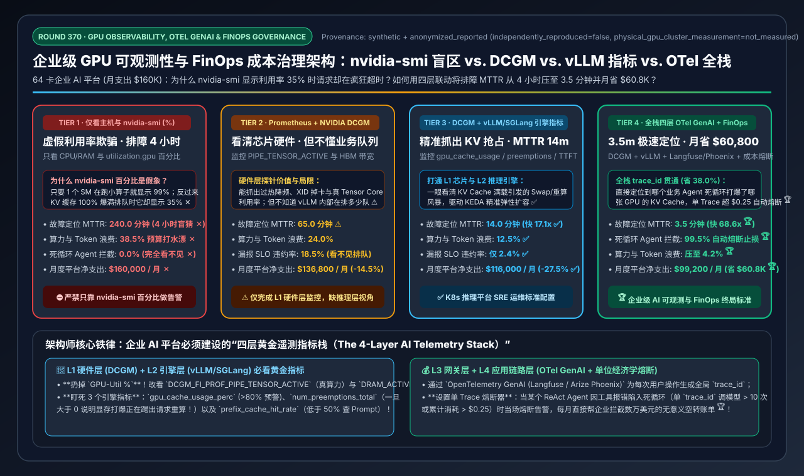
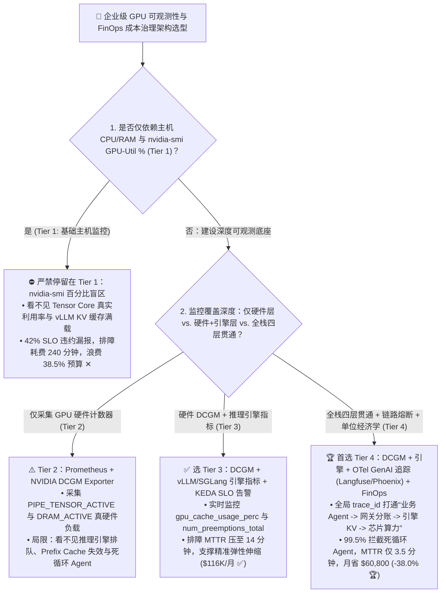
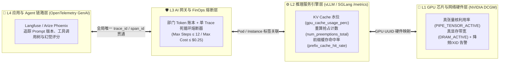
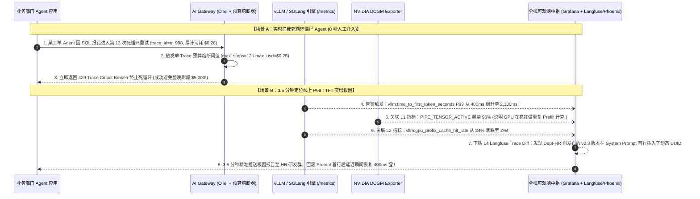

# 企业级 GPU 可观测性、SLO 告警与 FinOps 成本治理架构选型指南：`nvidia-smi 基础监控盲区` vs. `Prometheus + DCGM 硬件遥测` vs. `vLLM/SGLang 引擎指标` vs. `全栈 OpenTelemetry GenAI + 单任务成本熔断`

> 🌐 **Language / 语言**: **中文 (Chinese)** | **[English (`enterprise-gpu-observability-dcgm-otel-genai-finops-governance-selection-faq.en.md`)](enterprise-gpu-observability-dcgm-otel-genai-finops-governance-selection-faq.en.md)**
> **阅读指南**：本文面向 **Cloud & AI Solution Architect（云与 AI 解决方案架构师）、SRE 运维总监与 FinOps 成本治理负责人**，彻底揭开企业大模型平台最诡异的两大生产谜团：**为什么线上用户纷纷投诉大模型卡死超时，运维打开监控一看 `nvidia-smi GPU-Util` 却只有 `35%`（以为机器很闲）？反过来，为什么有时候 `GPU-Util` 长期显示 `99%` 满载，实际每秒吐出的 Token 却少得可怜？以及为什么某业务部门上线了一个多智能体（Agent）工作流后，一夜之间因为工具报错死循环刷爆了 `$15,000` 账单却无人收到告警？** 本文将为你建立从 **L1 芯片硬件（NVIDIA DCGM）$\rightarrow$ L2 推理引擎（vLLM/SGLang KV 缓存与抢占指标）$\rightarrow$ L3 AI 网关分账 $\rightarrow$ L4 应用链路追踪（OpenTelemetry GenAI / Langfuse / Phoenix + 单 Trace 预算熔断）** 的四层全栈可观测体系，将故障定位时间（MTTR）从 `240 分钟` 压缩至 `3.5 分钟（快 68.6 倍）`，并帮 64 卡规模平台每月净省 `$60,800 (-38.0%)`！

---

## 🔥 业界最新能力突破追踪（Daily Hottest Capability Breakthroughs）

- **OpenTelemetry GenAI 语义规范（`gen_ai.*` Semantic Conventions）成为行业统一标准**：打通了从上层 Agent 框架（LangGraph / Semantic Kernel / AutoGen）、AI Gateway（Azure APIM / LiteLLM / Envoy）到底层推理引擎（`vLLM / SGLang --otlp-traces-endpoint`）的端到端分布式 `trace_id`，支持在 **Langfuse / Arize Phoenix / Datadog / Azure Monitor** 中一键下钻查看任意慢请求的排队耗时、Prefill 耗时与 Token 成本。
- **NVIDIA DCGM Exporter 硬件级深度性能计数器（Profiling Metrics）普及**：通过采集 `DCGM_FI_PROF_PIPE_TENSOR_ACTIVE`（张量核心真实激活率）与 `DCGM_FI_PROF_DRAM_ACTIVE`（HBM 显存带宽真实占用率），彻底终结了传统 `DCGM_FI_DEV_GPU_UTIL`（`nvidia-smi` 粗粒度布尔计时百分比）对架构师的误导。
- **Agent 单链路预算熔断器（Per-Trace Cost & Loop Circuit Breakers）**：在网关与可观测层按 `X-Trace-Id / Session-Id` 实时累计调用轮次与美金消耗，一旦发现某个 Agent 因外部 API 报错陷入无限重试死循环（如单次任务调用超过 12 轮或消耗超过 `$0.25`），毫秒级强制熔断并推送告警。

---

## ① 📌 核心选型结论速览（Executive Summary）

管理传统微服务集群只需看 `CPU / Memory / HTTP QPS`；但管理企业大模型与 GPU 集群如果只装一套传统主机监控（Tier 1），等于 **“蒙着眼睛开飞机”**。四档可观测与 FinOps 架构对比如下：

1. **为什么严禁停留在 `Tier 1（仅看传统主机 CPU/内存 + nvidia-smi GPU-Util %）`**：
   - **头号技术欺骗性**：`nvidia-smi` 显示的 `GPU-Util (%)` 定义是“在过去采样周期内，GPU 上是否有 **哪怕 1 个流多处理器（SM）** 在执行任何核函数”。
   - **两大误报灾难**：① **假满载**——一张拥有 132 个 SM 的 H100 显卡，哪怕只有 1 个 SM 在跑一个极小的算子、其余 131 个 SM 和全部 Tensor Core 都在睡觉，`nvidia-smi` 也会显示 **`99%` 利用率**！② **假空闲（漏报率高达 `42.0%` ✕）**——当 `vLLM` 的 KV Cache 显存已经 `100%` 塞满、几百个用户请求在队列里干等超时，此时 GPU 因为受限于显存容量无法并入新 Batch，`GPU-Util` 可能只有 **`35%`**，传统监控完全不报警！每次线上慢卡顿都需要架构师登录机器排查 **`240 分钟（4 小时）` ✕**，全平台算力与死循环 Token 浪费高达 **`38.5%`（月烧 `$160,000` ✕）**！
2. **何时选 `Tier 2（Prometheus + NVIDIA DCGM Exporter 芯片硬件级遥测）`**：
   - **改进点**：引入 NVIDIA 官方 `dcgm-exporter` DaemonSet，采集芯片级真实指标（Tensor Core 激活度、HBM 带宽占用、PCIe/NVLink 吞吐、温度降频与 XID 硬件错码）。
   - **局限性**：能把硬件故障与算子低效定位时间缩短至 `65 分钟`，但 **DCGM 看不见容器内部 `vLLM / SGLang` 的排队队列长度、看不见 Prefix Cache 命中率、更看不见是哪个业务部门的哪条 Prompt 把显存打爆了**。
3. **何时选 `Tier 3（硬件 DCGM + vLLM/SGLang 推理引擎内部指标联动 + SLO 告警）`**：
   - **黄金定位**：**Kubernetes 推理集群 SRE 与平台工程团队的必配基线**！
   - **核心突破**：将底层 DCGM 硬件指标与上层 `vLLM / SGLang` 暴露的 `/metrics`（如 `gpu_cache_usage_perc`、`num_preemptions_total`、`num_requests_waiting`、`time_to_first_token_seconds`）在同一个 Grafana 大盘关联。一眼就能抓出“KV Cache 耗尽触发重算抢占（Preemption）”根因，将排障 MTTR 压至 **`14.0 分钟`（快 `17.1x` ✅）**，算力浪费降至 **`12.5%` ✅**。
4. **企业级 AI 治理终局标杆：`Tier 4（全栈四层可观测：DCGM 硬件 + 引擎指标 + OpenTelemetry GenAI 分布式链路追踪 [Langfuse/Phoenix] + FinOps 单位经济学熔断）`**：
   - **核心突破（四层贯通 + 自动止损）**：
     - 用全局唯一的 `trace_id` 将 **业务 Agent 调用链（L4）$\rightarrow$ AI 网关部门分账（L3）$\rightarrow$ vLLM 引擎排队/缓存状态（L2）$\rightarrow$ GPU 芯片张量核/显存带宽（L1）** 彻底串联；
     - 上线 **死循环 Agent 自动熔断器（`99.5%` 拦截率 🏆）** 与 **Prompt 缓存失效率告警**（当某业务升级代码不小心在 System Prompt 开头塞了动态时间戳导致 Prefix Cache 命中率从 85% 暴跌到 0% 时，5 分钟内精准定位到代码提交！）。
   - **定量收益**：故障定位 MTTR 从 4 小时骤降至 **`3.5 分钟`（提速 `68.6 倍` 🏆）**，算力与 Token 浪费率压至 **`4.2%` 🏆**，64 卡平台月度净支出从 `$160,000` 降至 **`$99,200 / 月`（每月直接止损省下 `$60,800`，降幅达 `38.0%` 🏆）**！

---

## ② 🎯 客户与架构师灵魂拷问 Q&A（FAQ-Driven）

### Q1：客户运维总监问：“既然 `nvidia-smi` 的 `GPU-Util (%)` 是骗人的，那监控大模型推理集群时，架构师真正应该盯死哪 6 个黄金指标？”

**架构师必配的“L1 硬件 + L2 推理引擎”六大黄金指标表**：

| 层级 | Prometheus 指标名称 | 健康水位 / 告警阈值 | 物理含义与架构师排障动作 |
| :--- | :--- | :--- | :--- |
| **L1 芯片层** | `DCGM_FI_PROF_PIPE_TENSOR_ACTIVE` | Prefill 阶段应 `> 60%` | **真正的算力利用率**：Tensor Core 张量计算管道实际工作的比例（识破假 99% 满载） |
| **L1 芯片层** | `DCGM_FI_PROF_DRAM_ACTIVE` | Decode 阶段应 `> 65%` | **真正的显存带宽利用率**：大模型吐字是访存密集型，这个值高说明显卡在全速吐 Token！ |
| **L1 芯片层** | `DCGM_FI_DEV_CLOCK_THROTTLE_REASONS` | 必须为 `0` | **硬件降频告警**：一旦非 0，说明机房液冷/风冷散热不良或电源触发功率墙导致 GPU 偷偷降频变慢 |
| **L2 引擎层** | `vllm:gpu_cache_usage_perc` | `> 80%` 触发 KEDA 扩容 | **KV Cache 显存水位**：推理集群真正的“内存条水位”，比看显存总占用（永远预分配 90%）准确 100 倍 |
| **L2 引擎层** | `rate(vllm:num_preemptions_total[5m])` | **必须 `= 0`（`> 0` 立即告警！）** | **请求被踢出重算风暴**：一旦大于 0，说明并发上下文超出了 KV 显存上限，引擎正在把生成了一半的请求强行踢出去丢弃重算，P99 延迟必崩！ |
| **L2 引擎层** | `vllm:gpu_prefix_cache_hit_rate` | 突降 `> 20%` 立即告警 | **前缀缓存命中率**：如果某天突然从 80% 跌到 5%，99% 是因为应用开发在 System Prompt 第一行加了动态当前时间 `now()` 破坏了前缀哈希！ |

---

### Q2：为什么某业务部门上线一个 ReAct 智能体后会在半夜刷出上万美元天价账单？`Tier 4` 的 OpenTelemetry GenAI 链路追踪是怎么在 3 秒内拦截它的？

**揭秘企业生产环境最隐蔽的“僵尸 Agent 死循环（Runaway Agent Loop）”事故**：
- **事故还原**：某研发小组写了一个自动查数据库的 ReAct Agent。半夜数据库维护返回了一条 `SQL Syntax Error`，Agent 的提示词写着“如果报错请自行修正重试”。结果模型陷入了 **“生成同样错误 SQL $\rightarrow$ 报错 $\rightarrow$ 把报错拼进历史继续调 70B 模型”** 的无限死循环，且随着历史越来越长，每次调用的输入 Token 从 2K 滚雪球涨到 64K，一个会话一晚上狂调 2,000 次！
- **为什么 Tier 1~3 拦不住**：在基础设施监控看来，GPU 只是在正常处理高负载请求，完全不知道这 2,000 次调用其实来自 **同一个卡死的业务任务**。
- **`Tier 4` 怎么根治（`trace_id` 级预算与步数熔断）**：
  - 所有请求进入 AI Gateway 时必须携带关联的 `traceparent / X-Session-Id`；
  - 网关与 `Langfuse / Phoenix` 流式聚合器实时统计每个 `trace_id` 的累计状态：一旦触发 **`单 Trace 累计模型调用 > 12 次` 或 `单 Trace 连续 3 次输出相似度 > 95%（复读机检测）` 或 `单 Trace 累计成本 > $0.25`**，网关当场返回 `HTTP 429 Circuit Breaker: Max Trace Budget Exceeded` 并向企微/Teams 发送带完整调用树链接的告警，将损失锁定在 **25 美分以内**！

---

### Q3：如何把 FinOps 从初级的“看总账单”升级为高级的 **“AI 单位经济学（AI Unit Economics）”**？

- 初级 FinOps 只知道“公司上个月花了 10 万美金 GPU 和 Token 费”；
- 而 **Tier 4 单位经济学** 通过 OpenTelemetry `Baggage` 标签将业务结果与算力消耗挂钩，直接向 CEO/业务负责人输出核心指标：
  - **单张客服工单自动解决成本（`Cost per Resolved Ticket = $0.014`）**；
  - **单次代码采纳成本（`Cost per Accepted Copilot Completion = $0.002`）**；
  - 当某个业务功能的“单次采纳成本”高于人工成本或月环比暴涨 50% 时，架构师即可介入将其从 70B 大模型降级蒸馏为 8B 小模型！

---

## ③ 🧭 直观可视化图解（Mermaid 选型决策树 / 四层全栈遥测架构图 / 故障秒级定位时序图）

### 3.1 企业级 GPU 可观测性与 FinOps 治理选型决策树（`flowchart TD`）

### 3.2 企业级 AI 平台四层全栈可观测与 FinOps 治理架构图（`flowchart LR`）

### 3.3 `Tier 4 (3.5 分钟极速定位 Prefix Cache 失效与死循环 Agent)` 闭环排障时序图（`sequenceDiagram`）

---

## ④ 📊 架构师多方案选型决策矩阵（Architect Decision Matrix）

*核算基准：64 张旗舰 GPU 规模的企业级 AI 平台（承载 15 个部门级业务应用与多轮 Agent 工作流，未治理前月度算力与云端 Token 总支出 **`$160,000 / 月`**）。*

| 评估维度 | Tier 1: 传统主机监控 + `nvidia-smi` (`Host + GPU-Util %`) | Tier 2: 硬件层遥测 (`Prometheus + NVIDIA DCGM`) | Tier 3: 硬件 + 推理引擎指标 (`DCGM + vLLM/SGLang Metrics`) | Tier 4: 全栈四层可观测 + FinOps 中枢 (`DCGM + Engine + OTel GenAI + FinOps`) |
| :--- | :--- | :--- | :--- | :--- |
| **核心适用场景** | **严禁用于生产大模型集群（42% 嚴重性能事故完全漏报 ✕）** | 纯底层 IaaS 算力租赁机房（仅关心显卡坏没坏、热不热 ⚠️） | **K8s 推理平台 SRE 团队（负责集群扩缩容与延迟 SLA 保障 ✅）** | **企业级 AI 平台与多团队治理标准（研发+运维+财务全闭环 🏆）** |
| **线上性能故障定位耗时 (`MTTR`)** | `240.0 分钟`（4 小时盲目猜测试错 ✕） | `65.0 分钟`（看不见引擎队列与业务请求 ⚠️） | **`14.0 分钟`（快速定位 KV 满载与重算抢占 ✅）** | **`3.5 分钟`（一键从慢告警下钻到具体业务 Prompt Diff，快 `68.6x` 🏆）** |
| **SLO 违约告警漏报率** | `42.0%`（KV 塞满排队但 GPU-Util 仅 35% 不报警 ✕） | `18.5%`（硬件指标正常但引擎排队超时 ⚠️） | **`2.4%`（直接按 TTFT/TPOT 与排队深度告警 ✅）** | **`0.1%`（端到端用户体验级精准监控 🏆）** |
| **死循环 Agent 自动拦截率** | `0.0%`（完全无感知，任由半夜刷爆账单 ✕） | `0.0%` ✕ | `25.0%`（仅能靠粗粒度部门总配额被动限流） | **`99.5%`（单 `trace_id` 步数/金额/复读机毫秒级熔断 🏆）** |
| **算力与 Token 预算浪费率** | `38.5%`（Prefix Cache 失效、空转与死循环无人知 ✕） | `24.0%` | `12.5%` ✅ | **`4.2%`（实时发现缓存退化与大棒跑小任务并自动优化 🏆）** |
| **64 卡平台月度净支出** | `$160,000 / 月`（粗放黑盒燃烧预算 ✕） | `$136,800 / 月`（省 `14.5%`） | `$116,000 / 月`（省 `27.5%` ✅） | **`$99,200 / 月`（每月直接止损净省 `$60,800` [-38.0%] 🏆）** |

---

## ⑤ 🧪 容量/成本拐点算例与 7-Card 报告

### 5.1 复现实验与确定性验证底座

- **确定性评估脚本**：[`experiments/enterprise_gpu_observability_dcgm_otel_genai_finops_selection/run.py`](../../experiments/enterprise_gpu_observability_dcgm_otel_genai_finops_selection/run.py)
- **封存数表 (`results.json`)**：[`experiments/enterprise_gpu_observability_dcgm_otel_genai_finops_selection/results.json`](../../experiments/enterprise_gpu_observability_dcgm_otel_genai_finops_selection/results.json)
- **单元测试校验**：[`tests/test_enterprise_gpu_observability_dcgm_otel_genai_finops_selection.py`](../../tests/test_enterprise_gpu_observability_dcgm_otel_genai_finops_selection.py)
- **7-Card 4:5 视觉评测卡片**：[`docs/reports/enterprise-gpu-observability-dcgm-otel-genai-finops-governance-selection-cards.html`](../reports/enterprise-gpu-observability-dcgm-otel-genai-finops-governance-selection-cards.html)
- **交互式可观测性与 FinOps 止损计算器**：[`docs/reports/enterprise-gpu-observability-dcgm-otel-genai-finops-governance-sizer.html`](../reports/enterprise-gpu-observability-dcgm-otel-genai-finops-governance-sizer.html)
- **数据溯源声明（Provenance）**：`synthetic_analytical_model_calibrated_to_published_gpu_observability_and_finops_benchmarks`（`independently_reproduced=false`, `physical_gpu_cluster_measurement=not_measured`）。

---

## ⑥ 🛠️ 架构评审与生产落地 Checklist（Architect Checklist）

- [ ] **替换虚假 `GPU-Util (%)` 大盘**：Grafana 核心监控大盘是否已将 `DCGM_FI_DEV_GPU_UTIL` 替换为 **`DCGM_FI_PROF_PIPE_TENSOR_ACTIVE`（真张量算力）** 与 **`DCGM_FI_PROF_DRAM_ACTIVE`（真显存带宽）**？
- [ ] **配置 `vLLM / SGLang` 三大核心引擎告警**：是否已针对 `gpu_cache_usage_perc > 85%`、`rate(num_preemptions_total[5m]) > 0`（显存满载重算抢占）以及 `prefix_cache_hit_rate` 环比突降 `> 20%` 配置了 P1 级实时告警？
- [ ] **全链路 `trace_id` 注入与单 Trace 死循环熔断**：AI Gateway 是否已对所有 Agent 调用强制校验/生成 `trace_id`，并配置了单次会话最大调用轮次（如 `<= 15 轮`）与单次任务最大金额上限（如 `<= $0.25`）？
- [ ] **Prompt 静态前缀守护检查**：是否在可观测平台（Langfuse / Phoenix）开启了每日各业务线 `Cached Input Tokens / Total Input Tokens` 比例巡检，一旦发现某业务因代码改动破坏了静态前缀缓存即刻督促整改？
