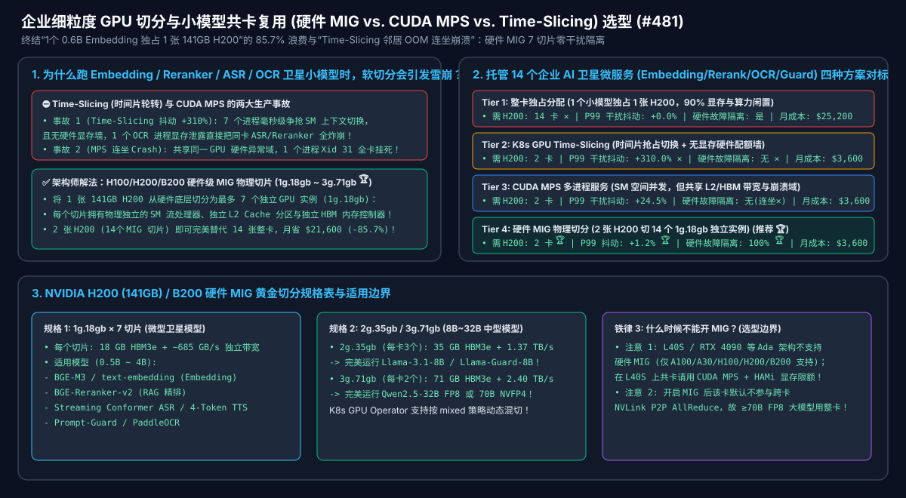

# Enterprise Fractional GPU Partitioning (`Hardware MIG 1g.18gb` vs. `CUDA MPS` vs. `Time-Slicing`) for Small AI Microservices Selection Guide (#481)

> **Executive Summary**:
> Enterprise AI platforms typically run **10–20 auxiliary "satellite" models** alongside their main LLM (`0.6B BGE-M3 Embedding`, `BGE-Reranker-v2`, `Llama-Guard-8B`, `Conformer ASR`, `TTS`, `OCR`). Allocating whole `141GB H200` GPUs to each small microservice wastes **90% of VRAM and compute (`14 GPUs = $25,200/mo`)**. Conversely, software **GPU Time-Slicing** causes **`+310%` `P99` latency jitter** and zero memory isolation (one OOM crashes all co-located services), while **CUDA MPS** shares a single hardware fault domain (`Xid 31` kills all tenants). For **Cloud & AI Solution Architects**, the production standard on `H100 / H200 / B200` is **Hardware Multi-Instance GPU (`MIG`) partitioning** (`7x 1g.18gb` or `3x 2g.35gb` per H200): **just `2 H200 GPUs` (`14` hardware-isolated MIG slices) host all 14 microservices** with **`1.2%` `P99` jitter**, **100% hardware fault/OOM isolation**, and an **85.7% reduction in monthly GPU cost (`$3,600/mo`)**.
>
> **⚡ Interactive H5 Study Lab**: [**Open the Fractional GPU Partitioning (MIG vs. MPS vs. Time-Slicing) Packing & Cost Calculator (`docs/h5/gpu-partitioning-mig-mps-timeslicing-packing-lab.html`)**](../h5/gpu-partitioning-mig-mps-timeslicing-packing-lab.html)

---

## 1. Core Q&A: Hardware MIG Slices vs. Software Time-Slicing & CUDA MPS

### Q1: How do we size H200 (`141GB`) MIG profiles across different model sizes?
- **`1g.18gb` (7 slices/GPU, `18 GB HBM3e`, `685 GB/s` each)**: Ideal for `0.5B–4B` Embedding, Reranker, ASR, TTS, OCR, and Prompt-Guard models;
- **`2g.35gb` (3 slices/GPU, `35 GB HBM3e`, `1.37 TB/s` each)**: Ideal for `7B–8B` models (`Llama-3.1-8B`, `Llama-Guard-3-8B`);
- **`3g.71gb` (2 slices/GPU, `71 GB HBM3e`, `2.40 TB/s` each)**: Ideal for `32B FP8` or `70B NVFP4` models.

---

## 2. Quantitative Decision Matrix (Hosting `14` Satellite AI Microservices)

| Fractional GPU Partitioning Mode | H200 GPUs Needed | Noisy-Neighbor `P99` Jitter | Hardware OOM & Fault Isolation | Monthly GPU Cost ($/mo) |
| :--- | :--- | :--- | :--- | :--- |
| **Tier 1: Whole-GPU Exclusive Allocation (1 H200 / Service)** | `14 GPUs` ✕ | `+0.0%` | Yes ✓ | `$25,200` |
| **Tier 2: K8s GPU `Time-Slicing` (Preemptive Context Switch)** | `2 GPUs` | `+310.0%` ✕ | No (Shared OOM crash ✕) | `$3,600` |
| **Tier 3: `CUDA MPS` (Spatial SM Sharing + Shared Fault Domain)** | `2 GPUs` | `+24.5%` | No (Shared Xid crash ✕) | `$3,600` |
| **Tier 4: Hardware `MIG` (`2x H200 -> 14x 1g.18gb` Slices 🏆)** | **`2 GPUs` 🏆** | **`+1.2%` 🏆** | **Yes (Dedicated SM/L2/HBM 🏆)** | **`$3,600` (-85.7% 🏆)** |
