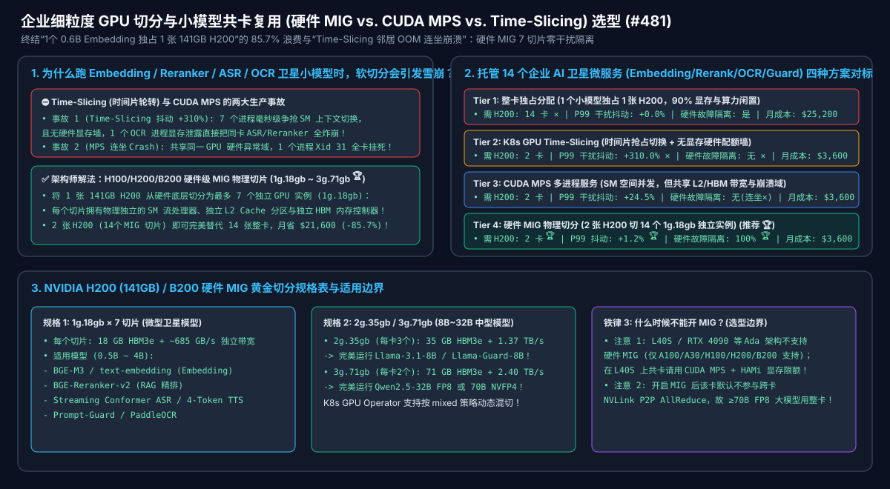
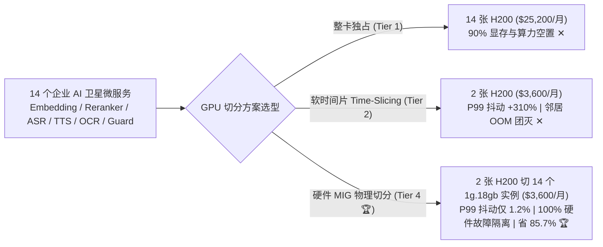

# 企业细粒度 GPU 切分与卫星小模型共卡复用（`Hardware MIG` vs. `CUDA MPS` vs. `Time-Slicing`）选型指南 (#481)

> **核心观点（Executive Summary）**：
> 在企业大模型生产平台中，除了 `70B / 671B` 主力生成模型外，往往还伴随着 **十几个不可或缺的“卫星 AI 微服务”（如 `0.6B BGE-M3 Embedding`、`BGE-Reranker-v2`、`Llama-Guard-8B 安全护栏`、`Whisper/Conformer ASR`、`CosyVoice TTS`、`PaddleOCR`）**。如果按 K8s 默认整卡分配（`nvidia.com/gpu: 1`），这 14 个仅需 `2–16 GB` 显存的小模型会白白霸占 **`14 张 141GB H200`（月账单 `$25,200`，90% 显存与算力空置）**！反之，如果开启软件层 **`Time-Slicing`（时间片轮转）**，不仅多进程上下文抢占会导致 `P99` 延迟暴涨 **`+310%`**，更会因为缺乏硬件显存墙导致“1 个 OCR 进程 OOM 爆显存，同卡 6 个其他服务连坐崩溃”！作为 **Cloud & AI Solution Architect**，生产级小模型共池必须采用 **`NVIDIA H100 / H200 / B200 硬件级多实例切分（Multi-Instance GPU, MIG）`**：从芯片底层将 SM 计算单元、L2 Cache、HBM 内存控制器与 Crossbar 总线物理切分为独立实例（如每张 H200 切 **`7 个 1g.18gb`** 或 **`3 个 2g.35gb`**），**仅用 `2 张 H200`（14 个硬件 MIG 切片）即可零干扰托管全部 14 个微服务**，邻居噪声抖动压至 **`1.2%`**，具备 **100% 硬件级 OOM 与故障隔离**，月度算力成本直降 **85.7%（从 `$2.52万` 降至 `$3,600`）**！
>
> **⚡ 配套交互式 H5 精读沙盘**：[**打开 GPU 细粒度切分 (硬件 MIG vs. MPS vs. Time-Slicing) 装箱与成本计算器 (`docs/h5/gpu-partitioning-mig-mps-timeslicing-packing-lab.html`)**](../h5/gpu-partitioning-mig-mps-timeslicing-packing-lab.html)

---

## 一、 灵魂拷问：为什么 `Time-Slicing` 与 `CUDA MPS` 不能替代硬件 `MIG`？

### Q1：Time-Slicing、CUDA MPS 与硬件 MIG 在芯片物理层到底有什么区别？
1. **K8s GPU Time-Slicing（时间片抢占复用）**：
   - 7 个容器共享同一套 SM 流处理器和同一个 HBM 地址空间，靠驱动时间片轮转（Context Switch）交替执行；
   - **两大死穴**：① 每次时间片切换都要冲刷寄存器与缓存，高并发下 `P99` 尾延迟劣化 **`+310%`**；② **零显存配额保护**，任一容器发生显存越界，同卡所有容器立即报 `CUDA OOM` 团灭。
2. **CUDA MPS（Multi-Process Service，空间并发复用）**：
   - 允许不同进程的 CUDA Kernel 同时在空闲的 SM 上并发执行（消除时间片切换开销），并支持设置 `CUDA_MPS_ACTIVE_THREAD_PERCENTAGE` 限制算力占比；
   - **致命短板**：所有进程仍然 **共享同一个 L2 Cache、同一条 HBM 内存带宽通道以及同一个 GPU 硬件异常域（Fault Domain）**！一旦某个容器触发非法内存访问（`Xid 31`）或 MPS Daemon 崩溃，整张卡上所有租户容器必须全部重启！
3. **Hardware MIG（Multi-Instance GPU，物理硬切片）**：
   - 将单张 H200（`141 GB HBM3e`）在硅片硬件层切分为最多 **7 个完全独立的硬件分区**：每个分区独占专用的 SM 核心、专用的 L2 缓存段、专用的 HBM3e 内存控制器通道（每 `1g.18gb` 切片独享 `~685 GB/s` 内存带宽）与独立的硬件页表/错误隔离域——**邻居哪怕把自己的切片跑崩，你的切片 `P99` 延迟波动也只有 `1.2%`**！

### Q2：单张 `NVIDIA H200 (141GB)` 怎么切 MIG 最划算？如果用的是不支持 MIG 的 `L40S` 怎么办？
- **H200 (141GB) 三大主力 MIG 规格选型表**：
  - **`1g.18gb`（每卡可切 7 个）**：每个切片 `18 GB HBM3e` + `685 GB/s` 带宽 $\rightarrow$ 专跑 `Embedding (BGE-M3)`、`Reranker`、`ASR`、`TTS`、`OCR`、`Prompt-Guard`；
  - **`2g.35gb`（每卡可切 3 个）**：每个切片 `35 GB HBM3e` + `1.37 TB/s` 带宽 $\rightarrow$ 专跑 `Llama-3.1-8B / Qwen2.5-7B / Llama-Guard-3-8B`；
  - **`3g.71gb`（每卡可切 2 个）**：每个切片 `71 GB HBM3e` + `2.40 TB/s` 带宽 $\rightarrow$ 专跑 `Qwen2.5-32B FP8` 或 `70B NVFP4`！
- **如果在 `L40S`（Ada 架构，不支持硬件 MIG）上跑小模型怎么办？**
  - 在 `L40S` 上必须采用 **`CUDA MPS + HAMi (原 k8s-vgpu-scheduler API 拦截层)`**：由 `CUDA MPS` 提供 SM 空间并发，由 `HAMi` 拦截 `cuMemAlloc` 强制实施软显存配额上限（防止单个容器吃光 48GB 显存）。

---

## 二、 托管 14 个 AI 卫星微服务四种 GPU 切分方案选型决策矩阵

| GPU 切分与共卡复用方案（托管 `14` 个卫星服务） | 所需 H200 整卡数 | 邻居高负载下 `P99` 抖动 (%) | 硬件级 OOM 与 Xid 故障隔离 | 月度 GPU 成本 ($/mo) |
| :--- | :--- | :--- | :--- | :--- |
| **Tier 1: 整卡独占分配（每个小模型独占 1 张 H200）** | `14 卡` ✕ | `+0.0%` | 支持 ✓ | `$25,200` |
| **Tier 2: K8s GPU `Time-Slicing`（时间片轮转 + 无显存墙）** | `2 卡` | `+310.0%` ✕ | 不支持（OOM 连坐团灭 ✕） | `$3,600` |
| **Tier 3: `CUDA MPS` 多进程服务（SM 空间并发 + 共享崩溃域）** | `2 卡` | `+24.5%` | 不支持（Xid 31 全卡挂死 ✕） | `$3,600` |
| **Tier 4: 硬件 `MIG` 物理切分（`2x H200 -> 14x 1g.18gb` 切片 🏆）** | **`2 卡` 🏆** | **`+1.2%` 🏆** | **支持（独立 SM/L2/HBM 控制器 🏆）** | **`$3,600` (-85.7% 🏆)** |

---

## 三、 生产落地核对清单（SA Production Checklist）

- [ ] **小于 `32B` 的辅助与边缘模型一律禁止独占整张 H100/H200**：通过 K8s `NVIDIA GPU Operator` 开启 `mig.strategy = mixed`，按需声明 `nvidia.com/mig-1g.18gb: 1` 或 `nvidia.com/mig-2g.35gb: 1`。
- [ ] **大参数主模型（`>= 70B FP8`）保持整卡非 MIG 模式**：因为开启 MIG 后默认不支持跨卡 NVLink P2P AllReduce，跑 `TP >= 2` 的主力大模型节点应关闭 MIG，仅将集群中专门划出的 1~2 台“卫星服务节点”开启 MIG。
- [ ] **在非 MIG 显卡（如 `L40S`）上强制搭配 `MPS + HAMi` 显存硬限额**：严禁在生产环境裸开无显存配额限制的 `Time-Slicing`。

---

## 四、 延伸阅读与配套工具

- **交互式 H5 精学沙盘**：[docs/h5/gpu-partitioning-mig-mps-timeslicing-packing-lab.html](../h5/gpu-partitioning-mig-mps-timeslicing-packing-lab.html)
- **7-Card 4:5 视觉评测卡片**：[docs/reports/enterprise-gpu-partitioning-mig-mps-timeslicing-small-model-packing-selection-cards.html](../reports/enterprise-gpu-partitioning-mig-mps-timeslicing-small-model-packing-selection-cards.html)
- **交互式 Sizer 测算器**：[docs/reports/enterprise-gpu-partitioning-mig-mps-timeslicing-small-model-packing-selection-sizer.html](../reports/enterprise-gpu-partitioning-mig-mps-timeslicing-small-model-packing-selection-sizer.html)
- **可复现实验模型**：[`experiments/enterprise_gpu_partitioning_mig_mps_timeslicing_small_model_packing_selection/run.py`](../../experiments/enterprise_gpu_partitioning_mig_mps_timeslicing_small_model_packing_selection/run.py)
