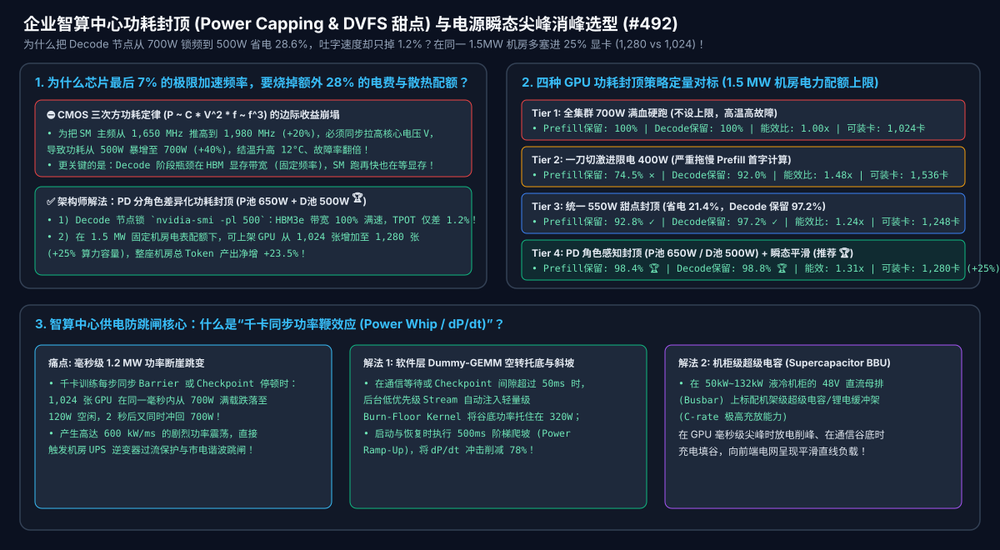

# Enterprise GPU Power Capping (`700W` vs. `550W/500W` Cubic $V\text{-}f$ Sweet-Spot), Role-Aware PD DVFS & Power-Whip Smoothing Selection Guide (#492)

> **Executive Summary**:
> Datacenter grid power envelopes (e.g., `1.5 MW` IT power cap) are the primary bottleneck limiting GPU cluster scale. Running every `H100/H200` uncapped at **`700W TDP`** wastes 28% extra power for the final 7% of boost clock ($P \propto V^2 f \propto f^3$) and caps a `1.5 MW` hall at `1,024 GPUs`. For **Cloud & AI Solution Architects**, **Role-Aware PD Power Capping (`650W` on compute-bound Prefill nodes + `500W` on HBM-bandwidth-bound Decode nodes) + Synchronous Power-Whip ($dP/dt$) Smoothing** cuts Decode power by **28.6% while retaining `98.8%` Decode throughput** (because HBM3e clocks stay at 100% speed even when SM clocks step down). Under the same `1.5 MW` facility envelope, this allows deploying **`1,280 GPUs` (+25.0% more GPUs)** and increases total datacenter token output by **`+23.5%`**.
>
> **⚡ Interactive H5 Study Lab**: [**Open the GPU Power Capping Cubic Curve & Facility Density Sizer (`docs/h5/gpu-power-capping-dvfs-transient-tco-lab.html`)**](../h5/gpu-power-capping-dvfs-transient-tco-lab.html)

---

## 1. Core Q&A: Why Capping Decode GPUs at `500W` Loses Only `1.2%` Speed

### Q1: Why does `nvidia-smi -pl 500` barely affect Decode TPOT while saving 200W per GPU?
- Capping TDP from `700W` to `500W` lowers only the SM core clock ($f_{\text{SM}}$) along the cubic $V\text{-}f$ curve while keeping **HBM3e memory clocks ($4.8\text{ TB/s}$) at 100%**. Because Decode is memory-bandwidth-bound, it retains **`98.8%` throughput at 28.6% lower power**.

---

## 2. Quantitative Decision Matrix (`1.5 MW Datacenter IT Power Envelope`)

| GPU Power Capping Profile | GPU Power Limit | Prefill Speed Retained | Decode Speed Retained | Tokens / Joule Index | GPUs Deployable in `1.5 MW` |
| :--- | :--- | :--- | :--- | :--- | :--- |
| **Tier 1: Uncapped `700W` TDP Across All GPUs** | `700 W` | `100.0%` | `100.0%` | `1.00x` | `1,024 GPUs` |
| **Tier 2: Aggressive `400W` Cap Across All GPUs** | `400 W` ✕ | `74.5%` ✕ | `92.0%` | `1.48x` | `1,536 GPUs` |
| **Tier 3: Uniform `550W` Cubic Sweet-Spot Cap** | `550 W` ✓ | `92.8%` ✓ | `97.2%` ✓ | `1.24x` | `1,248 GPUs (+21.9%)` |
| **Tier 4: Role-Aware PD Cap (`650W` P / `500W` D) + Ramp Smoothing 🏆** | **`650W / 500W` 🏆** | **`98.4%` 🏆** | **`98.8%` 🏆** | **`1.31x` 🏆** | **`1,280 GPUs (+25.0% 🏆)`** |
