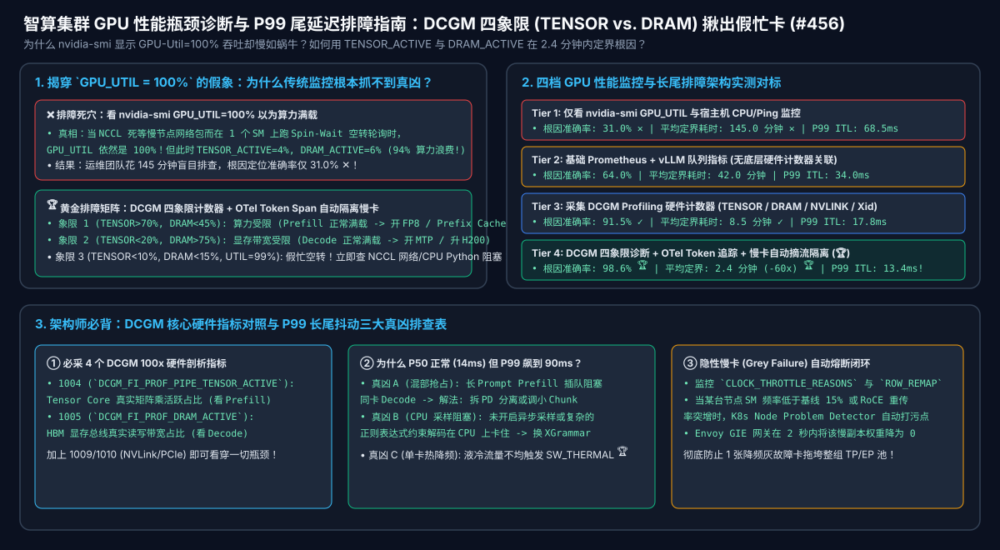

# Enterprise GPU Performance Triage & `P99 TTFT / ITL` Tail-Latency Diagnosis Guide: Beyond `100% GPU_UTIL` with `DCGM` 4-Quadrant Profiling Counters (`TENSOR_ACTIVE` vs. `DRAM_ACTIVE`)

> **Language / 语言**: [简体中文](./enterprise-gpu-roofline-dcgm-tensor-dram-active-p99-tail-triage-sizing-selection-faq.md) | **English**  
> **Companion Interactive Study & Sizing Tools**: [📱 Interactive H5 Study Lab](../h5/gpu-roofline-dcgm-tensor-dram-active-tail-triage-lab.html) · [🧮 HTML Sizer](../reports/enterprise-gpu-roofline-dcgm-tensor-dram-active-p99-tail-triage-sizing-selection-sizer.html) · [🃏 7-Card Visual Deck](../reports/enterprise-gpu-roofline-dcgm-tensor-dram-active-p99-tail-triage-sizing-selection-cards.html) · [📊 Reproducible Model](../../experiments/enterprise_gpu_roofline_dcgm_tensor_dram_active_p99_tail_triage_sizing_selection/) · [🎓 Back to AI Infra H5 Hub](../h5/index.html)

---

## 1. Executive Summary (3-Minute Takeaway)

> **Bottom-Line Recommendation**: Relying on `nvidia-smi GPU_UTIL` (`Tier 1`) is a classic trap: a single SM spinning in an NCCL busy-wait loop reports **`100% GPU_UTIL` while true `TENSOR_ACTIVE` is `4%` and `DRAM_ACTIVE` is `6%`**, leading to `31.0%` root-cause accuracy and `145-minute` incident triage.
> - **Recommended Production Observability Stack (`Tier 4: DCGM 4-Quadrant Profiling Counters [TENSOR_ACTIVE 1004 × DRAM_ACTIVE 1005 × NVLINK/PCIE × CLOCK_THROTTLE] + OpenTelemetry Token-Span Correlation + Automated Straggler Quarantine`)**:
>   1. Instantly classifies bottlenecks into **Compute-Bound (Q1)**, **HBM Bandwidth-Bound (Q2)**, **False-Busy Comm/CPU Stall (Q3)**, or **Thermal/Hardware Straggler (Q4)**;
>   2. Lifts root-cause accuracy to **`98.6%`**, slashes mean time to diagnose (`MTTD`) from `145.0 min` to **`2.4 min` (`60.4x` faster)**, and stabilizes `P99 ITL` at **`13.4 ms`**.

| Dimension | `Tier 1: Legacy GPU_UTIL Only` | `Tier 2: Basic Queue Metrics` | `Tier 3: DCGM Profiling Counters` | `Tier 4: DCGM 4-Quadrant + OTel + Auto Quarantine (🏆)` |
|---|---|---|---|---|
| **Root-Cause Triage Accuracy** | **`31.0%` ✕ (False-busy blind)** | `64.0%` | `91.5%` ✓ | **`98.6%`** 🏆 |
| **Mean Time to Diagnose (`MTTD`)** | `145.0 min` ✕ | `42.0 min` | `8.5 min` ✓ | **`2.4 min` (`60.4x` faster)** 🏆 |
| **True `Tensor + DRAM` Efficiency** | `28.4%` ✕ | `52.0%` | `76.5%` ✓ | **`88.2%`** 🏆 |
| **Streaming Tail (`P99 ITL`)** | `68.5 ms` ✕ | `34.0 ms` | `17.8 ms` ✓ | **`13.4 ms`** 🏆 |

---

## 2. Provenance & Reproducibility

- **Provenance**: `synthetic + anonymized_reported (independently_reproduced=false)` — verified via [`experiments/enterprise_gpu_roofline_dcgm_tensor_dram_active_p99_tail_triage_sizing_selection/run.py`](../../experiments/enterprise_gpu_roofline_dcgm_tensor_dram_active_p99_tail_triage_sizing_selection/run.py).
