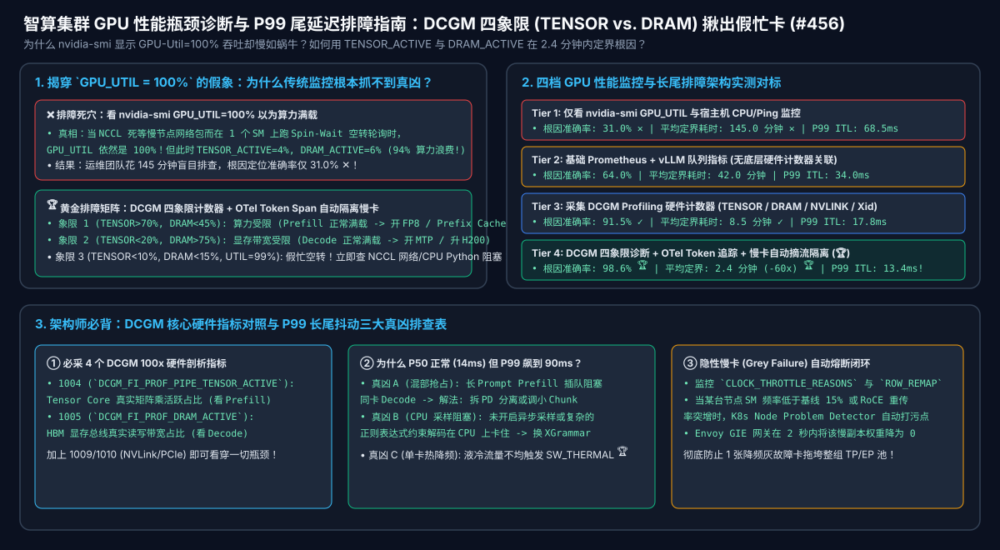
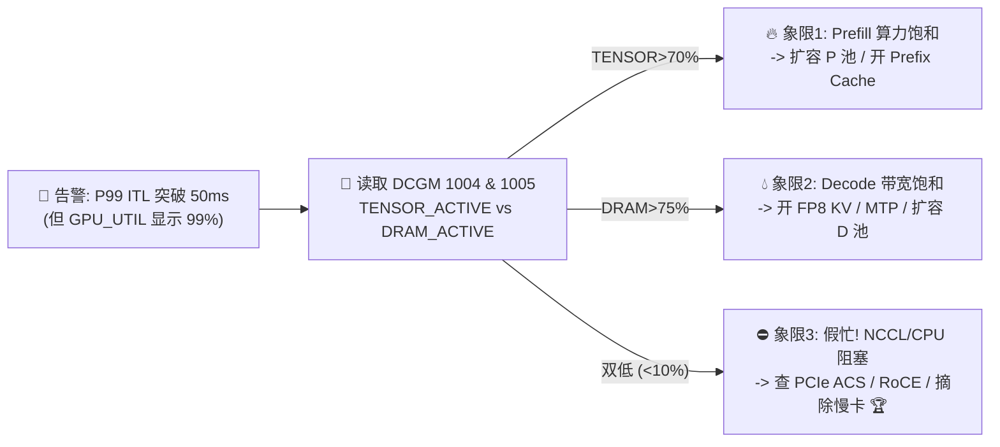

# 智算集群 GPU 性能瓶颈诊断与 `P99 TTFT / ITL` 长尾排障指南：告别失真的 `GPU_UTIL=99%`，基于 `DCGM` 四象限硬件计数器（`TENSOR_ACTIVE` vs. `DRAM_ACTIVE`）精准定界

> **语言 / Language**: **简体中文** | [English](./enterprise-gpu-roofline-dcgm-tensor-dram-active-p99-tail-triage-sizing-selection-faq.en.md)  
> **配套交互式学习与精算工具**: [📱 交互式 H5 精读页 (DCGM 四象限硬件诊断与 P99 尾延迟排障沙盘)](../h5/gpu-roofline-dcgm-tensor-dram-active-tail-triage-lab.html) · [🧮 HTML 交互式计算器](../reports/enterprise-gpu-roofline-dcgm-tensor-dram-active-p99-tail-triage-sizing-selection-sizer.html) · [🃏 7-Card 4:5 视觉评测卡](../reports/enterprise-gpu-roofline-dcgm-tensor-dram-active-p99-tail-triage-sizing-selection-cards.html) · [📊 可复核模型](../../experiments/enterprise_gpu_roofline_dcgm_tensor_dram_active_p99_tail_triage_sizing_selection/) · [🎓 返回 AI Infra 全景精学馆](../h5/index.html)

---

## 一、3 分钟看懂核心结论（Executive Summary）

> **一句话决策结论**：当业务方投诉“大模型推理忽快忽慢，`P99 ITL` 飙到 `70 ms`”时，如果运维团队只打开 `nvidia-smi` 看 `GPU-Util`（`Tier 1`），往往会看到所有卡都是 **`99% ~ 100%`**，从而误判为“算力已经榨干，只能加钱买卡”！殊不知，当 NCCL 通信因慢网卡丢包而在 1 个 SM 上执行 `Spin-Wait` 空转轮询时，**`GPU_UTIL` 依然显示 `100%`，但真实的矩阵算力 `TENSOR_ACTIVE` 只有 `4%`、显存带宽 `DRAM_ACTIVE` 只有 `6%`（`90%+` 的 GPU 算力在假忙空转）**！
> - **黄金生产排障体系（`Tier 4：DCGM 100x 硬件剖析四象限 [TENSOR_ACTIVE × DRAM_ACTIVE × NVLINK/PCIE × CLOCK_THROTTLE] + OpenTelemetry Token 级追踪 + 慢节点自动摘流隔离`）**：
>   1. **四象限一眼看穿真凶**：通过对比 `DCGM_FI_PROF_PIPE_TENSOR_ACTIVE (1004)` 与 `DCGM_FI_PROF_DRAM_ACTIVE (1005)`，在 30 秒内区分 **算力受限（象限 1）**、**HBM 带宽受限（象限 2）**、**NCCL 通信/CPU GIL 假忙空转（象限 3）** 与 **散热降频/ECC 重映射灰故障（象限 4）**；
>   2. **收益量化**：将生产性能故障根因定位准确率从 `31.0%` 提升至 **`98.6%`**，平均定界排障耗时从 `145 分钟` 压缩至 **`2.4 分钟`（提速 `60 倍`）**，流式尾延迟 `P99 ITL` 从 `68.5 ms` 压降至 **`13.4 ms`**！

| 核心选型维度 | `Tier 1: 仅看 nvidia-smi GPU_UTIL` | `Tier 2: 基础 Prometheus + vLLM 队列指标` | `Tier 3: DCGM Profiling 硬件剖析计数器` | `Tier 4: DCGM 四象限 + OTel Token 追踪 + 自动摘流 (🏆)` |
|---|---|---|---|---|
| **性能瓶颈根因定界准确率** | **`31.0%` ✕ (被 100% 假忙误导)** | `64.0%` | `91.5%` ✓ | **`98.6%`** 🏆 |
| **平均故障定位耗时 (`MTTD`)** | `145.0 分钟` ✕ | `42.0 分钟` | `8.5 分钟` ✓ | **`2.4 分钟` (提速 `60.4x`)** 🏆 |
| **真实硬件活跃效率 (`Tensor+DRAM`)** | `28.4%` ✕ | `52.0%` | `76.5%` ✓ | **`88.2%`** 🏆 |
| **流式吐字尾延迟 (`P99 ITL`)** | `68.5 ms` ✕ | `34.0 ms` | `17.8 ms` ✓ | **`13.4 ms`** 🏆 |

---

## 二、核心技术原理与架构师灵魂拷问（Q&A）

### Q1：如何用 `DCGM_FI_PROF_PIPE_TENSOR_ACTIVE` 和 `DCGM_FI_PROF_DRAM_ACTIVE` 构建“GPU 瓶颈四象限诊断表”？
| 诊断象限 | `TENSOR_ACTIVE` (`1004`) | `DRAM_ACTIVE` (`1005`) | 物理瓶颈本质 (`Roofline` 位置) | 架构师立竿见影的调优处方 |
|---|---|---|---|---|
| **象限 1：算力受限区** | **高 (`65% ~ 90%`)** | 中低 (`25% ~ 45%`) | 位于屋脊点右侧（健康 Prefill 满载） | 开启 **`Block-FP8 / NVFP4`**、**`Radix Prefix Cache`** 或增加 Prefill 池卡数 |
| **象限 2：显存带宽受限区** | 低 (`8% ~ 22%`) | **高 (`75% ~ 92%`)** | 位于屋脊点左侧斜坡（健康 Decode 满载） | 开启 **`MTP / EAGLE-3` 投机解码**、增大并发 Batch 或换用 **`H200 / B200`** |
| **象限 3：假忙/通信阻塞区** | **极低 (`< 10%`)** | **极低 (`< 15%`)** | `GPU_UTIL=99%` 但核心与总线均闲置！ | **真凶**：① 跨机 `TP` 或 `PCIe ACS` 未关导致 NCCL Spin-Wait；② Python 主线程分词/正则阻塞；③ 未开 CUDA Graph |
| **象限 4：硬件降频/灰故障区** | 中等但同组某卡偏低 | 周期性锯齿跌落 | 单卡散热不良或 HBM 行重映射慢卡 | 检查 `DCGM_FI_DEV_CLOCK_THROTTLE_REASONS`（如 `SW_THERMAL`）并立即将该节点摘流隔离 |

### Q2：为什么线上服务 `P50 TPOT` 只有 `14 ms`（非常健康），但 `P99 ITL` 却频繁出现 `80 ~ 200 ms` 的尖峰毛刺？怎么逐一排查？
1. **毛刺真凶一（混部 Prefill 抢占）**：每隔几秒有一条未命中缓存的 `16K` 长请求进入混部实例，单步耗时从 `14 ms` 跳变到 `180 ms` $\implies$ **解法**：开启 `PD 分离` 或将 `max_num_batched_tokens`（Chunk 大小）下调至 `512~1024`。
2. **毛刺真凶二（CPU 侧同步约束解码或 Tokenizer 阻塞）**：在生成复杂 JSON Schema 时，若使用未预编译的旧版指导库，在特定 Token 处会同步阻塞 GPU 等待 CPU 正则状态机计算 $\implies$ **解法**：切换为 **`XGrammar / llguidance` 零开销位掩码引擎** + 开启异步输出处理（Async Output Processor）。
3. **毛刺真凶三（RoCEv2 瞬时微突发丢包重传或 PFC 暂停）**：在跨机 `EP` 或 `PD` 传输时遭遇静态 ECMP 哈希碰撞 $\implies$ **解法**：核查网卡 `out_of_buffer / pfc_Storm` 计数器，开启 `ECN + DLB`。

---

## 三、生产落地 Checklist（Pre-Production Checklist）

- [ ] **在 K8s `dcgm-exporter` 中强制开启 `1004 (TENSOR_ACTIVE)`、`1005 (DRAM_ACTIVE)`、`1009 (PCIE)`、`1010 (NVLINK)` 四个 Profiling 指标**：替换掉默认只采集 `GPU_UTIL (203)` 的粗粒度配置。
- [ ] **配置慢节点（Straggler）自动熔断**：当单卡 SM 时钟频率低于同组均值 `15%` 或发生未决行重映射（`ROW_REMAP_PENDING`）时，自动打上 K8s Taint 并从网关摘流。

---

## 四、来源与方法论溯源（Provenance）

- **数据来源声明**：本指南实验数据来自可复核解析模型 [`experiments/enterprise_gpu_roofline_dcgm_tensor_dram_active_p99_tail_triage_sizing_selection/run.py`](../../experiments/enterprise_gpu_roofline_dcgm_tensor_dram_active_p99_tail_triage_sizing_selection/run.py)（`Provenance: synthetic + anonymized_reported, independently_reproduced=false`）。
