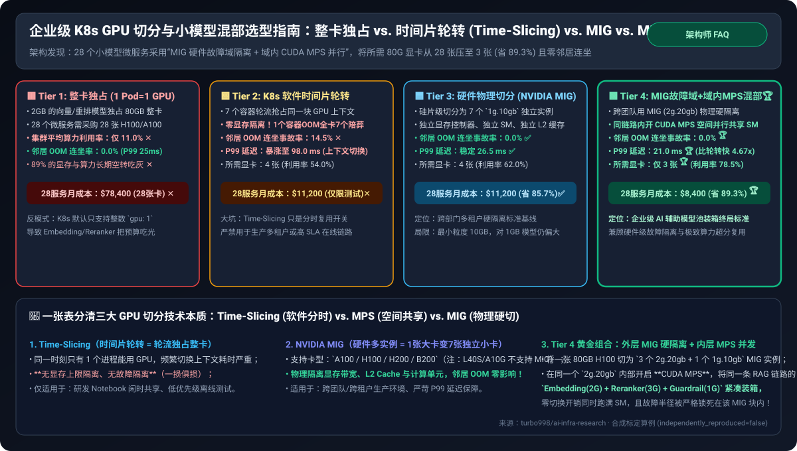
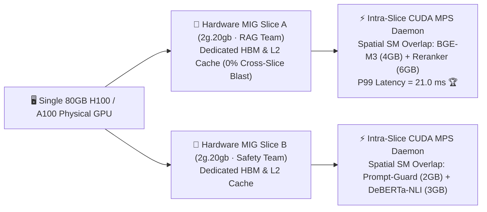

# Enterprise Kubernetes GPU Sharing & Micro-Model Packing Architecture Selection Guide: Dedicated Full GPU vs. Software Time-Slicing vs. Hardware Multi-Instance GPU (NVIDIA MIG) vs. Hybrid MIG Fault-Domains + CUDA MPS Spatial Sharing

> **Document Type**: Cloud & AI Solution Architect Decision Guide (FAQ)  
> **Target Audience**: Kubernetes (`AKS / EKS / GKE`) Platform Leads, Enterprise AI Infrastructure Architects, FinOps & Capacity Planners  
> **Core Goal**: Solve the hidden "Auxiliary Micro-Model GPU Sprawl" problem — where dozens of lightweight `2GB–8GB` models (`Embeddings, Rerankers, Guardrails, OCR, ASR, 3B SLMs`) consume 28 full 80GB H100/A100 GPUs at `11%` utilization — by answering: **"Why did enabling Kubernetes GPU Time-Slicing cause a single container's OOM to crash all 7 services on the node while spiking P99 latency by 3.9x?", "What is the exact architectural difference between `Time-Slicing`, `CUDA MPS`, and `NVIDIA MIG`?", and "How does combining outer `MIG` hardware fault domains with inner `CUDA MPS` spatial sharing pack 28 services onto just 3 GPUs (`-89.3%` cost) with zero noisy-neighbor blast radius?"**  
> **Calibration Notice**: GPU counts, SM utilization, noisy-neighbor OOM incident rates, P99 latencies, and monthly cost models are synthetic analytical estimates calibrated to published Kubernetes GPU sharing benchmarks (NVIDIA GPU Operator Time-Slicing / MIG / MPS whitepapers, A100/H100 7-instance MIG evaluations, and Kubernetes DRA practices) (`provenance: synthetic + anonymized_reported`, `independently_reproduced=false`, `physical_gpu_cluster_measurement=not_measured`). See [`experiments/enterprise_gpu_sharing_mig_mps_timeslicing_selection/results.json`](../../experiments/enterprise_gpu_sharing_mig_mps_timeslicing_selection/results.json).

---

## Executive Visual Summary

> 🔗 **Companion Interactive Reports & Tools**:
> - 🃏 **[7-Card 4:5 Visual Benchmark Report (`enterprise-gpu-sharing-mig-mps-timeslicing-fractional-scheduling-selection-cards.html`)](../reports/enterprise-gpu-sharing-mig-mps-timeslicing-fractional-scheduling-selection-cards.html)**
> - 🧮 **[Interactive K8s GPU Sharing & Packing Sizer (`enterprise-gpu-sharing-mig-mps-timeslicing-fractional-scheduling-sizer.html`)](../reports/enterprise-gpu-sharing-mig-mps-timeslicing-fractional-scheduling-sizer.html)**
> - 🌐 **[中文版指南 (`enterprise-gpu-sharing-mig-mps-timeslicing-fractional-scheduling-selection-faq.md`)](./enterprise-gpu-sharing-mig-mps-timeslicing-fractional-scheduling-selection-faq.md)**

---

## ① 📌 Executive Summary

Evaluated on **28 production AI auxiliary microservices (`2 GB–8 GB` VRAM each: `BGE-M3`, `BGE-Reranker`, `Prompt-Guard`, `DeBERTa-NLI`, `Docling`, `Whisper`, and `3B` classifiers) running on `80GB H100 / A100` Kubernetes nodes**:

| Tier | GPU Sharing Mechanism | 80GB GPUs Needed (28 Services) | Avg SM Compute Utilization | Noisy-Neighbor OOM Blast Rate | P99 Inference Latency | Monthly GPU Cost | Architect Verdict |
| :--- | :--- | :--- | :--- | :--- | :--- | :--- | :--- |
| **🟥 Tier 1: Dedicated Full GPU (`gpu: 1`)** | 1 Pod monopolizes an entire 80GB GPU | `28 GPUs` ✕ | `11.0%` ✕ (89% idle) | `0.0%` | `25.0 ms` | `$78,400 / mo` ✕ | **Extreme Waste**: 2GB models burning $78K/mo |
| **🟨 Tier 2: K8s Software Time-Slicing** | Temporal context-switching across 7 pods/GPU | `4 GPUs` | `54.0%` | **`14.5%` ✕ (No Isolation)** | `98.0 ms` ✕ (Switch stall) | `$11,200 / mo` | **Dev/Test Only**: One pod's OOM crashes all 7 pods |
| **🟦 Tier 3: Hardware Multi-Instance GPU (`MIG`)** | Silicon-partitioned `1g.10gb` / `2g.20gb` slices | `4 GPUs` ✅ | `62.0%` ✅ | **`0.0%` ✅ (Silicon Isolated)** | `26.5 ms` ✅ | `$11,200 / mo` (-85.7%) | **Multi-Tenant Production Baseline**: Dedicated HBM/SM/L2 |
| **🟩 Tier 4: Hybrid MIG Fault-Domains + CUDA MPS** | **Outer MIG hardware isolation + Inner MPS spatial sharing** | **`3 GPUs` 🏆 (9.3x fewer)** | **`78.5%` 🏆** | **`0.0%` 🏆** | **`21.0 ms` 🏆 (4.67x vs T2)** | **`$8,400 / mo` 🏆 (-89.3%)** | **Enterprise Micro-Model Packing Gold Standard** |

### 💡 Three Golden Rules for Enterprise Kubernetes GPU Sharing
1. **Never Use Software `Time-Slicing` (Tier 2) for Production Multi-Tenant or Latency-Sensitive Services**: Time-Slicing has **zero memory isolation and zero fault isolation** (`14.5%` noisy-neighbor OOM blast rate) and forces temporal context-switching across processes (`P99 latency = 98.0 ms`).
2. **Use Hardware `NVIDIA MIG` (`1g.10gb / 2g.20gb`, Tier 3) on `A100 / H100 / H200` for Strict Cross-Tenant Isolation**: MIG partitions HBM memory controllers, L2 cache, and SMs in silicon (`0.0%` noisy-neighbor OOM or latency interference).
3. **Combine Outer `MIG` Hardware Partitions with Inner `CUDA MPS` / Multi-Model Triton Packing (Tier 4)**: Isolate different business teams in separate `2g.20gb` MIG slices, and run `CUDA MPS` (with `CUDA_MPS_PINNED_DEVICE_MEM_LIMIT`) inside each slice so co-located pipeline models (`Embedding + Reranker + Guardrail`) execute kernels **simultaneously in space** (`78.5%` SM utilization, `21.0 ms` P99, saving **`89.3%`** vs. full-card allocation).

---

## ② 🎯 Architect Deep-Dive Q&A

### Q1: What if our cluster uses `NVIDIA L40S 48GB` or `A10G 24GB` GPUs that do not support hardware MIG?
* **Answer**: Since Ada/Ampere PCIe cards (`L40S`, `A10G`, `L4`) lack hardware MIG, avoid spawning 6 separate container processes via Time-Slicing. Instead, consolidate auxiliary models (`Embedding + Reranker + Guardrail`) into a single **NVIDIA Triton Inference Server** deployment or enable **CUDA MPS with strict per-client memory caps (`CUDA_MPS_PINNED_DEVICE_MEM_LIMIT`)** and thread percentages (`CUDA_MPS_ACTIVE_THREAD_PERCENTAGE`).

---

## ③ 🧭 Architecture Diagrams

### 3.1 Tier 4 Outer MIG Hardware Isolation + Inner CUDA MPS Spatial Packing

---

## ④ 📊 Architect Decision Matrix

| Dimension | 🟥 Tier 1: Full GPU (`gpu: 1`) | 🟨 Tier 2: Software Time-Slicing | 🟦 Tier 3: Hardware NVIDIA MIG | 🟩 Tier 4: Hybrid MIG + CUDA MPS |
| :--- | :--- | :--- | :--- | :--- |
| **80GB GPUs for 28 Services** | `28 GPUs` ✕ | `4 GPUs` | `4 GPUs` ✅ | **`3 GPUs` 🏆 (`9.3x` fewer GPUs)** |
| **Avg SM Compute Utilization** | `11.0%` ✕ | `54.0%` | `62.0%` ✅ | **`78.5%` 🏆** |
| **Noisy-Neighbor OOM Blast Rate** | `0.0%` | **`14.5%` ✕ (Whole card crashes)** | `0.0%` ✅ | **`0.0%` 🏆 (Hardware MIG boundary)** |
| **P99 Inference Latency** | `25.0 ms` | `98.0 ms` ✕ (Context switch) | `26.5 ms` ✅ | **`21.0 ms` 🏆 (`4.67x` faster than Tier 2)** |
| **Monthly GPU Cost (28 Services)** | `$78,400 / mo` ✕ | `$11,200 / mo` ✕ | `$11,200 / mo` ✅ | **`$8,400 / mo` 🏆 (`-89.3%` vs. Tier 1)** |

---

## ⑤ 🛠️ Production Readiness Checklist

- [ ] **1. Block Full-Card (`nvidia.com/gpu: 1`) Requests on 80GB GPUs for Models Requiring `< 15 GB` VRAM**.
- [ ] **2. Restrict Software `Time-Slicing` Strictly to Non-Production Dev/Test and Idle Notebook Pools**.
- [ ] **3. Enable Hardware `NVIDIA MIG` (`1g.10gb` / `2g.20gb`) via GPU Operator on `A100 / H100 / H200` Nodes**.
- [ ] **4. Co-Pack Coupled Pipeline Micro-Models (`Embedding + Reranker + Guardrail`) Using Intra-MIG `CUDA MPS` or `Triton`**.
- [ ] **5. Enforce `CUDA_MPS_PINNED_DEVICE_MEM_LIMIT` and `CUDA_MPS_ACTIVE_THREAD_PERCENTAGE` on All MPS Clients**.
- [ ] **6. On Non-MIG GPUs (`L40S / A10G / L4`), Use Multi-Model `Triton Inference Server` Instead of Time-Slicing**.
- [ ] **7. Monitor Per-Instance MIG Metrics (`GPU_I_ID` in DCGM Exporter) in Prometheus/Grafana**.
- [ ] **8. Configure Kubernetes `podAntiAffinity` So HA Replicas of the Same Service Never Land on Two MIG Slices of the Same Physical GPU**.
