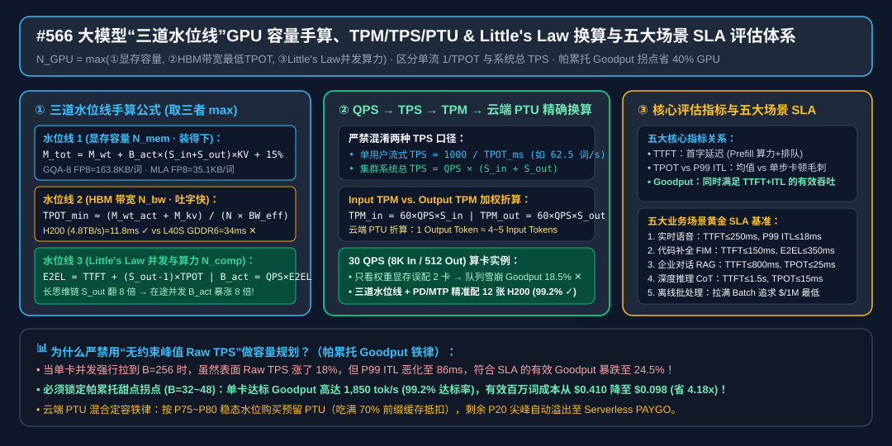

# Enterprise GPU Capacity Sizer (Three-Watermark Hand-Calculation Formula), `TPM / TPS / PTU` & `Little's Law` Exact Conversion, and User Evaluation Metrics (`TTFT / TPOT / ITL / E2EL / Goodput`) Selection Guide (`#566`)

> **Language / 语言**: [简体中文](./enterprise-gpu-sizer-three-watermarks-tpm-tps-littles-law-sla-sizing-faq.md) | **English** · [📱 Interactive H5 Study Lab (3-Watermark + Little's Law Sizer)](../h5/enterprise-gpu-sizer-three-watermarks-tpm-tps-littles-law-sla-lab.html) · [🧮 Interactive HTML Sizer](../reports/enterprise-gpu-sizer-three-watermarks-tpm-tps-littles-law-sla-sizing-sizer.html) · [🃏 7-Card Visual Report](../reports/enterprise-gpu-sizer-three-watermarks-tpm-tps-littles-law-sla-sizing-cards.html) · [Back to Catalog](../full-catalog-en.md)

---

## 1. 3-Minute Executive Summary

1. **Bottom-Line Conclusion**:
   - Sizing a production LLM cluster solely by model weight memory (`70B FP8 = 70 GB -> 2x H200`) causes immediate queue collapse (`94.0 ms` P99 TPOT, **`18.5%` SLA Goodput**), while sizing by unconstrained max-batch `Raw TPS` in colocated mode requires **`20x H200 GPUs`** and still suffers `26.8 ms` P99 ITL tail spikes (`82.4%` Goodput).
   - Solution Architects must size by the **maximum of Three Watermarks**:
     $$N_{\text{GPU}} = \max\left(N_{\text{mem}}, \ N_{\text{bw}}, \ N_{\text{compute}}\right)$$
   - For `30 Peak QPS` (`8K Input + 512 Output`, `Llama-3.3-70B FP8`, `P95 TTFT <= 800 ms`, `P99 TPOT/ITL <= 18 ms`), combining **Three-Watermark Sizing + Little's Law Concurrency + PD Disaggregation (`4P + 8D`) + 70% Prefix Caching + Native MTP/EAGLE-3** sizes the fleet at exactly **`12x H200 GPUs`** (`-40.0%` vs. colocated `20 GPUs`), achieving **`99.2%` SLA Goodput** (`13.2 ms` P99 TPOT) and cutting effective cost per 1M goodput tokens `4.18x` to **`$0.098 / 1M`**!

---

## 2. Deep-Dive Q&A: Three-Watermark Math, Little's Law & `TPM / TPS / PTU` Conversion

### Q1: What are the exact formulas for the Three Watermarks and Little's Law concurrency?
- **Answer**:
  1. **Little's Law In-Flight Active Concurrency ($B_{\text{active}}$)**:
     $$\text{E2EL} = \text{TTFT} + (S_{\text{out}} - 1) \times \text{TPOT}, \quad B_{\text{active}} = \text{QPS} \times \text{E2EL}$$
     At `30 QPS`, $S_{\text{out}}=512$, $\text{E2EL} = 8.06\text{ s} \implies B_{\text{active}} = \mathbf{242\text{ concurrent sessions}}$.
  2. **Watermark ① — HBM Memory Capacity ($N_{\text{mem}}$)**:
     $$M_{\text{total}} = R \times M_{\text{weights}} + B_{\text{active}} \times \bar{S}_{\text{seq}} \times \text{Bytes}_{\text{KV/tok}} \times (1 - r_{\text{share}}), \quad N_{\text{mem}} = \left\lceil \frac{M_{\text{total}}}{0.85 \times M_{\text{GPU\_HBM}}} \right\rceil$$
  3. **Watermark ② — HBM Bandwidth Minimum `TPOT` ($N_{\text{bw}}$)**:
     $$\text{TPOT}_{\min} \approx \frac{M_{\text{weights\_active}} + M_{\text{KV\_replica}}}{N_{\text{TP}} \times \eta_{\text{bw}} \times BW_{\text{HBM}}} + T_{\text{comm}} \le \text{SLA}_{\text{TPOT}}$$
  4. **Watermark ③ — Compute & Pareto Decode Slot Capacity ($N_{\text{compute}}$)**:
     $$N_P = \left\lceil \frac{\text{QPS} \times S_{\text{in}} \times (1 - r_{\text{cache}})}{\text{TPS}_{\text{prefill/GPU}}} \right\rceil = 4, \quad N_D = \left\lceil \frac{B_{\text{active}}}{B_{\text{sweetspot/GPU}}} \right\rceil = 8 \implies N_{\text{GPU}} = \mathbf{12\text{x H200}}$$

---

### Q2: How do `QPS`, `User TPS`, `System TPS`, `Input/Output TPM`, and Cloud `PTU` convert?
- **Answer**:
  - **Single-User Stream TPS**: $1000 / \text{TPOT}_{\text{ms}}$ (`16 ms -> 62.5 tok/s/user`).
  - **Cluster Aggregate TPS**: $\text{TPS}_{\text{in}} = \text{QPS} \times S_{\text{in}}$, $\text{TPS}_{\text{out}} = \text{QPS} \times S_{\text{out}}$.
  - **Cluster TPM**: $\text{TPM}_{\text{in}} = 60 \times \text{TPS}_{\text{in}} = 14.75\text{M TPM}$; $\text{TPM}_{\text{out}} = 60 \times \text{TPS}_{\text{out}} = 0.92\text{M TPM}$.
  - **Weighted Cloud PTU Equivalent**: $\text{TPM}_{\text{equiv}} = \text{TPM}_{\text{in\_uncached}} + 0.15 \times \text{TPM}_{\text{in\_cached}} + 4.5 \times \text{TPM}_{\text{out}} \approx 10.11\text{M TPM}$ (`~107 PTUs` at P80 base load).

---

## 3. Quantitative Sizing Method Comparison Matrix (`30 QPS · 8K In / 512 Out · 70B FP8`)

| Metric | Scheme A: Weight-Only Sizing (`2x H200`) | Scheme B: Unconstrained Raw-TPS Colocated (`20x H200`) | Scheme C: 3-Watermark + Pareto Goodput + PD/MTP (`12x H200`) 🏆 |
| :--- | :--- | :--- | :--- |
| **`P95 TTFT`** | `4,850 ms` (Queue Collapse ✕) | `740 ms` | **`390 ms`** |
| **`P99 TPOT / ITL`** | `94.0 ms` (Severe Breach ✕) | `26.8 ms` (Misses `18ms` SLA ✕) | **`13.2 ms` (Compliant ✓)** |
| **SLA-Compliant `Goodput %`** | `18.5%` | `82.4%` | **`99.2%` (`+80.7 pts`)** |
| **Provisioned H200 GPUs** | `2 GPUs` (Under-sized ✕) | `20x H200 GPUs` | **`12x H200 GPUs` (`4P + 8D`, `-40.0%` vs. Colocated)** |
| **Effective Cost (`$/1M Goodput Tokens`)** | `$0.410 / 1M` | `$0.215 / 1M` | **`$0.098 / 1M` (`4.18x` lower cost)** |

---

## 4. Pre-Production Capacity & SLA Verification Checklist

- [ ] **Evaluate all three watermarks ($N_{\text{mem}}, N_{\text{bw}}, N_{\text{compute}}$)** and take the maximum.
- [ ] **Apply Little's Law ($B_{\text{active}} = \text{QPS} \times \text{E2EL}$)** before onboarding long-CoT reasoning models.
- [ ] **Gate load tests on dual-SLA `Goodput` (`P95 TTFT` + `P99 ITL`)**, never unconstrained `Raw TPS`.
