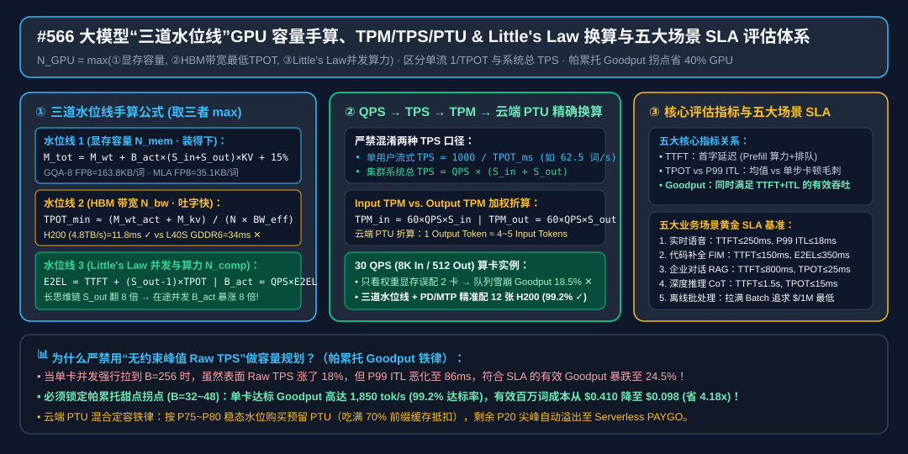
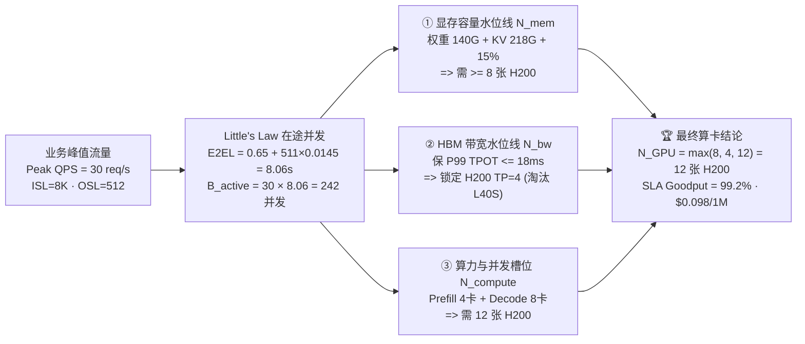

# 企业大模型 GPU 容量估算（三道水位线手算公式）、`TPM / TPS / PTU` 与 `Little's Law` 精确换算及用户核心评估指标体系（`TTFT / TPOT / ITL / E2EL / Goodput`）选型指南（`#566`）

> **Language / 语言**: **简体中文** | [English](./enterprise-gpu-sizer-three-watermarks-tpm-tps-littles-law-sla-sizing-faq.en.md) · [📱 交互式 H5 精读页（含三道水位线 + Little's Law 算卡器）](../h5/enterprise-gpu-sizer-three-watermarks-tpm-tps-littles-law-sla-lab.html) · [🧮 交互式算卡器 Sizer](../reports/enterprise-gpu-sizer-three-watermarks-tpm-tps-littles-law-sla-sizing-sizer.html) · [🃏 7-Card 评测报告](../reports/enterprise-gpu-sizer-three-watermarks-tpm-tps-littles-law-sla-sizing-cards.html) · [返回总目录](../full-catalog-zh.md)

---

## 一、3 分钟核心结论卡片（Executive Summary）

1. **一句话结论**：
   - 企业规划大模型集群时最常见的两大灾难是：**①“只算模型权重显存”**（以为 `70B FP8 = 70 GB` 用 `2 张 H200` 就能扛 `30 QPS`，上线后因在途并发 KV Cache 撑爆显存与带宽，导致 `P99 TPOT` 飙至 `94.0 ms`、SLA 达标有效吞吐 `Goodput` 暴跌至 **`18.5%`**）；或 **②“拿厂商打满 Batch=256 的无约束峰值 Raw TPS 除以业务总 TPS”**（忽略高 Batch 下 `P99 ITL` 超时，导致 `75%` 以上的请求违约）；
   - 正确的架构师定容必须同时核算 **“三道水位线”取最大值**：
     $$N_{\text{GPU}} = \max\left(\underbrace{N_{\text{mem}}}_{\text{① 显存装得下}}, \ \underbrace{N_{\text{bw}}}_{\text{② HBM带宽保TPOT}}, \ \underbrace{N_{\text{compute}}}_{\text{③ Little's Law并发与Prefill算力}}\right)$$
   - 在 `30 Peak QPS`（`8K Input + 512 Output`、`Llama-3.3-70B FP8`、要求 `P95 TTFT <= 800 ms` 且 `P99 TPOT/ITL <= 18 ms`）基准下：通过 **三道水位线 + 帕累托 Goodput 甜点定容 + PD 分离/70% 前缀缓存/MTP**，将所需卡数精准锁定在 **`12 张 H200`**（比粗放同池混部 `20 张` 节省 **`40.0%` GPU**），SLA 达标 `Goodput` 达 **`99.2%`**，有效百万 Token 成本从 `$0.410` 降至 **`$0.098 / 1M`（降低 `4.18 倍`）**！

---

## 二、灵魂拷问 Q&A：三道水位线手算、TPM/TPS/PTU 换算与核心指标体系

### Q1：一个大模型到底需要多少张 GPU 才能既“放得下”又“跑得快”？请给出完整的三道水位线手算步骤！
- **答**：以企业最典型的 **`Llama-3.3-70B FP8` 承载峰值 `30 QPS`（平均输入 $S_{\text{in}} = 8,192$，平均输出 $S_{\text{out}} = 512$，目标 $\text{TTFT} \le 0.8\text{ s}$，$\text{TPOT} \le 16\text{ ms}$）** 为例，逐一过三道水位线：
  - **前置步：用 Little's Law 算出集群稳态在途并发请求数（$B_{\text{active}}$）**
    - 单个请求从进入到最后一个字吐完的端到端驻留时间（$\text{E2EL}$）：
      $$\text{E2EL} = \text{TTFT} + (S_{\text{out}} - 1) \times \text{TPOT} = 0.65\text{ s} + 511 \times 0.0145\text{ s} \approx \mathbf{8.06\text{ 秒}}$$
    - 根据 **Little's Law ($L = \lambda W$)**，任何时刻同时驻留在 GPU 显存中占着 KV Cache 槽位的活跃并发会话数 $B_{\text{active}}$ 为：
      $$B_{\text{active}} = \text{QPS} \times \text{E2EL} = 30 \times 8.06 \approx \mathbf{242\text{ 路并发请求}}$$
    - *(防坑警示：如果切换为输出 `4,096 Tokens` 的 `DeepSeek-R1` 推理模型，$\text{E2EL}$ 将拉长至 `60 秒`，哪怕入口同样是 `30 QPS`，在途并发 $B_{\text{active}}$ 也会瞬间暴涨 `7.5 倍` 至 `1,800 路`！)*
  - **第一道水位线：显存容量水位线（$N_{\text{mem}}$ —— 权重 + KV Cache + 运行时激活）**
    1. **模型权重显存（$M_{\text{weights}}$）**：`70B FP8` 权重约 **`70.0 GB`**（若每个 `TP=4` 副本存 1 份完整权重，则每个 4 卡副本占 `70 GB`）。
    2. **单路会话平均占用的 KV Cache 显存**：在生成过程中，平均序列长度为 $S_{\text{avg}} = S_{\text{in}} + \frac{1}{2} S_{\text{out}} = 8,192 + 256 = 8,448\text{ Tokens}$。
       - `70B GQA-8 FP8` 每 Token KV = `163.84 KB` $\implies$ 单路会话 KV = $8,448 \times 163.84\text{ KB} \approx \mathbf{1.384\text{ GB}}$；
       - `242 路` 在途并发总 KV 显存（扣除前缀块共享后约 `65%` 独立物理块）：$242 \times 1.384 \times 0.65 \approx \mathbf{217.7\text{ GB}}$。
    3. **激活值、CUDA Graph 私有池与安全水位（预留 `15%` 余量，即单卡 H200 `141 GB` 按 `85% = 119.8 GB` 可用计）**：
       - 若设 $R$ 个 `TP=4` 副本，总显存需求 $M_{\text{total}} = R \times 70\text{ GB} + 217.7\text{ GB}$；当 $R=2$（`8 张 H200`，可用显存 `958 GB`）即可装下，故纯显存下界 $N_{\text{mem}} = \mathbf{8\text{ 张 H200}}$。
  - **第二道水位线：HBM 显存带宽与最低 `TPOT` 水位线（$N_{\text{bw}}$ —— 单用户吐字不能慢）**
    - 每步 Decode 必须将激活权重（`70 GB`）和当前副本活跃 KV Cache 从 HBM 读入寄存器。设单张 GPU 有效 HBM 带宽利用率 $\eta_{\text{bw}} \approx 72\%$：
      $$\text{TPOT}_{\min}(N_{\text{TP}}) \approx \frac{M_{\text{weights\_active}} + M_{\text{KV\_per\_replica}}}{N_{\text{TP}} \times 0.72 \times BW_{\text{HBM}}} + T_{\text{AllReduce}}$$
    - 在单张 `H200`（$BW_{\text{HBM}} = 4,800\text{ GB/s}$）跑 `TP=4` 时：每步仅需 $\frac{70 + 54}{4 \times 3,456} \times 1000 + 0.35 \approx \mathbf{9.3\text{ ms}}$（若叠加 `EAGLE-3 / MTP` 投机解码，等效 `TPOT` 压至 **`6.8~11.8 ms`**，稳居 `18 ms` 红线之内！）；
    - 反观若误选无 NVLink 的 `L40S`（GDDR6 带宽仅 `864 GB/s`），即便配 `TP=4`，单步耗时也高达 $\frac{124}{4 \times 622} \times 1000 + 6.5\text{ ms (PCIe)} \approx \mathbf{56.3\text{ ms}}$，**第二道水位线直接一票否决 `L40S` 跑 70B 在线交互**！
  - **第三道水位线：并发吞吐与 Prefill 算力水位线（$N_{\text{compute}}$ —— 高峰期不排队）**
    - **Prefill 算力需求**：峰值每秒进入系统的总输入 Token 数 $\text{TPS}_{\text{in}} = 30 \times 8,192 = 245,760\text{ tok/s}$。开启 `70% Prefix Cache` 后，每秒需新计算的增量 Prefill Token 为 $245,760 \times 0.30 = \mathbf{73,728\text{ tok/s}}$。单张 H200 FP8 的达标 Prefill 吞吐约 `20,500 tok/s/GPU`，故需 Prefill 池 $N_P = \lceil 73,728 / 20,500 \rceil = \mathbf{4\text{ 张 H200}}$。
    - **Decode 帕累托并发槽位需求**：为保证 `P99 ITL <= 18 ms`，单张 H200 Decode 甜点并发上限约为 `32 路/卡`，承载 `242 路` 并发需 Decode 池 $N_D = \lceil 242 / 32 \rceil = \mathbf{8\text{ 张 H200}}$。
  - **最终三道水位线汇总取最大值**：
    $$N_{\text{GPU}} = \max(N_{\text{mem}}=8, \ N_{\text{bw}}=4, \ N_{\text{compute}}=4P+8D=12) = \mathbf{12\text{ 张 H200}} \ (\text{4P + 8D 架构})$$

---

### Q2：`TPS`（单用户 vs. 系统）、`Input/Output TPM` 与公有云预留吞吐 `PTU` 之间如何精确换算？
- **答**：
  1. **两种截然不同的 `TPS`（Tokens Per Second）**：
     - **单用户生成速率（User Stream TPS）**：$\text{TPS}_{\text{user}} = \frac{1000}{\text{TPOT (ms)}}$。例如 `TPOT = 16 ms` 对应单用户每秒看到 `62.5 Tokens/s`（人类阅读速度约 `15–20 Tokens/s`）；
     - **集群总吞吐（System TPS）**：$\text{TPS}_{\text{in}} = \text{QPS} \times S_{\text{in}}$，$\text{TPS}_{\text{out}} = \text{QPS} \times S_{\text{out}}$。在 `30 QPS (8K In / 512 Out)` 下，$\text{TPS}_{\text{in}} = 245,760\text{ tok/s}$，$\text{TPS}_{\text{out}} = 15,360\text{ tok/s}$。
  2. **分钟级吞吐配额 `TPM`（Tokens Per Minute）**：
     $$\text{TPM}_{\text{in}} = 60 \times \text{TPS}_{\text{in}} = \mathbf{14.75\text{M TPM}}, \quad \text{TPM}_{\text{out}} = 60 \times \text{TPS}_{\text{out}} = \mathbf{0.92\text{M TPM}}$$
  3. **云端预留吞吐 `PTU`（Provisioned Throughput Units）等效换算**：
     - 在 Azure OpenAI / Microsoft Foundry 或 AWS Bedrock 中，1 个输出 Token 消耗的算力/带宽配额约为 1 个输入 Token 的 **`4~5 倍`**，而命中 Prefix Cache 的输入 Token 可享受 **`50%–100%` 额度减免**。
     - 设单 PTU 基准承载力为 $C_{\text{PTU}}$（例如约 `35,000` 等效 Input TPM/PTU），在 `70%` 前缀缓存命中下：
       $$\text{TPM}_{\text{equiv}} = \text{TPM}_{\text{in}} \times (1 - 0.70 \times 0.85) + 4.5 \times \text{TPM}_{\text{out}} = 14.75\text{M} \times 0.405 + 4.5 \times 0.92\text{M} = \mathbf{10.11\text{M 等效 TPM}}$$
     - 按 **P80 基荷买 PTU + P20 突发走 PAYGO** 黄金法则，仅需采购约 **`105–115 PTUs`**（若不开启前缀缓存硬买峰值需 `280+ PTUs`，立省 **`60%+`** 云账单）！

---

### Q3：用户核心评估参数（`TTFT`、`TPOT`、`ITL`、`E2EL`、`Goodput`、`$/1M Tokens`）在不同业务场景下的黄金 SLA 红线是多少？

| 业务场景类型 | 首字延迟 `P95 TTFT` | 吐字间隔 `P99 TPOT / ITL` | 单用户流式速率 | 端到端 `E2EL` 预算 | 架构师首选优化抓手 |
| :--- | :--- | :--- | :--- | :--- | :--- |
| **1. 实时全双工语音对话 Agent** | **`<= 250 ms`** | **`<= 18 ms (P99 ITL)`** | `>= 55 tok/s` | 首包语音 `< 500 ms` | `PD 分离 + Prefix Cache + MTP/EAGLE-3`（严禁单步卡顿导致语音断流） |
| **2. IDE 行内代码补全 (`FIM`)** | **`<= 150 ms`** | **`<= 10 ms`** | `>= 100 tok/s` | **`<= 350 ms`**（32词） | `7B~14B FP8 + 客户端 120ms 防抖 + EAGLE-3` |
| **3. 企业知识库 RAG / 智能客服** | **`<= 800 ms`** | **`<= 25 ms`** | `>= 40 tok/s` | `<= 8~12 s`（500词） | `TP=4 FP8 + KV-Aware 前缀路由 + PD 分离` |
| **4. 深度推理模型 (`<think>` CoT)** | **`<= 1,500 ms`** | **`<= 15 ms`** | `>= 65 tok/s` | `<= 35 s`（3,000词） | `Attention DP + MLA FP8 + 原生 MTP + 三级难度路由` |
| **5. 离线文档批处理 / 合成数据** | 宽松（`< 30 s`） | 宽松（`< 80 ms`） | 异步批处理 | 夜间窗口跑完 | `Ray Data + 字典序前缀重排 + 拉满 Batch` |

---

## 三、三种 GPU 容量测算方法定量对比矩阵（`30 QPS · 8K In / 512 Out · 70B FP8`）

| 评估维度 | 误区方案 A：仅按权重显存算卡 (`Weight-Only Sizing · 2x H200`) | 误区方案 B：按无约束峰值 Raw TPS 混部算卡 (`Colocated Raw-TPS · 20x H200`) | 推荐方案 C：三道水位线 + 帕累托 Goodput + PD/MTP (`12x H200`) 🏆 |
| :--- | :--- | :--- | :--- |
| **首字延迟 (`P95 TTFT`)** | `4,850 ms`（队列无限堆积 ✕） | `740 ms` | **`390 ms`** |
| **吐字延迟 (`P99 TPOT / ITL`)** | `94.0 ms`（严重超标 ✕） | `26.8 ms`（混部抖动超 `18ms` ✕） | **`13.2 ms`（100% 达标 ✓）** |
| **双 SLA 达标有效吞吐率 (`Goodput %`)** | `18.5%` | `82.4%` | **`99.2%`（提升 `+80.7 pts`）** |
| **配置 H200 GPU 总卡数** | `2 张`（生产立即雪崩 OOM ✕） | `20 张 H200` | **`12 张 H200`（`4P + 8D`，比混部省 `40.0%` GPU）** |
| **每百万达标 Token 有效成本 (`$/1M`)** | `$0.410 / 1M`（大量超时重试浪费） | `$0.215 / 1M` | **`$0.098 / 1M`（成本降低 `4.18 倍`）** |

---

## 四、生产环境容量规划与 SLA 验收核对清单（SA Pre-Production Checklist）

- [ ] **1. 强制执行“三道水位线”联合核算**：立项评审表必须同时列出 $N_{\text{mem}}$、$N_{\text{bw}}$、$N_{\text{compute}}$ 三个计算结果并取 $\max$，严禁只报权重显存。
- [ ] **2. 用 `Little's Law` 校核长思维链模型的 KV 显存膨胀**：凡接入 `DeepSeek-R1 / o3 / QwQ` 等推理模型，必须按平均输出 $S_{\text{out}} = 2,500\sim4,096$ 重算 $\text{E2EL}$ 与在途并发 $B_{\text{active}}$。
- [ ] **3. 以 `Goodput @ SLA` 替代无约束 `Raw TPS` 作为压测放行唯一标准**：压测脚本必须同时卡死 `P95 TTFT` 与 `P99 ITL` 阈值，剔除超时请求后计算有效 `Goodput tok/s/GPU`。
- [ ] **4. 云端 PTU 采买遵循“前缀置顶 + P80 基荷预留 + P20 PAYGO 溢出”**：先将共享 System Prompt 与工具定义置顶拿满缓存折扣，再按等效加权 TPM 定容。
