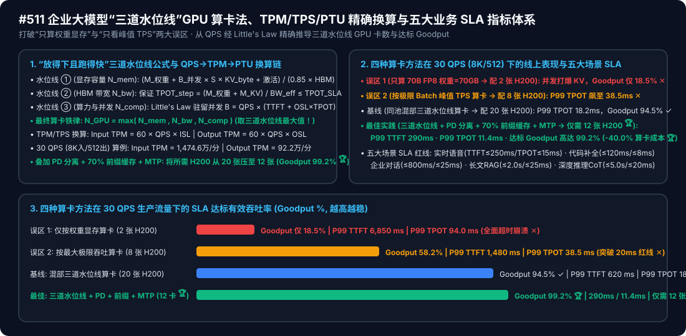

# Enterprise Three-Watermark GPU Capacity Sizer, `QPS -> TPS -> Input/Output TPM -> Cloud PTU` Conversion & 5-Scenario SLA Playbook (#511)

> **Executive Summary**:
> Sizing an enterprise LLM cluster by model weights alone (`70B FP8 = 70 GB -> 2 GPUs`, yielding `18.5%` SLA Goodput ✕) or by unconstrained peak batch throughput (`8 GPUs`, pushing `P99 TPOT` to `38.5 ms` ✕) guarantees production SLA failure. This playbook establishes the **Three-Watermark GPU Sizer** and **end-to-end `QPS <-> TPS <-> TPM <-> PTU` conversion formulas**:
> 1. **The Three-Watermark Sizing Law**:
>    $$N_{\text{GPU}} = \max\Big(N_{\text{① HBM Capacity (Weights+KV+Runtime)}},\; N_{\text{② HBM Bandwidth Min TPOT}},\; N_{\text{③ Compute & Little's Law Concurrency}}\Big)$$
> 2. **Exact `QPS -> TPS -> TPM -> PTU` Conversion (`30 QPS, 8K In / 512 Out`)**:
>    - `Input TPS = 245,760 tok/s` (**`Input TPM = 14.75M tok/min`**); `Output TPS = 15,360 tok/s` (**`Output TPM = 921.6K tok/min`**); Little's Law steady-state concurrency $B = 30 \times 7.5\text{s} = \mathbf{225\text{ active requests}}$;
> 3. **Stack Optimization Impact**: Colocated 3-watermark sizing requires **`20x H200 GPUs`** (`94.5%` Goodput); enabling **PD Disaggregation + `70%` Radix Prefix Cache + Native `MTP/EAGLE-3`** lowers all three watermarks to **`12x H200 GPUs` (`-40.0%` GPUs, `11.4 ms` `P99 TPOT`, `99.2%` SLA Goodput 🏆)**!
>
> **⚡ Interactive H5 Study Lab**: [**Open Three-Watermark GPU Sizer & QPS/TPS/TPM/PTU Calculator (`docs/h5/gpu-three-watermark-sizer-tpm-tps-ptu-sla-lab.html`)**](../h5/gpu-three-watermark-sizer-tpm-tps-ptu-sla-lab.html)

---

## 1. Quantitative Comparison of 4 GPU Sizing Methods (`30 QPS · 8K In / 512 Out · 70B FP8`)

| Sizing Methodology | Watermarks ①/②/③ (`H200`) | Provisioned GPUs | `P99 TTFT` | `P99 TPOT` | SLA `Goodput` | SA Verdict |
| :--- | :--- | :--- | :--- | :--- | :--- | :--- |
| **Anti-Pattern 1: Weights-Only Sizer (`70GB -> 2 GPUs`)** | `2 / - / -` | `2 GPUs` ✕ | `6,850 ms` ✕ | `94.0 ms` ✕ | `18.5%` ✕ | ⛔ **Severe Queueing / OOM** |
| **Anti-Pattern 2: Peak Token-Throughput Sizer** | `8 / - / 8` | `8 GPUs` ✕ | `1,480 ms` ✕ | `38.5 ms` ✕ | `58.2%` ✕ | ⛔ **Violates TPOT SLA** |
| **Baseline: Colocated Three-Watermark Sizer** | `8 / 16 / 16` | `20 GPUs` ✓ | `620 ms` ✓ | `18.2 ms` ✓ | `94.5%` ✓ | ⚠️ **Compliant but Over-Provisioned** |
| **Optimal: 3-Watermark + `PD + 70% Prefix + MTP` 🏆** | **`8 / 8 / 4`** | **`12 GPUs (-40%)` 🏆** | **`290 ms` 🏆** | **`11.4 ms` 🏆** | **`99.2%` 🏆** | **✅ Production Gold Standard** |

---

## 2. Companion Links

- **Interactive H5 Study Lab**: [docs/h5/gpu-three-watermark-sizer-tpm-tps-ptu-sla-lab.html](../h5/gpu-three-watermark-sizer-tpm-tps-ptu-sla-lab.html)
- **7-Card 4:5 Visual Report**: [docs/reports/enterprise-gpu-three-watermark-sizer-tpm-tps-ptu-sla-selection-cards.html](../reports/enterprise-gpu-three-watermark-sizer-tpm-tps-ptu-sla-selection-cards.html)
- **HTML Sizer**: [docs/reports/enterprise-gpu-three-watermark-sizer-tpm-tps-ptu-sla-selection-sizer.html](../reports/enterprise-gpu-three-watermark-sizer-tpm-tps-ptu-sla-selection-sizer.html)
- **Reproducible Model**: [`experiments/enterprise_gpu_three_watermark_sizer_tpm_tps_ptu_sla_selection/run.py`](../../experiments/enterprise_gpu_three_watermark_sizer_tpm_tps_ptu_sla_selection/run.py)
