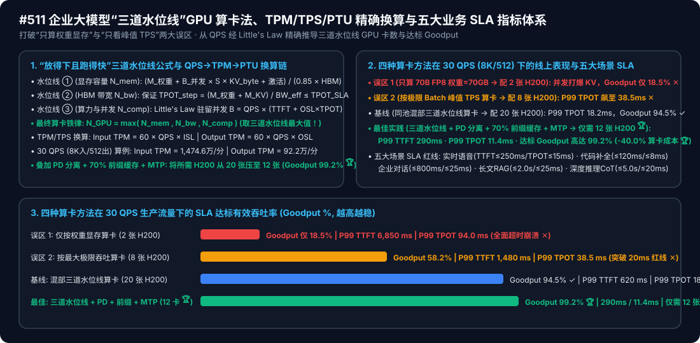

# 企业大模型“三道水位线”GPU 容量估算（`Three-Watermark Sizer`）、`QPS -> TPS -> Input/Output TPM -> 云端 PTU` 精确换算与五大业务场景 SLA 指标体系手算指南 (#511)

> **核心观点（Executive Summary）**：
> 客户问架构师最多的一个问题是：**“我要上线一个 70B / 671B 大模型应用，峰值 `30 QPS`，到底需要买多少张 GPU 或多少云端 PTU？”** 90% 的翻车方案要么 **“只算模型权重显存（70B FP8 = 70GB，以为 1~2 张 H200 就够，结果上线 Goodput 仅 `18.5%` ✕）”**，要么 **“按极限大 Batch 峰值 TPS 算卡（忽略了高并发下 `P99 TPOT` 突破 `38.5ms` 的带宽墙 ✕）”**。本专题给出企业级容量规划的标准手算公式：
> 1. **模型既要“放得下”更要“跑得快”——三道水位线取最大值铁律**：
>    $$N_{\text{GPU}} = \max\Big(N_{\text{① 显存容量 (权重+KV+运行时)}},\; N_{\text{② HBM 带宽最低 TPOT}},\; N_{\text{③ 算力与 Little's Law 在途并发}}\Big)$$
> 2. **`QPS <-> TPS <-> Input/Output TPM <-> 云端 PTU` 全链路精确换算**：
>    - 以 `30 QPS (8K 入 / 512 出)` 为例：集群输入吞吐 $\text{TPS}_{\text{in}} = 245,760\text{ tok/s}$（**`Input TPM = 1,474.6 万词/分钟`**），输出吞吐 $\text{TPS}_{\text{out}} = 15,360\text{ tok/s}$（**`Output TPM = 92.2 万词/分钟`**）；由 Little's Law 得稳态驻留并发 $B = 30 \times 7.5\text{s} = \mathbf{225\text{ 路}}$！
> 3. **叠加软件栈代差后的最终算卡结论**：同池混部按三道水位线需 **`20 张 H200`**（`Goodput 94.5%`）；开启 **PD 分离 + `70%` 前缀缓存 + 原生 `MTP/EAGLE-3`** 后，三道水位线同步下移，仅需 **`12 张 H200`（立省 `40.0%` 算卡，`P99 TPOT` 压至 `11.4ms`，达标 `Goodput` 高达 `99.2%` 🏆）**！
>
> **⚡ 配套交互式 H5 精读沙盘**：[**打开三道水位线 GPU 容量估算与 QPS/TPS/TPM/PTU 换算计算器 (`docs/h5/gpu-three-watermark-sizer-tpm-tps-ptu-sla-lab.html`)**](../h5/gpu-three-watermark-sizer-tpm-tps-ptu-sla-lab.html)

---

## 一、 灵魂拷问：如何手算三道水位线、换算 TPM/TPS/PTU 并对齐五大业务场景 SLA？

### Q1：“三道水位线”每一道的具体手算公式是什么？（以 `Llama-3.3-70B FP8 @ 30 QPS, 8K 入 / 512 出` 为例）
- **前置步骤：先用 Little's Law 算出稳态在途并发请求数 $B_{\text{concurrent}}$**：
  $$\text{E2EL} = \text{TTFT} + \text{OSL} \times \text{TPOT} \approx 0.35\text{s} + 512 \times 0.014\text{s} = 7.52\text{ s}$$
  $$B_{\text{concurrent}} = \lambda_{\text{QPS}} \times \text{E2EL} = 30 \times 7.52 \approx \mathbf{225\text{ 路并发请求}}$$
- **水位线 ①：显存容量水位线（$N_{\text{mem}}$，必须预留 15% 运行时/碎片余量）**：
  - **权重显存**：`70B FP8` = $70\text{ GB}$（每个 `TP=4` 实例占 $70\text{ GB}$）；
  - **KV Cache 显存（区分 MHA / GQA / MLA）**：
    - `70B MHA (BF16)`：$2 \times 80 \times 64 \times 128 \times 2 = \mathbf{2.5\text{ MB/词}}$（已淘汰）；
    - `70B GQA (FP8, n_kv=8)`：$2 \times 80 \times 8 \times 128 \times 1 = \mathbf{160\text{ KB/词}}$；
    - `671B MLA (FP8, d_latent=576)`：$61 \times 576 \times 1 = \mathbf{34.3\text{ KB/词}}$。
  - `225` 路请求（平均驻留序列长 $8,192 + 256 = 8,448$ 词）总 KV 显存 = $225 \times 8,448 \times 160\text{ KB} \approx \mathbf{304.1\text{ GB}}$。加上多副本权重、激活与 CUDA Graph，至少需要 **`8 张 H200`（$N_{\text{mem}} = 8$）** 才放得下！
- **水位线 ②：HBM 显存带宽与最低 TPOT 水位线（$N_{\text{bw}}$）**：
  $$\text{TPOT}_{\text{step}}(b) = \frac{M_{\text{weights}} + b \cdot S_{\text{avg}} \cdot \text{Bytes/Token}_{\text{KV}}}{N_{\text{TP}} \cdot \text{BW}_{\text{HBM}} \cdot \eta_{\text{BW}}} + t_{\text{AllReduce}} \le \text{TPOT}_{\text{SLA}}$$
  - 单个 `TP=4 H200` 实例有效 HBM 带宽约为 $4 \times 4.8\text{ TB/s} \times 0.72 = 13.8\text{ TB/s}$。当单实例并发 $b > 115$ 路时，单步读取 `70GB 权重 + 155GB KV` 耗时突破 `18ms`。为承载 `225` 路并发且压住 P99 尾延迟，混部需 $N_{\text{bw}} = 16$ 卡；若开启 **原生 `MTP/EAGLE-3`**（单步吐 2.28 词），Decode 池仅需 **`8 张 H200`（$N_{\text{bw}} = 8$）**！
- **水位线 ③：Prefill 算力与突发排队水位线（$N_{\text{comp}}$）**：
  - 未开启前缀缓存时，每秒需预填充 $30 \times 8,192 = 245,760\text{ tok/s}$；开启 **`70%` Prefix Cache** 后降至 $73,728\text{ tok/s}$，仅需 **`1` 个 `TP=4` Prefill 实例（$N_P = 4\text{ 张 H200}$）**。
  - **汇总**：`4P + 8D = 12 张 H200`（较同池混部 `20 张` 节省 **`40.0%`**，达标 `Goodput` 达 **`99.2%` 🏆**）！

### Q2：单请求生成速率（$1/\text{TPOT}$）、系统总 `TPS`、集群 `Input/Output TPM` 与云端 `PTU` 如何精确折算？
1. **单用户体验速率 vs. 集群总 TPS**：
   - **单用户吐字速率** = $1 / \text{TPOT}$（例如 $\text{TPOT}=12.5\text{ms} \implies \mathbf{80\text{ tok/s/user}}$，决定了单个用户觉得“打字快不快”）；
   - **集群总输出 TPS** = $\text{QPS} \times \text{OSL} = 30 \times 512 = \mathbf{15,360\text{ output tok/s}}$；
   - **集群总输入 TPS** = $\text{QPS} \times \text{ISL} = 30 \times 8,192 = \mathbf{245,760\text{ input tok/s}}$。
2. **分钟级配额 `Input TPM` / `Output TPM` 与云端 `PTU` 折算**：
   $$\text{Input TPM} = 60 \times \text{QPS} \times \text{ISL} = \mathbf{14,745,600\text{ TPM}}, \qquad \text{Output TPM} = 60 \times \text{QPS} \times \text{OSL} = \mathbf{921,600\text{ TPM}}$$
   - 在云端预留吞吐（如 Azure OpenAI `PTU`）中，**1 个 Output Token 消耗的算力配额通常等价于 `3~4` 个未缓存 Input Token**，而命中的 Prefix Cache 输入可享受 `50%~75%` 折扣：
     $$\text{Normalized TPM}_{\text{PTU}} = \text{Input TPM} \times (1 - 0.75 h) + 4 \times \text{Output TPM}$$

---

## 二、 四种算卡方法线上实测对比与五大业务场景 SLA 基准表

| 容量估算方法（`30 QPS · 8K 入 / 512 出 · 70B FP8`） | 水位线 ①/②/③ (`H200`) | 实际交付总卡数 | `P99 TTFT` | `P99 TPOT` | 达标 `Goodput` | 架构师诊断结论 |
| :--- | :--- | :--- | :--- | :--- | :--- | :--- |
| **误区 1：只算权重显存 (`70GB -> 2张卡`)** | `2 / - / -` | `2 张 H200` ✕ | `6,850 ms` ✕ | `94.0 ms` ✕ | `18.5%` ✕ | ⛔ **上线即 OOM/雪崩** |
| **误区 2：按极限 Batch 峰值 TPS 算卡** | `8 / - / 8` | `8 张 H200` ✕ | `1,480 ms` ✕ | `38.5 ms` ✕ | `58.2%` ✕ | ⛔ **流式吐字严重卡顿** |
| **基线：同池混部三道水位线算卡** | `8 / 16 / 16` | `20 张 H200` ✓ | `620 ms` ✓ | `18.2 ms` ✓ | `94.5%` ✓ | ⚠️ **达标但存在混部冗余** |
| **最佳：三道水位线 + `PD分离 + 70%前缀 + MTP` 🏆** | **`8 / 8 / 4`** | **`12 张 H200 (-40%)` 🏆** | **`290 ms` 🏆** | **`11.4 ms` 🏆** | **`99.2%` 🏆** | **✅ 企业生产算卡金标准** |

### 五大核心 AI 业务场景的用户体验评估参数（`TTFT · TPOT/ITL · E2EL · Goodput`）基准

| 业务场景类型 | 典型 `ISL / OSL` | `P90/P99 TTFT` 红线 | `P90/P99 TPOT (ITL)` 红线 | 端到端 `E2EL` 目标 | 瓶颈主导水位线 |
| :--- | :--- | :--- | :--- | :--- | :--- |
| **1. 实时语音数字人 / 客服通话** | `1.5K / 120` | **`<= 250 ms`**（人类听觉极限） | **`<= 15 ms` (`>66 tok/s`)** | `<= 1.2 s` | **延迟极敏（机内 NVLink + MTP）** |
| **2. 研发 IDE 实时代码补全 (FIM)** | `2K / 48` | **`<= 120 ms`** | **`<= 8 ms` (`>125 tok/s`)** | **`<= 200 ms`** | **极速首字 + 语法防抖 (`7B/14B PLD`)** |
| **3. 企业交互式知识助手 / 对话** | `4K / 512` | `<= 800 ms` | `<= 25 ms` (`>40 tok/s`) | `<= 8.0 s` | **均衡水位（`1P:1D` + 前缀缓存）** |
| **4. 128K 超长文档 RAG / 合同审查** | `32K–64K / 512` | `<= 2,000 ms` | `<= 25 ms` (`>40 tok/s`) | `<= 15.0 s` | **水位线 ③ Prefill 算力 + KV 显存** |
| **5. 深度推理慢思考 (CoT) / 离线批处理** | `2K / 4K–8K` | `<= 5,000 ms` | `<= 20 ms` (`>50 tok/s`) | `<= 90.0 s` | **水位线 ① & ② Decode 并发与带宽** |

---

## 三、 生产落地核对清单（SA Production Checklist）

- [ ] **拒绝任何未包含 Little's Law 在途并发（$B = \text{QPS} \times \text{E2EL}$）的显存估算表**：算卡前必须先根据目标 `QPS` 与平均输出时长算出同时驻留显存的请求数 $B$。
- [ ] **明确区分平均 `TPOT` 与分位尾延迟 `P99 ITL (Inter-Token Latency)`**：混部集群的平均 TPOT 可能只有 `18ms`，但插入长文 Prefill 块时的 `P99 ITL` 会飙到 `180ms` 造成肉眼可见的停顿，必须以 **同时满足 `P99 TTFT` 与 `P99 ITL` 的请求占比（`Goodput >= 95%`）** 作为唯一验收口径。

---

## 四、 延伸阅读与配套工具

- **交互式 H5 精学沙盘**：[docs/h5/gpu-three-watermark-sizer-tpm-tps-ptu-sla-lab.html](../h5/gpu-three-watermark-sizer-tpm-tps-ptu-sla-lab.html)
- **7-Card 4:5 视觉评测卡片**：[docs/reports/enterprise-gpu-three-watermark-sizer-tpm-tps-ptu-sla-selection-cards.html](../reports/enterprise-gpu-three-watermark-sizer-tpm-tps-ptu-sla-selection-cards.html)
- **交互式 Sizer 测算器**：[docs/reports/enterprise-gpu-three-watermark-sizer-tpm-tps-ptu-sla-selection-sizer.html](../reports/enterprise-gpu-three-watermark-sizer-tpm-tps-ptu-sla-selection-sizer.html)
- **可复现实验模型**：[`experiments/enterprise_gpu_three_watermark_sizer_tpm_tps_ptu_sla_selection/run.py`](../../experiments/enterprise_gpu_three_watermark_sizer_tpm_tps_ptu_sla_selection/run.py)
