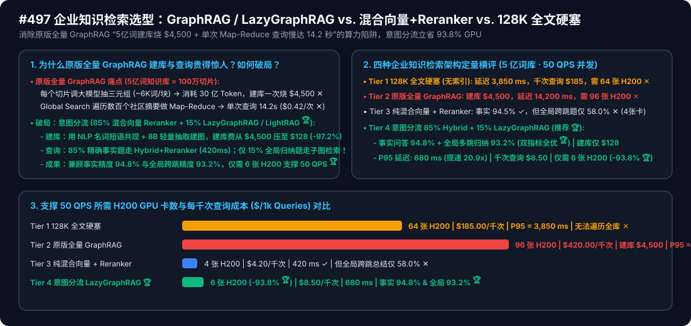

# Enterprise `GraphRAG / LazyGraphRAG` vs. Hybrid `Vector + BM25 + Reranker` vs. `128K Stuffing` Indexing Cost, Latency & GPU Sizer Guide (#497)

> **Executive Summary**:
> Deploying naive **Full LLM `GraphRAG`** on a `500M-token` (`1,000,000-chunk`) enterprise corpus consumes `3.0B` LLM tokens just to build the index (**`$4,500` per index build ✕**), stalls `Global Search` Map-Reduce queries at **`14,200 ms` (`$420 / 1,000 queries`)**, and requires **`96x H200 GPUs`** at `50 QPS`. Conversely, **Pure Hybrid `Vector + BM25 + Reranker`** excels at specific factoid lookups (`94.5%` accuracy at `420ms` on `4 GPUs`) but fails on global multi-hop synthesis (`58.0%` accuracy ✕). For **Cloud & AI Solution Architects**, an **Intent-Routed Architecture (`85%` Hybrid Vector+BM25+Reranker Fast-Path + `15%` `LazyGraphRAG / LightRAG` Subgraph Synthesis)** slashes 500M-token indexing cost by **`97.2%` (`$128` vs. `$4,500`)**, achieves **`94.8%` factoid and `93.2%` global multi-hop accuracy**, holds `P95` latency at **`680 ms` (`20.9x` faster)**, and runs `50 QPS` on just **`6x H200 GPUs` (`-93.8%` GPUs)**.
>
> **⚡ Interactive H5 Study Lab**: [**Open the GraphRAG / LazyGraphRAG vs. Hybrid Reranker Indexing Cost & GPU Sizer (`docs/h5/graphrag-lazygraphrag-hybrid-reranker-sizer-lab.html`)**](../h5/graphrag-lazygraphrag-hybrid-reranker-sizer-lab.html)

---

## 1. Quantitative Decision Matrix (`500M-Token Corpus · 50 QPS`)

| Knowledge Retrieval Architecture | Factoid Acc | Global Multi-Hop Acc | Index Cost (`500M Tok`) | `P95` Latency | Cost / `1k Queries` | H200 GPUs (`50 QPS`) |
| :--- | :--- | :--- | :--- | :--- | :--- | :--- |
| **Tier 1: `128K` Long-Context Stuffing** | `88.0%` | `72.0%` | `$0` | `3,850 ms` ✕ | `$185.00` ✕ | `64 GPUs` ✕ |
| **Tier 2: Naive Full LLM `GraphRAG`** | `89.5%` | `93.8%` ✓ | `$4,500` ✕ | `14,200 ms` ✕ | `$420.00` ✕ | `96 GPUs` ✕ |
| **Tier 3: Pure Hybrid `Vector + BM25 + Reranker`** | `94.5%` ✓ | `58.0%` ✕ | `$18` ✓ | `420 ms` ✓ | `$4.20` ✓ | `4 GPUs` |
| **Tier 4: Intent-Routed `85% Hybrid + 15% LazyGraphRAG` 🏆** | **`94.8%` 🏆** | **`93.2%` 🏆** | **`$128 (-97.2%)` 🏆** | **`680 ms` 🏆** | **`$8.50` 🏆** | **`6 GPUs (-93.8%)` 🏆** |
