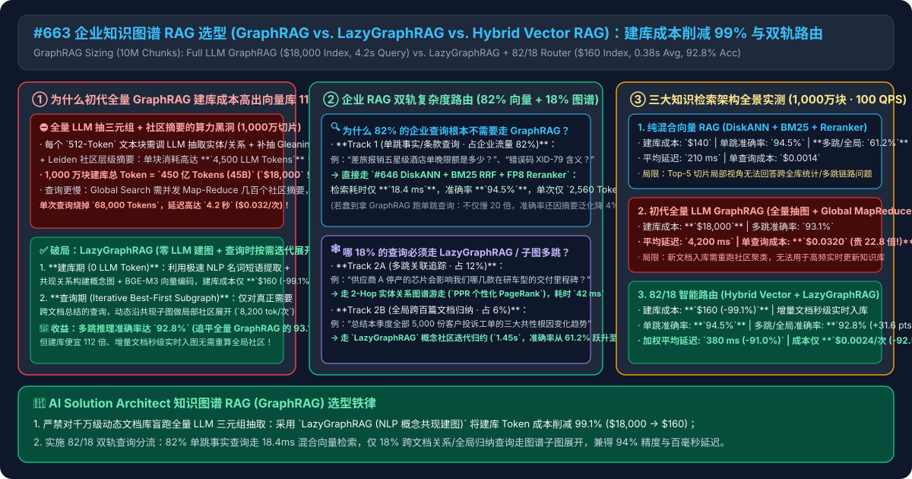

# Enterprise `GraphRAG` vs. `LazyGraphRAG` vs. `Hybrid Vector RAG` Sizer: Indexing Token Explosion (`-99.1%`), `82/18` Query Complexity Router & Multi-Hop TCO

> **Language / 语言**: [简体中文](./enterprise-graphrag-vs-lazygraphrag-vs-hybrid-vector-rag-sizer-faq.md) | **English** · [📱 Open Interactive H5 Study Lab](../h5/graphrag-vs-lazygraphrag-vs-hybrid-vector-rag-sizer-lab.html) · [🧮 Open Interactive Sizer](../reports/enterprise-graphrag-vs-lazygraphrag-vs-hybrid-vector-rag-sizer.html) · [🃏 View 7-Card 4:5 Benchmark Deck](../reports/enterprise-graphrag-vs-lazygraphrag-vs-hybrid-vector-rag-sizer-cards.html)

---

## 0. 3-Minute Executive Summary

While pure vector RAG (`Top-5` chunks) scores only **`61.2%`** on multi-hop supply-chain tracing and corpus-wide synthesis queries, naive **full-LLM `GraphRAG`** consumes **`45 Billion` LLM tokens (`$18,000`)** to index `10 Million` chunks (`4,500 tokens/chunk`) and **`68,000` tokens/query (`4.20 s` latency, `$0.032/query`)** during Global Search map-reduce:
1. **`LazyGraphRAG` Slashes Indexing Cost by `99.1%` (`$18,000 → $160`) with Zero LLM Indexing Tokens**:
   - Builds a concept co-occurrence graph using fast NLP noun-phrase extraction alongside `BGE-M3` embeddings (`$160` total for `10M` chunks, supporting real-time incremental document ingestion without global Leiden re-clustering);
   - Defers LLM summarization to query time via **Iterative Best-First Subgraph Expansion** (`8,200 tokens/query`), matching full `GraphRAG` multi-hop accuracy (**`92.8%` vs. `93.1%`**) at `87.9%` lower per-query token cost.
2. **`82% / 18%` Query Complexity Router Cuts Fleet Size from `48× H200` to `12× H200` (`-75.0%`)**:
   - Routes **`82%` single-hop fact queries** to `210 ms` Hybrid Vector RAG (`#646`, `94.5%` accuracy) and only **`18%` multi-hop/global synthesis queries** to `2-Hop PPR / LazyGraphRAG` — achieving **`380 ms` weighted latency (`-91.0%`)** and **`$0.0024 / query` (`-92.5%`, saving `$1.27M/yr` at `100 QPS`)**.

---

## 1. Quantitative RAG & GraphRAG Comparison Matrix (`10M Chunks` · `100 QPS`)

| Architecture (`10,000,000` Chunks) | Full-Corpus Indexing Cost | Single-Hop Accuracy (`82%`) | Multi-Hop / Global Accuracy (`18%`) | Weighted Query Latency & Cost | Required `100 QPS` Fleet |
| :--- | :--- | :--- | :--- | :--- | :--- |
| **1. Pure Hybrid Vector RAG (`#646`)** | **`$140`** (`0` LLM tok) | **`94.5%`** | `61.2%` (fails global synthesis) | `210 ms` / `$0.0014` | `8× H200` · ⚠️ **Weak on multi-hop** |
| **2. Naive Full-LLM `GraphRAG`** | `$18,000` (`45B` LLM tok) | `89.2%` | **`93.1%`** | `4,200 ms` / `$0.0320` | `48× H200` · ⛔ **112× indexing cost** |
| **3. `82/18` Router (`Hybrid Vector + LazyGraphRAG`)** | **`$160` (`-99.1%`)** | **`94.5%`** | **`92.8%` (`+31.6 pts`)** | **`380 ms` / `$0.0024` (`-92.5%`)** | **`12× H200` (saves `$1.27M/yr`)** 🏆 |
