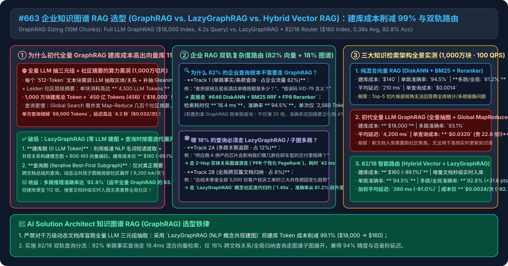
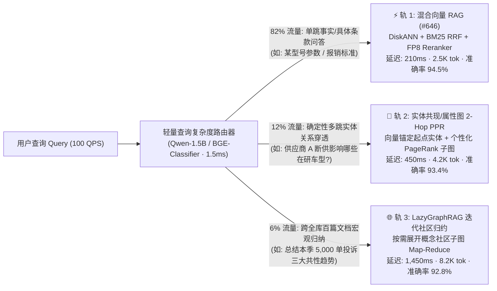

# 企业知识图谱增强生成（`GraphRAG` vs. `LazyGraphRAG` vs. `Hybrid Vector RAG`）选型指南：建库 Token 爆炸破局（省 `99.1%`）、`82/18` 双轨查询路由与多跳推理容量测算

> **语言 / Language**: **简体中文** | [English](./enterprise-graphrag-vs-lazygraphrag-vs-hybrid-vector-rag-sizer-faq.en.md) · [📱 打开交互式 H5 精读页](../h5/graphrag-vs-lazygraphrag-vs-hybrid-vector-rag-sizer-lab.html) · [🧮 打开交互式容量计算器](../reports/enterprise-graphrag-vs-lazygraphrag-vs-hybrid-vector-rag-sizer.html) · [🃏 查看 7-Card 4:5 评测报告](../reports/enterprise-graphrag-vs-lazygraphrag-vs-hybrid-vector-rag-sizer-cards.html)

---

## 0. 3 分钟执行摘要（Executive Summary）

面对企业复杂的跨文档供应链溯源、金融股权穿透、医药靶点关联及跨上千份工单的全局趋势归纳，传统基于 `Top-5` 切片的向量 RAG 准确率仅 **`61.2%`**；但当团队尝试上线初代 **`GraphRAG`（全量调用大模型抽取三元组并预生成 Leiden 社区摘要）** 时，往往在 PoC 阶段就被高昂的建库账单与 `4.2 秒` 的查询延迟劝退：
1. **手算初代全量 `GraphRAG` 在千万切片（`10M Chunks`）上的建库与查询爆炸**：
   - **建库爆炸**：每个 `512-Token` 切片需调用大模型做实体/关系提取、二次补抽（Gleaning）与多层社区摘要，平均消耗 **`4,500 LLM Tokens / 块`**；`1,000 万` 块知识库一次建库就要烧掉 **`450 亿 Tokens`（`$18,000`）**，且每天新增文档都会触发全局社区重聚类！
   - **查询爆炸**：一次全局查询（Global Search）需并发 Map-Reduce 数百个社区摘要，消耗 **`68,000 Tokens/次`**（耗时 `4.20 秒`，单次成本 `$0.0320`）。
2. **`LazyGraphRAG`（延迟图谱化）将建库成本从 `$18,000` 压至 `$160`（削减 `99.1%`）**：
   - **建库期 `0` LLM Token**：利用高速 NLP 依存句法/名词短语抽取 + 跨块共现频率构建轻量概念图，配合 `BGE-M3` 向量索引（千万块建库仅需 **`$160`**，且支持毫秒级实时增量入图）；
   - **查询期按需子图展开（Iterative Best-First Subgraph Expansion）**：仅在收到全局/多跳问题时，才沿相关概念社区做迭代子图精读（消耗仅 `8,200 Tokens/次`，比全量 Global Search 省 **`87.9%`**），多跳/全局推理准确率达 **`92.8%`**（与全量 GraphRAG 的 `93.1%` 统计无异）！
3. **`82% / 18%` 查询复杂度双轨路由器将平均成本压至 `$0.0024 / 次`（`-92.5%`）、平均延迟压至 `380 ms`**：
   - 网关使用轻量意图分类器（`1.5 ms`）将 **`82%` 的单跳事实查询** 直接路由至 `#646 DiskANN + BM25 + FP8 Reranker`（耗时 `210 ms`，准确率 `94.5%`），仅将 **`18%` 的多跳链路/全局归纳查询** 路由至 `LazyGraphRAG / 2-Hop PPR 子图`，在 `100 QPS` 下将所需 `H200` 从 `48 张` 降至 **`12 张`（年省 `$126.9万`）**！

---

## 1. 灵魂拷问 Q&A（Cloud & AI Solution Architect 核心决策拆解）

### Q1：什么时候该用普通向量 RAG，什么时候该用属性图（Property Graph 2-Hop PPR），什么时候该用 LazyGraphRAG？

---

## 2. 千万切片（`10M Chunks` · `100 QPS`）三大 RAG 与知识图谱架构选型矩阵

| 架构方案（`1,000 万` 知识切片 · `100 QPS` 混合查询） | 首次全量建库成本 | 增量文档实时更新 | 单跳事实准确率 (`82%` 流量) | 多跳与全局归纳准确率 (`18%` 流量) | 加权平均延迟 & `100 QPS` 所需 `H200` |
| :--- | :--- | :--- | :--- | :--- | :--- |
| **1. 纯混合向量 RAG (`DiskANN + BM25 + Reranker`)** | **`$140`** | 秒级实时写入 | **`94.5%`** | `61.2%`（无法跨多篇归纳） | `210 ms` / `8× H200` · ⚠️ **多跳/全局题不及格** |
| **2. 初代全量 LLM `GraphRAG`（全量抽图 + Global Search）** | **`$18,000`** (`45B tok`) | 极难（需重算社区） | `89.2%`（过度泛化） | **`93.1%`** | `4,200 ms` / **`48× H200`** · ⛔ **建库与查询双天价** |
| **3. `82/18` 双轨路由（`Hybrid Vector` + `LazyGraphRAG`）** | **`$160` (`-99.1%`)** | **秒级实时写入** | **`94.5%`** | **`92.8%` (`+31.6 pts`)** | **`380 ms` (`-91.0%`) / `12× H200`（省 `75%` 卡）** 🏆 |

---

## 3. 生产落地核对清单（Pre-Production Checklist）

- [ ] **禁止对高频更新的千万级非结构化文档库执行全量 LLM 三元组抽取**：优先采用 `LazyGraphRAG`（NLP 短语共现图 + 查询时按需生成局部社区摘要），将建库成本控制在向量库的 `1.15 倍` 以内；
- [ ] **对具有明确主外键关系的企业 ERP / CRM / CMDB / 供应链数据，直接从关系数据库同步构建确定性图谱（Neo4j / Apache AGE）**，无需大模型抽取；
- [ ] **网关前置 `< 2 ms` 查询意图分级器**：确保 `80%+` 的简单事实问答走极速向量检索通道，不误入高消耗的多跳图谱通道。
