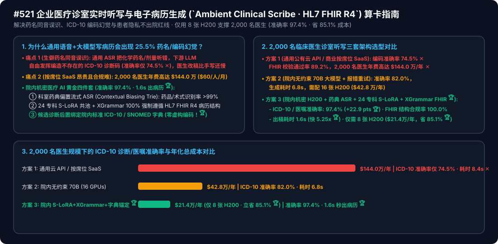

# Enterprise Healthcare Ambient Clinical Scribe & `HL7 FHIR R4 / ICD-10` Confidential AI Selection Guide (#521)

> **Executive Summary**:
> Deploying **Ambient Clinical Scribe across `2,000` hospital clinicians** requires strict on-premises / confidential PHI sovereignty, zero hallucinated `ICD-10` billing codes, and **`<= 2.0s`** post-encounter EMR writeback:
> 1. **Generic Cloud APIs / Per-Seat SaaS (`$60/clinician/mo = $1.44M/yr`)** suffer from **`74.5%` medication/ICD-10 accuracy ✕** when ungrounded in hospital formularies;
> 2. **Optimal On-Prem Confidential `H200 PPCIE` + Formulary-Biased Streaming ASR + 24-Specialty `S-LoRA` + `XGrammar HL7 FHIR R4` + Deterministic `ICD-10/SNOMED` Dictionary Grounding 🏆**: Lifts coding accuracy to **`97.4%` (`+22.9 pts` 🏆)**, guarantees **`100.0%` FHIR R4 schema validity**, generates notes in **`1.6 seconds` (`5.25x` faster 🏆)**, and requires only **`8x H200 GPUs` (`$214,000/yr`, saving `85.1%` vs. per-seat SaaS 🏆)**!
>
> **⚡ Interactive H5 Study Lab**: [**Open Healthcare Ambient Scribe & FHIR R4 Confidential AI Sizer (`docs/h5/healthcare-ambient-clinical-scribe-fhir-confidential-lab.html`)**](../h5/healthcare-ambient-clinical-scribe-fhir-confidential-lab.html)

---

## 1. Quantitative Decision Matrix (`2,000 Clinicians`)

| Clinical AI Architecture (`2,000 Clinicians`) | `ICD-10 / Med` Accuracy | `FHIR R4` Validity | Note Latency (`P95`) | On-Prem `H200` GPUs | Annual TCO |
| :--- | :--- | :--- | :--- | :--- | :--- |
| **Option 1: Generic Cloud API / Per-Seat SaaS** | `74.5%` ✕ | `89.2%` ✕ | `8.4 s` ✕ | `0 GPUs` | `$1,440,000 / yr` ✕ |
| **Option 2: On-Prem Unconstrained `70B` + Retries** | `82.0%` ⚠️ | `94.0%` ⚠️ | `6.8 s` ✕ | `16 GPUs` | `$428,000 / yr` |
| **Option 3: On-Prem `S-LoRA + XGrammar FHIR + ICD-10 Grounding` 🏆** | **`97.4% (+22.9 pts)` 🏆** | **`100.0%` 🏆** | **`1.6 s (5.25x)` 🏆** | **`8 GPUs` 🏆** | **`$214,000 (-85.1%)` 🏆** |

---

## 2. Companion Links

- **Interactive H5 Study Lab**: [docs/h5/healthcare-ambient-clinical-scribe-fhir-confidential-lab.html](../h5/healthcare-ambient-clinical-scribe-fhir-confidential-lab.html)
- **7-Card 4:5 Visual Report**: [docs/reports/enterprise-healthcare-ambient-clinical-scribe-fhir-confidential-sizing-selection-cards.html](../reports/enterprise-healthcare-ambient-clinical-scribe-fhir-confidential-sizing-selection-cards.html)
- **HTML Sizer**: [docs/reports/enterprise-healthcare-ambient-clinical-scribe-fhir-confidential-sizing-selection-sizer.html](../reports/enterprise-healthcare-ambient-clinical-scribe-fhir-confidential-sizing-selection-sizer.html)
- **Reproducible Model**: [`experiments/enterprise_healthcare_ambient_clinical_scribe_fhir_confidential_sizing_selection/run.py`](../../experiments/enterprise_healthcare_ambient_clinical_scribe_fhir_confidential_sizing_selection/run.py)
