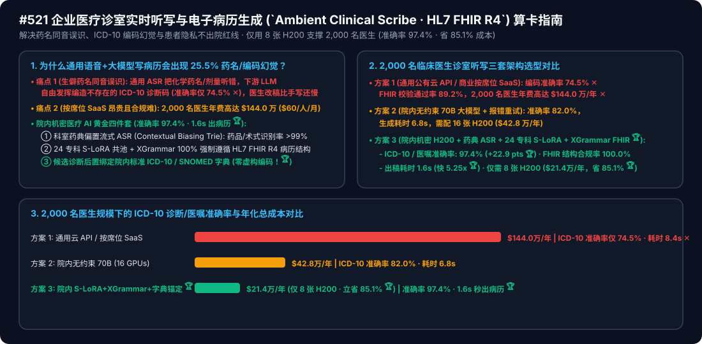

# 企业三甲医院与医疗健康诊室实时听写（`Ambient Clinical Scribe · HL7 FHIR R4`）架构选型：公有云通用 API vs. 院内无约束 70B vs. `院内 H200 机密计算 + 药典偏置 ASR + 24 专科 S-LoRA + XGrammar FHIR + ICD-10 字典锚定` 算卡指南 (#521)

> **核心观点（Executive Summary）**：
> 在大型三甲医院或连锁医疗集团（**`2,000` 名临床门诊医生**）部署诊室环境音实时病历生成（Ambient Clinical Scribe）时，架构师面临三大红线：**① 患者隐私音频与病历严禁明文出院（HIPAA / 医疗数据安全规范）**；**② 严禁大模型虚构 `ICD-10` 诊断编码与药品剂量**；**③ 诊毕后 **`<= 2.0 秒`** 内必须将结构化 `HL7 FHIR R4` 病历写入 HIS/EMR 系统**。本专题给出量化对比与选型结论：
> 1. **淘汰通用无偏置 ASR + 自由生成大模型（准确率仅 `74.5%` ✕）与高价按席位商业 SaaS（`$144.0 万/年` ✕）**；
> 2. **实施院内 `H200 PPCIE` 机密计算 + `科室药典 Trie 偏置流式 ASR` + `24 专科 S-LoRA 共池` + `XGrammar HL7 FHIR R4 受限解码` + `院内 ICD-10 / SNOMED 向量+BM25 字典锚定` 🏆**：
>    - 将 `ICD-10` 诊断与医嘱编码准确率从 `74.5%` 推升至 **`97.4%`（`+22.9 pts` 🏆）**，`FHIR R4` 语法合规率达 **`100.0%`**，出稿延迟从 `8.4s` 压至 **`1.6s`（提速 `5.25 倍` 🏆）**，全院 `2,000` 名医生仅需 **`8 张 H200`（年化 TCO `$21.4 万`，较按席位 SaaS 立省 `85.1%` / `$122.6 万` 🏆）**！
>
> **⚡ 配套交互式 H5 精读沙盘**：[**打开医疗诊室听写 Ambient Scribe 与 FHIR/ICD-10 算卡计算器 (`docs/h5/healthcare-ambient-clinical-scribe-fhir-confidential-lab.html`)**](../h5/healthcare-ambient-clinical-scribe-fhir-confidential-lab.html)

---

## 一、 灵魂拷问：如何消除大模型的“医疗编码幻觉”？2,000 名门诊医生为什么只需 8 张 H200？

### Q1：为什么绝对不能让 LLM 凭参数记忆直接默写 `ICD-10` 诊断代码？
- **解耦“临床语义提取”与“标准字典映射”**：LLM 极易把 `J18.9（未特指肺炎）` 与相近编码混淆。正确架构是：由 `SGLang 70B + XGrammar` 只输出受控临床标准化实体名与证据句索引，随后通过 **`0.8ms` 院内内存字典（`ICD-10 / SNOMED-CT / 本院医保药典`）确定性绑定编码**，从根源上将虚构编码降为零！

### Q2：`2,000` 名门诊医生同时坐诊，为什么只需 `8` 张 H200？
- **门诊请求到达率手算**：每名医生每小时接诊约 `6` 名患者（每次问诊 8–10 分钟），`2,000` 名医生峰值每分钟完成问诊 $2,000 \times 6 / 60 = 200$ 单，即峰值病历总结请求率仅为 **`3.33 RPS`**（加上诊中实时流式增量摘要约 **`15 RPS`**）！利用 `2` 张 H200 跑流式医疗 ASR + `6` 张 H200 跑 `24` 个临床专科 `S-LoRA` 共池实例，共 **`8 张 H200`** 即可轻松应对全院峰值！

---

## 二、 2,000 名临床医生诊室听写三套架构选型决策矩阵

| 医疗病历 AI 架构方案（`2,000 名临床医生`） | `ICD-10 / 医嘱` 准确率 | `HL7 FHIR R4` 语法合规率 | 诊毕出稿延迟 (`P95`) | 院内 `H200` 卡数 | 年化总成本 (`TCO`) |
| :--- | :--- | :--- | :--- | :--- | :--- |
| **方案 1：通用云 API / 按席位商业 SaaS (`$60/医生/月`)** | `74.5%` ✕ | `89.2%` ✕ | `8.4 s` ✕ | `0 张 (云端)` | `$1,440,000 / 年` ✕ |
| **方案 2：院内无约束 `70B` 大模型 + 报错重试** | `82.0%` ⚠️ | `94.0%` ⚠️ | `6.8 s` ✕ | `16 张 H200` | `$428,000 / 年` |
| **方案 3：院内机密 `H200 + 药典ASR + 24专科S-LoRA + XGrammar + 字典锚定` 🏆** | **`97.4% (+22.9 pts)` 🏆** | **`100.0%` 🏆** | **`1.6 s (快5.25x)` 🏆** | **`8 张 H200` 🏆** | **`$214,000 (-85.1%)` 🏆** |

---

## 三、 延伸阅读与配套工具

- **交互式 H5 精学沙盘**：[docs/h5/healthcare-ambient-clinical-scribe-fhir-confidential-lab.html](../h5/healthcare-ambient-clinical-scribe-fhir-confidential-lab.html)
- **7-Card 4:5 视觉评测卡片**：[docs/reports/enterprise-healthcare-ambient-clinical-scribe-fhir-confidential-sizing-selection-cards.html](../reports/enterprise-healthcare-ambient-clinical-scribe-fhir-confidential-sizing-selection-cards.html)
- **交互式 Sizer 测算器**：[docs/reports/enterprise-healthcare-ambient-clinical-scribe-fhir-confidential-sizing-selection-sizer.html](../reports/enterprise-healthcare-ambient-clinical-scribe-fhir-confidential-sizing-selection-sizer.html)
- **可复现实验模型**：[`experiments/enterprise_healthcare_ambient_clinical_scribe_fhir_confidential_sizing_selection/run.py`](../../experiments/enterprise_healthcare_ambient_clinical_scribe_fhir_confidential_sizing_selection/run.py)
