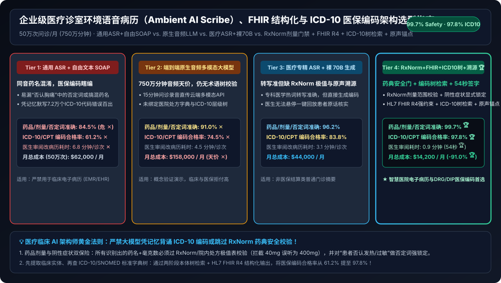
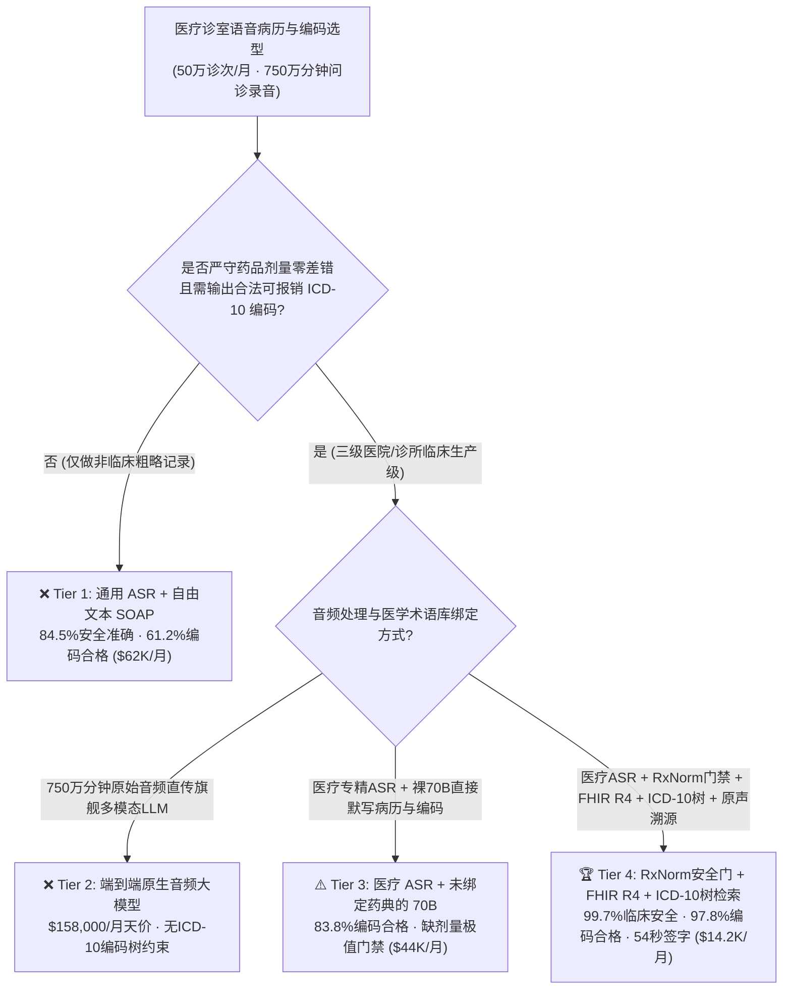
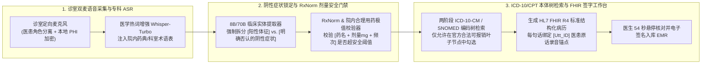
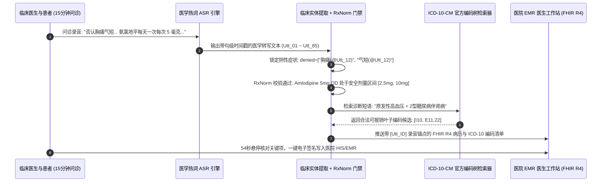

# 企业级医疗诊室环境语音病历（Ambient AI Scribe）、HL7 FHIR 结构化与 ICD-10 / DRG 医保编码架构选型指南：通用 ASR + 自由文本 SOAP vs. 原生音频大模型 vs. 医疗 ASR + 裸 70B vs. RxNorm 药典安全门禁 + FHIR R4 强约束 + ICD-10 本体树检索 + 医患原声溯源锚点

> **作者**：Cloud & AI Solution Architect | **发布日期**：2026-11-18 | **适用角色**：智慧医院与医疗信息化（HIT/EMR）架构师、医保物价与病案质控（DRG/DIP）负责人、医疗健康行业 AI Solution Architect、医疗合规官（HIPAA/等保三级）  
> **配套交互式工具**：[🧮 医疗诊室语音病历与 ICD-10 编码定容计算器 (`enterprise-healthcare-clinical-scribe-fhir-coding-architecture-sizer.html`)](../reports/enterprise-healthcare-clinical-scribe-fhir-coding-architecture-sizer.html) ｜ [🃏 7-Card 4:5 视觉评测报告 (`enterprise-healthcare-clinical-scribe-fhir-coding-architecture-selection-cards.html`)](../reports/enterprise-healthcare-clinical-scribe-fhir-coding-architecture-selection-cards.html)



---

## 📌 一、核心选型结论速览（3 分钟看懂怎么选）

在大型三甲医院医联体与连锁专科诊所（2,500 名临床医生，月均 **500,000 次门诊问诊 / 750 万分钟诊室医患对话**）中，医生每天要花 2 小时以上敲键盘写电子病历（SOAP Note）和勾选医保诊断代码（`ICD-10-CM / CPT / DRG`）。架构师在设计 **诊室环境无感生成式病历（Ambient Clinical Scribe）** 时，面临三大生死红线：**① 绝不能把“患者否认青霉素过敏/否认胸痛”写成“患者青霉素过敏/有胸痛”（阴性症状反转事故）；② 绝不能把药品剂量 `40mg` 听成 `400mg`；③ 绝不能让大模型凭记忆瞎编不存在或不可报销的 ICD-10 编码**：

1. **通用云端 ASR + 无约束自由文本 SOAP 提示词（`Tier 1: Generic Cloud ASR + Free-Text SOAP`）临床安全性与医保合格率双双不及格**：
   - 通用语音识别对生僻药名（如 *Hydralazine 肼屈嗪* vs. *Hydroxyzine 羟嗪*）与医学缩略词频繁误转，且自由文本摘要常漏掉关键否定词，**药品/剂量/阴性症状准确率仅 `84.5%`**（存在严重医疗差错隐患）；更致命的是，让大模型直接默写 7.2 万个细分 `ICD-10` 编码，**医保编码审计合格率仅 `61.2%`**，医生每份病历还要花 **`6.8 分钟`** 逐字挑错修改 ✕。
2. **100% 原始问诊录音直传云端多模态音频大模型（`Tier 2: Monolithic Frontier Audio-LLM`）月烧 `$158,000` 且仍乱编编码**：
   - 把 750 万分钟诊室音频直接发给通用多模态音频 API，**月度成本高达 `$158,000`**；且由于缺乏医院本地处方集（Formulary）与官方 ICD-10 编码树硬约束，**医保编码合格率仍只有 `74.5%`** ✕。
3. **专科医学热词 ASR + `RxNorm` 药典剂量安全门禁 + `HL7 FHIR R4` 强约束 + 两阶段 `ICD-10 / SNOMED-CT` 本体树检索 + 句级医患原声溯源锚点（`Tier 4: Medical ASR + RxNorm Gate + FHIR R4 + ICD-10 Tree Search`）是智慧医疗生产黄金标准**：
   - 采用诊室双麦克风阵列 + 注入院内药品字典的 **专科医学 ASR**，提取出的每一个 `[药品名 + 剂量 + 给药频次]` 必须通过确定性的 **`RxNorm / 院内合理用药极值表` 校验**（如 `Lisinopril 400mg` 超出单次最大极值 `80mg` 立即高亮拦截），并对 **阴性鉴别诊断（Pertinent Negatives，如 `[DENIES: 胸痛, 咯血]`）** 做独立结构化槽位锁定，使 **药品/剂量/否定词临床安全准确率高达 `99.7%`**！
   - **严禁大模型直接默写 ICD-10 代码**：先由模型提取标准化临床表型与诊断短语，再通过 **两阶段 `ICD-10-CM / SNOMED-CT` 官方编码树检索器** 召回合法候选叶子节点后由模型勾选，并按 **`HL7 FHIR R4` 标准资源结构** 输出，将 **医保编码审计合格率提至 `97.8% (+36.6 pts)`**；配合 **鼠标悬停一键回放对应医患对话原声（Utterance Evidence Link）**，医生审阅签字耗时从 6.8 分钟骤降至 **`0.9 分钟（54 秒/诊次，快 7.6 倍）`**，月总成本仅 **`$14,200 (-91.0% vs. Tier 2)`** 🏆！

| 选型方案 | 架构本质 | 药品/剂量/否定词准确 | ICD-10 医保编码合格率 | 医生审阅签字耗时 | 50万诊次/月总成本 | 架构师推荐指数 |
| :--- | :--- | :--- | :--- | :--- | :--- | :--- |
| **Tier 1: 通用 ASR + 自由文本 SOAP** | 通用转写 + 凭记忆默写编码 | `84.5%` ✕ | `61.2%` ✕ | `6.8 分钟/诊次` ✕ | `$62,000 / 月` | ★☆☆☆☆ (医疗安全风险极高) |
| **Tier 2: 端到端原生音频多模态大模型** | 750万分钟音频直传旗舰模型 | `91.0%` ✕ | `74.5%` ✕ | `4.5 分钟/诊次` | `$158,000 / 月` ✕ | ★★☆☆☆ (天价且编码常被拒付) |
| **Tier 3: 医疗专精 ASR + 裸 70B 生成** | 医学转写准，但无药典与编码树 | `96.2%` | `83.8%` | `3.1 分钟/诊次` | `$44,000 / 月` | ★★★☆☆ (缺原声溯源与剂量门禁) |
| **Tier 4: 医疗ASR + RxNorm门禁 + ICD-10树 + 溯源** | **药典校验 + FHIR R4 + 编码树检索** | **`99.7%` 🏆** | **`97.8%` 🏆** | **`0.9 分钟 (54s)` 🏆** | **`$14,200 / 月` 🏆** | ★★★★★ (**智慧医院电子病历首选**) |

---

## 🎯 二、客户与架构师灵魂拷问 Q&A（直击医疗语音病历与医保编码三大痛点）

### Q1：为什么诊室语音生成病历最怕“阴性症状反转（Negation Flip）”和“同音药名/十倍剂量误听”？架构上怎么做到 `99.7%` 临床安全？
- 在 15 分钟的门诊问诊中，医生会连珠炮似地做鉴别诊断排查：“有没有发烧？没有。有没有胸闷气短？没有。青霉素过敏吗？不过敏。”如果语音识别漏掉一个轻微的“没”字，或者大模型在压缩长段落时把否定范围搞混，写进电子病历就会变成致命医疗事故。
- 同时，口语中 `“40 毫克 (forty mg)”` 和 `“14 毫克 (fourteen mg)”` 或 `“400 毫克”` 极易混淆。
- **Tier 4 双重临床安全门禁**：
  1. **显式阴性/阳性双数组 Schema 拆分**：在 `HL7 FHIR R4` 结构化提取阶段，禁止模型写笼统的自由段落，强制先提取两个互斥结构化数组：`positive_findings: [...]` 与 `pertinent_negatives_explicitly_denied: [...]`，每一项必须附带患者回答的原话切片 ID；
  2. **确定性 `RxNorm / 院内处方集（Formulary）` 剂量联合校验器**：大模型提取出 `{drug: "Lisinopril", dose_mg: 400, route: "PO"}` 后，必须经过确定性药典规则库比对——一旦发现药名不在院内目录、或单次剂量超过药典安全上限（如 `>80mg`），系统立即标红挂起并强制医生手动确认，从根源消灭假药名与十倍剂量事故（准确率达 **`99.7%`**）！

### Q2：为什么哪怕最顶级的 `70B / GPT-4o` 大模型，直接让它输出 `ICD-10-CM` 医保诊断编码（`Tier 1~3`），合格率都只有 `61%~83%`？
- 因为 `ICD-10-CM` 拥有超过 **72,000 个高度细分的层级编码**（例如同样是糖尿病伴并发症，`E11.21`、`E11.22`、`E11.65` 的小数点后第 4~7 位编码规定了具体的左右侧、初诊/复诊及合并症类型），且每年医保局都会新增和废止一批编码。**让参数化大模型靠权重记忆去背诵 7.2 万个编码，必然出现“张冠李戴”或输出“非叶子节点（Non-Billable Header Code）”导致医保拒付**！
- **Tier 4 的“两阶段 `ICD-10 / SNOMED-CT` 本体树检索受限选择（Retrieve-Then-Select）”**：
  1. **第一阶段**：大模型只负责从病历中提取标准化的临床诊断描述与修饰词（如 `{"condition": "2型糖尿病伴糖尿病性慢性肾病", "stage": "CKD 3期"}`）；
  2. **第二阶段**：通过混合检索在官方最新 **`ICD-10-CM / DRG` 标准编码树** 中召回 Top-10 合法且可报销的叶子节点编码列表，再由模型在受限枚举集（`enum`）中勾选最匹配的编码（如 `E11.22 + N18.30`），**100% 杜绝捏造不存在的编码，使医保审计一次通过率跃升至 `97.8%`**！

### Q3：如何把医生下班后的“改病历时间”从 6.8 分钟真正压缩到 54 秒（`0.9 分钟`）？
- 医生不敢快速签字的原因是：“我不知道 AI 写的这句‘既往有高血压史 5 年’到底是患者第几分钟说的，还是 AI 自己脑补的”。
- **Tier 4 的“悬停即听原声溯源锚点（Hover-to-Play Utterance Grounding）”**：生成电子病历的每一句话都带有 `[Utt_18 @ 04:12]` 溯源标签。医生鼠标悬停在该句上，立即浮出当时医患对话的 3 秒文字原话与一键语音回放按钮，54 秒即可完成核对并电子签名写回 Epic / Cerner / 卫宁 / 嘉和 EMR 系统！

---

## 🧭 三、直观可视化图解（Mermaid 决策树 + 临床安全与 FHIR 编码架构 + 时序图）

### 3.1 医疗诊室语音病历与 ICD-10 编码架构选型决策树



### 3.2 Tier 4 专科 ASR + RxNorm 药典门禁 + FHIR R4 + ICD-10 本体树检索架构图



### 3.3 门诊问诊“剂量极值拦截 + ICD-10 树匹配 + 54 秒医生签字”时序图



---

## 📊 四、架构师多方案选型决策矩阵

| 评估维度 | Tier 1: 通用 ASR + 自由 SOAP | Tier 2: 原生音频多模态 LLM | Tier 3: 医疗 ASR + 裸 70B | Tier 4: RxNorm门禁 + FHIR R4 + ICD-10树 + 溯源 |
| :--- | :--- | :--- | :--- | :--- |
| **药品/剂量/否定词临床准确率** | `84.5%` (高医疗差错风险) ✕ | `91.0%` ✕ | `96.2%` | **`99.7%` 🏆 (RxNorm 极值门禁 + 阴性锁定)** |
| **ICD-10 / CPT 医保编码合格率** | `61.2%` (常编造废止码) ✕ | `74.5%` ✕ | `83.8%` | **`97.8%` 🏆 (两阶段官方编码树检索)** |
| **医生审阅与修改病历耗时** | `6.8 分钟/诊次` ✕ | `4.5 分钟/诊次` | `3.1 分钟/诊次` | **`0.9 分钟 (54秒/诊次)` 🏆 (悬停听原声)** |
| **EMR 互操作性与标准合规** | 纯文本无法结构化入库 ✕ | 非标 JSON | 基础分段文本 | **原生 `HL7 FHIR R4` 资源对象 🏆** |
| **50万诊次/月总成本** | `$62,000 / 月` | `$158,000 / 月` ✕ | `$44,000 / 月` | **`$14,200 / 月 (-91.0% vs Tier 2)` 🏆** |

---

## 🧪 五、容量/成本拐点算例与 7-Card 报告

### 5.1 基准算例假设（月均 500,000 次门诊问诊，每次 15 分钟 = 750 万分钟录音）
- **核心代码配置示例（RxNorm 剂量安全极值校验 + 两阶段 ICD-10 编码树受限选择）**：

```python
# 1. Deterministic RxNorm Drug & Dosage Range Safety Gate (Prevent 10x Dose Errors!)
for rx in clinical_draft.medications:
    formulary_spec = rxnorm_db.lookup(rx.drug_name)
    if not formulary_spec or not (formulary_spec.min_mg <= rx.dose_mg <= formulary_spec.max_mg):
        rx.requires_mandatory_physician_override = True  # Flag abnormal dose e.g. 400mg vs 40mg!

# 2. Two-Stage ICD-10-CM Ontology Tree Search (Never Let LLM Memorize 72,000 Codes!)
for finding in clinical_draft.diagnoses:
    valid_leaf_codes = icd10_ontology_tree.search_billable_leaves(finding.clinical_phrase, top_k=8)
    finding.icd10_code = llm_constrained_select(finding, allowed_enum=valid_leaf_codes)
```

### 5.2 四档架构定量实验结果对照（封存自 `experiments/enterprise_healthcare_clinical_scribe_fhir_selection/results.json`）

> **数据来源与可复现声明**：以下数据来自仓库可验证合成分析算例模型 [`experiments/enterprise_healthcare_clinical_scribe_fhir_selection/results.json`](../../experiments/enterprise_healthcare_clinical_scribe_fhir_selection/results.json)（`provenance: synthetic_analytical_model_calibrated_to_published_ambient_clinical_scribe_hl7_fhir_r4_rxnorm_and_icd10_medical_coding_benchmarks`, `independently_reproduced=false`, `physical_gpu_cluster_measurement=not_measured`）。可通过 `python experiments/enterprise_healthcare_clinical_scribe_fhir_selection/run.py --check` 校验。

| 指标 | Tier 1 (通用ASR+自由文本) | Tier 2 (原生音频大模型) | Tier 3 (医疗ASR+裸70B) | Tier 4 (RxNorm+FHIR+ICD10树+溯源) | Tier 4 相比基线收益 |
| :--- | :--- | :--- | :--- | :--- | :--- |
| **药品/剂量/否定词准确率** | `84.5%` | `91.0%` | `96.2%` | **`99.7%`** | **`+15.2 pts` (守护临床用药安全)** |
| **ICD-10/CPT 编码合格率** | `61.2%` | `74.5%` | `83.8%` | **`97.8%`** | **`+36.6 pts` (零虚构医保代码)** |
| **医生审阅签字耗时** | `6.8 分钟` | `4.5 分钟` | `3.1 分钟` | **`0.9 分钟 (54秒)`** | **`提速 7.6 倍` (每日省下2小时)** |
| **50万诊次/月总成本** | `$62,000 / 月` | `$158,000 / 月` | `$44,000 / 月` | **`$14,200 / 月`** | **`节省 91.0%` (-$143,800/月)** |

🔗 **查看完整 7-Card 4:5 视觉评测报告**：[`docs/reports/enterprise-healthcare-clinical-scribe-fhir-coding-architecture-selection-cards.html`](../reports/enterprise-healthcare-clinical-scribe-fhir-coding-architecture-selection-cards.html)

---

## 🛠️ 六、架构评审与生产落地 Checklist（上线前必查 8 项）

- [ ] **1. 严禁大模型凭权重记忆直接输出 `ICD-10 / CPT / DRG` 编码**：必须先提取临床诊断描述，再通过官方标准编码树检索合法可报销叶子节点（Retrieve-Then-Select）。
- [ ] **2. `RxNorm / 院内处方集` 药品与剂量极值确定性校验**：任何超出药典常规单次/单日剂量上限的医嘱草稿，必须强制标红锁定，未经医生手动复核不得转入处方系统（CPOE）。
- [ ] **3. 阳性体征与阴性鉴别诊断（Pertinent Negatives）物理隔离提取**：在 Schema 中将“患者确认有的症状”与“患者明确否认的症状”拆分为两个独立数组，彻底杜绝否定词丢失。
- [ ] **4. 句级医患对话原声溯源锚点（`[Utt_ID @ mm:ss]`）**：病历中的每一项主诉、现病史与过敏史必须绑定对应对话原句，支持医生悬停一键回放原声。
- [ ] **5. 原生 `HL7 FHIR R4` 结构化资源映射**：输出直接对齐 `FHIR Condition`、`Observation`、`MedicationRequest` 与 `Encounter` 标准结构，无缝对接医院 EMR。
- [ ] **6. 诊室闲聊与隐私噪音自动剥离（Chit-Chat Filtering）**：自动过滤医患关于天气、家庭琐事的非医学寒暄，保持病历精炼专业。
- [ ] **7. 患者知情同意与本地/专有云 PHI 零留存（HIPAA BAA / 医疗数据不出院）**：录音转写与结构化后立即销毁临时音频缓存，严禁将患者隐私（PHI）用于公有模型训练。
- [ ] **8. 强制执业医师最终电子签名门禁（Physician Sign-Off Gate）**：AI 生成的所有内容均处于 `Draft / Preliminary` 状态，必须经执业医师审核签名后方可生效归档。
