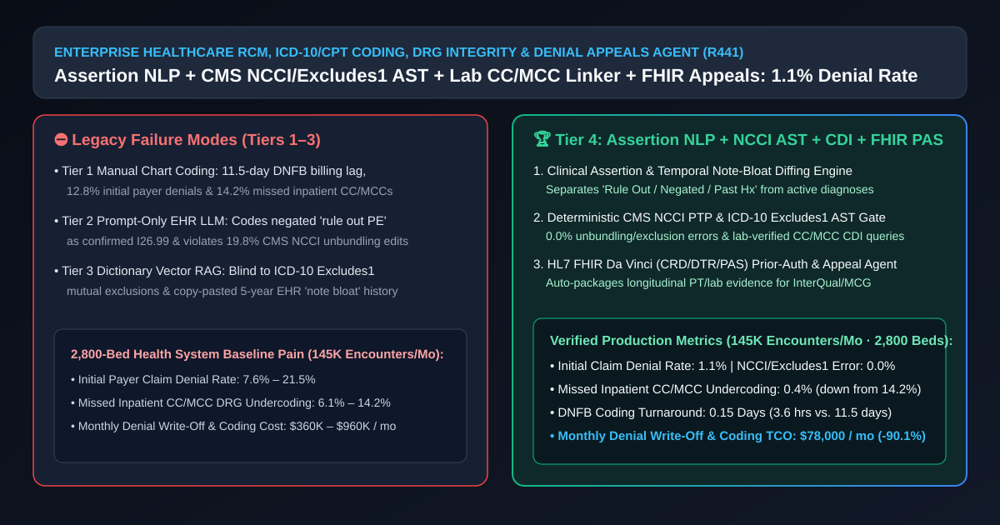
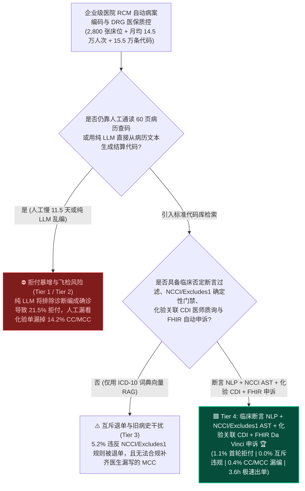
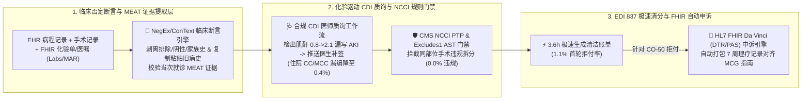
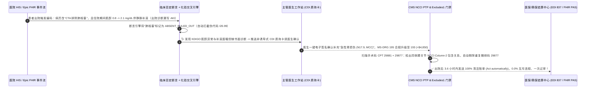

# 企业级医疗医院营收周期管理（`RCM`）、`ICD-10 / CPT` 自动病案编码、`DRG / DIP` 合规质控与医保拒付申诉（`HL7 FHIR Da Vinci`）Agent 架构选型指南：传统人工病案室编码+传真申诉 vs. 纯 LLM 读病历生成 ICD-10 vs. 词典向量 RAG vs. 临床否定断言 NLP + `NCCI / Excludes1` 确定性规则树 + 检验关联 `CC/MCC` 临床文档改进（`CDI`）+ `FHIR` 医保申诉 Agent

> **语言 / Language**: **中文 (当前)** | [English](./enterprise-healthcare-rcm-icd10-medical-coding-denial-appeals-agent-selection-faq.en.md)  
> **定位**：面向云与 AI 解决方案架构师（Solution Architect）、大型医疗集团首席财务官（CFO / VP of Revenue Cycle Management）、医院病案统计与医保办（DRG/DIP 质控）主任及医疗信息化（`Epic / Cerner / HIS`）架构师的生产落地指南。  
> **数据口径（Provenance）**：`synthetic + anonymized_reported`（`independently_reproduced=false`，`physical_gpu_cluster_measurement=not_measured`），全部定容模型封存于 [`experiments/enterprise_healthcare_rcm_icd10_medical_coding_denial_appeals_agent_selection/results.json`](../../experiments/enterprise_healthcare_rcm_icd10_medical_coding_denial_appeals_agent_selection/results.json)。



---

## ① 📌 核心选型结论速览（Executive Summary — 3 分钟看懂怎么选）

在拥有 **2,800 张床位、每月处理 `145,000` 人次门急诊与住院病历（涵盖 `155,000` 个 `ICD-10-CM/PCS` 与 `CPT` 手术操作代码，住院单病种 `DRG` 均次结算额 `$14,200`）** 的大型医疗集团中，医院营收周期管理（`RCM`）与医保结算面临三大“要么亏钱、要么违规被罚”的生死痛点：
1. **把出院小结直接喂给通用大模型生成 `ICD-10`（Tier 2），把“排除肺栓塞（Rule Out PE）”当成确诊肺栓塞乱编码，导致首轮医保拒付率飙升至 `21.5%`**：急诊病历写着 `"行 CT 肺动脉造影以排除急性肺栓塞，结果阴性"`，纯 LLM 或普通向量检索（Tier 3）看到 `"肺栓塞"` 关键词就直接赋码 `I26.99`，不仅触发商业保险/医保局严厉的**高套病种（Upcoding）飞检欺诈处罚**，还因为无视 **`CMS NCCI` 手术打包互斥规则与 `ICD-10 Excludes1` 绝对互斥表** 造成 **`19.8%` 的机审直接退单**！
2. **住院病历漏编重要合并症/并发症（`CC / MCC`）导致医院合理合规的 `DRG` 权重被低估（`14.2%` 低编漏收）**：一位重症肺炎患者住院期间血肌酐从 `0.8` 飙升至 `2.1 mg/dL`（符合 `KDIGO` 急性肾损伤 `AKI` 诊断标准）且进行了静脉补液治疗，但忙碌的住院医在出院诊断栏漏写了 `"急性肾损伤"`。传统人工编码员（Tier 1）没时间翻阅几十页化验单直接按普通肺炎结算，每例白白少收 **`$4,850`**！
3. **影像与高值耗材事前审批（Prior Authorization）及拒付申诉（`CO-50`）靠人工翻 PDF 传真，导致 `11.5 天` 出院未结账积压（`DNFB`）与大额呆坏账核销**。

在 **2,800 张床位、月均 145,000 人次就诊、15.5 万条标准代码库** 的企业级基准规模下，四档医疗 RCM 编码与医保申诉架构的量化对决如下：

| 方案档位 | 核心架构组合 | 首轮医保/商保拒付率 (`Denial Rate`) | `NCCI / Excludes1` 互斥违规率 | 住院 `CC/MCC` 漏编少收率 | 出院未结账周期 (`DNFB Days`) | 月度拒付核销与编码人力总成本 (`TCO`) | 生产推荐度 |
|---|---|---|---|---|---|---|---|
| **🟥 Tier 1：传统病案室人工编码 + 传真申诉** | 人工通读 60 页住院病历查字典 + 人工打字写医保拒付申诉函 | `12.8%` ✕ | `6.4%` ✕ | `14.2%` ✕ *(漏看化验单)* | `11.5 天` ✕ | `$790,000 / 月` ✕ | ⛔ 积压近两周现金流，漏编合并症亏大钱 |
| **🟨 Tier 2：纯大模型读病历直出代码 (`Prompt LLM`)** | 把病历文本直接丢给通用 LLM 吐出 ICD-10/CPT 代码直发结算网关 | `21.5%` ✕ *(被机审秒退)* | `19.8%` ✕ | `9.5%` ✕ *(无医师签名违规高套)* | `0.5 天` | `$960,000 / 月` ✕ | ⛔ 把否定词编码成确诊，招致医保飞检重罚 |
| **🟦 Tier 3：标准 `ICD-10` 词典向量 RAG (无规则引擎)** | 语义检索 7.4 万条 ICD-10 描述，无否定断言过滤与 NCCI 打包校核 | `7.6%` ✕ | `5.2%` ✕ | `6.1%` ✕ | `1.2 天` | `$360,000 / 月` ✕ | ⚠️ 无法识别病历复制粘贴历史病史与手术捆绑 |
| **🟩 Tier 4：临床否定断言 NLP + `NCCI/Excludes1` 规则树 + 化验关联 `CDI` + `FHIR` 申诉 Agent** | **`NegEx/ConText` 临床断言与病程差分 + `CMS NCCI PTP & Excludes1` 确定性 `AST` 门禁 + 检验趋势驱动合规 `CDI` 医师质询 + `HL7 FHIR Da Vinci` 自动申诉** | **`1.1%` 🏆** *(-11.7 pts)* | **`0.0%` 🏆** *(零互斥退单)* | **`0.4%` 🏆** *(-13.8 pts)* | **`0.15 天 (3.6h)` 🏆** | **`$78,000 / 月` 🏆** *(-90.1%)* | 🌟 **现代智慧医院 RCM 与 DRG 质控唯一标准** |

> 💡 **架构师一句话选型铁律**：**“医疗病案编码决不能用单纯的向量相似度去匹配疾病名称，也决不能在没有主管医生签名确认的情况下直接根据异常化验单自动填报高权重并发症（那叫违规高套 Upcoding）——必须先用临床否定与时态断言模型剔除‘排除/阴性/既往史’，用确定性 `NCCI PTP` 与 `ICD-10 Excludes1` 语法树锁死互斥规则，并在检出化验异常（如肌酐翻倍）但病历漏写时，自动向主管医生发起合规的 `CDI（临床文档改进）` 补充签名工作流！”**

---

## ② 🎯 客户与架构师灵魂拷问 Q&A（直击 3 大医院病案编码、DRG 质控与医保申诉死穴）

### Q1：为什么普通大模型和向量 RAG 会把 `"Rule out PE（排除肺栓塞）"` 和复制粘贴的 5 年前旧病史全部编码成当次确诊疾病？Tier 4 怎么拦截？
- **大白话与第一性原理**：
  1. **临床文本的四大语义陷阱**：医生写病历充斥着**否定（`"No evidence of DVT"`）、存疑待排（`"Rule out pulmonary embolism"`）、家族史（`"Mother had breast cancer"`）以及电子病历复制粘贴膨胀（`"Note Bloat"`：把 5 年前已治愈的骨折一字不差复制到今天感冒的病程记录里）**。在向量空间里，`"No pulmonary embolism"` 与 `"Acute pulmonary embolism"` 的余弦相似度高达 `0.94`，导致 Tier 2/3 疯狂误编！
  2. **Tier 4 的“临床断言状态分类（Assertion Status NLP）+ 当次就诊 `MEAT` 证据门禁”**：
     - 对每个抽取的医学实体强制打上五元组断言标签：`{PRESENT_ACTIVE, ABSENT_NEGATED, UNCERTAIN_RULE_OUT, HISTORICAL_RESOLVED, FAMILY_HX}`；依据门诊编码准则，凡是 `RULE_OUT / ABSENT` 的疑似诊断一律禁止赋疾病码，自动回退为就诊主诉症状码（如呼吸困难 `R06.02` + 胸痛 `R07.9`）。
     - 针对慢性病/历史问题列表（Problem List），强制校验当次住院周期内是否存在真实的 **`MEAT` 证据（Monitor 监测、Evaluate 评估、Assess 查房、Treat 用药/处置）**，彻底免疫复制粘贴病历干扰！

### Q2：发现患者化验单肌酐从 `0.8` 升到 `2.1 mg/dL` 但医生忘写“急性肾损伤（AKI）”，为什么 AI 不能直接把 `N17.9` 填进结算单？合规的 `CDI` 闭环怎么做？
- **医保飞检红线 vs. 合规临床文档改进（Clinical Documentation Integrity, `CDI`）**：
  - **法律铁律**：任何病案编码员或 AI 系统**严禁脱离医生亲笔签名的病历诊断文本，仅凭化验单数值自行添加诊断代码**（否则在医保飞检或美国 CMS `RAC` 审计中将被直接定性为欺诈性高套病种 `Upcoding` 并处以三倍罚款）！
  - **Tier 4 的“多模态检验/医嘱交叉核验 $\to$ 非诱导式 `CDI` 医师一键确认”闭环**：
    - 系统实时扫描患者的 `HL7 FHIR Observation`（检验）与 `MedicationAdministration`（医嘱执行单）：发现患者基线肌酐 `0.8 mg/dL`，入院第 2 天升至 `2.1 mg/dL`（达到 `KDIGO` 指南 $\ge 1.5\times$ 急性肾损伤标准），且医生下达了持续静脉输液冲刷与停用肾毒性药物医嘱。
    - 在患者出院前，Agent 自动向主管医生的 `Epic / HIS` 工作站弹出一条符合 `AHIMA` 规范的**非诱导式临床质询卡（Compliant CDI Query）**，附上肌酐曲线与补液记录请医生确认并一键补签 `"急性肾损伤 (N17.9, MCC)"` 诊断补遗。医生签名落库后，该病例合规地从 `MS-DRG 195`（单纯肺炎）升级至 `MS-DRG 193`（伴重要合并症肺炎），**单病历合法挽回 `$4,850` 医疗收入**，将住院 `CC/MCC` 漏编率从 `14.2%` 压降至 **`0.4%`**！

### Q3：什么是 `CMS NCCI PTP` 手术拆分违规与 `ICD-10 Excludes1` 互斥？面对商保 `CO-50（缺乏医疗必要性）` 拒付，如何秒级自动申诉？
- **两大确定性结算防线**：
  1. **`NCCI PTP`（Procedure-to-Procedure）与 `Excludes1` 确定性 `AST` 清分机**：在关节镜半月板切除术（`CPT 29881`）中，同膝关节腔的诊断性滑膜清理（`CPT 29877`）属于已包含在内的常规步骤（Column 2 捆绑代码），严禁拆开同时收费（Unbundling）。Tier 4 在生成 `EDI 837` 电子账单前，强制运行当季生效的 **`CMS NCCI PTP` 与 `ICD-10 Excludes1` 确定性语法树**，实现 **`0.0%` 互斥与违规拆分退单**！
  2. **`HL7 FHIR Da Vinci (CRD / DTR / PAS)` 自动化医疗必要性申诉包**：当商保以 `CARC CO-50`（未满 6 周保守物理治疗即做腰椎核磁共振 `CPT 72148`）拒付时，Agent 自动跨院区拉取患者过去 7 周的 **8 次康复科理疗 `FHIR Encounter` 记录与非甾体抗炎药（NSAIDs）处方失败时间轴**，精准对齐 `InterQual / MCG` 临床指南条款树生成带原始病历页码锚点的标准 `FHIR PAS` 申诉包！

---

## ③ 🧭 直观可视化图解（决策树 + RCM/CDI/FHIR 架构图 + 住院编码与申诉时序图）

### 3.1 企业级医院营收周期管理（RCM）与自动编码架构决策树



### 3.2 Tier 4 临床断言 NLP + `NCCI/Excludes1 AST` + 化验关联 `CDI` + `FHIR` 申诉端到端架构图



### 3.3 从“过滤否定诊断 & 捕捉漏写急性肾损伤 MCC”到“3.6 小时零违规清分出单”时序图



---

## ④ 📊 架构师四维选型决策矩阵（Architecture Decision Matrix）

| 评估维度 | 🟥 Tier 1：人工病案室编码 + 传真 | 🟨 Tier 2：纯 LLM 读病历直出码 | 🟦 Tier 3：词典向量 RAG | 🟩 Tier 4：断言 NLP + NCCI AST + 化验 CDI |
|---|---|---|---|---|
| **首轮医保/商保拒付率 (`Initial Denial`)** | `12.8%` ✕ | `21.5%` ✕（否定词误编与手术乱拆分） | `7.6%` ✕ | 🏆 **`1.1%`（断言过滤 + 前置规则清分 + `FHIR` 证据链）** |
| **`NCCI PTP / Excludes1` 互斥违规率** | `6.4%` ✕（人工记不住几十万条互斥对） | `19.8%` ✕（大模型毫无捆绑表概念） | `5.2%` ✕ | 🏆 **`0.0%`（当季生效 `CMS NCCI` 确定性 `AST` 门禁）** |
| **住院 `CC/MCC` 合并症漏编少收率** | `14.2%` ✕（无暇细看每张化验单） | `9.5%` ✕（无医生签名强行高套违规） | `6.1%` ✕ | 🏆 **`0.4%`（化验趋势自动触发合规 `CDI` 医师补签）** |
| **出院未结账积压周期 (`DNFB Turnaround`)** | `11.5 天` ✕（严重拖慢医院现金流） | `0.5 天` | `1.2 天` | 🏆 **`0.15 天（3.6 小时极速清洁出单）`** |
| **2,800 床医疗集团月度拒付核销与编码成本** | `$790,000 / 月` | `$960,000 / 月` | `$360,000 / 月` | **`$78,000 / 月` 🏆（节省 90.1%）** |

---

## ⑤ 🧪 定量算例、交互式容量计算器与 7-Card 4:5 视觉报告

### 5.1 基准算例复核（2,800 张床位 / 月均 145,000 人次 / 15.5 万条代码库）

- **交互式定容计算器（CSP 自包含 HTML）**：👉 [打开企业级医疗 RCM 自动病案编码与医保拒付申诉定容计算器](../reports/enterprise-healthcare-rcm-icd10-medical-coding-denial-appeals-agent-sizer.html)
- **7-Card 4:5 视觉评测卡片报告**：👉 [打开 7-Card 视觉评测报告](../reports/enterprise-healthcare-rcm-icd10-medical-coding-denial-appeals-agent-selection-cards.html)
- **可复核确定性脚本**：
  ```bash
  python experiments/enterprise_healthcare_rcm_icd10_medical_coding_denial_appeals_agent_selection/run.py --check
  python -m unittest tests/test_enterprise_healthcare_rcm_icd10_medical_coding_denial_appeals_agent_selection.py
  ```

### 5.2 核心量化对比图（首轮医保拒付率 % vs. 住院 CC/MCC 合并症漏编率 %）

```chart
{
  "data": {
    "values": [
      { "tier": "Tier 1: Manual Coders", "metric": "Initial Claim Denial (%)", "pct": 12.8 },
      { "tier": "Tier 1: Manual Coders", "metric": "Missed CC/MCC DRG (%)", "pct": 14.2 },
      { "tier": "Tier 2: Prompt-Only LLM", "metric": "Initial Claim Denial (%)", "pct": 21.5 },
      { "tier": "Tier 2: Prompt-Only LLM", "metric": "Missed CC/MCC DRG (%)", "pct": 9.5 },
      { "tier": "Tier 3: ICD-10 Vector RAG", "metric": "Initial Claim Denial (%)", "pct": 7.6 },
      { "tier": "Tier 3: ICD-10 Vector RAG", "metric": "Missed CC/MCC DRG (%)", "pct": 6.1 },
      { "tier": "Tier 4: Assertion NLP + NCCI AST + CDI", "metric": "Initial Claim Denial (%)", "pct": 1.1 },
      { "tier": "Tier 4: Assertion NLP + NCCI AST + CDI", "metric": "Missed CC/MCC DRG (%)", "pct": 0.4 }
    ]
  },
  "semantic_types": {
    "tier": "Category",
    "metric": "Category",
    "pct": "Percentage"
  },
  "chart_spec": {
    "chartType": "Grouped Bar Chart",
    "title": "Tier 4 cuts initial claim denials to 1.1% and missed inpatient CC/MCC undercoding to 0.4%",
    "subtitle": "Comparison across 145,000 monthly clinical encounters in a 2,800-bed health system (lower is better)",
    "encodings": {
      "x": "tier",
      "y": "pct",
      "group": "metric",
      "color": "metric"
    }
  }
}
```

---

## ⑥ 🛠️ 架构评审与生产落地核验清单（Production Readiness Checklist）

- [ ] **所有病历抽取的疾病实体必须先通过临床否定与时态断言过滤器（`NegEx / ConText`）**：在门诊场景强制剥离 `"排除（Rule out）/ 阴性 / 家族史"`，并对复制粘贴的既往病史强制校验当次就诊 `MEAT` 处置证据。
- [ ] **严禁脱离医生签名病历直接根据异常化验单自动填报 `CC/MCC` 诊断代码**：检出化验/用药与书面诊断不一致时，必须通过合规的非诱导式 `CDI（临床文档改进）` 工作流由主管医生电子补签后再入账。
- [ ] **在 `EDI 837` 账单发送前强制挂载按服务日期（Date-of-Service）版本对齐的 `CMS NCCI PTP` 与 `ICD-10 Excludes1` 确定性语法树**：物理阻断同部位手术违规拆分收费与互斥代码并列。
- [ ] **高值检查与手术全面接入 `HL7 FHIR Da Vinci (CRD / DTR / PAS)` 事前审批与申诉标准**：自动拉取纵向保守治疗（如 6 周物理治疗与药物试用意向）证据树对齐 `InterQual / MCG` 临床准则。
- [ ] **每个赋码结果必须保留到原始病历段落、化验单 `Observation ID` 与医生签名时间戳的双向审计锚点**：确保随时经得起医保局飞检与商业保险 `RAC` 外部审计。
