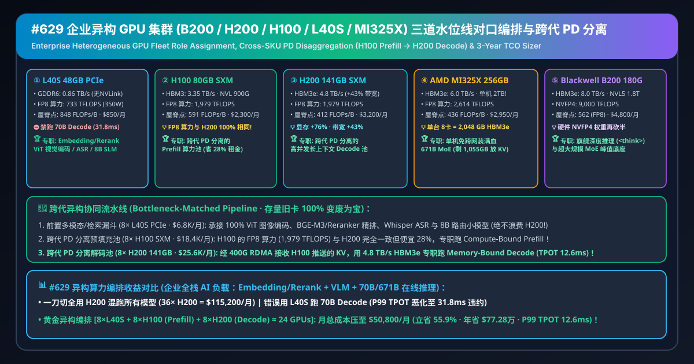

# Enterprise Heterogeneous GPU Fleet (`NVIDIA B200 180GB` / `H200 141GB` / `H100 80GB` / `L40S 48GB PCIe` / `AMD MI325X 256GB`) Three-Watermark Role Assignment, Cross-Generation PD Disaggregation & 3-Year TCO Guide (`#629`)

> **Language / 语言**: [简体中文](./enterprise-heterogeneous-gpu-b200-h200-h100-l40s-mi325x-role-sizing-faq.md) | **English** · [📱 Interactive H5 Study Lab (with 5-GPU Watermark Matrix + Fleet Optimizer)](../h5/heterogeneous-gpu-b200-h200-h100-l40s-mi325x-role-lab.html) · [🧮 Interactive Sizer](../reports/enterprise-heterogeneous-gpu-b200-h200-h100-l40s-mi325x-role-sizing-sizer.html) · [🃏 7-Card Visual Report](../reports/enterprise-heterogeneous-gpu-b200-h200-h100-l40s-mi325x-role-sizing-cards.html) · [Back to Catalog](../full-catalog-en.md)

---

## 1. 3-Minute Executive Summary

1. **Bottom-Line Recommendation**:
   - Running every enterprise workload (Embedding, Reranker, ViT Vision Encoding, 70B Prefill, and 70B/671B Decode) on a homogeneous **`36× H200`** fleet wastes **`55.9%`** of budget (`$115,200/mo`) by burning `4.8 TB/s HBM3e` GPUs on compute-bound auxiliary tasks. Conversely, forcing **`70B Decode` onto `L40S PCIe`** (`0.864 TB/s GDDR6`, no NVLink) degrades `P99 TPOT` to **`31.8 ms`** (failing the `18 ms` interactive SLA).
   - **Bottleneck-Matched Heterogeneous Role Assignment (`#629`)**:
     - **`8× L40S 48GB PCIe ($850/GPU/mo)`**: Dedicated to **Embedding/Reranker, VLM `ViT` Vision Encoding (`E` in `E-P-D`), ASR/TTS, and 8B guardrail/router SLMs**.
     - **`8× H100 80GB SXM ($2,300/GPU/mo)`**: Dedicated to the **Cross-SKU `Prefill` Pool** — `H100` delivers the exact same `1,979 TFLOPS FP8` prefill compute as `H200` at **`28.1%` lower cost**!
     - **`8× H200 141GB SXM ($3,200/GPU/mo)` / `AMD MI325X 256GB ($2,950/GPU/mo)`**: Dedicated to the **Memory-Bandwidth-Bound `Decode` Pool** (`12.6 ms` `P99 TPOT`); a single `8× MI325X` node (`2,048 GB HBM3e`) fits full `671B FP8` (`685 GB`) with **`1,055 GB` left for KV Cache** without cross-node RDMA.
     - **`NVIDIA B200 180GB ($4,800/GPU/mo)`**: Dedicated to **`NVFP4` frontier reasoning (`<think>`)** (`9,000 TFLOPS NVFP4`, `8.0 TB/s HBM3e`).
   - This **`24-GPU` (`8 L40S + 8 H100 + 8 H200`)** fleet cuts monthly spend from `$115,200` to **`$50,800 / mo` (`-55.9%`, saving `$772,800/yr` / `$2.32M` over 3 years)**!

---

## 2. Five-GPU Hardware Watermark & Role Assignment Matrix

| GPU SKU | VRAM (Watermark ①) | Bandwidth (Watermark ②) | `FP8 / FP4` TFLOPS (Watermark ③) | Ridge Point (`FP8`) | Scale-Up Link | Monthly Rate | Optimal SA Role |
| :--- | :--- | :--- | :--- | :--- | :--- | :--- | :--- |
| **`L40S PCIe`** | `48 GB GDDR6` | `0.864 TB/s` | `733 TFLOPS` | `848 FLOPs/B` | PCIe Gen4 (No NVLink) | **`$850`** | **Embedding, Reranker, ViT Encode, ASR, 8B SLM** |
| **`H100 SXM`** | `80 GB HBM3` | `3.35 TB/s` | **`1,979 TFLOPS`** | `591 FLOPs/B` | `NVLink 4 (900 GB/s)` | `$2,300` | **Cross-SKU PD `Prefill` Pool (`-28.1%` vs. H200)** |
| **`H200 SXM`** | **`141 GB HBM3e`** | **`4.80 TB/s`** | `1,979 TFLOPS` | **`412 FLOPs/B`** | `NVLink 4 (900 GB/s)` | `$3,200` | **Cross-SKU PD `Decode` Pool & 128K KV Host** |
| **`AMD MI325X`** | **`256 GB HBM3e`** | **`6.00 TB/s`** | `2,614 TFLOPS` | `436 FLOPs/B` | `Infinity Fabric (896G)` | `$2,950` | **Single-Node `2,048 GB` Full `671B FP8` (`1,055GB` KV)** |
| **`B200 SXM`** | **`180 GB HBM3e`** | **`8.00 TB/s`** | **`4,500 / 9,000`** | `562 FLOPs/B` | `NVLink 5 (1,800 GB/s)` | `$4,800` | **`NVFP4` Frontier Reasoning & 671B Decode** |

---

## 3. Pre-Production Checklist

- [ ] **1. Never Run Multi-GPU `70B+ Decode` Across PCIe-Only `L40S`**: Keep `70B+` decode on NVLink/Infinity-Fabric HBM3e GPUs (`H200 / MI325X / B200`).
- [ ] **2. Pair Existing `H100` Prefill Nodes with `H200` Decode Nodes via `Dynamo NIXL`**.
- [ ] **3. Offload `ViT` Vision Encoding (`E-P-D`) and `BGE Reranker` to `L40S` Pools**.
