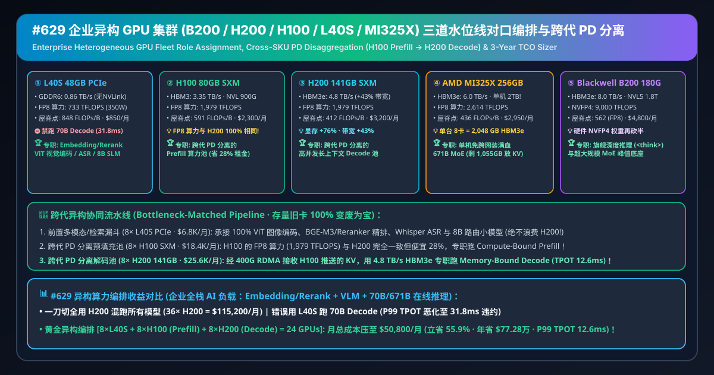
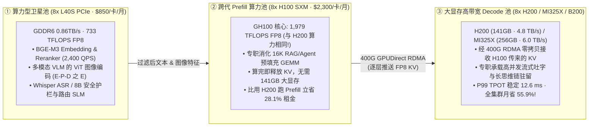

# 企业异构 GPU 集群（`NVIDIA B200 180GB` / `H200 141GB` / `H100 80GB` / `L40S 48GB PCIe` / `AMD MI325X 256GB`）三道水位线硬件对口编排、跨代 PD 分离（`H100 Prefill + H200/MI325X Decode`）与三年 TCO 选型指南（`#629`）

> **Language / 语言**: **简体中文** | [English](./enterprise-heterogeneous-gpu-b200-h200-h100-l40s-mi325x-role-sizing-faq.en.md) · [📱 交互式 H5 精读页（含五款芯片三道水位线对比 + 异构编排计算器）](../h5/heterogeneous-gpu-b200-h200-h100-l40s-mi325x-role-lab.html) · [🧮 交互式容量计算器 Sizer](../reports/enterprise-heterogeneous-gpu-b200-h200-h100-l40s-mi325x-role-sizing-sizer.html) · [🃏 7-Card 评测报告](../reports/enterprise-heterogeneous-gpu-b200-h200-h100-l40s-mi325x-role-sizing-cards.html) · [返回总目录](../full-catalog-zh.md)

---

## 一、3 分钟核心结论卡片（Executive Summary）

1. **一句话结论**：
   - 现实中的企业智算中心几乎都是**跨代、跨系列的异构 GPU 池**（既有存量的 `H100 80GB`、`L40S 48GB PCIe`，又有新采购的 `H200 141GB`、`B200 180GB` 或 `AMD Instinct MI325X 256GB`）。
   - **两大常见败笔**：
     1. **一刀切“全买顶配 H200/B200 跑所有任务”**：拿 `$3,200/月`、带 `4.8 TB/s HBM3e` 的 H200 去跑计算密集的 `BGE-M3 Embedding / Reranker`、`ViT 视觉编码` 或 `Whisper ASR`，高昂的 HBM3e 带宽闲置 `85%`，月度账单高达 **`$115,200 / 月`（36 张 H200）**；
     2. **反过来“用廉价 L40S 强跑 70B 大模型 Decode”**：`L40S` 采用 `GDDR6` 显存（带宽仅 **`0.864 TB/s`**，不到 H200 的 `1/5.5`）且**没有 NVLink**（跨卡 `TP=4` 只能走慢速 PCIe），导致 `70B FP8` 的 `P99 TPOT` 恶化至 **`31.8 ms`**（严重违约 `18 ms` 红线）。
   - **架构师“按三道水位线瓶颈对口派活（Bottleneck-Matched Role Assignment）”黄金法则**：
     - **`L40S 48GB PCIe ($850/月)` 专职做“算力型卫星池”**：100% 承接 `Embedding / Reranker`、多模态 `E-P-D` 中的 **`ViT 视觉编码 (Encode)`**、`ASR/TTS` 语音及 `7B/8B` 护栏/路由小模型；
     - **`H100 80GB SXM ($2,300/月)` 专职做“跨代 PD 分离的 Prefill 池”**：因为 **H100 的 FP8 算力（`1,979 TFLOPS`）与 H200 100% 完全相同，但月租金便宜 `28.1%`**，拿存量 H100 专跑算力受限的 Prefill 性价比极高；
     - **`H200 141GB ($3,200/月)` / `MI325X 256GB ($2,950/月)` 专职做“大显存高带宽 Decode 池”**：利用 `4.8–6.0 TB/s HBM3e` 与超大显存承接 `70B` 长上下文 Decode 或**单机 8×MI325X (`2,048 GB`) 免跨网直接装下满血 `DeepSeek 671B FP8`**；
     - **`B200 180GB ($4,800/月)` 专职做“原生 `NVFP4` 深度推理 (`<think>`) 与超大 MoE 核心池”**：利用 `8.0 TB/s` 带宽与 `9,000 TFLOPS NVFP4` 算力将单卡 Decode 吞吐推高 `3.2 倍`！
   - **综合收益**：通过 **`8× L40S + 8× H100 (Prefill) + 8× H200 (Decode) = 24 张异构 GPU`** 协同编排，将 `P99 TPOT` 锁死在 **`12.6 ms`**，同时将月度总成本从全 H200 方案的 `$115,200` 压降至 **`$50,800 / 月`（立省 `55.9%` / 每年净省 `$772,800`）**！

2. **五大主流企业级 AI 加速卡“三道水位线”硬核参数与角色定位于一表**：

| 芯片型号 | 显存容量 (水位线 ①) | 显存带宽 (水位线 ②) | `FP8` / `FP4` 算力 (水位线 ③) | 屋脊拐点 (`FP8 FLOPs/B`) | 机内互联 (`Scale-Up`) | 市场参考月租 | 架构师唯一黄金定位 |
| :--- | :--- | :--- | :--- | :--- | :--- | :--- | :--- |
| **`NVIDIA L40S`** | `48 GB GDDR6` | `0.864 TB/s` | `733 TFLOPS` (无 FP4) | **`848` (极度偏算力)** | 仅 `PCIe Gen4 x16` (无 NVLink) | **`$850 / 月`** | **Embedding/Reranker、ViT 视觉编码、ASR、8B SLM** |
| **`NVIDIA H100 SXM`** | `80 GB HBM3` | `3.35 TB/s` | **`1,979 TFLOPS`** | `591` | `NVLink 4 (900 GB/s)` | `$2,300 / 月` | **跨代 PD 分离的 `Prefill` 算力池、70B 标准训推** |
| **`NVIDIA H200 SXM`** | **`141 GB HBM3e`** | **`4.80 TB/s`** | `1,979 TFLOPS` | **`412` (带宽充沛)** | `NVLink 4 (900 GB/s)` | `$3,200 / 月` | **跨代 PD 分离的 `Decode` 带宽池、128K 长上下文** |
| **`AMD MI325X`** | **`256 GB HBM3e`** | **`6.00 TB/s`** | `2,614 TFLOPS` | `436` | `Infinity Fabric (896 GB/s)` | `$2,950 / 月` | **单机 `2,048 GB` 免跨网装满血 `671B MoE` (`+1,055GB` KV)** |
| **`NVIDIA B200 SXM`** | **`180 GB HBM3e`** | **`8.00 TB/s`** | **`4,500` (FP8) `9,000` (`NVFP4`)** | `562` (FP8) | `NVLink 5 (1,800 GB/s)` | `$4,800 / 月` | **硬件 `NVFP4` 旗舰 `671B/R1` 深度推理与高密底座** |

---

## 二、灵魂拷问 Q&A：跨代 PD 分离、L40S 边界与 MI325X 单机 671B 算账

### Q1：为什么“用 `H100 80GB` 做 Prefill 池 + 用 `H200 141GB` 做 Decode 池”被称为企业利旧降本的“神仙组合”？
- **答**：对比 `H100 SXM` 与 `H200 SXM` 的硅片架构就会发现一个极具价值的非对称事实：
  1. **两者的 Tensor Core 计算核心是完全同一颗 `GH100` 芯片**：在 `FP8` 或 `BF16` 下，`H100` 与 `H200` 的峰值算力**一模一样，都是 `1,979 TFLOPS`（FP8）**！
  2. **在 Compute-Bound 的 Prefill 阶段**：因为算术强度高达 `2,048+ FLOPs/Byte`，瓶颈 100% 在 Tensor Core 算力而不在 HBM 带宽，且 Prefill 算完立即把 KV 推送给 Decode 节点并释放显存（不需要 141GB 大显存驻留长尾 KV），所以 **`1` 张 `$2,300/月` 的 H100 跑 Prefill 的速度与 `$3,200/月` 的 H200 几乎完全相等（相差 `< 2%`），但成本直接立省 `28.1%`**！
  3. **在 Memory-Bandwidth-Bound 的 Decode 阶段**：`H200` 凭借 `141 GB` 容量（`+76%`）与 `4.8 TB/s` 带宽（`+43.3%`），单实例可容纳的并发 KV 会话数是 H100 的 **`2.2 倍`**，且单步 `TPOT` 比 H100 快 **`30.2%`**！
  4. **跨代异构 PD 组合结论**：通过 `Dynamo NIXL / Mooncake` 走 `400G GPUDirect RDMA` 连接 **`H100 Prefill 池` $\rightarrow$ `H200 Decode 池`**，让存量 H100 发挥 100% 的算力价值，让新购 H200 发挥 100% 的大带宽显存价值！

---

### Q2：为什么在私有化部署满血 `DeepSeek-V3/R1 671B` 时，单台 8 卡 `AMD Instinct MI325X (8×256GB = 2,048GB)` 或 4 卡 `Blackwell B200 NVFP4` 具有颠覆性的架构优势？
- **答**：我们用**第一道水位线（显存容量）**算一笔账：
  - `DeepSeek-V3/R1 671B` 在 `FP8` 下主模型权重占 `671 GB`，加上原生 `MTP` 草案头 `14 GB`，**仅静态权重就高达 `685 GB`**：
    1. **在 `8× H100 (640 GB)` 上**：连静态权重都塞不下（`685 GB > 640 GB`），**被迫拆成两台 8 卡机器（16 卡）跨网部署**；
    2. **在单台 `8× H200 (1,128 GB)` 上**：扣除 `15%` 系统余量后可用显存约 `958 GB`，装完 `685 GB` 权重后仅剩 **`273 GB`** 放 KV Cache；
    3. **在单台 `8× AMD MI325X (8×256 GB = 2,048 GB)` 上**：扣除 `15%` 余量后可用显存高达 **`1,740 GB`**，装完 `685 GB` 权重后**还剩下整整 `1,055 GB` HBM3e 显存用来放 KV Cache（是单机 H200 可用 KV 空间的 `3.86 倍`）**！这意味着**完全不需要跨节点 RDMA 网络**，单台 8 卡机器在机内 `896 GB/s Infinity Fabric` 内就能跑满超高并发 `671B` 推理！
    4. **在 `Blackwell B200 (180 GB · NVFP4)` 上**：开启硬件原生 `NVFP4` 后，`671B` 权重直接减半至 **`~342 GB`**，仅需 **`4 张 B200`（半台节点 `720 GB`）** 即可轻松装下并跑出 `< 8.5 ms` 的极致 `TPOT`！

---

## 三、企业混合 AI 负载三种硬件配置方案三年 TCO 对比矩阵

| 评估维度 | 方案 A：一刀切全买 `36x H200` 同构混跑所有模型 | 方案 B：错误低配用 `L40S` 强跑 `70B Decode` (`48x L40S`) | 方案 C：瓶颈对口异构编排 (`8x L40S + 8x H100 Prefill + 8x H200 Decode`) 🏆 |
| :--- | :--- | :--- | :--- |
| **大模型 `P99 TPOT / ITL` 吐字延迟** | `12.4 ms`（达标但严重浪费） | `31.8 ms`（GDDR6+PCIe 瓶颈严重违约 ✕） | **`12.6 ms`（与全 H200 持平，丝滑达标 ✓）** |
| **多模态 `ViT` + `Embedding/Rerank` 吞吐** | 占用昂贵 H200 显存与卡槽 | `2,400 QPS` | **`2,400 QPS`（由 `$850/月` 的 L40S 专职高效承接 ✓）** |
| **集群 GPU 总卡数与结构** | `36 张 H200` | `48 张 L40S`（无法满足大模型 SLA ✕） | **`24 张 GPU`（`8 L40S + 8 H100 + 8 H200` ✓）** |
| **月度算力总租金 (`Monthly TCO`)** | `$115,200 / 月` | `$40,800 / 月`（但业务 SLA 不合格） | **`$50,800 / 月`（较全 H200 立省 `55.9%` ✓）** |
| **三年累计总拥有成本 (`3-Year TCO`)** | `$4,147,200` | 不合格方案 | **`$1,828,800`（三年净省 `$231.8万 / -$77.28万/年` ✓）** |

---

## 四、异构 GPU 集群生产编排核对清单（SA Pre-Production Checklist）

- [ ] **1. 严禁在无 NVLink 的 PCIe 卡（如 `L40S`）上跑跨卡大 `TP` 的大模型 Decode**：`L40S` 仅用于单卡能装下的 `<=14B` 模型、`Embedding/Reranker`、`ViT` 编码或离线批处理；
- [ ] **2. 存量 `H100 80GB` 优先划入跨代 PD 分离的 `Prefill` 池**：利用 K8s 节点标签（`ai.role=prefill, gpu=h100` vs `ai.role=decode, gpu=h200`）由 `Dynamo` 统一调度，白捡 `28%` 算力差价；
- [ ] **3. 跨厂商（NVIDIA CUDA + AMD ROCm）共池统一采用 `vLLM V1 / SGLang + OpenAI 兼容网关`**：在网关层屏蔽底层芯片差异，将无跨机通信依赖的 `671B` 单机大吞吐实例路由至 `8× MI325X` 节点。
