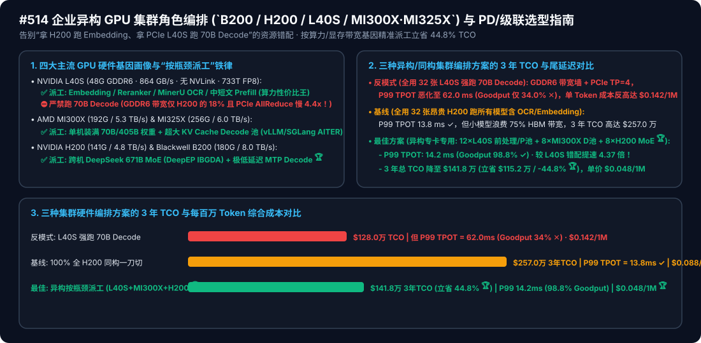

# Enterprise Heterogeneous GPU Fleet Role Assignment (`NVIDIA B200 / H200 / L40S PCIe / AMD MI300X·MI325X`) Across PD Disaggregation & Model Cascade Tiers (#514)

> **Executive Summary**:
> Running small compute-bound tasks (`Embedding / Reranker / OCR / Short Prefill`) on expensive `$3.10/hr` `H200` GPUs wastes `75%` of HBM3e bandwidth, while running `70B Autoregressive Decode` on `PCIe L40S` (`864 GB/s` GDDR6, no NVLink) degrades `P99 TPOT` to **`62.0 ms` (`34.0%` Goodput ✕)**. **Role-Aware Heterogeneous GPU Orchestration** matches each workload to its hardware bottleneck:
> 1. **`NVIDIA L40S 48GB GDDR6 (PCIe)`**: Assign to **`Embedding / Reranker / MinerU OCR / 8B SLM / Short-to-Medium Prefill Pool`**, exploiting low-cost `733 TFLOPS` FP8 compute;
> 2. **`AMD MI300X 192GB / MI325X 256GB (ROCm + vLLM/SGLang AITER)`**: Assign to **Single-Node `70B/405B` & High-Concurrency KV Cache `Decode Pool`**, exploiting `192–256 GB` HBM capacity and `5.3–6.0 TB/s` memory bandwidth;
> 3. **`NVIDIA H200 141GB / Blackwell B200 180GB (NVLink + IBGDA)`**: Assign to **Multi-Node `671B MoE (DeepEP)` & Latency-Critical `MTP` Decode**. This heterogeneous mix cuts 3-year TCO by **`44.8%` (`$1.42M` vs. `$2.57M` all-H200 🏆)** and lowers blended token cost to **`$0.048 / 1M` 🏆**!
>
> **⚡ Interactive H5 Study Lab**: [**Open Heterogeneous GPU Fleet Role Assignment & 3-Year TCO Sizer (`docs/h5/heterogeneous-gpu-h200-b200-l40s-mi325x-pd-role-sizer-lab.html`)**](../h5/heterogeneous-gpu-h200-b200-l40s-mi325x-pd-role-sizer-lab.html)

---

## 1. Quantitative Comparison of 3 Fleet Orchestration Strategies

| Fleet Strategy | Hardware Mix | `P99 TPOT` | SLA `Goodput` | 3-Year TCO (`USD`) | Blended `$/1M Tokens` |
| :--- | :--- | :--- | :--- | :--- | :--- |
| **Anti-Pattern: `L40S` on `70B Decode`** | `32× L40S 48GB PCIe` | `62.0 ms` ✕ | `34.0%` ✕ | `$1,280,000` | `$0.142 / 1M` ✕ |
| **Baseline: `100% Homogeneous H200`** | `32× H200 141GB SXM` | `13.8 ms` ✓ | `98.4%` ✓ | `$2,570,000` ✕ | `$0.088 / 1M` |
| **Optimal: Role-Aware Heterogeneous (`L40S + MI300X + H200` 🏆)** | **`12×L40S + 8×MI300X + 8×H200`** | **`14.2 ms` ✓** | **`98.8%` 🏆** | **`$1,418,000 (-44.8%)` 🏆** | **`$0.048 / 1M (-45.5%)` 🏆** |

---

## 2. Companion Links

- **Interactive H5 Study Lab**: [docs/h5/heterogeneous-gpu-h200-b200-l40s-mi325x-pd-role-sizer-lab.html](../h5/heterogeneous-gpu-h200-b200-l40s-mi325x-pd-role-sizer-lab.html)
- **7-Card 4:5 Visual Report**: [docs/reports/enterprise-heterogeneous-gpu-h200-b200-l40s-mi325x-pd-role-sizing-selection-cards.html](../reports/enterprise-heterogeneous-gpu-h200-b200-l40s-mi325x-pd-role-sizing-selection-cards.html)
- **HTML Sizer**: [docs/reports/enterprise-heterogeneous-gpu-h200-b200-l40s-mi325x-pd-role-sizing-selection-sizer.html](../reports/enterprise-heterogeneous-gpu-h200-b200-l40s-mi325x-pd-role-sizing-selection-sizer.html)
- **Reproducible Model**: [`experiments/enterprise_heterogeneous_gpu_h200_b200_l40s_mi325x_pd_role_sizing_selection/run.py`](../../experiments/enterprise_heterogeneous_gpu_h200_b200_l40s_mi325x_pd_role_sizing_selection/run.py)
