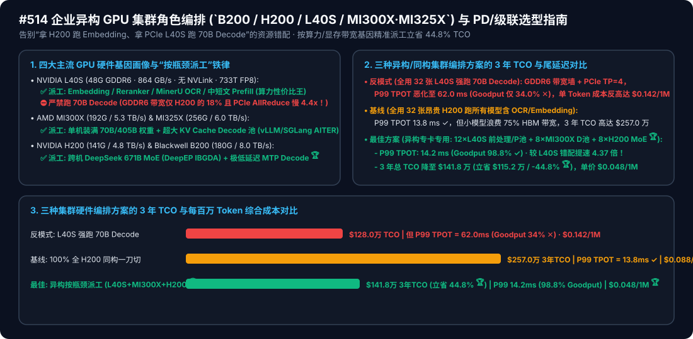

# 企业异构 GPU 集群角色编排与选型指南：跨代/跨厂算力（`NVIDIA B200 / H200 / L40S PCIe / AMD MI300X·MI325X`）在 PD 分离、大小模型分流与 CUDA/ROCm 共池中的黄金匹配及三年 TCO 沙盘 (#514)

> **核心观点（Executive Summary）**：
> 企业智算中心建设中常见的两大资源错配是：**“拿单张 `$3.10/hr` 的 `H200` 去跑 `BGE-M3` 向量化、`MinerU OCR` 或计算受限的短文 Prefill（浪费 `75%` HBM3e 带宽）”**，以及反过来 **“拿没有 NVLink、仅有 `864 GB/s` GDDR6 显存带宽的 `PCIe L40S` 去强跑 `70B` 自回归 Decode（导致 `P99 TPOT` 恶化至 `62.0 ms`，达标 Goodput 跌至 `34.0%` ✕）”**。本专题提出 **“按硬件算力/带宽基因精准派工（Role-Aware Heterogeneous GPU Orchestration）”**：
> 1. **`NVIDIA L40S 48GB GDDR6 (PCIe)` 的黄金定位**：凭借高达 `733 TFLOPS` 的 FP8 Tensor Core 与极低采购/租赁成本，专职承载 **`Embedding / Reranker / 文档 OCR / 7B-8B 快筛 / 中短文 Prefill 池（P-Pool）`**；
> 2. **`AMD MI300X 192GB / MI325X 256GB (ROCm + vLLM/SGLang AITER)` 的黄金定位**：凭借单卡 `192–256 GB` 海量 HBM 与 `5.3–6.0 TB/s` 超高显存带宽，专职承载 **单机免跨机 `70B/405B` 与超大 KV Cache 的 `Decode 池（D-Pool）`**；
> 3. **`NVIDIA H200 141GB / Blackwell B200 180GB (NVLink + IBGDA)` 的黄金定位**：专职承载 **跨机 `DeepSeek 671B MoE (DeepEP)` 与延迟极敏的 `MTP` 旗舰推理池**。三类异构芯片协同共池后，3 年总 TCO 从全 H200 同构方案的 `$257.0 万` 降至 **`$141.8 万`（净省 `$115.2 万 / -44.8%` 🏆）**，每百万 Token 综合成本降至 **`$0.048 / 1M` 🏆**！
>
> **⚡ 配套交互式 H5 精读沙盘**：[**打开异构 GPU 集群 (B200/H200/L40S/MI300X) 角色派工与 3 年 TCO 计算器 (`docs/h5/heterogeneous-gpu-h200-b200-l40s-mi325x-pd-role-sizer-lab.html`)**](../h5/heterogeneous-gpu-h200-b200-l40s-mi325x-pd-role-sizer-lab.html)

---

## 一、 灵魂拷问：四大主流 GPU 芯片的硬件基因有何差异？为什么不能混为一谈？

### Q1：为什么 `L40S` 跑 Prefill 很快，跑 `70B Decode` 却慢如蜗牛？
- **算力比 vs. 显存带宽比的巨大剪刀差**：
  - **FP8 算力对比**：`L40S`（`733 TFLOPS`）拥有 `H200`（`1,979 TFLOPS`）约 **`37%` 的算力**，而单卡价格不到 H200 的 `35%`——因此在 **计算受限（Compute-bound）** 的 `Embedding / Reranker / OCR / Prefill` 阶段，`L40S` 的单位美元算力性价比极高！
  - **显存带宽与互联对比**：`L40S` 采用 `GDDR6` 显存，带宽仅 **`0.864 TB/s`**（仅为 `H200 4.8 TB/s` 的 **`18%`**、`MI300X 5.3 TB/s` 的 **`16.3%`**），且 **没有 NVLink**（4 卡 `TP=4` 必须走 `PCIe Gen4 64 GB/s` 做 160 次 AllReduce）。在 **显存带宽与同步延迟受限** 的 `70B Decode` 阶段，`L40S` 的 `P99 TPOT` 高达 **`62.0 ms`**，比 `H200 / MI300X`（`13.8–14.2 ms`）慢 **`4.37 倍`**！

---

## 二、 主流 GPU 硬件规格与黄金角色派工决策矩阵

| GPU 硬件型号 | 显存容量与类型 | 显存带宽 (`TB/s`) | `FP8` 峰值算力 | 机内互联总线 | 架构师黄金派工角色 (`Best-Fit Role`) | 严禁错配红线 (`Anti-Pattern`) |
| :--- | :--- | :--- | :--- | :--- | :--- | :--- |
| **`NVIDIA L40S` (PCIe)** | `48 GB GDDR6` | `0.864 TB/s` | `733 TFLOPS` | `PCIe Gen4 (无NVLink)` | **`Embedding / Reranker / OCR / 8B / P-Pool` ✓** | ⛔ **严禁跑 `>=70B` 在线 Decode** |
| **`AMD MI300X / MI325X`** | **`192–256 GB HBM3/3e` 🏆** | **`5.3–6.0 TB/s` 🏆** | `2,610 TFLOPS` | `Infinity Fabric 896 GB/s` | **单机 `70B/405B` 与大并发长 KV `D-Pool` 🏆** | ⚠️ 需固定使用 `vLLM/SGLang ROCm AITER` 镜像 |
| **`NVIDIA H200` (SXM)** | `141 GB HBM3e` | `4.8 TB/s` | `1,979 TFLOPS` | `NVLink 4.0 (900 GB/s)` | **跨机 `671B MoE (DeepEP)` + 极低延迟 `D-Pool` 🏆** | ⛔ **勿拿高价 HBM3e 卡跑纯 CPU/OCR 小任务** |
| **`NVIDIA Blackwell B200`** | `180–192 GB HBM3e` | **`8.0 TB/s` 🏆** | **`4,500 TFLOPS (FP8) / 9P (FP4)` 🏆** | `NVLink 5.0 (1.8 TB/s)` | **超长思维链 `CoT` 与 `NVFP4` 旗舰推理池 🏆** | ⛔ 需配齐高密液冷/供电机柜 |

### 三套集群硬件编排方案的线上 SLA 与 3 年 TCO 对比

| 集群硬件编排方案 | 硬件配置组合 | `P99 TPOT` | 达标 `Goodput` | 3 年总 TCO (`USD`) | 每百万 Token 成本 |
| :--- | :--- | :--- | :--- | :--- | :--- |
| **反模式：全 `L40S` 强跑 `70B Decode`** | `32× L40S 48GB PCIe` | `62.0 ms` ✕ | `34.0%` ✕ | `$1,280,000` | `$0.142 / 1M` ✕ |
| **基线：`100% 全 H200` 同构包打天下** | `32× H200 141GB SXM` | `13.8 ms` ✓ | `98.4%` ✓ | `$2,570,000` ✕ | `$0.088 / 1M` |
| **最佳：异构专卡专用 (`L40S + MI300X + H200` 🏆)** | **`12×L40S + 8×MI300X + 8×H200`** | **`14.2 ms` ✓** | **`98.8%` 🏆** | **`$1,418,000 (-44.8%)` 🏆** | **`$0.048 / 1M (-45.5%)` 🏆** |

---

## 三、 生产落地核对清单（SA Production Checklist）

- [ ] **在 Kubernetes (`Kueue + NodeSelector/Taints`) 中建立三类物理算力池标签**：`pool=compute-gddr6 (L40S)`、`pool=memory-hbm-rocm (MI300X/MI325X)` 与 `pool=flagship-nvlink (H200/B200)`，由 AI Gateway 按模型尺寸与任务类型自动路由。
- [ ] **跨厂异构集群统一锁定 `OpenAI 兼容 API + vLLM / SGLang` 容器抽象层**：上层业务与 Agent 编排完全屏蔽底层是 `CUDA` 还是 `ROCm`，实现零代码修改跨芯弹性调度。

---

## 四、 延伸阅读与配套工具

- **交互式 H5 精学沙盘**：[docs/h5/heterogeneous-gpu-h200-b200-l40s-mi325x-pd-role-sizer-lab.html](../h5/heterogeneous-gpu-h200-b200-l40s-mi325x-pd-role-sizer-lab.html)
- **7-Card 4:5 视觉评测卡片**：[docs/reports/enterprise-heterogeneous-gpu-h200-b200-l40s-mi325x-pd-role-sizing-selection-cards.html](../reports/enterprise-heterogeneous-gpu-h200-b200-l40s-mi325x-pd-role-sizing-selection-cards.html)
- **交互式 Sizer 测算器**：[docs/reports/enterprise-heterogeneous-gpu-h200-b200-l40s-mi325x-pd-role-sizing-selection-sizer.html](../reports/enterprise-heterogeneous-gpu-h200-b200-l40s-mi325x-pd-role-sizing-selection-sizer.html)
- **可复现实验模型**：[`experiments/enterprise_heterogeneous_gpu_h200_b200_l40s_mi325x_pd_role_sizing_selection/run.py`](../../experiments/enterprise_heterogeneous_gpu_h200_b200_l40s_mi325x_pd_role_sizing_selection/run.py)
