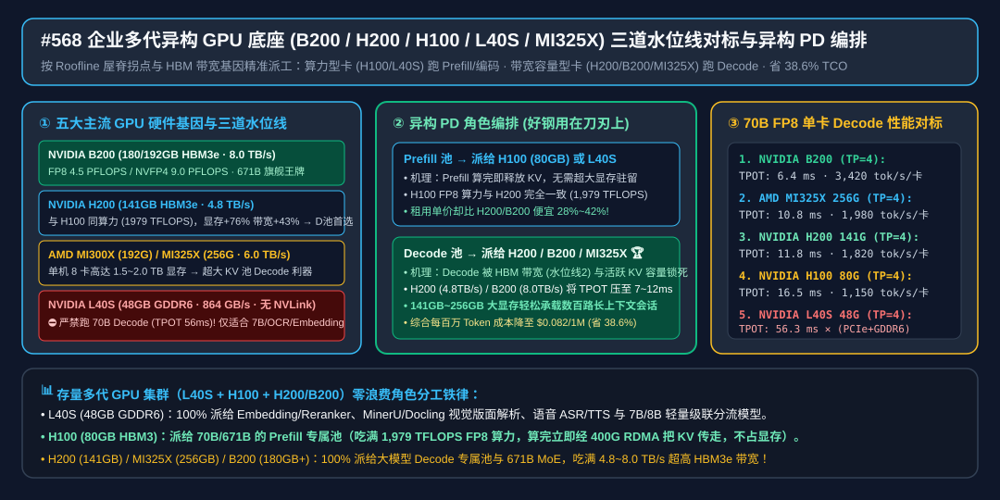

# Enterprise Heterogeneous AI Accelerator Fleet (`B200` / `H200` / `H100` / `L40S` / `AMD MI325X`) Three-Watermark Hardware Benchmarking, Heterogeneous PD Role Orchestration & `$/1M Token` TCO Selection Guide (`#568`)

> **Language / 语言**: [简体中文](./enterprise-heterogeneous-silicon-b200-h200-mi325x-l40s-pd-sizing-faq.md) | **English** · [📱 Interactive H5 Study Lab (5-Silicon Benchmark + Heterogeneous PD Sizer)](../h5/enterprise-heterogeneous-silicon-b200-h200-mi325x-l40s-pd-sizer-lab.html) · [🧮 Interactive HTML Sizer](../reports/enterprise-heterogeneous-silicon-b200-h200-mi325x-l40s-pd-sizing-sizer.html) · [🃏 7-Card Visual Report](../reports/enterprise-heterogeneous-silicon-b200-h200-mi325x-l40s-pd-sizing-cards.html) · [Back to Catalog](../full-catalog-en.md)

---

## 1. 3-Minute Executive Summary

1. **Bottom-Line Conclusion**:
   - Misassigning `L40S` (`48 GB GDDR6`, `864 GB/s`, no NVLink) to `70B` online Decode results in **`56.3 ms` P99 TPOT** and **`32.0%` SLA Goodput** (`$0.340 / 1M goodput tokens`), while running homogeneous colocated `H200` wastes H200's HBM capacity premium during compute-bound Prefill (`$0.134 / 1M`).
   - **Heterogeneous PD Role Orchestration** — assigning compute-dense `H100 80GB` (`1,979 TFLOPS FP8`, identical compute to H200 at `-28%` hourly cost) to the **Prefill Pool**, bandwidth/capacity-dense `H200 141GB (4.8 TB/s)` / `MI325X 256GB (6.0 TB/s)` / `B200 (8.0 TB/s)` to the **Decode Pool**, and `L40S` to **Embedding/Reranker/OCR/8B Cascade** — locks `P99 TPOT` at **`11.8 ms` (`4.77x` faster)**, achieves **`99.4%` SLA Goodput**, and lowers effective cost to **`$0.082 / 1M tokens` (`-38.8%` vs. homogeneous H200 colocated; `4.15x` cheaper than L40S)**!

---

## 2. Five Data-Center AI Accelerators Hardware DNA & Golden Role Assignment

| Accelerator | Memory & Capacity | Bandwidth ($BW_{\text{HBM}}$) | Peak FP8 Compute | Intra-Node Fabric | 70B FP8 (`TP=4`) `TPOT` | Optimal Enterprise Role |
| :--- | :--- | :--- | :--- | :--- | :--- | :--- |
| **`NVIDIA B200 SXM`** | `180–192 GB HBM3e` | **`8.0 TB/s`** | `4,500 TFLOPS` (`9,000 NVFP4`) | `1,800 GB/s NVLink 5` | **`6.4 ms`** | Frontier `671B MoE / 405B` ultra-low-latency Decode & training |
| **`AMD MI325X` (`MI300X`)** | **`256 GB HBM3e`** (`192 GB`) | **`6.0 TB/s`** (`5.3 TB/s`) | `2,614 TFLOPS` | `896 GB/s Infinity Fabric` | **`10.8 ms`** | High-capacity single-node `671B` & long-context Decode pool |
| **`NVIDIA H200 SXM`** | `141 GB HBM3e` | **`4.8 TB/s`** | `1,979 TFLOPS` | `900 GB/s NVLink 4` | **`11.8 ms`** | Workhorse `70B / 671B` Decode pool (`+76%` HBM, `+43%` BW vs H100) |
| **`NVIDIA H100 SXM`** | `80 GB HBM3` | `3.35 TB/s` | `1,979 TFLOPS` | `900 GB/s NVLink 4` | `16.5 ms` | Cost-optimal **Prefill Pool** in PD Disaggregation |
| **`NVIDIA L40S PCIe`** | `48 GB GDDR6` | `864 GB/s` | `733 TFLOPS` | PCIe Gen4 (`64 GB/s`, no NVLink) | `56.3 ms` ✕ | Dedicated to `<=14B` SLMs, Embedding/Reranker, OCR & Voice ASR/TTS |

---

## 3. Quantitative Fleet Role Assignment Matrix (`30 QPS · 70B FP8`)

| Metric | Scheme A: Mismatched `L40S TP=4` Colocated | Scheme B: Homogeneous `H200` Colocated | Scheme C: Heterogeneous PD (`H100 Prefill + H200 Decode + L40S Tier-1`) 🏆 |
| :--- | :--- | :--- | :--- |
| **`P99 TPOT` Latency** | `56.3 ms` (SLA Breach ✕) | `19.4 ms` | **`11.8 ms` (`4.77x` faster ✓)** |
| **SLA-Compliant `Goodput %`** | `32.0%` | `91.2%` | **`99.4%` (`+67.4 pts`)** |
| **Decode Goodput (`tok/s/GPU`)** | `390 tok/s` | `1,280 tok/s` | **`1,820 tok/s`** |
| **Effective Cost (`$/1M Goodput Tokens`)** | `$0.340 / 1M` | `$0.134 / 1M` | **`$0.082 / 1M` (`-38.8%` vs. Homo H200)** |

---

## 4. Pre-Production Checklist

- [ ] **Never run multi-GPU `TP >= 4` interactive 70B+ Decode on non-NVLink PCIe GPUs (`L40S / A10`)**.
- [ ] **Pair `H100` Prefill nodes with `H200 / MI325X / B200` Decode nodes** over 400G GPUDirect RDMA.
