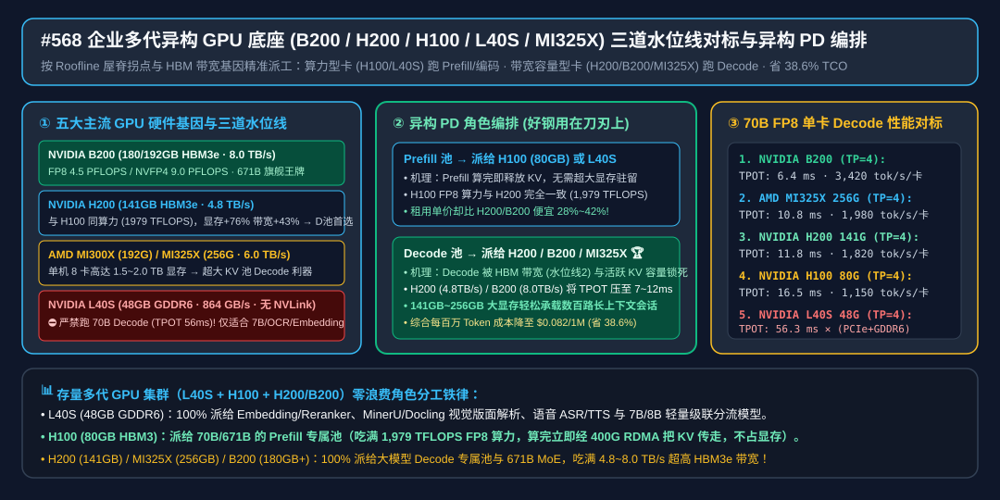
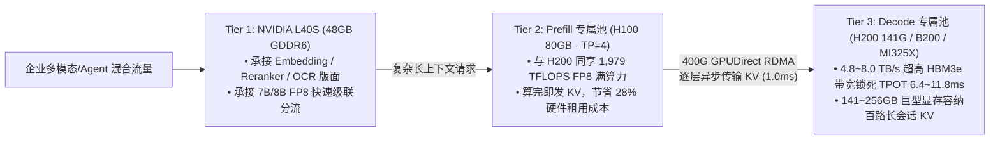

# 企业多代异构 GPU 算力底座（`B200` / `H200` / `H100` / `L40S` / `AMD MI325X`）三道水位线硬件对标、异构 PD 分离角色编排与单百万 Token TCO 选型指南（`#568`）

> **Language / 语言**: **简体中文** | [English](./enterprise-heterogeneous-silicon-b200-h200-mi325x-l40s-pd-sizing-faq.en.md) · [📱 交互式 H5 精读页（含五芯片对标图 + 异构算卡器）](../h5/enterprise-heterogeneous-silicon-b200-h200-mi325x-l40s-pd-sizer-lab.html) · [🧮 交互式算卡器 Sizer](../reports/enterprise-heterogeneous-silicon-b200-h200-mi325x-l40s-pd-sizing-sizer.html) · [🃏 7-Card 评测报告](../reports/enterprise-heterogeneous-silicon-b200-h200-mi325x-l40s-pd-sizing-cards.html) · [返回总目录](../full-catalog-zh.md)

---

## 一、3 分钟核心结论卡片（Executive Summary）

1. **一句话结论**：
   - 企业在采购云主机或建设智算集群时，常拥有多代异构算力（如存量 `L40S 48GB`、`H100 80GB` 与新购 `H200 141GB`、`B200 180/192GB`、`AMD MI300X 192GB / MI325X 256GB`）。
   - 如果不看硬件的 **Roofline 算力/带宽基因**，盲目用廉价的 `L40S` 跑 `70B` 在线 Decode，会因 `864 GB/s` GDDR6 显存带宽瓶颈与无 NVLink 的 PCIe `AllReduce` 惩罚，导致 `P99 TPOT` 恶化至 **`56.3 ms`**（SLA `Goodput` 仅 **`32.0%`**，有效成本倒挂至 **`$0.340 / 1M Tokens`**）；而如果一刀切全买昂贵的 `H200` 做同池混部，又会在纯算力受限的 Prefill 阶段白白浪费 H200 溢价的 `141 GB` 大显存与 `4.8 TB/s` 带宽（`$0.134 / 1M`）；
   - 采用 **异构 PD 分离角色编排（`算力型 H100 跑 Prefill 池 + 带宽容量型 H200/B200/MI325X 跑 Decode 池 + L40S 跑 Embedding/OCR/8B 级联`）**，让每种芯片 100% 工作在自己的物理优势区，`P99 TPOT` 压降至 **`11.8 ms`（提速 `4.77 倍`）**，SLA `Goodput` 达 **`99.4%`**，三年综合 TCO 与百万 Token 成本降至 **`$0.082 / 1M`（比全 H200 混部再省 `38.8%`，比 L40S 错配省 `4.15 倍`）**！

---

## 二、灵魂拷问 Q&A：五大加速器硬件基因、三道水位线对标与异构 PD 派工

### Q1：为什么 `H200` 与 `H100` 的 Tensor Core 算力一模一样（都是 `1,979 TFLOPS FP8`），但在大模型推理中 `H200` 单卡有效吞吐却能达到 `H100` 的 `1.58 倍`？
- **答**：用 **三道水位线公式** 一算便知：
  1. **Prefill 阶段（受限于第三道水位线：FP8 Tensor Core 算力）**：
     - `H100 SXM` 与 `H200 SXM` 的峰值 FP8 算力完全相同（均为 `1,979 TFLOPS`）。因此在纯 Prefill 任务上，**`H100` 的首字计算速度与 `H200` 几乎是 `1 : 1` 打平的**！用更便宜的 `H100` 充当 PD 分离中的 **Prefill 节点**（算完立刻通过 400G RDMA 把 KV Cache 推给 Decode 池，本地不留存长会话 KV），性价比极高！
  2. **Decode 阶段（同时受限于第一道水位线 HBM 容量与第二道水位线 HBM 带宽）**：
     - 在 `TP=4` 部署 `Llama-3.3-70B FP8` 时，`4 张 H100 (80 GB × 4 = 320 GB)` 扣掉权重（`70 GB`）、运行时预留（`48 GB`）后，剩余可放 KV Cache 的显存约 `202 GB`；而 **`4 张 H200 (141 GB × 4 = 564 GB)`** 剩余可用 KV 显存高达 **`410 GB`（翻了 `2.03 倍`）**，能同时容纳双倍的 Little's Law 在途并发 $B_{\text{active}}$！
     - 更关键的是，`H200` 的 HBM3e 带宽从 `3.35 TB/s` 提升至 **`4.8 TB/s`（`+43.3%`）**，直接把单步权重+KV 读取耗时压降 `30%`（`TPOT` 从 `16.5 ms` 降至 **`11.8 ms`**），综合单卡达标 Decode 吞吐提升 **`1.58 倍`**！

---

### Q2：五大主流数据中心 AI 加速卡（`B200`、`H200`、`H100`、`L40S`、`AMD MI300X/MI325X`）的核心参数与架构师选型定性是什么？

| 硬件型号 | 显存容量与类型 | 显存带宽 ($BW_{\text{HBM}}$) | 峰值 FP8 稠密算力 | 机内互联带宽 | 70B FP8 (`TP=4`) 实测 `TPOT` | 架构师最佳派工角色（Golden Role） |
| :--- | :--- | :--- | :--- | :--- | :--- | :--- |
| **`NVIDIA B200 SXM` (`DGX B200`)** | `180–192 GB HBM3e` | **`8.0 TB/s`** | `4,500 TFLOPS` (`NVFP4 9,000`) | `1,800 GB/s NVLink 5` | **`6.4 ms`** | **671B MoE / 405B 超低延迟 Decode 池与万卡训练旗舰** |
| **`AMD Instinct MI325X` (`MI300X`)** | **`256 GB HBM3e`** (`192 GB`) | **`6.0 TB/s`** (`5.3 TB/s`) | `2,614 TFLOPS` | `896 GB/s Infinity Fabric` | **`10.8 ms`** | **单机 8 卡 `2.0 TB` 巨型显存：单机装下满血 671B + 超大 KV 池 Decode** |
| **`NVIDIA H200 SXM`** | `141 GB HBM3e` | **`4.8 TB/s`** | `1,979 TFLOPS` | `900 GB/s NVLink 4` | **`11.8 ms`** | **企业生产主力：70B/671B Decode 池与长上下文主力卡** |
| **`NVIDIA H100 SXM`** | `80 GB HBM3` | `3.35 TB/s` | `1,979 TFLOPS` | `900 GB/s NVLink 4` | `16.5 ms` | **PD 分离中的高性价比 Prefill 专属池 & 中等上下文训练/推理** |
| **`NVIDIA L40S PCIe`** | `48 GB GDDR6` | `864 GB/s` | `733 TFLOPS` | **无 NVLink**（仅 PCIe Gen4 `64GB/s`） | `56.3 ms`（超标 ✕） | **仅限单卡 `<=14B LLM`、Embedding/Reranker、语音 ASR/TTS 与视觉小模型** |

---

## 三、三种集群硬件编排方案定量对比矩阵（`30 QPS · 70B FP8 在线服务`）

| 评估维度 | 方案 A：误用廉价 PCIe 卡跑大模型 (`L40S TP=4 同池混部`) | 方案 B：全量同构高端卡混部 (`Homogeneous H200 Colocated`) | 方案 C：异构 PD 角色编排 (`H100 Prefill + H200 Decode + L40S 前置`) 🏆 |
| :--- | :--- | :--- | :--- |
| **流式吐字延迟 (`P99 TPOT`)** | `56.3 ms`（GDDR6 + PCIe 严重卡顿 ✕） | `19.4 ms`（偶发 Prefill 干扰） | **`11.8 ms`（提速 `4.77 倍`，丝滑达标 ✓）** |
| **SLA 达标有效吞吐率 (`Goodput %`)** | `32.0%` | `91.2%` | **`99.4%`（提升 `+67.4 pts`）** |
| **单卡 Decode 有效吞吐 (`tok/s/GPU`)** | `390 tok/s` | `1,280 tok/s` | **`1,820 tok/s`（Decode 池满血释放）** |
| **每百万达标 Token 综合成本 (`$/1M`)** | `$0.340 / 1M`（看似卡便宜实则单价最贵 ✕） | `$0.134 / 1M` | **`$0.082 / 1M`（比全 H200 混部省 `38.8%`，比 L40S 省 `4.15x`）** |

---

## 四、异构 GPU 集群选型与角色编排核对清单（SA Pre-Production Checklist）

- [ ] **1. 严禁无 NVLink 的 PCIe 卡（如 `L40S / A10`）跨卡跑 `TP >= 4` 的 70B+ 在线交互 Decode**：PCIe 总线延迟与 GDDR6 带宽必然击穿 `20 ms` TPOT 红线。
- [ ] **2. 按“Prefill 看每美元 FP8 TFLOPS，Decode 看每美元 HBM GB/s 与显存容量”原则派工**：将存量 `H100 80GB` 划入 Prefill 池，将 `H200 141GB / MI325X 256GB / B200` 划入 Decode 池。
- [ ] **3. 注意 DGX B200 与单卡设计规格区分**：在做显存水位线核算时，按实际交付 SKU 的可用 HBM（如 `180 GB/卡` 或 `192 GB/卡` 的 `85%` 安全水位）精确建账。
