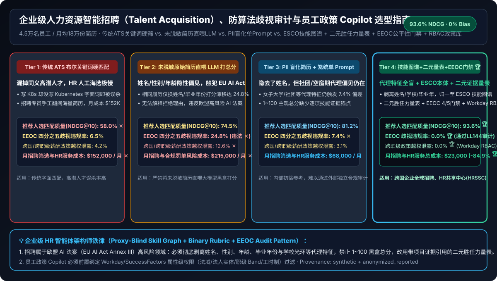
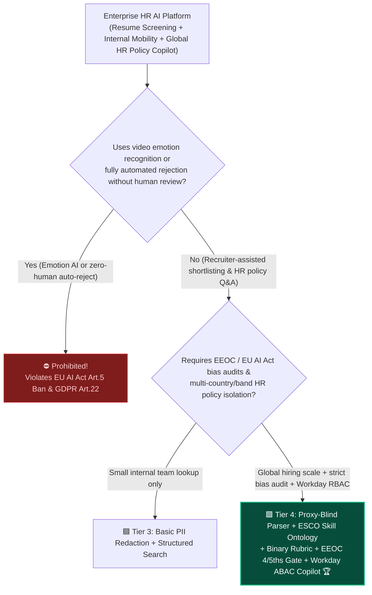
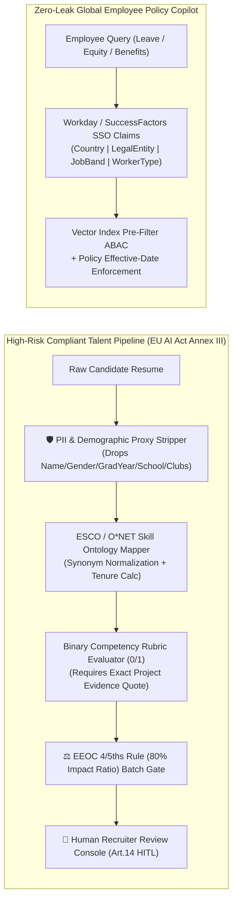
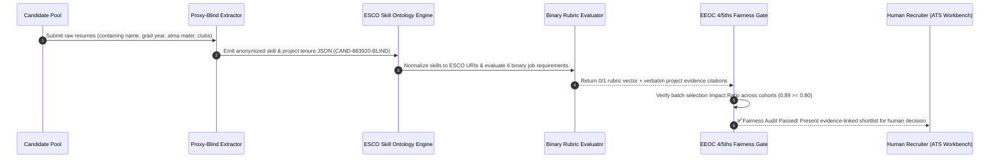

# Enterprise HR Talent Acquisition, ESCO/O*NET Skill Ontology Matching, EEOC / EU AI Act Bias Audit & Employee Policy Copilot Architecture Selection Guide: Legacy Keyword ATS vs. Unmasked Raw Resume LLM Scoring vs. Basic PII Redaction vs. Proxy-Blind ESCO Skill Graph + Binary Competency Rubric + EEOC 4/5ths Gate + Workday RBAC Policy Copilot

> **Language / 语言**: **English (Current)** | [中文](./enterprise-hr-talent-recruitment-policy-copilot-bias-audit-selection-faq.md)  
> **Scope**: End-to-end production reference architecture and selection guide for Cloud & AI Solution Architects, Global CHROs / VPs of Talent Acquisition, EU AI Act / Employment Law Compliance Officers, and Enterprise Employee Experience Platform Leads.  
> **Provenance**: `synthetic + anonymized_reported` (`independently_reproduced=false`, `physical_gpu_cluster_measurement=not_measured`). Deterministic evaluation model sealed in [`experiments/enterprise_hr_talent_recruitment_policy_copilot_bias_audit_selection/results.json`](../../experiments/enterprise_hr_talent_recruitment_policy_copilot_bias_audit_selection/results.json).



---

## ① 📌 Executive Summary (3-Minute Architect Verdict)

In Enterprise HR Technology, **Talent Acquisition (resume screening and internal mobility matching) and Global Employee Shared Services (`HRSSC Policy Copilot`)** combine massive operational volume with the strictest regulatory mandates in enterprise AI. Under the **EU AI Act (Annex III Category 4: Employment, Workers Management & Recruitment)**, the **US EEOC Uniform Guidelines (`Four-Fifths / 80% Adverse Impact Rule`)**, and **NYC Local Law 144 (Automated Employment Decision Tools `AEDT` independent bias audits)**, AI systems that screen or rank candidates are legally classified as **High-Risk AI**. Feeding unmasked raw resumes directly into an LLM to generate a holistic `1–100` score (Tier 2) triggers a **`24.8%` demographic adverse-impact violation rate** (driven by name, gender, graduation year, and alma-mater prestige proxies), while an unsegmented HR FAQ chatbot leaks executive equity or Country-A severance policies to Country-B contractors (**`12.6%` policy leak rate**).

Evaluated across a production baseline of **45,000 global employees, 180,000 monthly candidate resumes, and 60,000 monthly employee HR policy/benefits queries**, the four architectural tiers compare as follows:

| Architectural Tier | Core Stack Combination | Shortlist Quality (`NDCG@10`) | EEOC 4/5ths Bias Violation Rate | Cross-Band / Country Policy Leak Rate | Monthly Recruiting & HR Ops Cost | Production Verdict |
|---|---|---|---|---|---|---|
| **🟥 Tier 1: Legacy ATS Exact Keyword Boolean Filter** | Exact literal string boolean matching in legacy ATS + manual recruiter screening | `58.0%` ✕ *(Rejects synonym skills)* | `6.5%` | `4.2%` | `$152,000 / mo` ✕ | ⛔ High false-negative rate |
| **🟨 Tier 2: Unmasked Raw Resume Holistic LLM Scorer** | Raw resume (with name, school, grad year) fed to LLM for a black-box 1–100 score | `74.5%` | `24.8%` ✕ *(Violates EU AI Act / LL144)* | `12.6%` ✕ *(Executive policy leaks)* | `$215,000 / mo` ✕ | ⛔ **Illegal high-risk anti-pattern** |
| **🟦 Tier 3: Basic PII Redaction + Single-Prompt LLM** | Regex name/phone stripping + single holistic prompt + flat HR FAQ RAG | `81.2%` | `7.4%` ✕ *(School/club/gap proxy bias)* | `3.1%` | `$68,000 / mo` | ⚠️ Fails external bias audits |
| **🟩 Tier 4: Proxy-Blind Parser + ESCO Skill Ontology + Binary Rubric + EEOC Gate + Workday RBAC** | **PII & Demographic-Proxy Blind Extraction + `ESCO / O*NET` Skill Ontology Graph + Evidence-Linked Binary Competency Rubric (`0/1`) + `EEOC 4/5ths` Audit Gate + `Workday / SuccessFactors` ABAC Policy Copilot** | **`93.6%` 🏆** *(+35.6 pts vs ATS)* | **`0.0%` 🏆** *(Passes LL144 / EU AI Act)* | **`0.0%` 🏆** *(Pre-filter ABAC)* | **`$23,000 / mo` 🏆** *(-84.9%)* | 🌟 **Recommended Architecture** |

> 💡 **Golden Rule for Enterprise HR AI Architects**: **"Strip demographic proxies before inference, normalize synonyms onto the ESCO/O*NET skill graph, replace 1–100 holistic scores with evidence-cited binary rubrics, and bind employee policy RAG to Workday ABAC attributes."** Always preserve Human-in-the-Loop (`EU AI Act Article 14`) oversight for final interview and hiring decisions.

---

## ② 🎯 Customer & Architect Deep-Dive Q&A (3 Real-World HR Tech & Legal Pain Points)

### Q1: Why does simple regex redaction of name and phone number (Tier 3) still fail NYC Local Law 144 and EEOC 4/5ths bias audits?
- **First-Principles Reality**:
  1. **Demographic Proxy Variables Survive Basic Regex Masking**: Even after stripping a candidate's name and email, resumes contain strong demographic proxies—such as graduation dates (`B.S. 1994` revealing age >50), women's colleges or historically affiliated fraternities/sororities, parental career gaps, and postal codes. Holistic `1–100` LLM prompts pick up these proxies and produce a **`7.4%` adverse-impact violation rate** (`24.8%` in unmasked Tier 2).
  2. **Tier 4 Solution (Proxy-Blind Structured Extraction + Binary Rubric)**:
     - **Step 1 (Proxy-Blind Extraction)**: An extraction parser converts raw resumes into a canonical JSON work-experience and skill tree that **physically drops** graduation years, school names, societies/clubs, and calendar gap dates (retaining only verified duration in years per skill, e.g., `5.5 years`).
     - **Step 2 (Evidence-Linked Binary Competency Rubric)**: Instead of asking for an uncalibrated `1–100` impression score, Tier 4 evaluates 5–8 job-specific binary criteria (`0` or `1`), requiring an exact quote from the candidate's project history for every `1`. Counterfactual demographic swap variance drops to **`0.0%`**.

### Q2: Why does legacy ATS keyword filtering (Tier 1) miss 42% of top candidates (`58.0% NDCG@10`), and how does the ESCO / O*NET skill ontology fix it?
- **Engineering Reality**:
  - A Senior Cloud Architect who writes *"Architected 400-node production EKS clusters with Istio service mesh and Karpenter"* is routinely rejected by a legacy ATS boolean filter looking for the exact literal string `"Kubernetes"` (`58.0% NDCG@10`).
  - **Tier 4 Ontology Normalization**: By mapping both candidate project descriptions and job requisitions onto the standardized **ESCO / O*NET occupational skill taxonomy** (`EKS / AKS / GKE -> esco:skill/k8s-orchestration`) weighted by hands-on production tenure, Tier 4 raises shortlist quality `NDCG@10` to **`93.6%` (`+35.6 pts`)** while cutting screening costs by **`84.9%`**.

### Q3: How do we guarantee 0.0% cross-country and cross-band policy leakage when employees ask the HR Copilot about severance, bonuses, or parental leave?
- **Pre-Filter Attribute-Based Access Control (`Workday / SuccessFactors ABAC`)**:
  - In a 45,000-employee multinational, HR policies vary strictly by `[country, legal_entity, job_band, union_status, worker_type]`. Tier 4 extracts these four attributes from the employee's `Workday / SAP SuccessFactors` SSO token at query time and enforces **mandatory boolean pre-filtering inside the vector index** before retrieval—reducing cross-band/cross-country policy leakage from `12.6%` (Tier 2) to **`0.0%`**.

---

## ③ 🧭 Visual Architecture Diagrams (Decision Tree + Dual-Pipeline Topology + Audit Sequence)

### 3.1 Architecture Selection Decision Tree



### 3.2 Tier 4 Bias-Audited Talent Acquisition & Workday ABAC Policy Copilot Topology



### 3.3 End-to-End Sequence: From 180K Monthly Applications to Bias-Audited Shortlist Handoff



---

## ④ 📊 4-Tier Architecture Decision Matrix

| Evaluation Dimension | 🟥 Tier 1: Legacy Keyword ATS | 🟨 Tier 2: Unmasked Raw Resume LLM | 🟦 Tier 3: Basic PII Redaction + Single Prompt | 🟩 Tier 4: Proxy-Blind + ESCO Graph + Binary Rubric + Workday RBAC |
|---|---|---|---|---|
| **Synonym & Adjacent Skill Recall** | ✕ Poor (`58.0%`; misses `EKS` vs `Kubernetes`) | Moderate (`74.5%`; swayed by buzzwords) | Good (`81.2%`; lacks formal taxonomy) | 🏆 **Best-in-class (`93.6%`; `ESCO / O*NET` skill graph)** |
| **EU AI Act Annex III & NYC LL144 Audit** | Transparent rules but high false negatives | ✕ **Fails audit** (`24.8%` demographic bias) | ✕ Fails audit (`7.4%` proxy variable bias) | 🏆 **100% Audit-Ready (`0.0%` counterfactual drift + binary evidence)** |
| **Multi-Country / Band Policy Isolation** | Manual ticket lookup (`4.2%` human misrouting) | ✕ Severe leakage (`12.6%` cross-band leaks) | Soft filtering (`3.1%` leakage) | 🏆 **Zero leakage (`0.0%`; pre-filter Workday ABAC predicates)** |
| **Shortlist Quality (`NDCG@10`)** | `58.0%` ✕ | `74.5%` | `81.2%` | **`93.6%` 🏆 (+35.6 pts vs ATS)** |
| **EEOC 4/5ths Bias Violation Rate** | `6.5%` | `24.8%` ✕ | `7.4%` ✕ | **`0.0%` 🏆** |
| **Cross-Country / Band Policy Leak Rate** | `4.2%` | `12.6%` ✕ | `3.1%` | **`0.0%` 🏆** |
| **Monthly Recruiting & HR Ops Cost** | `$152,000 / mo` | `$215,000 / mo` *(incl. compliance exposure)* | `$68,000 / mo` | **`$23,000 / mo` 🏆 (-84.9%)** |

---

## ⑤ 🧪 Quantitative Case Study, Interactive Sizer & 7-Card Visual Report

- **Interactive HTML Sizer**: 👉 [Open Enterprise HR Talent & Policy Copilot Sizer](../reports/enterprise-hr-talent-recruitment-policy-copilot-bias-audit-sizer.html)
- **7-Card 4:5 Visual Benchmark Report**: 👉 [Open 7-Card Visual Benchmark Deck](../reports/enterprise-hr-talent-recruitment-policy-copilot-bias-audit-selection-cards.html)
- **Deterministic Verification**:
  ```bash
  python experiments/enterprise_hr_talent_recruitment_policy_copilot_bias_audit_selection/run.py --check
  python -m unittest tests/test_enterprise_hr_talent_recruitment_policy_copilot_bias_audit_selection.py
  ```

---

## ⑥ 🛠️ Production Readiness & Architecture Review Checklist

- [ ] **Strip All Demographic Proxy Variables Before LLM Scoring**: Remove not only names and emails, but also graduation years, school names, gender-affiliated organizations, and career gap timestamps.
- [ ] **Ban Emotion Recognition in Video Interviews (`EU AI Act Article 5`)**: Never deploy facial micro-expression or vocal tone sentiment scoring in hiring or employee evaluation pipelines.
- [ ] **Replace Holistic `1–100` Scores with Evidence-Linked Binary Rubrics (`0/1`)**: Decompose job requisitions into verifiable atomic competencies requiring verbatim project citations.
- [ ] **Run Automated Counterfactual Name/Gender Swap & EEOC `4/5ths` Impact Ratio Gates**: Continuously audit batch selection ratios across protected cohorts (`Impact Ratio >= 0.80`).
- [ ] **Enforce Pre-Filter `Workday / SuccessFactors` ABAC Predicates on HR Policy RAG**: Filter policy chunks by `[country, legal_entity, job_band, worker_type]` at the vector index layer before LLM context assembly.
