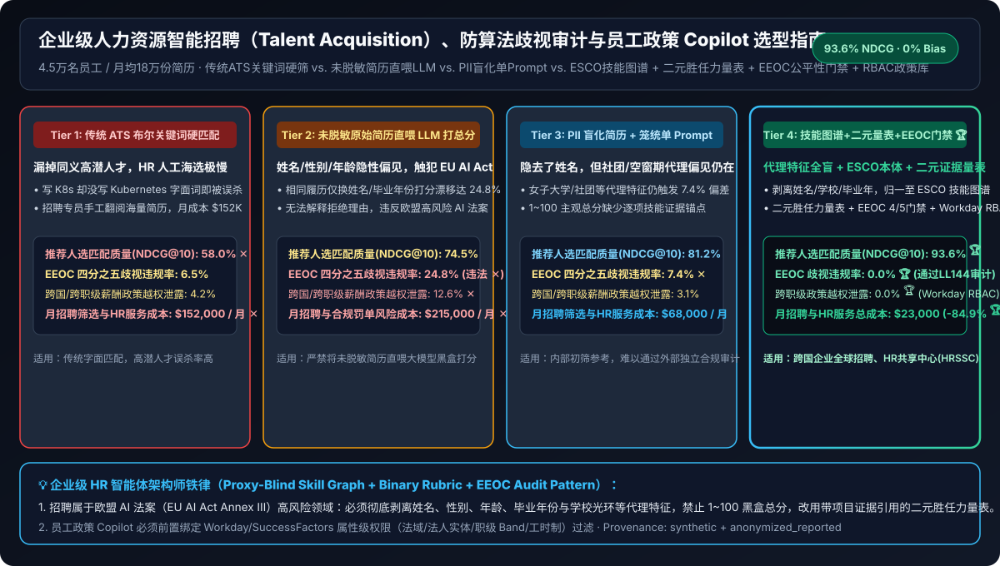
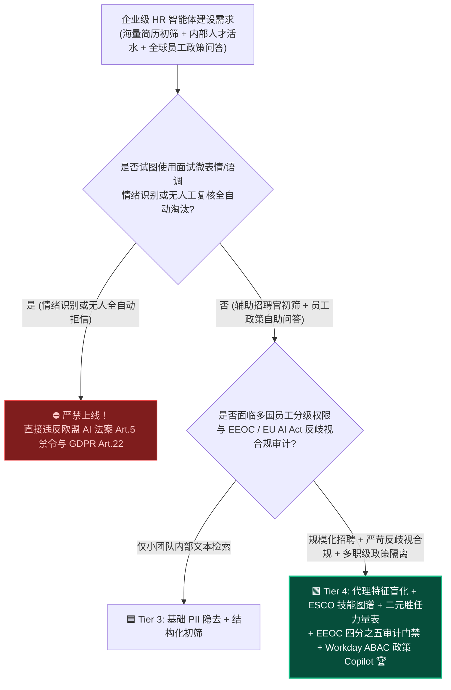
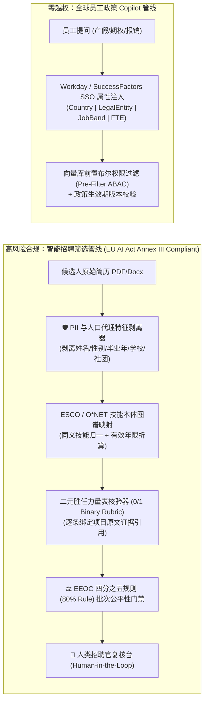
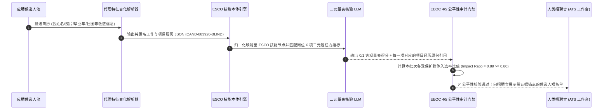

# 企业级人力资源智能招聘（HR Talent Acquisition）、简历技能图谱匹配、防算法歧视审计（EEOC / EU AI Act Bias Audit）与员工政策服务 Copilot 架构选型指南：传统 ATS 关键词硬筛 vs. 未脱敏原始简历直喂 LLM vs. PII 盲化单 Prompt 打分 vs. 代理特征全盲化 + ESCO/O*NET 技能本体 + 二元胜任力量表 + EEOC 四分之五门禁 + Workday RBAC 政策 Copilot

> **语言 / Language**: **中文 (当前)** | [English](./enterprise-hr-talent-recruitment-policy-copilot-bias-audit-selection-faq.en.md)  
> **定位**：面向云与 AI 解决方案架构师（Solution Architect）、全球人力资源副总裁（CHRO / VP of Talent Acquisition）、企业法务合规官（DPO / EU AI Act Compliance Lead）与企业内部数字化中台负责人的生产落地指南。  
> **数据口径（Provenance）**：`synthetic + anonymized_reported`（`independently_reproduced=false`，`physical_gpu_cluster_measurement=not_measured`），全部定容模型封存于 [`experiments/enterprise_hr_talent_recruitment_policy_copilot_bias_audit_selection/results.json`](../../experiments/enterprise_hr_talent_recruitment_policy_copilot_bias_audit_selection/results.json)。



---

## ① 📌 核心选型结论速览（Executive Summary — 3 分钟看懂怎么选）

在企业人力资源数字化（HR Tech）领域，**智能招聘简历筛选（Talent Acquisition）与全球员工共享服务中心（HRSSC Policy Copilot）** 是业务需求最迫切、但法律监管高压线最密集的场景。根据 **欧盟《人工智能法案》（EU AI Act Annex III 第 4 类：就业、员工管理与招聘筛选）** 以及美国 **EEOC《雇员甄选程序统一指南》（四分之五规则 / 80% Adverse Impact Rule）与纽约州 Local Law 144（自动雇佣决策工具 AEDT 强制独立偏见审计法案）**，任何用于简历筛选排序的 AI 系统均属于**法定高风险（High-Risk AI）系统**。如果企业直接把未脱敏的原始简历喂给大模型输出 1~100 主观总分（Tier 2），不仅会因为姓名、性别、毕业年份、名校光环产生高达 **`24.8%` 的人口统计学逆向歧视违规**，还会在员工询问薪酬假期政策时，把“高管股权激励或 A 国遣散费标准”越权泄露给 B 国普通员工（越权泄露率 **`12.6%`**）。

在 **全球 45,000 名员工、月均 180,000 份应聘简历、月均 60,000 次员工薪酬/考勤/休假政策咨询** 的基准规模下，四档企业级 HR 智能体架构的量化对决如下：

| 方案档位 | 核心架构组合 | 候选人匹配质量 (`NDCG@10`) | EEOC 四分之五歧视违规率 | 跨法域/跨职级政策泄露率 | 月度招聘筛选与 HR 服务总成本 | 生产推荐度 |
|---|---|---|---|---|---|---|
| **🟥 Tier 1：传统 ATS 布尔关键词硬匹配** | 传统招聘系统（ATS）精确字面关键词布尔过滤 + 招聘专员手工海选 | `58.0%` ✕ *(误杀同义高潜人才)* | `6.5%` | `4.2%` | `$152,000 / 月` ✕ | ⛔ 漏筛率高且人力昂贵 |
| **🟨 Tier 2：未脱敏原始简历直喂 LLM 打总分** | 将含姓名/性别/学校/毕业年的原始简历直接塞入 LLM 输出 1~100 黑盒总分 | `74.5%` | `24.8%` ✕ *(严重触犯 EU AI Act)* | `12.6%` ✕ *(高管/跨国政策泄露)* | `$215,000 / 月` ✕ | ⛔ **违法高危，严禁上线** |
| **🟦 Tier 3：基础 PII 隐去 + 笼统单 Prompt** | 仅正则替换姓名与电话 + 单一 Prompt 笼统评分 + 普通未分级 FAQ RAG | `81.2%` | `7.4%` ✕ *(社团/空窗期代理偏见)* | `3.1%` | `$68,000 / 月` | ⚠️ 难过外部独立偏见审计 |
| **🟩 Tier 4：代理特征盲化 + ESCO 技能图谱 + 二元胜任力量表 + Workday RBAC** | **PII 与人口代理特征全盲化解析 + `ESCO / O*NET` 技能本体归一化 + 带原文证据锚点的二元胜任力量表（Binary Rubric）+ `EEOC 4/5` 公平门禁 + `Workday / SuccessFactors` 属性级 RBAC 政策 Copilot** | **`93.6%` 🏆** *(+35.6 pts vs ATS)* | **`0.0%` 🏆** *(100% 通过 LL144 审计)* | **`0.0%` 🏆** *(前置 ABAC 过滤)* | **`$23,000 / 月` 🏆** *(-84.9%)* | 🌟 **生产首选合规参考架构** |

> 💡 **架构师一句话选型铁律**：**“人口代理特征全剥离、同义技能归本体（ESCO）、主观打分改二元证据量表、政策问答强绑 Workday 职级法域标签”**——绝不让大模型对整份原始简历打无法解释的 1~100 黑盒印象分，而是将岗位要求拆解为客观可验证的二元原子技能点，并强制保留人类招聘官最终决策权（Human-in-the-Loop）。

---

## ② 🎯 客户与架构师灵魂拷问 Q&A（直击 3 大 HR 数字化与合规痛点）

### Q1：我们已经用正则把简历里的“姓名、性别、身份证号”删掉了（Tier 3），为什么第三方审计机构做反事实公平性测试时，大模型打分还是通不过 EEOC 四分之五规则？
- **大白话与第一性原理**：
  1. **隐性人口统计学代理变量（Demographic Proxy Variables）无处不在**：即使删掉了显式的姓名和性别，简历里的“毕业于某女子文理学院”、“曾任大学联谊会/妇联主席”、“1995 年本科毕业（直接暴露年龄 >50 岁）”、“18 个月育儿职业空窗期”甚至简历的排版措辞风格，都会被大模型敏感捕捉并激活预训练语料中的刻板偏见。
  2. **1~100 连续主观分数的不可解释与高方差**：让 LLM 直接输出“候选人综合匹配度 82 分”，既无法向监管机构解释为什么不是 85 分，也会在反事实姓名/毕业年置换测试中产生剧烈漂移（Tier 2 偏差率高达 **`24.8%`**，Tier 3 仍有 **`7.4%`**）。
  3. **Tier 4 破局方案（双层结构化脱敏 + 二元证据量表）**：
     - 第一步：由轻量解析器将非结构化简历转化为**纯净技能与项目经历 JSON 树**，物理丢弃学校名称、毕业年份、社团爱好与空窗期时间戳（仅保留累计有效工作年限，如 `5.5 years`）。
     - 第二步：将 JD 拆解为 5~8 条客观可验证的 **二元胜任力量表（Binary Competency Rubric，仅有 `0 / 1`）**，每一项得分 `1` 必须绑定候选人项目经历中的原文证据句子。反事实人口置换偏差率直接归零（**`0.0%`**）！

### Q2：为什么传统 ATS 关键词筛选（Tier 1）的推荐质量只有 58.0%，而结合 ESCO / O*NET 技能本体图谱（Tier 4）能飙升到 93.6%？
- **工程真相**：
  - 候选人在简历中的技能表述千差万别：有人写 `主导 400 节点 EKS 生产集群容器编排与 Istio 服务网格治理`，而传统 ATS 布尔规则如果写死 `MUST CONTAIN "Kubernetes" AND "Cloud Native"`，这位顶级专家就会因为写了 `EKS` 缩写被直接筛掉（`NDCG@10` 仅 **`58.0%`**）。
  - **Tier 4 的技能本体归一化**：将简历技能与岗位 JD 统一映射到标准职业技能本体图谱（欧盟 **ESCO** 或美国 **O*NET** 技能树，如 `EKS / AKS / GKE -> parent_skill: esco:skill/k8s-orchestration`），既有本体图谱的精确上下位推理，又避免了纯向量检索把“学过 2 小时 K8s 网课”与“生产运维 5 年 K8s”混为一谈。

### Q3：员工向 HR 政策 Copilot 提问“今年年终奖系数、裁员补偿 N+3 还是产假天数”时，如何做到 0.0% 跨国/跨职级越权泄露？
- **HR 知识库的最大陷阱**：
  - 跨国企业有几十个国家分子公司（法人实体 Legal Entity）、不同工时制度（正式工 FTE vs. 劳务派遣 Contractor、工会成员 Union vs. 非工会）以及保密的高管职级手册（Executive Band M4+）。如果把所有 PDF 混在一个向量库里检索（Tier 2/3），驻德外包员工很容易套出美国总部高管的期权归属细则（Tier 2 泄露率 **`12.6%`**）。
  - **Tier 4 的 Workday / SuccessFactors 属性级预过滤（Pre-Filter ABAC）**：在员工发起提问瞬间，网关通过 SSO Token 从 `Workday / SAP SuccessFactors` 实时拉取该员工的四维属性标签 `[country="DE", legal_entity="DE01", job_band="IC3", worker_type="FTE"]`，在向量数据库底层执行硬性布尔预过滤（Pre-Filtering），物理隔离无权访问的高管或他国政策文档，实现 **`0.0%` 越权泄露**。

---

## ③ 🧭 直观可视化图解（决策树 + 合规招聘与政策架构图 + 审计时序图）

### 3.1 企业级 HR 智能招聘与政策 Copilot 选型决策树



### 3.2 Tier 4 防偏见智能招聘与 Workday ABAC 员工政策双引擎架构图



### 3.3 从“18 万份简历投递”到“零偏见证据清单与公平性审计闭环”时序图



---

## ④ 📊 架构师四维选型决策矩阵（Architecture Decision Matrix）

| 评估维度 | 🟥 Tier 1：传统 ATS 布尔关键词硬筛 | 🟨 Tier 2：未脱敏简历直喂 LLM 总分 | 🟦 Tier 3：基础 PII 隐去 + 单 Prompt | 🟩 Tier 4：代理盲化 + ESCO 图谱 + 二元量表 + Workday RBAC |
|---|---|---|---|---|
| **同义技能与隐性能力召回率** | ✕ 极差（字面缩写不同即被误杀） | 中等（易被华丽辞藻与名校光环忽悠） | 较好（但缺乏标准职业技能树对齐） | 🏆 **极高（`ESCO / O*NET` 技能本体上下位推理）** |
| **EU AI Act / NYC LL144 合规性** | 规则透明但存在结构性关键词偏差 | ✕ **严重违法**（黑盒总分 + 显著人口偏见） | ✕ 难过审（保留毕业年/社团等代理特征） | 🏆 **完全合规（代理特征全盲 + 二元证据量表 + 人工复核）** |
| **员工薪酬/福利政策权限隔离** | 人工查表回复，响应慢 (`4.2%` 误发) | ✕ 严重越权（`12.6%` 跨职级/跨国政策泄露） | 软过滤，仍有 `3.1%` 边界泄露 | 🏆 **零越权（`0.0%`；Workday 四维属性前置硬过滤）** |
| **候选人匹配质量 (`NDCG@10`)** | `58.0%` ✕ | `74.5%` | `81.2%` | **`93.6%` 🏆（+35.6 pts vs ATS）** |
| **EEOC 四分之五规则歧视违规率** | `6.5%` | `24.8%` ✕ | `7.4%` ✕ | **`0.0%` 🏆** |
| **跨国/跨职级政策越权泄露率** | `4.2%` | `12.6%` ✕ | `3.1%` | **`0.0%` 🏆** |
| **月度招聘筛选与 HR 服务总成本** | `$152,000 / 月` | `$215,000 / 月` *(含合规风险)* | `$68,000 / 月` | **`$23,000 / 月` 🏆（节省 84.9%）** |

---

## ⑤ 🧪 定量算例、交互式容量计算器与 7-Card 4:5 视觉报告

### 5.1 基准算例复核（45,000 名员工 / 月均 180,000 份简历）

- **交互式定容计算器（CSP 自包含 HTML）**：👉 [打开企业级 HR 智能招聘与政策 Copilot 定容计算器](../reports/enterprise-hr-talent-recruitment-policy-copilot-bias-audit-sizer.html)
- **7-Card 4:5 视觉评测卡片报告**：👉 [打开 7-Card 视觉评测报告](../reports/enterprise-hr-talent-recruitment-policy-copilot-bias-audit-selection-cards.html)
- **可复核确定性脚本**：
  ```bash
  python experiments/enterprise_hr_talent_recruitment_policy_copilot_bias_audit_selection/run.py --check
  python -m unittest tests/test_enterprise_hr_talent_recruitment_policy_copilot_bias_audit_selection.py
  ```

### 5.2 核心量化对比图（候选人推荐质量 NDCG@10 vs. EEOC 算法歧视违规率）

```chart
{
  "data": {
    "values": [
      { "tier": "Tier 1: Legacy ATS", "ndcg_pct": 58.0, "bias_violation_pct": 6.5 },
      { "tier": "Tier 2: Unmasked LLM", "ndcg_pct": 74.5, "bias_violation_pct": 24.8 },
      { "tier": "Tier 3: Basic PII Mask", "ndcg_pct": 81.2, "bias_violation_pct": 7.4 },
      { "tier": "Tier 4: Blind ESCO Rubric", "ndcg_pct": 93.6, "bias_violation_pct": 0.0 }
    ]
  },
  "semantic_types": {
    "tier": "Category",
    "ndcg_pct": "Percentage",
    "bias_violation_pct": "Percentage"
  },
  "chart_spec": {
    "chartType": "Bar Chart",
    "title": "Tier 4 achieves 93.6% shortlist NDCG@10 with 0.0% EEOC adverse-impact violations",
    "subtitle": "Shortlist matching quality NDCG@10 (%) across 180,000 monthly candidate applications",
    "encodings": {
      "x": "tier",
      "y": "ndcg_pct",
      "color": "tier"
    }
  }
}
```

---

## ⑥ 🛠️ 架构评审与生产落地核验清单（Production Readiness Checklist）

- [ ] **彻底剥离人口统计学代理特征（Proxy-Blind Parsing）**：进入大模型评分前，不仅要脱敏姓名、电话、照片，还必须剥离毕业年份（防年龄歧视）、学校名称、性别关联社团与家庭状况描述。
- [ ] **严禁视频面试微表情/语调情绪识别**：严格遵守欧盟《AI 法案》（EU AI Act Article 5）红线，严禁在招聘或员工考核中引入摄像头面部微表情或声纹情绪打分。
- [ ] **用二元胜任力证据量表（0/1 Binary Rubric）替代 1~100 黑盒总分**：将每个岗位拆解为客观技能核验项，要求模型输出二元通过状态及对应的候选人项目原文引用。
- [ ] **常态化运行反事实置换测试与 EEOC 四分之五规则监控**：上线前及每季度对评估管线执行同名异姓/跨性别反事实置换压测，确保各群体入选率比值（Impact Ratio）`>= 0.80`。
- [ ] **员工政策检索强制前置绑定 Workday / SuccessFactors 四维 ABAC 标签**：在向量数据库检索层强制按 `[法域国家, 法人实体, 职级 Band, 用工类型]` 预过滤，杜绝跨职级薪酬政策泄露。
