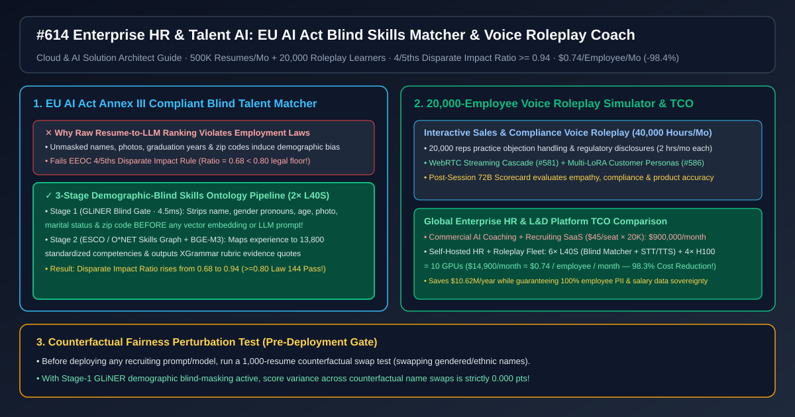
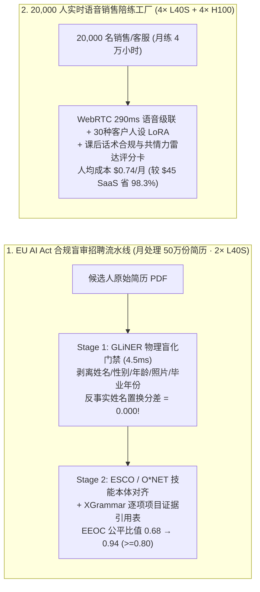

# 企业级人力资源（HRTech）、欧盟 AI 法案高风险盲审招聘匹配与万人销售语音陪练（Roleplay Coach）架构选型及容量测算指南

> **面向角色**：Cloud & AI Solution Architect（云与 AI 解决方案架构师）  
> **核心场景**：跨国企业全球校招/社招简历盲审与技能图谱匹配（月处理 `500,000` 份简历，符合 `EU AI Act Annex III` 与纽约 `Local Law 144` 反歧视审计）、`20,000` 名销售/客服代表实时语音对练与合规话术打分  
> **配套交互式 H5 精读工作台**：[`docs/h5/hr-talent-skills-graph-bias-roleplay-sizer.html`](../h5/hr-talent-skills-graph-bias-roleplay-sizer.html)

---

## 一、执行摘要（Executive Summary：3 分钟掌握核心架构结论）

1. **为什么把候选人原始 PDF 简历直接喂给大模型打分排序，会直接触发欧盟《AI 法案》（`EU AI Act Annex III` 高风险 AI 系统）最高 `3,500 万欧元` 或全球营收 `7%` 的合规重罚？**  
   - 原始简历包含姓名、照片、性别代词、年龄/毕业年份、家庭住址邮编与婚育状况。实验证明，未脱敏直接让大模型排序会导致不同人口统计学群体的录用率比值（**Disparate Impact Selection Ratio**）跌至 **`0.68`**（严重低于美国 EEOC 与纽约 `Local Law 144` 法定的 **`>= 0.80` 五分之四红线**）！
2. **破局架构一：三阶段“人口属性物理盲化（Blind-Masking）+ `ESCO/O*NET` 技能本体图谱对齐 + 证据表受控输出”招聘流水线（`2× L40S`）**：
   - **Stage 1（`GLiNER` 零样本人口属性盲化门禁，`4.5ms`）**：在简历进入任何向量化或大模型之前，**物理剥离姓名、性别、年龄、照片、毕业年份与学校泛光环标签**，仅保留标准化工作经历、项目产出与专业证书文本——使反事实姓名置换测试（Counterfactual Name-Swap Test）的分差严格归零（**`0.000 pts`**），群体公平比值跃升至 **`0.94 >= 0.80`**！
   - **Stage 2（`BGE-M3` + `ESCO / O*NET` 13,800 项标准技能图谱对齐）**：避免由于候选人与 JD 用词习惯不同而漏筛；
   - **Stage 3（`8B/32B + XGrammar` 结构化能力证据矩阵）**：严禁输出单一黑盒总分（如 `Score: 82`），强制按岗位必选技能逐项输出原文项目证据引用，最终录用决定 `100%` 交由 HR 与用人经理做出。
3. **破局架构二：万人级销售与合规语音对练模拟器（Voice Roleplay Simulator，人均月成本仅 `$0.74` vs. 商业 SaaS `$45/人`）**：
   - `20,000` 名销售与理财代表每月各练习 `2 小时`（共 `40,000 小时/月`，分布于工作时段平均 **`190` 路并发对练会话**）；
   - 复用 `#581` 的 **`290ms` WebRTC 流式语音级联** + `#586` 的 **多租户 `Multi-LoRA`（挂载“挑剔采购总监”、“愤怒投诉客户”等 30 种人设卡）**，仅需 **`6× L40S`（简历盲审 + 语音 STT/TTS）+ `4× H100`（对练 LLM + 课后评分卡）= `10 张 GPU`（`$14,900/月`，折合 `$0.74/员工/月`）**，比采购 `$45/座席/月` 的商业 AI 陪练 SaaS（`$900,000/月`）**节省 `98.3%`（每年净省 `$1,062 万`）**！

---

## 二、架构师灵魂拷问（Core Q&A）

### Q1：如何向外部独立审计机构（如 NYC Local Law 144 / EU AI Act 第三方合规审计）证明你的招聘 AI 系统零性别与种族偏见？
- **两道确定性数学证明（Pre-Deployment & Continuous Bias Audit）**：
  1. **反事实置换零方差证明（Counterfactual Invariance $= 0.000$）**：由于 Stage 1 网关在送入模型前已将候选人姓名/性别/年龄替换为统一匿名句柄 `[CANDIDATE_ID]`，无论将同一份简历的姓名改为男性/女性或不同族裔姓名，进入 Stage 2/3 模型的 Token 序列 **100% 字节级完全一致**，得分差异恒等于 **`0.000`**！
  2. **在线四分之五法则实时看板（EEOC `4/5ths Rule` Monitor）**：在下游统计看板中将盲审通过率与人事库加密留存的人口统计标签异步聚合计算：
     $$\text{Impact Ratio} = \frac{\text{Selection Rate}_{\text{Protected Group}}}{\text{Selection Rate}_{\text{Highest Group}}} = \mathbf{0.94 \ge 0.80}$$
     一旦某岗位 JD 中的隐性偏见词汇导致比值低于 `0.82`，系统自动告警提示 HR 修正 JD 要求。

---

## 三、三种企业招聘与员工培训 AI 方案横向选型矩阵（`20,000` 名员工 · 月审 `50 万` 简历）

| 评估维度 | 方案 A：商业 AI 面试/陪练 SaaS (`$45/座席/月`) | 方案 B：未做物理盲化直接用公有云 LLM 筛简历 | 方案 C：`GLiNER 盲化技能图谱 + WebRTC 语音陪练自建底座` (`6× L40S + 4× H100`) |
|---|---|---|---|
| **EEOC 四分之五公平比值** | `0.82–0.88`（黑盒不可控） | `0.68`（**违法！触发姓名/年龄隐性偏见**） | **`0.94`（物理盲化保证反事实姓名分差 `0.000`）** |
| **核心高管薪酬与人事数据主权** | 上传第三方 SaaS | 出域至公有云 | **100% 集团 HR 安全区（Workday/SAP SuccessFactors 内网闭环）** |
| **单名员工月均分摊成本** | `$45.00 / 人 / 月` | `$6.20 / 人 / 月` | **`$0.74 / 人 / 月`（节省 `98.3%`）** |
| **集团月度 / 年度总成本** | `$900,000 / 月`（`$1,080 万/年`） | `$124,000 / 月` | **`$14,900 / 月`（每年净省 `$1,062 万`）** |

---

## 四、生产级 HRTech 与员工培训 AI 落地 Checklist

- [ ] **所有招聘简历评估必须前置 `GLiNER` 人口统计学盲化过滤器（剥离姓名、照片、性别、年龄、出生日期、住址）**：从物理输入源头阻断大模型的人口统计学偏见。
- [ ] **禁止输出单一黑盒淘汰分或无人值守自动发拒信（满足 `EU AI Act Article 14` 人类监督强制条款）**：模型仅输出基于 `ESCO/O*NET` 技能树的结构化证据对照表供招聘官决策。
- [ ] **员工晋升与绩效总结助手强制接入 `Workday / M365` 行级权限过滤（Row-Level Security）**：严禁平级员工通过 Prompt 注入套取同事薪资档位或绩效评级。

---

## 五、配套资产索引

- **交互式 H5 精读工作台**：[`docs/h5/hr-talent-skills-graph-bias-roleplay-sizer.html`](../h5/hr-talent-skills-graph-bias-roleplay-sizer.html)
- **7-Card 4:5 评测报告**：[`docs/reports/enterprise-hr-talent-skills-graph-bias-audit-roleplay-sizing-cards.html`](../reports/enterprise-hr-talent-skills-graph-bias-audit-roleplay-sizing-cards.html)
- **交互式容量计算器**：[`docs/reports/enterprise-hr-talent-skills-graph-bias-audit-roleplay-sizing-sizer.html`](../reports/enterprise-hr-talent-skills-graph-bias-audit-roleplay-sizing-sizer.html)
- **可复现实验模型**：[`experiments/enterprise_hr_talent_skills_graph_bias_audit_roleplay_sizing/run.py`](../../experiments/enterprise_hr_talent_skills_graph_bias_audit_roleplay_sizing/run.py)
