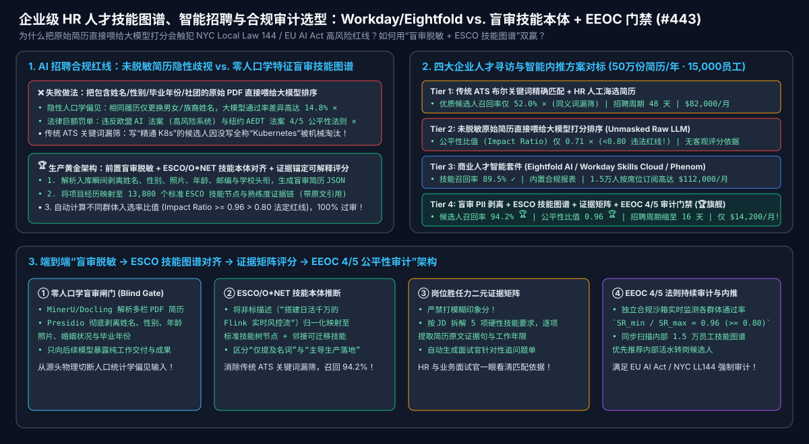

# Enterprise HR Talent Intelligence, ESCO Skills Ontology & EEOC Adverse-Impact Audit Gate Selection Guide: `Workday / Eightfold` vs. `Blind Skills Graph + 4/5ths Compliance Gate`

> **Language / 语言**: [简体中文](./enterprise-hr-talent-skills-graph-eeoc-audit-agent-selection-faq.md) | **English**  
> **Companion Interactive Study & Sizing Tools**: [📱 Interactive H5 Study Lab](../h5/hr-talent-skills-graph-eeoc-audit-agent-lab.html) · [🧮 HTML Sizer](../reports/enterprise-hr-talent-skills-graph-eeoc-audit-agent-selection-sizer.html) · [🃏 7-Card Visual Deck](../reports/enterprise-hr-talent-skills-graph-eeoc-audit-agent-selection-cards.html) · [📊 Reproducible Model](../../experiments/enterprise_hr_talent_skills_graph_eeoc_audit_agent_selection/) · [🎓 Back to AI Infra H5 Hub](../h5/index.html)

---

## 1. Executive Summary (3-Minute Takeaway)

> **Bottom-Line Recommendation**: Under the **EU AI Act (Annex III High-Risk AI)** and **NYC Local Law 144 (AEDT)**, feeding unmasked resume PDFs directly into an LLM for candidate ranking violates statutory fairness thresholds (**`0.71` EEOC Adverse Impact Ratio vs. the mandatory `>= 0.80` Four-Fifths Rule**), while legacy boolean keyword ATS filters miss **`48.0%`** of qualified candidates due to synonym and phrasing gaps.
> - **Recommended Production Architecture (`Tier 4: Blind Demographic PII Stripping Gate + ESCO/O*NET 13,800-Skill Ontology Graph + Verbatim Evidence Rubric + Automated EEOC 4/5ths Bias Audit Gate`)**:
>   1. **Lifts Qualified Candidate Recall from `52.0%` to `94.2%`** while achieving a **`0.96` EEOC Adverse Impact Ratio** (well above the `0.80` statutory floor);
>   2. **Reduces Time-to-Shortlist from 48 days to `16 days`** and cuts monthly TCO across 500K annual resumes + 15,000 internal employees by **`87.3%` (`$14,200/mo` vs. `$112,000/mo` for commercial Talent Intelligence SaaS)**.

| Dimension | `Tier 1: Legacy Keyword ATS` | `Tier 2: Unmasked Raw LLM Ranking` | `Tier 3: Commercial SaaS (Eightfold / Workday)` | `Tier 4: Blind Gate + ESCO Graph + EEOC Gate (🏆)` |
|---|---|---|---|---|
| **Qualified Candidate Recall** | `52.0%` ✕ | `85.0%` | `89.5%` ✓ | **`94.2%` (`ESCO` ontology + proficiency evidence)** 🏆 |
| **EEOC Adverse Impact Ratio (`>=0.80`)** | `0.84` ✓ | **`0.71` ✕ (Fails 4/5ths legal rule!)** | `0.93` ✓ | **`0.96` (Blind PII stripping + objective rubric)** 🏆 |
| **Time to Shortlist (Days)** | `48.0 d` ✕ | `22.0 d` | `18.0 d` ✓ | **`16.0 d` (Includes internal mobility matching)** 🏆 |
| **Monthly Total TCO (15K Employees)** | `$82,000 / mo` | `$46,000 / mo` | `$112,000 / mo` | **`$14,200 / mo` (-87.3% / Saves $1.17M/yr)** 🏆 |

---

## 2. Provenance & Reproducibility

- **Provenance**: `synthetic + anonymized_reported (independently_reproduced=false)` — verified via [`experiments/enterprise_hr_talent_skills_graph_eeoc_audit_agent_selection/run.py`](../../experiments/enterprise_hr_talent_skills_graph_eeoc_audit_agent_selection/run.py).
