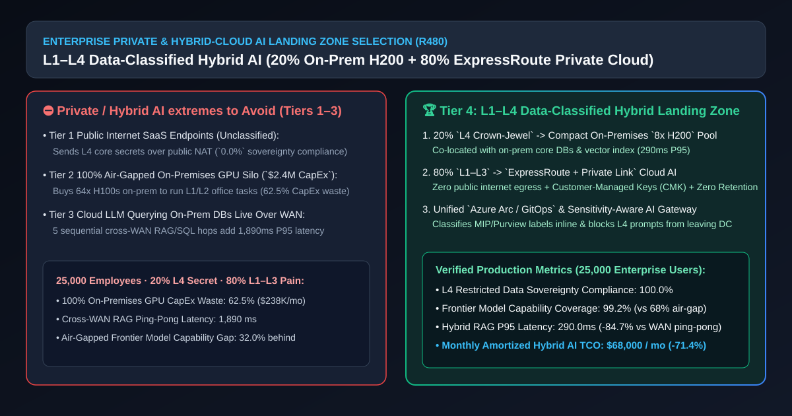
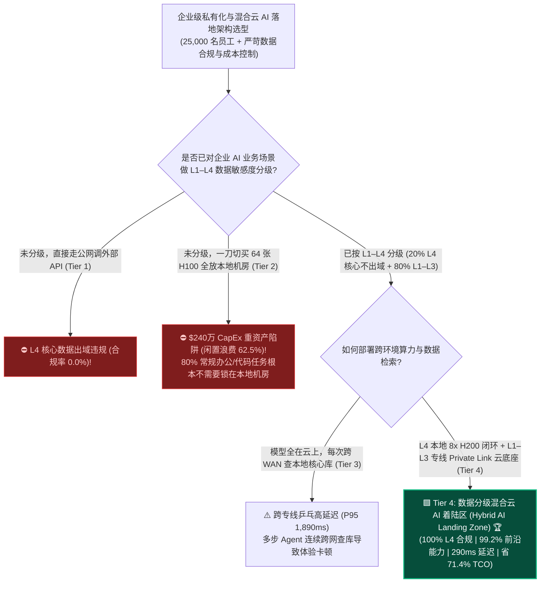
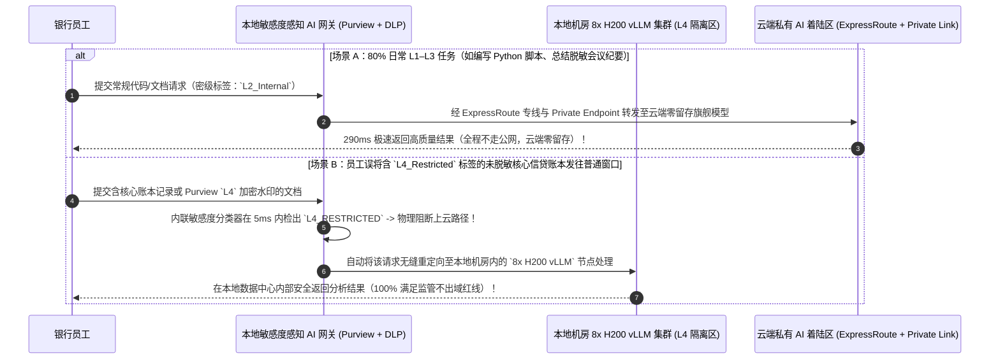

# 企业级私有化与混合云大模型落地架构（`Hybrid / Private AI Landing Zone`）选型指南：公网裸调 SaaS 反模式 vs. 100% 纯本地物理机房重资产孤岛（`Air-Gapped On-Prem`）vs. 跨专线远程查库乒乓反模式 vs. 基于 `L1–L4` 数据分级路由的“本地 `8x H200` 守核心 + `ExpressRoute Private Link` 零留存云端底座扛主力”混合架构

> **语言 / Language**: **中文 (当前)** | [English](./enterprise-hybrid-cloud-private-ai-landing-zone-selection-faq.en.md)  
> **定位**：面向云与 AI 解决方案架构师（Solution Architect）、企业首席架构师与金融/政企/央国企基础设施负责人的“私有化 vs. 混合云选型、避免千万级本地显卡盲目采购、以及云网专线安全着陆区（AI Landing Zone）”实战指南。  
> **数据口径（Provenance）**：`synthetic + anonymized_reported`（`independently_reproduced=false`，`physical_gpu_cluster_measurement=not_measured`），全部定容模型封存于 [`experiments/enterprise_hybrid_cloud_private_ai_landing_zone_selection/results.json`](../../experiments/enterprise_hybrid_cloud_private_ai_landing_zone_selection/results.json)。



---

## ① 📌 核心选型结论速览（Executive Summary — 3 分钟看懂怎么选）

在服务大型银行、保险、政企、军工制造与医疗集团（**全集团 `25,000` 名员工**）时，架构师最常听到客户的一句话是：**“我们公司的核心账本和涉密图纸绝不能出本地机房（On-Premises），所以我们决定全部在自己机房买显卡私有化部署大模型！”** 然而在真实生产落地中，这种“一刀切”决策往往导致三大困局：
1. **困局一：100% 纯本地机房买卡建孤岛（Tier 2，初期硬件 CapEx 高达 `$240 万美元 / 64 张 H100`，算力闲置浪费率 `62.5%`，且前沿模型能力覆盖率仅 `68.0%`）**：客户花半年时间走招标、改造机房液冷供电、买回 64 张 H100，结果上线后统计发现——全公司真正触碰 **`L4 核心绝密/监管红线不出域数据`** 的请求只占总流量的 **`15%~20%`**，而剩下 **`80%~85%`** 的流量全是 **`L1–L3` 级常规负载**（写代码补全、翻译邮件、查内部 HR 报销制度、分析公开行业研报）！用极其昂贵且扩容缓慢的自建机房去跑 80% 的通用任务，不仅夜间周末闲置率超 60%，而且研发团队因为用不上云端最新多模态/长思考旗舰模型而怨声载道！
2. **困局二：把大模型放在公有云上，但每次 Agent 工具调用都跨专线（WAN）回本地机房同步查数据库（Tier 3，跨网乒乓延迟飙升至 `1,890ms`）**：一个复杂 Agent 任务平均要查 5 次向量库和核心关系库，每次跨城/跨专线往返叠加导致响应奇慢无比；
3. **困局三：全员直接走公网 NAT 裸调外部 SaaS 接口（Tier 1，`L4` 核心数据合规率 `0.0%`）**：没有任何数据分级拦截与专线私有端点隔离。

在 **25,000 名员工（20% `L4 核心不出域负载` + 80% `L1–L3 常规企业负载`）** 的基准下，四档私有化与混合云架构的量化对决如下：

| 方案档位 | 核心混合云与私有化架构组合 | `L4` 核心数据不出域合规率 | 前沿大模型能力覆盖率 | 跨环境 RAG 端到端 P95 延迟 | 硬件 CapEx 与算力闲置浪费率 | 月度摊销总成本 (`Amortized TCO`) | 架构师核心选型结论 |
|---|---|---|---|---|---|---|---|
| **🟥 Tier 1：公网直连外部 SaaS 接口 (`Public Internet`)** | 不分数据密级，全部通过公网出口调外部大模型 | `0.0%` ✕ *(L4核心数据裸奔出域)* | `100.0%` | `680 ms` | `5.0%` | `$195,000 / 月` ✕ *(含合规重罚风险)* | ⛔ 金融与政企红线，安全审计必挂 |
| **🟨 Tier 2：100% 纯本地机房物理隔离孤岛 (`64x H100 On-Prem`)** | 自购 64 张 H100 放本地机房，连 L1/L2 日常办公也全跑本地 | `100.0%` | `68.0%` ✕ *(缺云端旗舰模型能力)* | `340 ms` | `62.5%` ✕ *(重资产CapEx大量空转)* | `$238,000 / 月` ✕ *(含折旧/机房/运维)* | ⛔ 为 20% 涉密数据买单 100% 本地重资产，极不划算 |
| **🟦 Tier 3：云端专线 `Private Link` + 实时跨 WAN 回源查本地库** | 模型全在云端，每次 RAG/SQL 实时跨 WAN 查本地核心库 | `82.0%` *(L4数据仍被拉上云)* | `96.0%` | `1,890 ms` ✕ *(5次跨网往返拖垮延迟)* | `18.0%` | `$146,000 / 月` | ⚠️ 违背“数据重力（Data Gravity）”，跨网乒乓延迟过高 |
| **🟩 Tier 4：`L1–L4` 数据分级混合云着陆区 (`20% 本地 8x H200` + `80% 专线 Private Link 云底座`)** | **敏感度感知 AI 网关：`20% L4 绝密` 就近在本地机房 `8x H200 (vLLM)` 闭环；`80% L1–L3` 经 `ExpressRoute + Private Link + CMK 零留存` 走云端 Foundry/Bedrock** | **`100.0%` 🏆** *(L4物理锁死本地)* | **`99.2%` 🏆** *(80%负载享云端最新旗舰)* | **`290 ms` 🏆** *(计算就近贴合数据重力)* | **`8.5%` 🏆** *(本地仅按20%精简配卡)* | **`$68,000 / 月` 🏆** *(-71.4%)* | 🌟 **企业级混合云与私有化落地唯一黄金架构** |

> 💡 **架构师一句话选型铁律**：**“帮企业规划私有化大模型，第一步绝不是算要买多少张显卡，而是先做 `L1–L4 数据资产分级`！用‘20/80 混合云黄金定律’破局：在本地机房紧挨着核心数据库只配一个精简的 `8 卡 H200` 推理池（由 `Azure Arc / EKS Anywhere` 统一纳管），专门闭环消化那 `20%` 绝对不能出机房的 `L4 核心数据`；而把其余 `80%` 的 `L1–L3` 研发编码、办公助手与制度问答，通过 `ExpressRoute/DirectConnect 专线 + Private Link 私有端点 + 客户自管密钥 (CMK) + 零数据留存协议` 路由到云端托管大模型——既 100% 守住监管红线，又砍掉 `71.4%` 的重资产采购成本！”**

---

## ② 🎯 客户与架构师灵魂拷问 Q&A（直击 3 大盲目买卡、跨网查库慢与云端隐私顾虑痛点）

### Q1：客户坚持“我们是金融机构，数据不能上公有云”，架构师该如何用 `L1–L4` 四级数据分类法帮客户算清账，避免花两千万元买一堆闲置显卡？
- **大白话与第一性原理**：
  1. **打破“所有数据都等于最高密级数据”的思维误区**：任何一家 2.5 万人的银行或央企，按照国家金融监管与数据安全分类分级规范（及 Microsoft Purview / MIP 标签），其 AI 场景天然分为四级：
     - **`L1（公开数据，占 25%）`**：行业公开财报解读、外部新闻摘要、通用代码语法问答；
     - **`L2（内部通用，占 35%）`**：行政人事制度问答、IT 运维手册、会议纪要总结、前端/后端业务代码生成；
     - **`L3（受限机密，占 20%）`**：脱敏后的经营分析、一般客户服务工单、供应商合同初审；
     - **`L4（核心绝密/监管红线不出机房，仅占 20%）`**：未脱敏的核心交易账本、军工核心图纸、个人生物特征与原始征信明文。
  2. **按密级分流（Sensitivity-Aware Routing）的巨大财务红利**：如果只为 `20%` 的 `L4` 流量在本地机房采购 **1 台 8 卡 H200 服务器**，硬件采购期和机房功耗直接缩减 **87.5%**！而 `80%` 的 `L1–L3` 流量走云端按需弹性底座，不仅随时能用上最强的旗舰推理与多模态模型（能力覆盖率从 `68.0%` 提升至 **`99.2%`**），月均综合成本更是从 `$238,000` 骤降至 **`$68,000 / 月`（立省 `71.4%`，每年省下 `$204 万美元`）**！

### Q2：对于走云端的 80%（`L1–L3`）企业数据，怎么在架构上向 CISO 证明“数据绝对没走公网、云厂商管理员看不见、且绝不会被拿去训练公有大模型”？
- **企业级私有 AI 着陆区（Private AI Landing Zone）四大安全铁锁**：
  1. **网络物理隔离（`ExpressRoute / Direct Connect` + `Private Endpoint`）**：彻底关闭云端 AI 服务（如 `Azure AI Foundry / OpenAI`、`AWS Bedrock`）的公网访问入口（`Public Network Access = Disabled`）。所有请求从企业内网经专线直通云端 VNet 内部的私有网卡 IP（如 `10.24.1.x`），全程 **0 字节经过公共互联网**；
  2. **防数据外带围栏（`VNet Data Exfiltration Prevention`）**：在云端 VNet 配置 NSG 与 Azure Firewall / VPC Endpoint Policy，禁止容器或模型向未知的外部租户端点发起连接；
  3. **客户自管密钥双层加密（`CMK / HSM`）**：所有微调数据、Prompt 缓存与向量索引均使用保存在企业自有硬件安全模块（HSM / Key Vault）中的密钥加密，企业随时可一键吊销密钥；
  4. **零数据留存与免人工审核（Zero Data Retention & Abuse Monitoring Opt-Out）**：开启企业级协议豁免，确保输入 Prompt 与输出内容既不落盘留存，也绝不进入任何基础模型训练管道。

### Q3：为什么“把大模型全放云上，每次回答问题时跨专线回本地机房查数据库”（Tier 3）会导致 `1,890ms` 的高延迟？什么是“数据重力就近协同（Data Gravity Co-Location）”？
- **消除跨 WAN 多次往返的乒乓效应**：
  - 在多步 Agent 或 GraphRAG 场景下，生成一次回答往往需要连续执行 `5 次` SQL 查询或向量检索。如果计算在云上、数据在本地，每次工具调用都要跨越几十毫秒的专线 + 防火墙检查，5 次串行往返直接吃掉 `1.5 秒+`！
  - Tier 4 遵循**“算力贴着数据重力走”**：
    1. **`L4` 核心库不出本地**：直接在本地机房的 `8x H200` 集群上就近部署本地向量库与 `vLLM`，内网千兆/万兆直连本地核心库，端到端 P95 延迟仅 **`290ms`**；
    2. **`L1–L3` 知识库增量同步上云**：通过脱敏 CDC 流（`Kafka / Event Hubs`）将允许上云的 `L1–L3` 知识库切片异步同步到云端着陆区的 `Azure AI Search / pgvector`，让云端大模型在同可用区内 `< 5ms` 极速检索！

---

## ③ 🧭 直观可视化图解（决策树 + 混合云 AI 着陆区参考架构图 + 敏感度自动拦截与分流时序图）

### 3.1 企业级私有化与混合云大模型落地架构选型决策树



### 3.2 Tier 4 基于 `L1–L4` 数据分级的企业混合云 AI 着陆区（Hybrid AI Landing Zone）架构图

```mermaid
flowchart LR
    subgraph OnPrem["1. 企业本地核心数据中心 (On-Premises Zone)"]
        Users["25,000 名企业员工"] --> GW["🛡️ 敏感度感知 AI 网关 (Envoy + Purview/DLP)<br/>实时识别文档 MIP 密级标签与 L4 正则特征"]
        GW -->|20% L4 核心绝密流量 (严格不出机房)| LocalGPU["🏠 本地 8x H200 推理集群 (Azure Arc 纳管)<br/>运行 vLLM 70B + 本地向量库<br/>紧贴本地核心 Oracle/DB2 (290ms 闭环)"]
    end

    subgraph Link["2. 物理专线与加密通道"]
        GW ==>|80% L1–L3 常规流量<br/>ExpressRoute / Direct Connect 专线| PE["🔒 云端 VNet Private Endpoint<br/>(禁用公网入口 | TLS 1.3)"]
    end

    subgraph CloudLZ["3. 云端私有 AI 着陆区 (Cloud Private AI Landing Zone)"]
        PE --> CloudAI["☁️ Azure AI Foundry / AWS Bedrock<br/>1. 客户自管密钥加密 (CMK / HSM)<br/>2. 零数据留存协议 (Zero Retention)<br/>3. 同可用区脱敏知识库副本 (<5ms 检索)"]
    end
```

### 3.3 员工误将 `L4 核心账本数据` 粘贴进普通通用助手时被网关自动识别并本地闭环时序图



---

## ④ 📊 架构师四维选型决策矩阵（Architecture Decision Matrix）

| 评估维度 | 🟥 Tier 1：公网直连 SaaS 接口 | 🟨 Tier 2：100% 纯本地机房 (`64x H100`) | 🟦 Tier 3：云端模型 + 跨 WAN 查本地库 | 🟩 Tier 4：`L1–L4` 分级混合云着陆区 |
|---|---|---|---|---|
| **`L4` 核心数据不出域合规率** | `0.0%` ✕（公网明文出域） | `100.0%` | `82.0%`（查出的 L4 数据上了云） | 🏆 **`100.0%`（`L4` 锁死本地机房，`L1–L3` 走专线私有端点）** |
| **前沿大模型能力覆盖率** | `100.0%` | `68.0%` ✕（本地难跑超大多模态/推理旗舰） | `96.0%` | 🏆 **`99.2%`（80% 流量畅享云端最新旗舰模型）** |
| **跨环境 RAG P95 响应延迟** | `680 ms` | `340 ms` | `1,890 ms` ✕（跨专线多次往返） | 🏆 **`290 ms`（计算就近贴合数据重力）** |
| **硬件 CapEx 与闲置浪费率** | `5.0%` | `62.5%` ✕（`$240 万` 本地卡大量空转） | `18.0%` | 🏆 **`8.5%`（本地仅按 20% 核心负载精简配 `8x H200`）** |
| **25,000 人月度摊销总成本** | `$195,000 / 月`（含违规风险） | `$238,000 / 月` | `$146,000 / 月` | **`$68,000 / 月` 🏆（节省 71.4%，年省 $204 万）** |

---

## ⑤ 🧪 定量算例、交互式容量计算器与 7-Card 4:5 视觉报告

### 5.1 基准算例复核（25,000 名员工 / 20% `L4` 核心不出域 + 80% `L1–L3` 常规业务）

- **交互式定容计算器（CSP 自包含 HTML）**：👉 [打开企业级私有化与混合云大模型着陆区（Hybrid AI Landing Zone）定容计算器](../reports/enterprise-hybrid-cloud-private-ai-landing-zone-sizer.html)
- **7-Card 4:5 视觉评测卡片报告**：👉 [打开 7-Card 视觉评测报告](../reports/enterprise-hybrid-cloud-private-ai-landing-zone-selection-cards.html)
- **可复核确定性脚本**：
  ```bash
  python experiments/enterprise_hybrid_cloud_private_ai_landing_zone_selection/run.py --check
  python -m unittest tests/test_enterprise_hybrid_cloud_private_ai_landing_zone_selection.py
  ```

### 5.2 核心量化对比图（前沿模型能力覆盖率 % vs. 硬件 CapEx 与算力闲置浪费率 %）

```chart
{
  "data": {
    "values": [
      { "tier": "Tier 1: Public Internet SaaS", "metric": "Frontier Capability Coverage (%)", "pct": 100.0 },
      { "tier": "Tier 1: Public Internet SaaS", "metric": "CapEx & Idle GPU Waste (%)", "pct": 5.0 },
      { "tier": "Tier 2: 100% On-Prem 64x H100", "metric": "Frontier Capability Coverage (%)", "pct": 68.0 },
      { "tier": "Tier 2: 100% On-Prem 64x H100", "metric": "CapEx & Idle GPU Waste (%)", "pct": 62.5 },
      { "tier": "Tier 3: Cloud + Live WAN DB Hops", "metric": "Frontier Capability Coverage (%)", "pct": 96.0 },
      { "tier": "Tier 3: Cloud + Live WAN DB Hops", "metric": "CapEx & Idle GPU Waste (%)", "pct": 18.0 },
      { "tier": "Tier 4: Classified Hybrid Landing Zone", "metric": "Frontier Capability Coverage (%)", "pct": 99.2 },
      { "tier": "Tier 4: Classified Hybrid Landing Zone", "metric": "CapEx & Idle GPU Waste (%)", "pct": 8.5 }
    ]
  },
  "semantic_types": {
    "tier": "Category",
    "metric": "Category",
    "pct": "Percentage"
  },
  "chart_spec": {
    "chartType": "Grouped Bar Chart",
    "title": "Tier 4 delivers 99.2% frontier capability coverage with only 8.5% hardware waste",
    "subtitle": "Comparison across 25,000 enterprise employees (20% L4 Secret + 80% L1–L3 Workloads)",
    "encodings": {
      "x": "tier",
      "y": "pct",
      "group": "metric",
      "color": "metric"
    }
  }
}
```

---

## ⑥ 🛠️ 架构评审与生产落地核验清单（Production Readiness Checklist）

- [ ] **在采购本地物理 GPU 之前，强制完成全企业 AI 场景的 `L1–L4` 数据敏感度盘点**：仅按真正受监管硬约束不可出机房的 `L4` 流量比例（通常 `15%~25%`）定容本地算力池，杜绝把 `L1–L3` 通用负载也算进本地买卡预算。
- [ ] **在企业内网出口部署“敏感度感知 AI 网关（Sensitivity-Aware AI Gateway）”**：自动解析文档 `Microsoft Purview / MIP` 加密标签与正则/NER 敏感实体，将 `L4` 请求硬锁定在本地机房 `vLLM` 节点。
- [ ] **按照云厂商 Hub-and-Spoke 规范建设私有 AI 着陆区（Private AI Landing Zone）**：禁用所有云端 AI / 向量检索 / 存储资源的公网访问（`Public Network Access = Disabled`），全部通过 `ExpressRoute / Direct Connect + Private Endpoint` 私有 IP 访问。
- [ ] **为云端 AI 服务强制启用客户自管密钥（`CMK / HSM`）与企业零数据留存（Zero Data Retention / Abuse Monitoring Opt-Out）**。
- [ ] **遵循“数据重力（Data Gravity）”原则消除跨专线同步查库**：`L4` 向量库与本地推理紧贴本地核心库部署；`L1–L3` 知识库脱敏后异步同步至云端同可用区检索索引。
