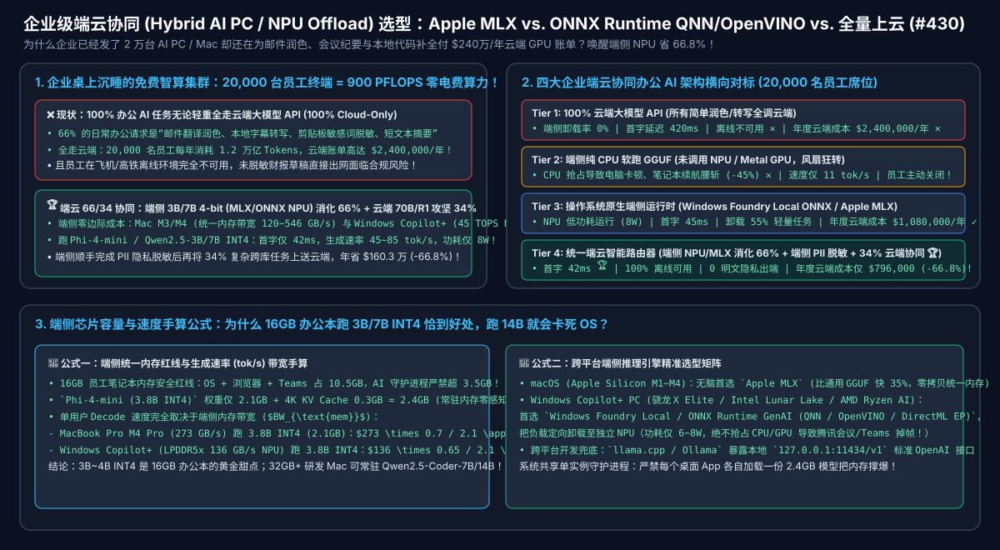

# Enterprise Hybrid Edge-Cloud AI PC & NPU Offload Selection Guide: `Apple MLX` vs. `Windows Foundry Local (ONNX Runtime QNN / OpenVINO)` vs. `100% Cloud API`

> **Language / 语言**: [简体中文](./enterprise-hybrid-edge-cloud-aipc-npu-mlx-onnx-offload-tco-selection-faq.md) | **English**  
> **Companion Interactive Study & Sizing Tools**: [📱 Interactive H5 Study Lab](../h5/hybrid-edge-cloud-aipc-npu-mlx-onnx-offload-tco-lab.html) · [🧮 HTML Sizer](../reports/enterprise-hybrid-edge-cloud-aipc-npu-mlx-onnx-offload-tco-selection-sizer.html) · [🃏 7-Card Visual Deck](../reports/enterprise-hybrid-edge-cloud-aipc-npu-mlx-onnx-offload-tco-selection-cards.html) · [📊 Reproducible Model](../../experiments/enterprise_hybrid_edge_cloud_aipc_npu_mlx_onnx_offload_tco_selection/) · [🎓 Back to AI Infra H5 Hub](../h5/index.html)

---

## 1. Executive Summary (3-Minute Takeaway)

> **Bottom-Line Recommendation**: A 20,000-employee enterprise equipped with modern `Apple Silicon Macs` and `Windows Copilot+ PCs (45+ TOPS NPU)` already owns **`900 PFLOPS` of zero-marginal-cost client compute**. Routing `100%` of lightweight everyday tasks (email drafting, live meeting captions, local summarization, PII scrubbing, inline code completion) to cloud APIs wastes **`$2,400,000/year`**. Conversely, running unaccelerated CPU-only `GGUF` models draws **`38W`**, throttles video calls, and drains laptop batteries.
> - **Recommended Production Architecture (`Tier 4: 66/34 Hybrid Edge-Cloud Router — Apple MLX + Windows Foundry Local [ONNX Runtime QNN/OpenVINO NPU] + On-Device PII Scrubbing`)**:
>   1. **Hardware-Matched Memory Guardrail**: Caps 16GB laptops at **`<= 3.5 GB` (`Phi-4-mini 3.8B INT4` / `Qwen2.5-3B INT4` = `2.4 GB`)** on the dedicated `7.5W` NPU / unified memory (`42ms` TTFT, `42–91 tok/s`);
>   2. **Offloads `66.8%` of Daily Tasks Locally & Scrubs PII Before Cloud Escalation**: Reduces annual cloud GPU spend by **`66.8%` (`$796,000/yr` vs. `$2,400,000/yr`, saving `$1.60M/yr`)** with 100% offline flight/train availability.

| Dimension | `Tier 1: 100% Cloud API Only` | `Tier 2: Naive CPU-Only GGUF` | `Tier 3: OS-Native NPU/Metal Standalone` | `Tier 4: 66/34 Hybrid Edge-Cloud + Local PII Scrubber (🏆)` |
|---|---|---|---|---|
| **Edge Task Offload Share** | `0.0%` ✕ | `30.0%` (Disabled by users) | `55.0%` ✓ | **`66.8%` (Drafts / Captions / FIM / PII)** 🏆 |
| **Local Task `TTFT` Latency** | `420 ms` | `380 ms` ✕ | `45 ms` ✓ | **`42 ms` (Zero WAN RTT)** 🏆 |
| **Laptop Inference Power Draw** | `0 W` | **`38.0 W` ✕ (Fan noise / battery drain)** | `7.8 W` ✓ (NPU) | **`7.5 W` (Dedicated NPU / Metal)** 🏆 |
| **Annual Cloud GPU Spend (20K Seats)** | `$2,400,000 / yr` ✕ | `$1,680,000 / yr` | `$1,080,000 / yr` ✓ | **`$796,000 / yr` (-66.8% · Saves `$1.60M`)** 🏆 |

---

## 2. Provenance & Reproducibility

- **Provenance**: `synthetic + anonymized_reported (independently_reproduced=false)` — verified via [`experiments/enterprise_hybrid_edge_cloud_aipc_npu_mlx_onnx_offload_tco_selection/run.py`](../../experiments/enterprise_hybrid_edge_cloud_aipc_npu_mlx_onnx_offload_tco_selection/run.py).
