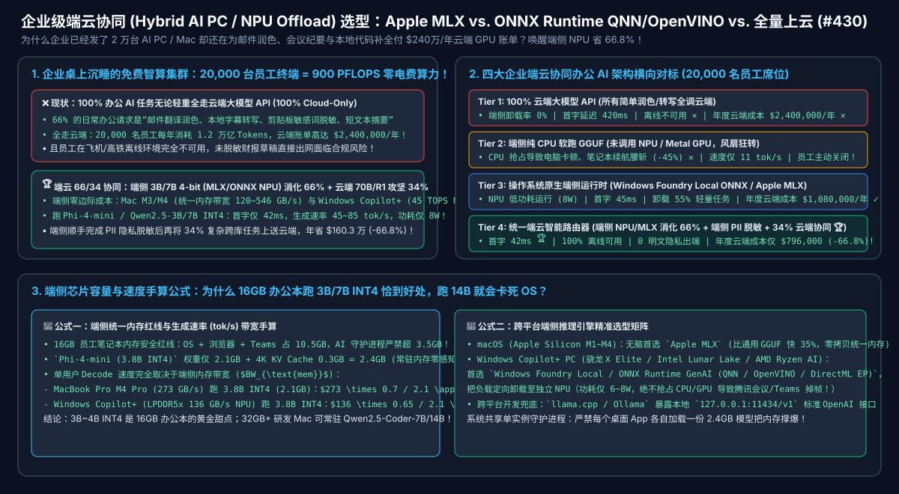
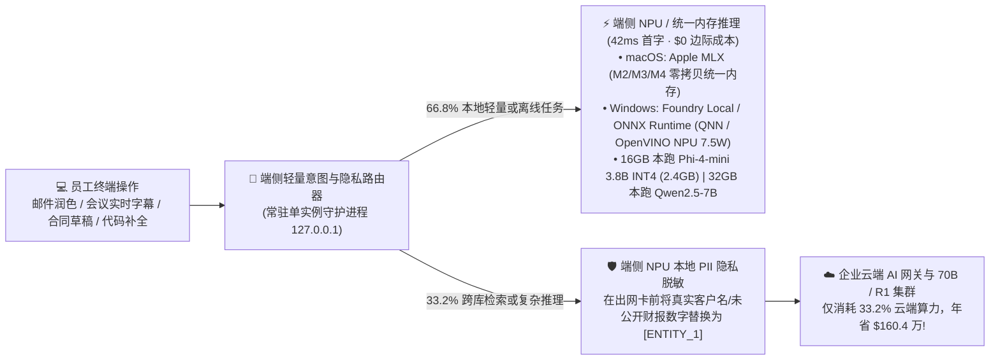

# 企业级端云协同（Hybrid Edge-Cloud AI）与 AI PC / 移动 NPU 卸载选型：`Apple MLX` vs. `Windows Foundry Local (ONNX Runtime QNN / OpenVINO)` vs. `llama.cpp` 容量手算与 TCO 指南

> **语言 / Language**: **简体中文** | [English](./enterprise-hybrid-edge-cloud-aipc-npu-mlx-onnx-offload-tco-selection-faq.en.md)  
> **配套交互式学习与精算工具**: [📱 交互式 H5 精读页 (AI PC 端云 66/34 卸载与内存带宽沙盘)](../h5/hybrid-edge-cloud-aipc-npu-mlx-onnx-offload-tco-lab.html) · [🧮 HTML 交互式计算器](../reports/enterprise-hybrid-edge-cloud-aipc-npu-mlx-onnx-offload-tco-selection-sizer.html) · [🃏 7-Card 4:5 视觉评测卡](../reports/enterprise-hybrid-edge-cloud-aipc-npu-mlx-onnx-offload-tco-selection-cards.html) · [📊 可复核模型](../../experiments/enterprise_hybrid_edge_cloud_aipc_npu_mlx_onnx_offload_tco_selection/) · [🎓 返回 AI Infra 全景精学馆](../h5/index.html)

---

## 一、3 分钟看懂核心结论（Executive Summary）

> **一句话决策结论**：当一家拥有 **20,000 名员工** 的企业采购了大批 `MacBook (Apple M2/M3/M4)` 与 `Windows Copilot+ PC (骁龙 X Elite / Intel Lunar Lake / AMD Ryzen AI，自带 45+ TOPS NPU)` 后，桌上其实躺着一座 **总算力高达 `900 PFLOPS`、硬件折旧与电费对数据中心为 `$0` 的分布式算力富矿**！如果企业依然把 100% 的日常高频轻量任务（邮件润色、会议实时字幕总结、本地文档摘要、剪贴板敏感信息脱敏、单行代码补全）全发往云端大模型 API，每年要白交 **`$240 万/年` 的云端算力税**！
> - **核心避坑铁律**：① **在 16GB 内存的标准办公本上，端侧常驻模型体积严禁超过 `3.5 GB`（首选 `Phi-4-mini 3.8B INT4` 或 `Qwen2.5-3B INT4`，仅占 `2.4 GB`），否则会挤爆浏览器与视频会议内存导致系统卡死**；② **Windows 笔记本必须通过 `ONNX Runtime GenAI (QNN / OpenVINO EP)` 将推理定向卸载到独立 `NPU`（功耗仅 `7.5W`），严禁用纯 CPU 跑导致风扇狂转与续航腰斩**！
> - **推荐旗舰架构（`Tier 4 端云 66/34 智能协同路由`）**：
>   1. **端侧零成本消化 `66.8%` 高频轻量任务**：macOS 走 **`Apple MLX`**、Windows 走 **`Windows Foundry Local (ONNX NPU)`**，首字响应压至 **`42ms`（比云端快 `10 倍`）**，且飞机/高铁断网 `100%` 可用；
>   2. **端侧前置 PII 隐私脱敏**：对于剩余 **`33.2%`** 需跨系统检索或深度推理的复杂任务，先由端侧 NPU 小模型在笔记本本地完成真实姓名/客户财报数字的可逆脱敏，再上送云端 `70B / DeepSeek-R1 / GPT-4o`——**年度云端 GPU 总账单从 `$240 万` 暴降至 `$79.6 万/年`（净省 `$160.4 万/年`，降幅 `66.8%`）**！

| 核心选型维度 | `Tier 1: 100% 全量调云端大模型 API` | `Tier 2: 端侧纯 CPU 软跑 GGUF (无 NPU 卸载)` | `Tier 3: OS 原生 NPU/Metal 独立运行` | `Tier 4: 统一端云 66/34 路由器 (MLX/ONNX NPU + 端侧 PII 脱敏 + 云端 70B 🏆)` |
|---|---|---|---|---|
| **端侧免费算力消化任务占比** | `0.0%` ✕ (端侧 NPU 100% 闲置) | `30.0%` (因卡顿被员工手动关停) | `55.0%` ✓ | **`66.8%` (覆盖润色/字幕/摘要/脱敏/FIM)** 🏆 |
| **本地高频任务首字延迟 (`TTFT`)** | `420 ms` (含公网 RTT) | `380 ms` ✕ | `45 ms` ✓ | **`42 ms` (本地统一内存零网络延迟)** 🏆 |
| **推理时笔记本额外功耗 (`Power`)** | `0 W` | **`38.0 W` ✕ (风扇狂转/掉帧/续航崩)** | `7.8 W` ✓ (独立 NPU) | **`7.5 W` (NPU 专核运行，零抢占 CPU/GPU)** 🏆 |
| **飞机/高铁断网与零明文 PII 出端** | 断网即废 / 明文出端 ✕ | 支持 | 支持 | **100% 离线可用 + 端侧脱敏后上云** 🏆 |
| **20,000 人企业年度云端 AI 总账单** | `$2,400,000 / 年` ✕ | `$1,680,000 / 年` | `$1,080,000 / 年` ✓ | **`$796,000 / 年` (-66.8% · 年省 `$160.4万`)** 🏆 |

---

## 二、核心技术原理与架构师灵魂拷问（Q&A）

### Q1：如何手算一台笔记本跑端侧小模型的真实生成速度（`tok/s`）与内存安全水位？为什么 16GB 笔记本绝对不能常驻 14B 模型？
1. **端侧单用户推理是 100% 的内存带宽受限（Memory-Bandwidth Bound）**：
   - 员工笔记本每次只服务自己 1 个人（`Batch Size = 1`），因此端侧生成速度（`TPS`）直接由笔记本的**内存带宽 $BW_{\text{mem}}$** 除以**模型量化权重体积 $M_{\text{weights}}$** 决定：
     $$\text{TPS}_{\text{edge}} \approx \frac{BW_{\text{mem}} \times \eta_{\text{bw}}}{M_{\text{weights}}}$$
   - **算例一（`MacBook Pro M4 Pro`，统一内存带宽 `273 GB/s`，运行 `Phi-4-mini 3.8B INT4` [权重 `2.1 GB`]）**：
     $$\text{TPS} \approx \frac{273 \times 0.70}{2.1} \approx \mathbf{91.0 \text{ tokens/s}} \quad (\text{比人眼阅读快 8 倍！})$$
   - **算例二（`Windows Copilot+ 轻薄本`，LPDDR5x 带宽 `136 GB/s`，NPU 运行 `3.8B INT4`）**：
     $$\text{TPS} \approx \frac{136 \times 0.65}{2.1} \approx \mathbf{42.1 \text{ tokens/s}} \quad (\text{极其丝滑，且功耗仅 } 7.5\text{W！})$$
2. **16GB 笔记本的 `3.5 GB` 内存生死线**：
   - 在 16GB 内存的办公本上，Windows 11 / macOS 系统内核 + 企业安全软件 + 20 个 Chrome 标签页 + Teams 视频会议已经常驻吃掉 **`10.5 ~ 12.0 GB`** 内存；
   - 如果强行加载一个 `14B INT4` 模型（权重 `8.2 GB` + 上下文 `1.2 GB` = **`9.4 GB`**），会立刻触发操作系统疯狂的 SSD 虚拟内存交换（Swap Thrashing），导致鼠标卡死、Teams 语音断续！
   - **分级配发铁律**：**16GB 标准办公本锁死 `3B ~ 4B INT4`（`2.4 GB`）**；**32GB/64GB 研发笔记本配发 `7B / 14B INT4`（`4.8 ~ 8.8 GB`）**！

---

## 三、生产落地 Checklist（Pre-Production Checklist）

- [ ] **全机共享唯一系统级本地推理守护进程（Single Shared Daemon）**：严禁企业内部每个桌面插件各自在进程内加载一份 2.4GB 模型权重；统一通过本地 Loopback 接口（或 Windows Foundry Local / macOS 系统服务）共享同一份常驻显存权重与空闲自动卸载策略（Idle Unload `TTL = 10 min`）。
- [ ] **Windows 端强制绑定 `NPU Execution Provider (QNN / OpenVINO / DirectML)`**：禁止在视频会议期间回退至占满全部 CPU 核心的 AVX2 软推理。
- [ ] **按终端硬件内存画像自动下发模型档位**：MDM（Intune / Jamf）根据设备内存（`16GB` vs. `32GB+`）与芯片型号自动推送匹配的 `3.8B` 或 `7B/14B` 量化包。

---

## 四、来源与方法论溯源（Provenance）

- **数据来源声明**：本指南实验数据来自可复核解析模型 [`experiments/enterprise_hybrid_edge_cloud_aipc_npu_mlx_onnx_offload_tco_selection/run.py`](../../experiments/enterprise_hybrid_edge_cloud_aipc_npu_mlx_onnx_offload_tco_selection/run.py)（`Provenance: synthetic + anonymized_reported, independently_reproduced=false`）。
