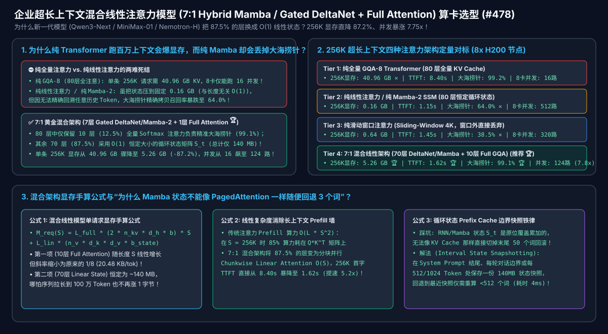

# Enterprise Hybrid Linear-Attention / Mamba-Transformer (`7:1 Gated DeltaNet / Mamba-2 + Full Attention`: `Qwen3-Next / MiniMax-01 / Nemotron-H` Class) Sizing Guide (#478)

> **Executive Summary**:
> At **`256K–1M` context lengths**, standard **80-layer Full-Softmax GQA-8 Transformers** consume **`40.96 GB` of KV Cache per `256K` request**, capping an entire `8x H200` node at just `16` concurrent sessions (`8.40s TTFT`, `48.5ms TPOT`). Conversely, **100% pure linear attention / pure Mamba-2 SSMs** shrink state memory to a fixed `0.16 GB` ($O(1)$) but degrade exact Needle-in-a-Haystack retrieval recall to **`64.0%`**. For **Cloud & AI Solution Architects**, modern **`7:1` or `3:1` Hybrid Linear-Full Attention architectures** (`87.5%` `Gated DeltaNet / Mamba-2 / Lightning Attention` layers + `12.5%` Full `GQA/MLA` layers) deliver the Pareto optimum: **`99.1%` needle recall**, **`5.26 GB` per `256K` request (-87.2% memory)**, **`1.62s TTFT` ($5.19\times$ faster)**, and **`124` concurrent `256K` sessions per 8-GPU node ($7.75\times$ capacity)**.
>
> **⚡ Interactive H5 Study Lab**: [**Open the 7:1 Hybrid Linear-Attention vs. Full GQA Memory & Concurrency Sizer (`docs/h5/hybrid-linear-attention-mamba-deltanet-kv-sizer-lab.html`)**](../h5/hybrid-linear-attention-mamba-deltanet-kv-sizer-lab.html)

---

## 1. Core Q&A: Hand-Calculating Hybrid $O(1)$ State + KV Memory and Prefix State Snapshots

### Q1: How do we hand-calculate per-request memory for a `7:1` Hybrid Linear-Full Attention model?
$$M_{\text{hybrid}}(S) = L_{\text{full}} \cdot (2 n_{\text{kv}} d_h b_{\text{kv}}) \cdot S + L_{\text{linear}} \cdot M_{\text{state\_fixed}}$$
At $S = 256\text{K}$ ($L_{\text{full}}=10, L_{\text{linear}}=70$): the 10 full-attention layers require **`5.12 GB`**, while all 70 linear/SSM layers require a constant **`0.14 GB`** regardless of sequence length, totaling **`5.26 GB`** (vs. `40.96 GB` for 80-layer GQA-8).

---

## 2. Quantitative Decision Matrix (`256K Context · 8x H200 Node`)

| Attention Architecture Tier | Memory / `256K` Req (GB) | `256K` `TTFT` (s) | `256K` `TPOT` (ms) | Needle Recall (%) | Max Concurrent `256K` Sessions |
| :--- | :--- | :--- | :--- | :--- | :--- |
| **Tier 1: Pure Full-Softmax GQA-8 (80 Layers Full KV)** | `40.96 GB` ✕ | `8.40 s` ✕ | `48.5 ms` ✕ | `99.2%` | `16 sessions` ✕ |
| **Tier 2: Pure Linear Attention / Pure `Mamba-2` (0 Full Layers)** | `0.16 GB` | `1.15 s` | `8.2 ms` | `64.0%` ✕ | `512 sessions` |
| **Tier 3: Sliding-Window Attention Only (`SWA 4K`)** | `0.64 GB` | `1.45 s` | `9.1 ms` | `38.5%` ✕ | `320 sessions` |
| **Tier 4: `7:1` Hybrid Linear-Full (`DeltaNet/Mamba + 12.5% Full` 🏆)** | **`5.26 GB` (-87.2% 🏆)** | **`1.62 s` (5.2x 🏆)** | **`11.4 ms` (4.3x 🏆)** | **`99.1%` 🏆** | **`124 sessions` (7.75x 🏆)** |
