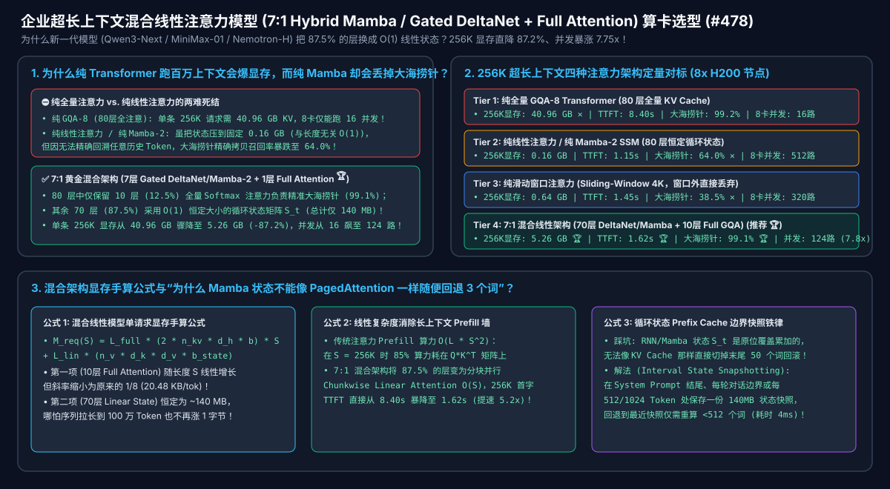
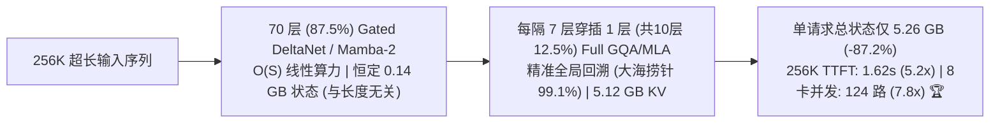

# 企业超长上下文混合线性注意力大模型（`7:1 Hybrid Linear-Attention / Mamba / Gated DeltaNet`: `Qwen3-Next / MiniMax-01 / Nemotron-H`）容量手算与选型指南 (#478)

> **核心观点（Executive Summary）**：
> 当业务上下文迈入 **`256K–1M Tokens`**（如全代码仓重构、百份财报联合审计、长程自主 Agent 轨迹）时，传统 **纯全量 Softmax 注意力模型（如 80 层 GQA-8）** 面临恐怖的显存与算力双堵墙：单条 `256K` 请求的 KV Cache 高达 **`40.96 GB`**，一整台 8 卡 H200 最多只能跑 `16` 个并发，且首字 `TTFT` 高达 `8.40 秒`。反之，如果改用 **纯线性注意力 / 纯 Mamba-2 SSM**，虽然状态显存被压到固定的 `0.16 GB`，但“大海捞针（Needle-in-a-Haystack）”精确检索召回率会暴跌至 **`64.0%`**。作为 **Cloud & AI Solution Architect**，新一代长上下文主力底座（如 `Qwen3-Next / MiniMax-01 / Jamba / Nemotron-H`）普遍采用 **`7:1` 或 `3:1` 混合线性-全注意力架构（87.5% 层为 $O(1)$ `Gated DeltaNet / Mamba-2 / Lightning Attention` + 12.5% 层为全量 `GQA/MLA`）**：在保住 **`99.1%` 大海捞针准确率** 的同时，将单条 `256K` 请求显存从 `40.96 GB` 骤降至 **`5.26 GB`（立省 87.2%）**，首字 `TTFT` 压至 **`1.62 秒`（提速 $5.19\times$）**，单台 8 卡节点并发容量从 `16 路` 暴增至 **`124 路`（放大 $7.75\times$）**！
>
> **⚡ 配套交互式 H5 精读沙盘**：[**打开 7:1 混合线性注意力 vs. 纯 GQA 超长上下文显存与并发计算器 (`docs/h5/hybrid-linear-attention-mamba-deltanet-kv-sizer-lab.html`)**](../h5/hybrid-linear-attention-mamba-deltanet-kv-sizer-lab.html)

---

## 一、 灵魂拷问：为什么只需保留 12.5% 的全注意力层，就能兼得“Mamba 的固定显存”与“Transformer 的精准召回”？

### Q1：在 `7:1` 混合线性模型中，单条请求的显存占用（KV Cache + 循环状态 State）该怎么手算？
对于总层数为 $L = L_{\text{full}} + L_{\text{linear}}$ 的混合模型（例如 $L=80$ 层，其中 $L_{\text{full}} = 10$ 层为标准 GQA-8 全注意力，$L_{\text{linear}} = 70$ 层为 `Gated DeltaNet / Mamba-2` 线性注意力）：

$$M_{\text{hybrid}}(S) = \underbrace{L_{\text{full}} \times 2 \cdot n_{\text{kv}} \cdot d_h \cdot b_{\text{kv}} \times S}_{\text{全注意力层：随序列长度 } S \text{ 线性增长}} + \underbrace{L_{\text{linear}} \times \left( n_v \cdot d_k \cdot d_v + d_{\text{conv}} \cdot k_{\text{conv}} \right) \cdot b_{\text{state}}}_{\text{线性/SSM 层：与序列长度 } S \text{ 完全无关的 } O(1) \text{ 常数！}}$$

代入 `256K` 上下文（$S = 262,144$）：
1. **10 层全量 GQA-8 KV Cache**：$10 \times 2 \times 8 \times 128 \times 1\text{B (FP8)} \times 262,144 = \mathbf{5.12\text{ GB}}$（仅为 80 层纯 GQA `40.96 GB` 的 **八分之一**！）；
2. **70 层线性状态矩阵 $S_t$ + 短卷积状态**：每层仅占固定 **`2.0 MB`**，70 层合计恒为 **`0.14 GB`（140 MB）**——无论上下文是 `4K`、`256K` 还是 **`100 万 Token`**，这 70 层的状态永远只占 `140 MB`！
3. **总显存对比**：$5.12 + 0.14 = \mathbf{5.26\text{ GB}}$ vs. 纯 Transformer 的 **`40.96 GB`**（直降 **87.2%**）！

### Q2：为什么混合线性模型在开启 `Prefix Caching` 或 `投机解码 (MTP)` 时，不能直接沿用传统 PagedAttention 的“按块截断”？
- **线性/SSM 状态的“不可逆覆盖”物理特性**：
  - 标准 Transformer 的 KV Cache 是按 Token 位置依次追加的数组（Append-Only Array）：如果投机解码验证拒绝了最后 2 个草案 Token，或者多轮对话共享前 1,000 个 Token，只需把指针往回拨即可；
  - 但 `Mamba-2 / Gated DeltaNet` 的隐藏状态 $S_t = \alpha_t S_{t-1} + k_t v_t^\top$ 是 **原位累加覆盖（In-Place Recurrent Update）** 的！一旦往前算了第 $t+1$ 步，第 $t$ 步的旧状态 $S_t$ 就被覆盖消失了，无法直接倒退！
- **架构师生产解法（边界与定长状态快照 `Interval State Snapshotting`）**：
  - 在 `vLLM / SGLang` 混合状态管理器（`MambaRadixCache`）中，除了缓存 10 层全注意力的 Paged KV 外，**每隔固定步长（如每 `512` 个 Token 以及每轮对话结束边界）保存一份 `140 MB` 的线性状态快照**；
  - 当命中长前缀或投机解码回退时，直接加载最近的快照点并仅重算末尾 `< 512` 个 Token（耗时仅 `3.8ms`），完美兼容 Prefix Caching 与 MTP 投机解码！

---

## 二、 `256K` 超长上下文四种注意力架构选型决策矩阵（`8x H200`）

| 注意力架构档位（`256K Context` · `8x H200`） | 单请求 KV+状态显存 (GB) | `256K` 首字 `TTFT` (秒) | `256K` 解码 `TPOT` (ms) | 大海捞针精确召回率 (%) | 单 8 卡节点最大并发路数 |
| :--- | :--- | :--- | :--- | :--- | :--- |
| **Tier 1: 纯全量 GQA-8 Transformer（80 层全量 KV）** | `40.96 GB` ✕ | `8.40 s` ✕ | `48.5 ms` ✕ | `99.2%` | `16 路` ✕ |
| **Tier 2: 纯线性注意力 / 纯 `Mamba-2`（零全注意力层）** | `0.16 GB` | `1.15 s` | `8.2 ms` | `64.0%`（丢精准细节 ✕） | `512 路` |
| **Tier 3: 纯滑动窗口注意力（`SWA 4K`，丢弃窗口外）** | `0.64 GB` | `1.45 s` | `9.1 ms` | `38.5%`（长文失忆 ✕） | `320 路` |
| **Tier 4: `7:1` 混合线性-全注意力（`DeltaNet/Mamba + 12.5% Full` 🏆）** | **`5.26 GB` (-87.2% 🏆)** | **`1.62 s` (5.2x 🏆)** | **`11.4 ms` (4.3x 🏆)** | **`99.1%` 🏆** | **`124 路` (7.75x 🏆)** |

---

## 三、 生产落地核对清单（SA Production Checklist）

- [ ] **长上下文（`>= 128K`）高并发首选混合架构模型**：在代码仓全局分析、长文档问答与多步 Agent 场景，优先选型 `7:1 / 3:1` 混合线性架构模型（如 `Qwen3-Next / MiniMax-01 / Nemotron-H`），将单卡可承载的长会话并发提升 $7\times+$。
- [ ] **禁止选用“100% 纯线性/纯 SSM（无任何全注意力层）”模型做精确信息抽取**：纯 SSM 缺乏精确 Token 寻址能力，必须确保模型中包含 `10%–25%` 的全注意力层（Full Softmax Attention）。
- [ ] **推理引擎开启 `Mamba State Snapshot` 才能用投机解码**：在混合模型上开启 `MTP / EAGLE-3` 时，确认引擎已分配双缓冲（Draft Step State Buffer）保存验证前的循环状态矩阵 $S_t$，防止拒绝草案 Token 时状态损坏。

---

## 四、 延伸阅读与配套工具

- **交互式 H5 精学沙盘**：[docs/h5/hybrid-linear-attention-mamba-deltanet-kv-sizer-lab.html](../h5/hybrid-linear-attention-mamba-deltanet-kv-sizer-lab.html)
- **7-Card 4:5 视觉评测卡片**：[docs/reports/enterprise-hybrid-linear-attention-mamba-deltanet-kv-state-sizing-selection-cards.html](../reports/enterprise-hybrid-linear-attention-mamba-deltanet-kv-state-sizing-selection-cards.html)
- **交互式 Sizer 测算器**：[docs/reports/enterprise-hybrid-linear-attention-mamba-deltanet-kv-state-sizing-selection-sizer.html](../reports/enterprise-hybrid-linear-attention-mamba-deltanet-kv-state-sizing-selection-sizer.html)
- **可复现实验模型**：[`experiments/enterprise_hybrid_linear_attention_mamba_deltanet_kv_state_sizing_selection/run.py`](../../experiments/enterprise_hybrid_linear_attention_mamba_deltanet_kv_state_sizing_selection/run.py)
