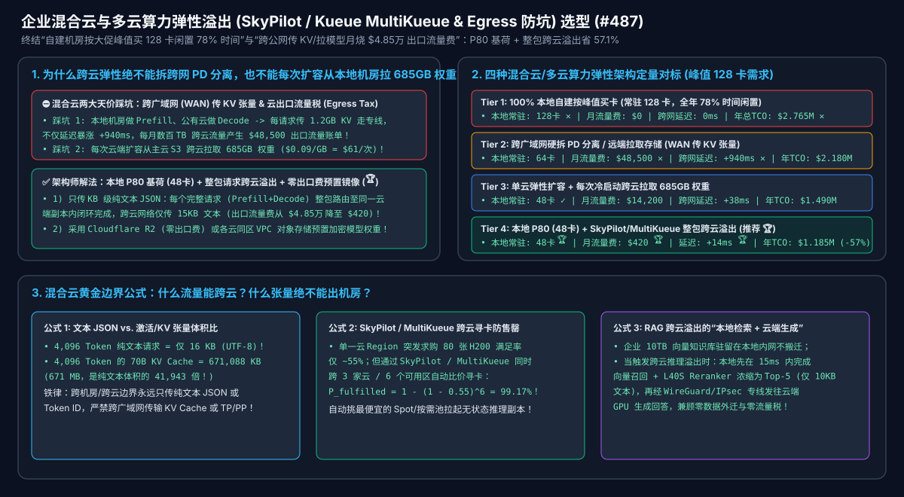

# Enterprise Hybrid / Multi-Cloud GPU Bursting (`SkyPilot / Kueue MultiKueue`, Egress Tax Avoidance & `P80` Base Sizing) Selection Guide (#487)

> **Executive Summary**:
> Provisioning an on-premises cluster for 100% of annual peak traffic (`128 H200 GPUs` when the `P80` baseline requires only `48 GPUs`) leaves 80 GPUs idle 78% of the year (`$2.765M/yr` TCO). However, naive hybrid bursting that splits Prefill and Decode across WAN links or pulls `685 GB` weights across clouds incurs **`$48,500/month` in cloud egress fees** and **`+940ms` WAN latency**. For **Cloud & AI Solution Architects**, the production hybrid pattern pairs an **On-Premises `P80` Base (`48 GPUs` at >90% utilization) + Multi-Cloud `SkyPilot / Kueue MultiKueue` Whole-Request Stateless Bursting + Local RAG Reranking (`15 KB` JSON payload over WAN) + Region-Local / Zero-Egress (`Cloudflare R2`) Weight Staging**. This cuts monthly egress bills by **99.1% (`$420/mo`)**, holds WAN overhead to **`+14ms`**, and reduces annual TCO by **57.1% (`$1.185M/yr`, saving `$1.58M/yr`)**.
>
> **⚡ Interactive H5 Study Lab**: [**Open the Hybrid Multi-Cloud GPU Bursting & Egress Tax Calculator (`docs/h5/hybrid-multicloud-gpu-bursting-egress-tco-lab.html`)**](../h5/hybrid-multicloud-gpu-bursting-egress-tco-lab.html)

---

## 1. Core Q&A: The 41,943x KV-to-Text Inflation Ratio Across WAN Boundaries

### Q1: Why must cross-cloud bursting always route whole stateless text requests rather than disaggregating PD across WAN?
- A 4,096-token UTF-8 JSON prompt is **`16 KB`**, whereas its `Llama-70B FP8` KV Cache is **`671 MB` (`41,943x` larger)**. Keep `TP`, `PP`, `EP`, and `PD Disaggregation` strictly inside a single datacenter's `400G RDMA` fabric, and cross WAN boundaries only with compact text JSON after local `L40S` RAG reranking.

---

## 2. Quantitative Decision Matrix (`Peak = 128 GPUs · P80 Base = 48 GPUs`)

| Hybrid / Multi-Cloud Bursting Model | On-Prem Base GPUs | Monthly Cloud Egress Bill | Cross-WAN Latency Penalty | Annual Total TCO ($/yr) |
| :--- | :--- | :--- | :--- | :--- |
| **Tier 1: 100% On-Prem Peak Over-Provisioning (Idle 78% of Time)** | `128 GPUs` ✕ | `$0 / mo` | `0.0 ms` | `$2,764,800` ✕ |
| **Tier 2: Naive Cross-WAN PD Split / Remote Storage Pull** | `64 GPUs` | `$48,500 / mo` ✕ | `+940.0 ms` ✕ | `$2,180,000` |
| **Tier 3: Single-Cloud Burst + Cross-Cloud Cold Weight Pull** | `48 GPUs` ✓ | `$14,200 / mo` | `+38.0 ms` | `$1,490,000` |
| **Tier 4: On-Prem `P80` (`48 GPUs`) + `SkyPilot/MultiKueue` Whole-Req Burst 🏆** | **`48 GPUs` 🏆** | **`$420 / mo` (-99.1% 🏆)** | **`+14.0 ms` 🏆** | **`$1,185,000` (-57.1% 🏆)** |
