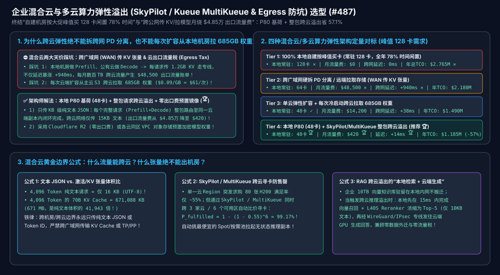
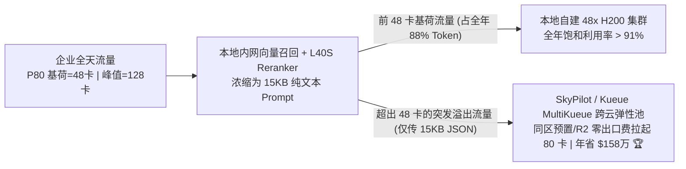

# 企业混合云与多云算力弹性溢出（`Hybrid / Multi-Cloud GPU Bursting`: `SkyPilot / Kueue MultiKueue`）与云出口流量税防坑指南 (#487)

> **核心观点（Executive Summary）**：
> 企业流量普遍存在剧烈的早晚潮汐与营销大促洪峰（峰值需求 `128 张 H200`，但全年 80% 时间的 `P80` 基荷仅需 `48 张`）。如果按峰值在本地机房自建全部 `128` 张卡，高达 `80` 张卡全年 78% 的时间在空转折旧，年 TCO 高达 **`$276.5万（$2.765M）`**！然而，许多团队在做“混合云弹性溢出”时踩中了两个致命大坑：① 试图跨广域网（WAN）把本地 Prefill 和云端 Decode 拆开（导致每请求搬运几百 MB 的 KV 张量，延迟暴涨 **`+940ms`**，且每月产生 **`$48,500` 的天价公有云出口流量账单 Egress Tax**）；② 每次云端扩容都跨云从主存储桶拉取 `685 GB` 权重。作为 **Cloud & AI Solution Architect**，混合云弹性溢出的黄金架构是：**“本地自建 `P80` 基荷（`48 张卡` 跑满 90%+ 利用率）+ `SkyPilot / Kueue MultiKueue` 跨多云自动寻卡弹性 + 本地 RAG 精排后仅传 `15 KB` 纯文本 JSON 整包溢出 + 各云同区预置/零出口费对象存储（如 Cloudflare R2）加载权重”**：将跨云出口流量费从 `$4.85万/月` 压至 **`$420/月`（削减 99.1%）**，跨网附加延迟仅 **`+14ms`**，全年总 TCO 从 `$276.5万` 直降至 **`$118.5万`（立省 57.1% / 年省 `$158万`）**！
>
> **⚡ 配套交互式 H5 精读沙盘**：[**打开混合云 P80 基荷 + 多云溢出 TCO 与出口流量税计算器 (`docs/h5/hybrid-multicloud-gpu-bursting-egress-tco-lab.html`)**](../h5/hybrid-multicloud-gpu-bursting-egress-tco-lab.html)

---

## 一、 灵魂拷问：为什么跨云边界只能传“纯文本 JSON”，绝对不能传“KV Cache 张量”？

### Q1：算一笔体积放大账：同一条 4,096 Token 的请求，纯文本 JSON 与 KV Cache 张量相差多少倍？
1. **纯文本 UTF-8 JSON 请求体积**：
   - `4,096` 个 Token 对应的原始文本字符串仅约 **`16 KB`**；通过专线或公网 IPsec 隧道传输 `16 KB` 仅需 **`1.5ms`**，哪怕一个月溢出 2,000 万次请求，总流量也只有 `320 GB`（流量费不到 **`$30`**！）。
2. **展开为 `Llama-70B FP8` KV Cache 张量后的体积**：
   - $4096 \times 163.84\text{ KB/tok} = \mathbf{671,088\text{ KB} \ (671\text{ MB})}$——**体积足足膨胀了 `41,943 倍`**！
   - 如果错误地把 Prefill 放在本地机房、把 Decode 放在公有云（跨 WAN PD 分离），每次请求跨网搬运 `671 MB`，不仅把 10G 专线瞬间塞爆（增加 **`940ms`** 延迟），每月还会产生数百 TB 的跨网流量费（高达 **`$48,500/月`**）！
3. **架构师混合云第一铁律（Whole-Request Stateless Spillover）**：
   - **PD 分离、TP、PP、EP 严格锁死在同一个数据中心机房内部的 400G RDMA 网络内**；
   - 跨机房 / 跨云溢出时，必须以 **“单次完整推理请求（Whole Request：输入纯文本 $\rightarrow$ 输出纯文本）”** 为最小调度粒度！甚至当知识库在本地内网时，也在本地先完成向量召回 + `L40S Reranker` 浓缩为 `Top-5` 纯文本片段（`10 KB`），再拼成完整 Prompt 发往云端无状态 GPU 副本生成回答！

### Q2：大促洪峰来袭时，单一公有云可用区经常报“H200 库存不足”，怎么用 `SkyPilot / Kueue MultiKueue` 把寻卡成功率提到 `99.2%`？
- 单一云厂商单个可用区在高峰期临时求购 `80` 张 H200/H100 的一次满足率往往只有 $p_1 \approx 55\%$；
- 通过 **`Kueue MultiKueue`（K8s 原生多集群作业分发）或 `SkyPilot`（跨云算力经纪人）**，同时对接 3 家云厂商的 6 个可用区（以及 AMD `MI300X/MI325X` 与 `L40S` 备选池）：
  $$P_{\text{fulfilled}} = 1 - \prod_{i=1}^{6} (1 - p_i) = 1 - (1 - 0.55)^6 = \mathbf{99.17\%}$$
- 且在各云同 Region 廉价对象存储（或零出口流量费的 **Cloudflare R2**）预先存放加密模型权重镜像，彻底消灭跨云拉取 `685 GB` 权重的 `$0.09/GB` 出口税！

---

## 二、 四种混合云/多云算力弹性架构选型决策矩阵（`峰值 128 卡 · 基荷 48 卡`）

| 混合云与多云算力架构档位 | 本地常驻购买 GPU 数 | 月度云出口流量费 (Egress) | 跨网附加延迟 (ms) | 全年综合总 TCO ($/yr) |
| :--- | :--- | :--- | :--- | :--- |
| **Tier 1: 100% 本地按峰值买卡（常驻 `128` 卡，78% 时间闲置）** | `128 卡` ✕ | `$0 / mo` | `0.0 ms` | `$2,764,800` ✕ |
| **Tier 2: 跨广域网硬拆 PD 分离 / 跨网拉存储（传 KV 张量）** | `64 卡` | `$48,500 / mo` ✕ | `+940.0 ms` ✕ | `$2,180,000` |
| **Tier 3: 单云弹性扩容 + 每次冷启动跨云拉取 `685GB` 权重** | `48 卡` ✓ | `$14,200 / mo` | `+38.0 ms` | `$1,490,000` |
| **Tier 4: 本地 `P80` (`48卡`) + `SkyPilot/MultiKueue` 整包跨云溢出（推荐 🏆）** | **`48 卡` 🏆** | **`$420 / mo` (-99.1% 🏆)** | **`+14.0 ms` 🏆** | **`$1,185,000` (-57.1% 🏆)** |

---

## 三、 生产落地核对清单（SA Production Checklist）

- [ ] **按 `P75–P80` 水位采购本地自建硬底座**：切勿按一年几次的营销大促峰值采购本地固定资产；将本地自建规模锁在 `P80` 水位确保全年利用率 `> 90%`，顶部 `20%–50%` 尖峰交由云端按需/Spot/Serverless 承接。
- [ ] **严禁跨数据中心/跨可用区边界拆分 TP、PP 或 PD 分离**：跨机房边界永远只走 HTTP/gRPC 纯文本 JSON 级整包路由。
- [ ] **消灭模型镜像跨云拉取出口税**：使用同云同 Region 对象存储桶或零 Egress 费用的 `Cloudflare R2` 分发 `685 GB` 模型权重与容器镜像。

---

## 四、 延伸阅读与配套工具

- **交互式 H5 精学沙盘**：[docs/h5/hybrid-multicloud-gpu-bursting-egress-tco-lab.html](../h5/hybrid-multicloud-gpu-bursting-egress-tco-lab.html)
- **7-Card 4:5 视觉评测卡片**：[docs/reports/enterprise-hybrid-multicloud-gpu-bursting-skypilot-multikueue-egress-tco-selection-cards.html](../reports/enterprise-hybrid-multicloud-gpu-bursting-skypilot-multikueue-egress-tco-selection-cards.html)
- **交互式 Sizer 测算器**：[docs/reports/enterprise-hybrid-multicloud-gpu-bursting-skypilot-multikueue-egress-tco-selection-sizer.html](../reports/enterprise-hybrid-multicloud-gpu-bursting-skypilot-multikueue-egress-tco-selection-sizer.html)
- **可复现实验模型**：[`experiments/enterprise_hybrid_multicloud_gpu_bursting_skypilot_multikueue_egress_tco_selection/run.py`](../../experiments/enterprise_hybrid_multicloud_gpu_bursting_skypilot_multikueue_egress_tco_selection/run.py)
