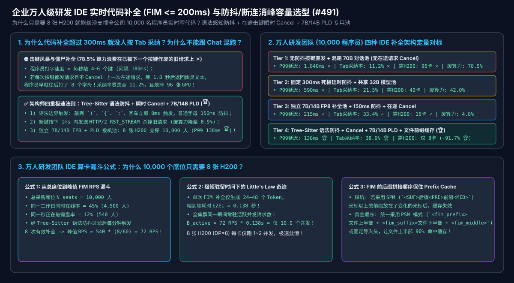

# Enterprise 10,000-Developer IDE Code Completion (`FIM <= 200ms`, `Syntax-Aware Debounce`, `In-Flight Cancel` & `PLD Speculative` Sizer) Selection Guide (#491)

> **Executive Summary**:
> Mixing real-time IDE inline code completion (`Fill-in-the-Middle / FIM`) into a shared `70B` Chat pool without keystroke debouncing or in-flight request cancellation wastes **`78.5%` of GPU compute on obsolete keystrokes**, inflates `P99` completion latency to **`1,840ms`**, drops developer `Tab` acceptance rate to **`11.2%`**, and consumes **`96 H200 GPUs`** for 10,000 developers. For **Cloud & AI Solution Architects**, the production architecture isolates a dedicated **`7B/14B FP8 + Prompt Lookup (PLD) Speculative` FIM Pool** paired with **Client-Side `Tree-Sitter` Syntax-Aware Debouncing (`0ms` on syntax boundaries, `150ms` mid-identifier) + `1ms` HTTP/2 In-Flight Cancellation + `PSM` File-Prefix Affinity Routing**. Because each 32-token FIM completion finishes in **`138ms`**, Little's Law ($B_{\text{active}} = 72\text{ RPS} \times 0.138\text{s} = \mathbf{10}$) allows **just `8 H200 GPUs` to serve all `10,000` developers (-91.7% GPUs)** while boosting `Tab` acceptance to **`38.6%` ($3.45\times$)**.
>
> **⚡ Interactive H5 Study Lab**: [**Open the 10,000-Developer IDE Code Completion Concurrency Funnel & GPU Sizer (`docs/h5/ide-code-completion-fim-debounce-gpu-sizer-lab.html`)**](../h5/ide-code-completion-fim-debounce-gpu-sizer-lab.html)

---

## 1. Core Q&A: The 10,000-Developer Little's Law Funnel and `PSM` Prefix Ordering

### Q1: Why do 10,000 active developer seats require only `10` concurrent active GPU slots (`8x H200`)?
- Out of `10,000` seats $\rightarrow$ `45%` online (`4,500`) $\rightarrow$ `12%` actively typing (`540`) $\rightarrow$ `8` syntax-debounced FIM requests/min = **`72 Peak RPS`**.
- With a short `32-token` output and `138ms` end-to-end duration (`E2EL = 0.138s`), Little's Law gives $B_{\text{active}} = 72 \times 0.138 = \mathbf{10}$ concurrent in-flight requests across `8x H200` (`DP=8`).

---

## 2. Quantitative Decision Matrix (`10,000 Enterprise Developers`)

| IDE Code Completion Architecture | `P99` FIM Latency (ms) | Developer `Tab` Acceptance (%) | H200 GPUs Needed (10k Devs) | Wasted Obsolete-Keystroke Compute |
| :--- | :--- | :--- | :--- | :--- |
| **Tier 1: Un-Debounced Keystrokes on Shared `70B` Pool (No Cancel)** | `1,840.0 ms` ✕ | `11.2%` ✕ | `96 GPUs` ✕ | `78.5%` ✕ |
| **Tier 2: Fixed `300ms` Timer Debounce on Shared `32B` Pool** | `590.0 ms` ✕ | `21.5%` | `40 GPUs` | `42.0%` |
| **Tier 3: Dedicated `7B/14B FP8` Pool + `150ms` Debounce + Cancel** | `215.0 ms` ✓ | `33.4%` ✓ | `16 GPUs` ✓ | `4.8%` |
| **Tier 4: `Tree-Sitter` Syntax Debounce + Cancel + `7B/14B PLD` + `PSM` Cache 🏆** | **`138.0 ms` 🏆** | **`38.6%` (3.45x 🏆)** | **`8 GPUs` (-91.7% 🏆)** | **`0.9%` 🏆** |
