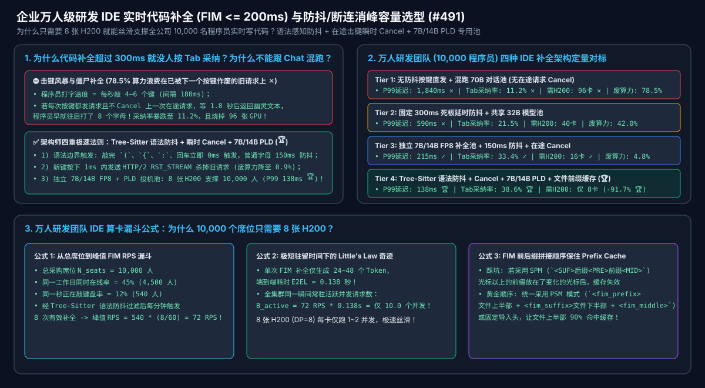
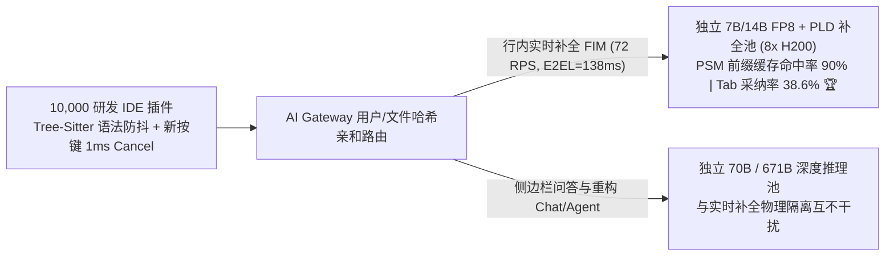

# 企业万人级研发 IDE 实时代码补全（`FIM <= 200ms`）与防抖/断连消峰容量选型指南 (#491)

> **核心观点（Executive Summary）**：
> 在大型软件企业为 **10,000 名研发工程师** 私有化部署 AI 编程助手（`IDE Inline Code Completion + Chat/Agent`）时，最常见的架构灾难是 **“把每敲一个键触发的实时行内代码补全（Fill-in-the-Middle, FIM）和侧边栏对话问答（Chat）混在同一个 `70B` 模型池里，且没有做客户端语法防抖与在途旧请求 Cancel”**——结果程序员连续敲击键盘产生的 **78.5% 作废按键风暴** 把 `96 张 H200` 全部塞满，行内灰字补全延迟高达 `1,840ms`，程序员早就自己打完了字，Tab 采纳率暴跌至 **`11.2%`**！作为 **Cloud & AI Solution Architect**，生产级研发辅助底座必须实行 **“双轨物理分池（`7B/14B FP8 + PLD 投机` 跑 `< 200ms` 行内 FIM 补全；`70B/671B` 跑侧边栏 Chat/Agent）+ 客户端 `Tree-Sitter` 语法感知防抖 + 新按键 `1ms` 瞬时 Cancel 在途旧请求 + `PSM` 文件前缀缓存亲和路由”**：将端到端补全 `P99` 延迟压至 **`138ms`**，程序员 Tab 采纳率跃升至 **`38.6%`（$3.45\times$）**，**仅用 `8 张 H200` 即可丝滑服务全公司 `10,000` 名开发者（立省 91.7% 算力！）**。
>
> **⚡ 配套交互式 H5 精读沙盘**：[**打开万人研发团队 IDE 实时代码补全 (FIM) 并发漏斗与算卡计算器 (`docs/h5/ide-code-completion-fim-debounce-gpu-sizer-lab.html`)**](../h5/ide-code-completion-fim-debounce-gpu-sizer-lab.html)

---

## 一、 灵魂拷问：为什么 10,000 名程序员同时写代码，居然只需要 8 张 H200 就能保证 138ms 秒出补全？

### Q1：算清“万人研发团队并发漏斗（10,000-Seat Concurrency Funnel）”：从 10,000 个席位到 GPU 常驻活跃 Batch 经历了哪四层衰减？
很多采购经理拍脑袋以为“10,000 人就要按 1,000 并发买 100 张卡”，其实严格按工业统计与 Little's Law 逐层推导：
1. **第一层（工作日同时在线率 $\eta_{\text{online}} \approx 45\%$）**：10,000 名授权研发人员中，除去会议、文档、午休与排期，同一时刻打开 IDE 的约 **`4,500 人`**；
2. **第二层（活跃编码击键率 $\eta_{\text{typing}} \approx 12\%$）**：程序员写代码时 88% 的时间在阅读代码、调试或思考，同一秒手指正在敲击键盘的约 **`540 人`**；
3. **第三层（Tree-Sitter 语法防抖后的有效请求率）**：每位正在打字的程序员经语法防抖过滤后，平均每分钟仅发出 `8` 次有效补全请求，因此 **全集群峰值请求速率 $\text{RPS}_{\text{peak}} = 540 \times (8 / 60) = \mathbf{72\text{ RPS}}$**；
4. **第四层（Little's Law 极短驻留时间奇迹）**：
   - 行内 FIM 补全不需要吐 1,000 字长文，每次只补全 1~3 行代码（平均 **`32` 个 Token**），在 `7B/14B FP8 + PLD 投机解码` 下，从首字到生成完毕的 **端到端驻留时间 $\text{E2EL} = 0.138\text{ s}$（138 毫秒）**！
   - 代入 Little's Law：
     $$B_{\text{active}} = \text{RPS}_{\text{peak}} \times \text{E2EL} = 72\text{ RPS} \times 0.138\text{ s} = \mathbf{9.94 \approx 10\text{ 个并发在途请求！}}$$
   - **震撼结论**：全公司 10,000 名程序员同时办公，因为每次补全 0.138 秒就结束腾出槽位，**任意一毫秒真正在 GPU 里跑的活跃请求只有 10 个**！用 **`8 张 H200`（`DP=8`）** 承载，平均每张卡同一时刻只跑 **1~2 个请求**，所以才能做到 `138ms` 极致响应！

### Q2：为什么固定 `300ms` 定时器防抖体验很差？什么是“Tree-Sitter 语法感知防抖 + 在途瞬时 Cancel”？
- **固定 `300ms` 定时器的两难**：设成 `300ms` 会让程序员敲完函数括号 `def calc(` 后干等 `0.3s + 0.2s = 0.5s` 才出提示（手感粘滞）；设成 `50ms` 又会在连续打单词 `variable_name` 时每敲一个字母发一次请求，产生海量废请求！
- **架构师标准解法**：
  1. **IDE 插件本地 `Tree-Sitter` AST 语法树触发**：当光标位于 **高价值语法边界（如刚敲下换行符 `\n`、冒号 `:`、左大括号 `{`、赋值号 `=`）** 时，**`0ms` 立即触发** 请求；当处于连续拼写标识符中间时，延迟 **`150ms–200ms`** 防抖且跳过无意义触发；
  2. **新按键 `1ms` 穿透 Cancel**：一旦用户在补全返回前又敲下了下一个键，IDE 立即发出 `HTTP/2 RST_STREAM`，网关与 `vLLM/SGLang` 在 `1ms` 内终止该旧请求并回收显存，将作废算力浪费从 `78.5%` 压至 **`0.9%`**！

---

## 二、 万人研发团队四种 IDE 补全架构选型决策矩阵

| IDE 实时代码补全架构档位（服务 `10,000` 名开发者） | 端到端 `P99` 补全延迟 | 程序员 `Tab` 采纳率 (%) | 所需 H200 卡数 | 作废击键浪费算力占比 (%) |
| :--- | :--- | :--- | :--- | :--- |
| **Tier 1: 无防抖按键直发 + 混跑 `70B` 对话池（无 Cancel）** | `1,840.0 ms` ✕ | `11.2%` ✕ | `96 卡` ✕ | `78.5%` ✕ |
| **Tier 2: 固定 `300ms` 定时器防抖 + 共享 `32B` 模型池** | `590.0 ms` ✕ | `21.5%` | `40 卡` | `42.0%` |
| **Tier 3: 独立 `7B/14B FP8` 补全池 + `150ms` 防抖 + 在途 Cancel** | `215.0 ms` ✓ | `33.4%` ✓ | `16 卡` ✓ | `4.8%` |
| **Tier 4: `Tree-Sitter` 语法防抖 + Cancel + `7B/14B PLD` + 文件前缀缓存（推荐 🏆）** | **`138.0 ms` 🏆** | **`38.6%` (3.4x 🏆)** | **`8 卡` (-91.7% 🏆)** | **`0.9%` 🏆** |

---

## 三、 生产落地核对清单（SA Production Checklist）

- [ ] **FIM 补全池与 Chat 对话池 100% 物理隔离**：严禁把需要 `< 200ms` 响应的行内 FIM 请求与耗时 `15s` 的长文 Chat/Agent 请求混部在同一组推理实例上。
- [ ] **统一使用 `PSM (Prefix-Suffix-Middle)` 格式并按文件路径亲和路由**：程序员在同一个源文件内连续下移光标写代码时，文件上半部（`Prefix`）保持不变；网关按 `(user_id, file_path)` 一致性哈希路由至同一张卡，可使 `Prefix Cache` 命中率高达 **90%+**！
- [ ] **设置严苛的停止词（Stop Tokens）**：对单行补全强制设置 `stop=["\n", "\r\n"]` 与 `max_tokens = 48`，防止模型失控连续生成几百行无用代码。

---

## 四、 延伸阅读与配套工具

- **交互式 H5 精学沙盘**：[docs/h5/ide-code-completion-fim-debounce-gpu-sizer-lab.html](../h5/ide-code-completion-fim-debounce-gpu-sizer-lab.html)
- **7-Card 4:5 视觉评测卡片**：[docs/reports/enterprise-ide-code-completion-fim-debounce-cancel-gpu-sizing-selection-cards.html](../reports/enterprise-ide-code-completion-fim-debounce-cancel-gpu-sizing-selection-cards.html)
- **交互式 Sizer 测算器**：[docs/reports/enterprise-ide-code-completion-fim-debounce-cancel-gpu-sizing-selection-sizer.html](../reports/enterprise-ide-code-completion-fim-debounce-cancel-gpu-sizing-selection-sizer.html)
- **可复现实验模型**：[`experiments/enterprise_ide_code_completion_fim_debounce_cancel_gpu_sizing_selection/run.py`](../../experiments/enterprise_ide_code_completion_fim_debounce_cancel_gpu_sizing_selection/run.py)
