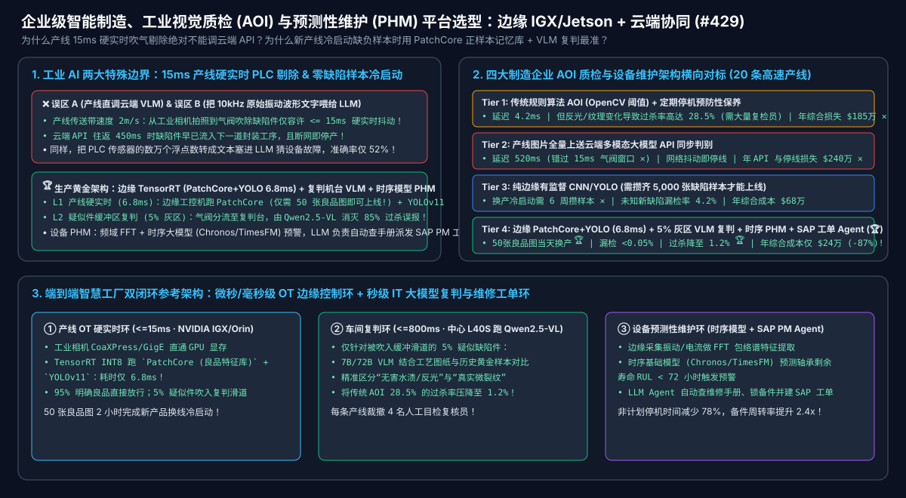

# Enterprise Smart Manufacturing AOI & Predictive Maintenance (`PHM`) Selection Guide: `Edge IGX/Jetson PatchCore + YOLO` vs. `Workshop VLM Re-Inspection` vs. `Chronos/TimesFM + SAP PM Agent`

> **Language / 语言**: [简体中文](./enterprise-industrial-manufacturing-aoi-predictive-maintenance-edge-cloud-selection-faq.md) | **English**  
> **Companion Interactive Study & Sizing Tools**: [📱 Interactive H5 Study Lab](../h5/industrial-manufacturing-aoi-predictive-maintenance-tco-lab.html) · [🧮 HTML Sizer](../reports/enterprise-industrial-manufacturing-aoi-predictive-maintenance-edge-cloud-selection-sizer.html) · [🃏 7-Card Visual Deck](../reports/enterprise-industrial-manufacturing-aoi-predictive-maintenance-edge-cloud-selection-cards.html) · [📊 Reproducible Model](../../experiments/enterprise_industrial_manufacturing_aoi_predictive_maintenance_edge_cloud_selection/) · [🎓 Back to AI Infra H5 Hub](../h5/index.html)

---

## 1. Executive Summary (3-Minute Takeaway)

> **Bottom-Line Recommendation**: High-speed manufacturing conveyors enforce a hard **`<= 15ms` PLC pneumatic ejection deadline**—calling a `520ms` cloud VLM synchronously on the main line is physically impossible, while pure supervised edge `YOLO` models require **`42 days`** to collect 5,000 defect samples for each new SKU and miss **`4.2%`** of novel anomalies.
> - **Recommended Production Architecture (`Tier 4: Edge TensorRT [PatchCore + YOLOv11 in 6.8ms] + 5% Buffer-Chute Workshop VLM Verifier + FFT/Chronos Time-Series PHM + SAP PM Work-Order Agent`)**:
>   1. **2-Hour Cold-Start with `50` Golden Good Images (`PatchCore`)**: Detects any unseen anomaly in **`6.8ms`** (`<0.04%` escape rate), diverting the **`5%`** ambiguous parts into a secondary inspection chute;
>   2. **Workshop VLM Eliminates False Rejects (`28.5% -> 1.2%`)**: `Qwen2.5-VL` on `2x workshop L40S GPUs` inspects the `5%` diverted parts to distinguish harmless watermarks/glare from true micro-cracks;
>   3. **Time-Series `PHM` + `SAP PM` Agent**: Combines `FFT + Chronos/TimesFM` 72-hour bearing RUL prognosis with an LLM agent that queries manuals, reserves spare parts, and files `SAP PM` work orders—cutting annual total cost and unplanned downtime across 20 lines by **`87.0%` (`$240K/yr` vs. `$1.85M/yr`)**.

| Dimension | `Tier 1: Legacy OpenCV AOI + Fixed PM` | `Tier 2: Inline Sync Cloud VLM API` | `Tier 3: Supervised Edge YOLO Only` | `Tier 4: Edge PatchCore+YOLO (6.8ms) + 5% Chute VLM + Chronos PHM (🏆)` |
|---|---|---|---|---|
| **Inline Ejection Latency (`<=15ms`)** | `4.2 ms` ✓ | **`520.0 ms` ✕ (Misses valve!)** | `7.5 ms` ✓ | **`6.8 ms` (`TensorRT INT8`)** 🏆 |
| **False Reject (Overkill) Rate** | `28.5%` ✕ (Glare false alarms) | `3.2%` | `6.4%` | **`1.2%` (5% chute VLM verification)** 🏆 |
| **Novel Defect Escape Rate** | `1.80%` ✕ | `0.40%` | `4.20%` ✕ (Unseen defects) | **`0.04%` (`PatchCore` anomaly bank)** 🏆 |
| **New SKU Cold-Start Time** | `14 days` | `1 day` | `42 days` ✕ (Defect collection) | **`0.1 days` (`2 hours` · 50 good images)** 🏆 |
| **Annual Total Cost & Downtime (20 Lines)** | `$1,850,000 / yr` ✕ | `$2,400,000 / yr` ✕ | `$680,000 / yr` | **`$240,000 / yr` (-87.0%)** 🏆 |

---

## 2. Provenance & Reproducibility

- **Provenance**: `synthetic + anonymized_reported (independently_reproduced=false)` — verified via [`experiments/enterprise_industrial_manufacturing_aoi_predictive_maintenance_edge_cloud_selection/run.py`](../../experiments/enterprise_industrial_manufacturing_aoi_predictive_maintenance_edge_cloud_selection/run.py).
