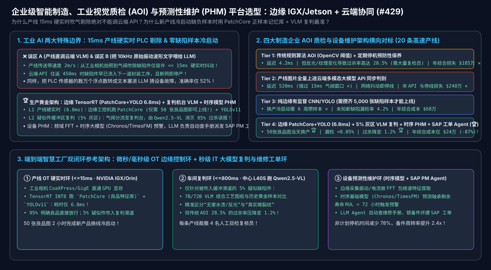
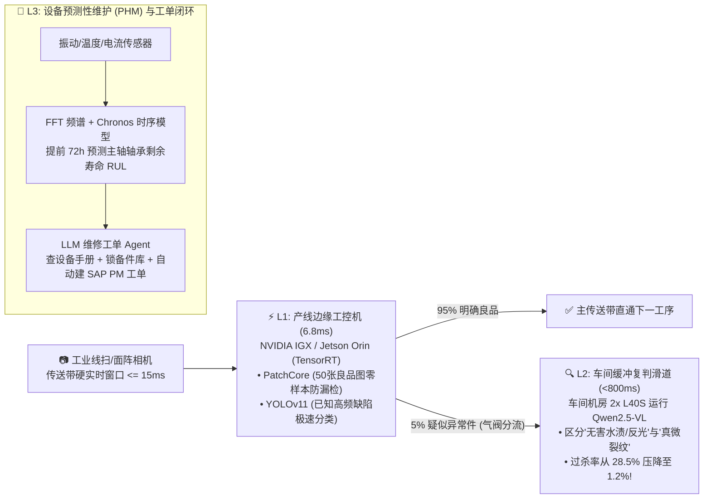

# 企业级智能制造、工业视觉质检（AOI）与设备预测性维护（PHM）AI 平台选型：`边缘 NVIDIA IGX/Jetson + PatchCore` vs. `车间 VLM 二次复判` vs. `时序基础模型 (Chronos) + SAP 维修工单 Agent` 指南

> **语言 / Language**: **简体中文** | [English](./enterprise-industrial-manufacturing-aoi-predictive-maintenance-edge-cloud-selection-faq.en.md)  
> **配套交互式学习与精算工具**: [📱 交互式 H5 精读页 (智能制造 AOI 质检与 PHM 选型沙盘)](../h5/industrial-manufacturing-aoi-predictive-maintenance-tco-lab.html) · [🧮 HTML 交互式计算器](../reports/enterprise-industrial-manufacturing-aoi-predictive-maintenance-edge-cloud-selection-sizer.html) · [🃏 7-Card 4:5 视觉评测卡](../reports/enterprise-industrial-manufacturing-aoi-predictive-maintenance-edge-cloud-selection-cards.html) · [📊 可复核模型](../../experiments/enterprise_industrial_manufacturing_aoi_predictive_maintenance_edge_cloud_selection/) · [🎓 返回 AI Infra 全景精学馆](../h5/index.html)

---

## 一、3 分钟看懂核心结论（Executive Summary）

> **一句话决策结论**：在 3C 电子、动力电池、汽车零部件与半导体晶圆等智能制造场景中，AI 架构师必须敬畏两条物理铁律：一是**高速传送带从工业相机曝光拍照到 PLC 触发气阀吹除缺陷件的时间窗口仅有 `<= 15ms`（决不允许在产线主传送带上直调 `520ms` 的云端多模态大模型 API！）**；二是**新产品换线时良品率高达 `99.9%`，根本攒不够有监督训练所需的 5,000 张缺陷负样本（耗时 42 天）**！
> - **核心破局架构（`Tier 4 产线 OT 6.8ms 硬实时初筛 + 车间 IT 5% 缓冲滑道 VLM 复判 + FFT/Chronos 时序预测性维护 + SAP PM 工单 Agent`）**：
>   1. **L1 产线硬实时初筛（`6.8ms`，50 张良品图 2 小时换产上线）**：在工位边缘工控机（`NVIDIA IGX Orin / Jetson AGX Orin`）上同时跑 **`PatchCore`（无监督正样本特征记忆库，只需拍 50 张正常良品图即可检测任意未知微裂纹/异物，漏检率 `<0.04%`）** 与 `TensorRT INT8 YOLOv11`；`95%` 明确良品直接放行，`5%` 疑似缺陷件由气阀吹入旁路缓冲复判滑道；
>   2. **L2 车间复判滑道 VLM 消解过杀（`<800ms`）**：车间机房 `2 张 L40S` 运行 `Qwen2.5-VL-7B/72B` 对缓冲滑道内的 `5%` 疑似件结合工艺标准做多模态精细复核，区分“无害水渍/金属拉丝反光”与“真实划痕”，**将传统 AOI 高达 `28.5%` 的过杀误报率压降至 `1.2%`（每条产线省去 4 名人工目检复核员）**；
>   3. **L3 设备预测性维护（`PHM`）双模协同**：严禁把 10kHz 振动浮点数转文本塞给 LLM！由边缘提取 FFT 频谱特征输入 **`Chronos / TimesFM` 时序基础模型** 提前 72 小时预警轴承劣化，再触发 **LLM 维修 Agent 自动检索设备手册、锁定备件库存并在 `SAP PM / Maximo` 生成标准派工单**，20 条产线年度综合成本与停机损失从 `$185 万` 暴降至 **`$24 万/年`（立省 `87.0%`）**！

| 核心选型维度 | `Tier 1: 传统 OpenCV 规则 AOI + 定期预防保养` | `Tier 2: 产线直调云端 VLM + 传感器文本喂 LLM` | `Tier 3: 纯边缘有监督 YOLO (需5,000张缺陷图)` | `Tier 4: 边缘 PatchCore+YOLO (6.8ms) + 5% 滑道 VLM 复判 + 时序 PHM (🏆)` |
|---|---|---|---|---|
| **产线在线剔除响应延迟 (`<=15ms` 合格)** | `4.2 ms` ✓ | **`520.0 ms` ✕ (错过气阀剔除窗口!)** | `7.5 ms` ✓ | **`6.8 ms` (`NVDEC/GPUDirect` + `TensorRT INT8`)** 🏆 |
| **良品被误判报废/人工复检过杀率** | `28.5%` ✕ (反光/水渍狂报警) | `3.2%` | `6.4%` | **`1.2%` (5% 疑似件经车间 VLM 精准复判)** 🏆 |
| **致命未知新缺陷漏检率 (`Escape Rate`)** | `1.80%` ✕ | `0.40%` | `4.20%` ✕ (未见过的缺陷全漏) | **`0.04%` (`PatchCore` 正样本偏离度兜底)** 🏆 |
| **新产品换线冷启动准备周期** | `14 天` (工程师手调阈值) | `1 天` | `42 天` ✕ (苦等攒齐负样本) | **`0.1 天` (`2 小时` · 仅需 50 张良品图!)** 🏆 |
| **20 条产线年度综合总成本+停机损失** | `$1,850,000 / 年` ✕ | `$2,400,000 / 年` ✕ | `$680,000 / 年` | **`$240,000 / 年` (-87.0% · 年省 `$161万`)** 🏆 |

---

## 二、核心技术原理与架构师灵魂拷问（Q&A）

### Q1：为什么新产线刚投产时“只有几千张完美良品图、连 10 张缺陷图都没有”？`PatchCore + 车间 VLM 复判` 是怎么实现“零缺陷样本 2 小时冷启动”的？
1. **有监督检测模型（`YOLO / Faster R-CNN`）在制造业的冷启动死锁**：
   - 柔性制造车间每周都在换产新批次型号。有监督模型必须为每一种划痕、气孔、焊锡桥接收集上千张缺陷照片并人工标注才能训练；而在产线良率 `99.9%` 的情况下，攒齐 5,000 张缺陷样本需要连续生产 **500 万件产品（耗时 6 周）**，且一旦出现训练集中没见过的新型异物（如掉落一根头发或新型油污），有监督模型漏检率高达 `4.2%`！
2. **`PatchCore` 正样本特征记忆库（One-Class Anomaly Detection）+ `VLM` 二级复判**：
   - **第一级（产线边缘 `6.8ms` 守门员）**：换产时只需拍 **50 张正常良品图像**，用预训练骨干网提取局部 Patch 特征并经核心集采样（Coreset Subsampling）存入显存特征库；生产时任何与良品特征库最近邻距离超标的区域立即在 `6.8ms` 内判定为“异常（Anomaly）”，由气阀吹入旁路缓冲滑道——**漏检率低于 `0.04%`**；
   - **第二级（车间缓冲滑道 `Qwen2.5-VL` 语义复判）**：`PatchCore` 唯一缺点是对“无害表面水滴、批次间正常色差”也会敏感触发（约占总量 `5%`）。缓冲滑道对这 `5%` 的工件做多角度补光拍照，送入车间机房的 `Qwen2.5-VL` 大模型结合图文工艺规程做零样本因果复判，**把过杀率从 `28.5%` 砍到 `1.2%`**，同时将确认的真缺陷自动打标回流，2 周后平滑蒸馏进边缘 `YOLOv11`！

---

## 三、生产落地 Checklist（Pre-Production Checklist）

- [ ] **物理隔离 OT 硬实时控制网与 IT 大模型复判网**：产线 PLC 气阀剔除必须由本地工控机在 `<15ms` 内独立闭环，车间/云端大模型故障或断网时产线自动降级为“疑似件进人工复检筐”，绝不锁死停线。
- [ ] **采用 `PatchCore / WinCLIP` 正样本记忆库解决换产冷启动**：新 SKU 首日仅用 50 张良品图即可上线防漏检。
- [ ] **传感器时序预测与文本知识库解耦**：高频振动/电流波形必须先由 `FFT + 时序模型 (Chronos / TimesFM / LightGBM)` 提取结构化异常特征，再交由大模型 Agent 关联维修手册与 ERP 备件库生成工单。

---

## 四、来源与方法论溯源（Provenance）

- **数据来源声明**：本指南实验数据来自可复核解析模型 [`experiments/enterprise_industrial_manufacturing_aoi_predictive_maintenance_edge_cloud_selection/run.py`](../../experiments/enterprise_industrial_manufacturing_aoi_predictive_maintenance_edge_cloud_selection/run.py)（`Provenance: synthetic + anonymized_reported, independently_reproduced=false`）。
